# Как работи `alex_school_results.py` — обяснено просто

Това ръководство е за хора, които **тепърва започват с Python**. То обяснява с прости думи всяка
функция (`def`) в [alex_school_results.py](../alex_school_results.py) и после показва как работят
заедно.

Как да го четете:
1. Прочетете **„Какво прави програмата“** и **„Думи, които ще срещнете“**.
2. Разгледайте **диаграмата** в раздел 4.
3. Прочетете функциите. Всяка има връзка към своя ред в кода (номерата на редовете са към
   25 ноември 2026 г.).

---

## 1. Какво прави програмата

1. **Пази** официалните изпитни резултати на всяко училище в България в **локална база данни** —
   файла `school_results.db`. Министерството на образованието и науката (МОН) ги публикува в
   интернет; програмата ги изтегля само първия път или когато щракнете зеления бутон
   **Check for new results**.
2. **Почиства** данните, докато ги изтегля, защото са разхвърляни: имена, написани по различен
   начин, числа със запетаи и т.н.
3. **Показва** резултатите на уеб страница във вашия браузър, направена с библиотеката Gradio.
4. На страницата **избирате** изпит, учебна година, област и населено място. Програмата
   **подрежда** училищата и населените места в класация.
5. Ако искате, **локален изкуствен интелект** (моделът gemma4, който работи в Ollama на вашия
   компютър) пише кратък обзор на първите 5 населени места и училища. Ако ИИ не е наличен,
   програмата сама пише по-опростен обзор.
6. **Карта на 28-те области** оцветява всяка област според това колко се отличават резултатите ѝ
   от средното за страната — от тъмночервено (много под) до светлозелено (много над), до стълбова
   диаграма с точните числа.
7. Три бутона в раздела с картата превключват между три **изгледа**: тази разлика от средното за
   страната, **промяната спрямо предходната година** и **тенденциите през годините**.

**Изпитите:**
- **НВО** (национално външно оценяване) в 4., 7. и 10. клас: точки от 0 до 100 по български
  език и литература (**BEL**) и математика (**MAT**).
- **ДЗИ** (държавни зрелостни изпити, матури) в 12. клас: оценки от 2 до 6 по български език и
  по втори изпит.

---

## 2. Думи, които ще срещнете

| Дума | Значение |
|---|---|
| **функция** (`def`) | Рецепта с име. Давате ѝ съставки (**параметри**), тя прави няколко стъпки и връща резултат (**`return`**). Пример: `def add(a, b): return a + b` → `add(2, 3)` дава `5`. |
| **извикване** на функция | Използването ѝ: `tidy_town("ГР. СОФИЯ")`. „A извиква B“ означава, че функцията A използва функцията B. |
| **`None`** | Думата на Python за „нищо, няма стойност“. |
| **низ** (string) | Текст в кавички: `"Варна"`. |
| **списък** (list) `[ ]` | Няколко стойности подред: `["Варна", "Бургас"]`. |
| **кортеж** (tuple) `( )` | Като списък, но не се променя: `("ГР.ВАРНА", "ВАРНА")`. Функция може да върне две стойности като кортеж. |
| **речник** (dictionary) `{ }` | Двойки *ключ → стойност*, като телефонен указател: `{"NVO 7th grade": "b56288b6-..."}`. |
| **таблица** (pandas `DataFrame`) | Лист като в Excel, но вътре в Python: редове и колони. |
| **база данни** (SQLite) | Файл, който пази таблици и в който се търси бързо. SQLite е вградена в Python, а цялата база е един файл — тук `school_results.db`. |
| **SQL** | Езикът, с който се задават въпроси на база данни. `SELECT school FROM results WHERE town = 'ГР.ВАРНА'` означава „дай ми училищата във Варна“. |
| **транзакция** | Няколко промени в база данни, които стават **всички заедно или никоя**. Ако нещо се провали по средата, нищо не остава записано наполовина. |
| **API** | Уебсайт, направен за **програми**, а не за хора: изпращате въпрос и получавате данни. |
| **JSON** | Текстов формат за данни, който прилича на речниците и списъците в Python. API-тата отговарят в JSON. |
| **грешка** (изключение, exception) | Сигналът на Python, че „нещо се е объркало“. `raise` изпраща такъв сигнал; `try:` … `except:` го хваща, за да може програмата да реагира. `finally:` се изпълнява винаги — с грешка или без. |
| **`_`** | Име за стойност, която **не ни трябва**: `kind, table = …` срещу `_, table = …`. |
| **декоратор** (`@cache`) | Етикет над функция, който ѝ дава допълнителна способност. `@cache` ѝ дава памет. |
| **генератор** (`yield`) | Функция, която връща резултатите **на части**, а не наведнъж с `return`. Използва се, за да се показва текстът на ИИ дума по дума. |
| **вътрешна функция** | Функция, написана вътре в друга функция. |
| **събитие** (event) | Нещо, което се случва на уеб страницата (щракване, нов избор). Тогава Gradio извиква функция. |
| **константа** | Настройка, написана с ГЛАВНИ букви в началото на файла, напр. `TOP = 5`. Не се променя, докато програмата работи. |
| **състояние** (`gr.State`) | Стойност, която Gradio **помни** за всеки посетител на страницата, без да я показва. Тук: кой от трите изгледа на картата сте избрали. |
| **медиана** | Средната по ред стойност: половината числа са по-малки, половината — по-големи. При четен брой числа е средното на двете в средата. За разлика от обикновената средна стойност, едно крайно число почти не я мести. |

---

## 3. Настройките в началото на файла (редове 57–199)

| Настройка | Какво е |
|---|---|
| `MON_OPEN_DATA_PAGE` | Страницата на министерството, която ни казва къде са данните |
| `PORTAL_API` | Адресът на API-то на Портала за отворени данни (data.egov.bg) |
| `KNOWN_MINISTRY_ID` | Идентификаторът (ID) на министерството в портала, за случая, когато mon.bg не работи |
| `headers` | Казва честно на сайтовете кой пита |
| `MODEL`, `THINK` | Моделът на ИИ (`gemma4`) и „не мисли на глас“, за да е по-бърз |
| `EXAMS` | Четирите изпита, с вида им (`"nvo"` или `"dzi"`) и името на набора им от данни в портала |
| `RESULT_COLUMNS` | Имената на четирите колони с резултати за всеки вид изпит |
| `ALL_REGIONS`, `ALL_TOWNS`, `ABROAD`, `RANK_BY` | Постоянни текстове, използвани на страницата |
| `TOP` | Колко населени места и училища показва обзорът на ИИ (5) |
| `MIN_TOWN_STUDENTS`, `MIN_TOWN_STUDENTS_IN_REGION`, `MIN_SCHOOL_STUDENTS` | Минималният брой ученици (100, 30, 10), за да влезеш в класацията, така че малки села да не печелят |
| `BOM` | Невидим символ, с който започват някои файлове |
| `DATABASE_FILE` | Къде е базата данни: файлът `school_results.db` до скрипта |
| `DATABASE_TABLES` | Трите таблици на базата, написани на SQL: `files`, `results` и `checks`. Създават се, когато файлът се отвори за първи път |
| `DATABASE_COLUMNS` | Имената на колоните с резултати в базата (`region`, `school`, `bel_average`…) |
| `REGION_MAP_FILE` | Къде са границите на областите за картата: файлът `bulgaria_regions.geojson` до скрипта |
| `MAP_SUBJECTS` | По какво може да се оцвети картата: двата предмета, български език или математика / втори изпит |
| `MAP_COLOURS` | Цветовете на картата — от тъмночервено (много под средното) до светлозелено (много над). Освен това стават все по-светли, така че по-тъмно винаги означава по-слабо |
| `MAP_VIEWS` | Трите изгледа в раздела с картата и надписът на бутона на всеки от тях: `"difference"` → „Difference from Bulgaria“ (разлика от България), `"change"` → „Change since the previous year“ (промяна спрямо предходната година), `"trends"` → „Trends over the years“ (тенденции през годините) |
| `MAP_NOTE` | Редът под картата: цветовете показват разлики в резултатите, а не качеството на училищата |
| `overview_system_prompt` | Правилата, които ИИ трябва да спазва, когато пише обзора |

---

## 4. Голямата картина: как са свързани функциите

Как да четете диаграмата:
- **Стрелка** `A → B` означава „A **извиква** B“.
- **Пунктирна стрелка** означава „създава“ или „после Gradio изпълнява“.
- **Цилиндър** е нещо извън кода: уебсайт, файл или ИИ на вашия компютър.

> Диаграмата се вижда като картинка **в GitHub**. Във VS Code инсталирайте разширението
> *„Markdown Preview Mermaid Support“* или прочетете текстовата версия под диаграмата.

```mermaid
flowchart TD
    START(["Стартирате скрипта"]) --> n_main["main()"]

    subgraph g_helpers ["1 - Малки помощници"]
        n_tidy["tidy()"]
        n_tidy_town["tidy_town()"]
        n_to_number["to_number()"]
        n_weighted["weighted_average()"]
        n_town_label["town_label()"]
        n_split_label["split_town_label()"]
    end

    subgraph g_internet ["2 - Получаване на данните от интернет"]
        n_find_ministry["find_ministry_on_portal()"]
        n_find_datasets["find_exam_datasets()"]
        n_list_files["list_exam_files()"]
        n_download["download_results()"]
        n_call_portal["call_portal()"]
    end

    subgraph g_db ["3 - Базата данни"]
        n_update["update_database()"]
        n_save["save_results()"]
        n_stored["stored_files()"]
        n_read["read_results()"]
        n_status["database_status()"]
        n_open["open_database()"]
        n_load_choice["load_choice()"]
    end

    subgraph g_rank ["4 - Избор и класиране"]
        n_town_choices["town_choices()"]
        n_show_results["show_results()"]
        n_rank_towns["rank_towns()"]
        n_rank_schools["rank_schools()"]
    end

    subgraph g_ai ["5 - Обзор от ИИ"]
        n_write_overview["write_overview()"]
        n_overview_messages["overview_messages()"]
        n_template["template_overview()"]
        n_ollama_problem["ollama_problem()"]
    end

    subgraph g_map ["6 - Картата и трите ѝ изгледа"]
        n_show_map["show_map()"]
        n_show_change["show_change()"]
        n_show_trends["show_trends()"]
        n_exam_years["exam_years()"]
        n_region_gaps["region_gaps()"]
        n_schools_in_bulgaria["schools_in_bulgaria()"]
        n_subject_score["subject_score()"]
        n_school_spread["school_spread()"]
        n_drift_words["drift_words()"]
        n_load_region_map["load_region_map()<br/>с памет: @cache"]
        n_region_map["region_map()"]
        n_region_bars["region_bars()"]
        n_trend_heatmap["trend_heatmap()"]
        n_gap_trend_chart["gap_trend_chart()"]
        n_colour_key["colour_key()"]
        n_signed["signed()"]
        n_year_labels["year_labels()"]
    end

    subgraph g_page ["7 - Уеб страницата, направена от build_page()"]
        n_build_page["build_page()"]
        n_show["show()"]
        n_refresh["refresh_towns()"]
        n_tab["show_schools_tab()"]
        n_overview["overview()"]
        n_map_view["map_view()"]
        n_difference_view["difference_view()"]
        n_change_view["change_view()"]
        n_trends_view["trends_view()"]
        n_check["check_for_new_results()"]
    end

    MON[("mon.bg")]
    PORTAL[("data.egov.bg")]
    DBFILE[("school_results.db")]
    OLLAMA[("Ollama с gemma4")]
    MAPFILE[("bulgaria_regions.geojson")]
    YOU(["Вие, в браузъра"])

    %% Стартиране на програмата
    n_main --> n_stored
    n_main -->|само ако базата е празна| n_update
    n_main --> n_read
    n_main --> n_build_page
    n_main --> n_ollama_problem

    %% Базата данни
    n_update --> n_find_ministry
    n_update --> n_find_datasets
    n_update --> n_list_files
    n_update --> n_stored
    n_update --> n_download
    n_update --> n_save
    n_update --> n_open
    n_save --> n_open
    n_stored --> n_open
    n_read --> n_open
    n_status --> n_open
    n_open --> DBFILE
    n_load_choice --> n_read

    %% Получаване на данните от интернет
    n_find_ministry --> MON
    n_find_datasets --> n_call_portal
    n_find_datasets --> n_tidy
    n_list_files --> n_call_portal
    n_download --> n_call_portal
    n_download --> n_to_number
    n_download --> n_tidy_town
    n_call_portal --> PORTAL

    %% Уеб страницата
    n_build_page --> n_town_choices
    n_build_page --> n_status
    n_build_page -.->|създава| n_show
    n_build_page -.->|създава| n_refresh
    n_build_page -.->|създава| n_tab
    n_build_page -.->|създава| n_overview
    n_build_page -.->|създава| n_map_view
    n_build_page -.->|създава| n_difference_view
    n_build_page -.->|създава| n_change_view
    n_build_page -.->|създава| n_trends_view
    n_build_page -.->|създава| n_check
    YOU -->|отваряне, ново място или класиране| n_show
    YOU -->|нов изпит или област| n_refresh
    YOU -->|Show results или Enter| n_tab
    YOU -->|Write AI overview| n_overview
    YOU -->|раздел Map, нов изпит или Colour by| n_map_view
    YOU -->|Difference from Bulgaria| n_difference_view
    YOU -->|Change since the previous year| n_change_view
    YOU -->|Trends over the years| n_trends_view
    YOU -->|Check for new results| n_check
    n_refresh -.->|после| n_show
    n_tab -.->|после| n_show
    n_check --> n_update
    n_check --> n_stored
    n_check --> n_status

    %% Избор и класиране
    n_show --> n_show_results
    n_refresh --> n_town_choices
    n_town_choices --> n_load_choice
    n_town_choices --> n_town_label
    n_show_results --> n_load_choice
    n_show_results --> n_split_label
    n_show_results --> n_weighted
    n_show_results --> n_rank_towns
    n_rank_towns --> n_weighted

    %% Обзор от ИИ
    n_overview --> n_write_overview
    n_write_overview --> n_load_choice
    n_write_overview --> n_rank_towns
    n_write_overview --> n_rank_schools
    n_write_overview --> n_weighted
    n_write_overview --> n_ollama_problem
    n_write_overview --> n_overview_messages
    n_write_overview -->|без ИИ| n_template
    n_write_overview --> OLLAMA
    n_ollama_problem --> OLLAMA

    %% Картата и трите ѝ изгледа
    n_difference_view --> n_map_view
    n_change_view --> n_map_view
    n_trends_view --> n_map_view
    n_map_view --> n_show_map
    n_map_view --> n_show_change
    n_map_view --> n_show_trends
    n_show_map --> n_load_choice
    n_show_map --> n_schools_in_bulgaria
    n_show_map --> n_load_region_map
    n_show_map --> n_subject_score
    n_show_map --> n_region_map
    n_show_map --> n_region_bars
    n_show_change --> n_load_choice
    n_show_change --> n_exam_years
    n_show_change --> n_load_region_map
    n_show_change --> n_region_gaps
    n_show_change --> n_region_map
    n_show_change --> n_region_bars
    n_show_trends --> n_load_choice
    n_show_trends --> n_exam_years
    n_show_trends --> n_region_gaps
    n_show_trends --> n_trend_heatmap
    n_show_trends --> n_gap_trend_chart
    n_show_trends --> n_drift_words
    n_region_gaps --> n_load_choice
    n_region_gaps --> n_schools_in_bulgaria
    n_region_gaps --> n_subject_score
    n_region_gaps --> n_school_spread
    n_region_map --> n_colour_key
    n_region_bars --> n_colour_key
    n_region_bars --> n_signed
    n_trend_heatmap --> n_colour_key
    n_trend_heatmap --> n_signed
    n_trend_heatmap --> n_year_labels
    n_gap_trend_chart --> n_year_labels
    n_subject_score --> n_weighted
    n_load_region_map --> MAPFILE
```



### Същото като текст: пет пътя

**Път А: стартирате програмата** (`uv run education_bulgaria/alex_school_results.py`)

```text
main()
 ├─ stored_files() → open_database()          списъкът с файлове в school_results.db
 ├─ update_database()                         САМО ако базата е празна: вижте Път Д
 ├─ read_results() → open_database()          първия файл, само за да вземе списъка с области
 ├─ build_page()                              изгражда уеб страницата
 │    ├─ database_status() → open_database()  редът „Data: 25 results files...“
 │    └─ town_choices()                       попълва списъка с населени места
 │         ├─ load_choice() → read_results()
 │         └─ town_label()
 ├─ ollama_problem()                          готов ли е ИИ? (само предупреждение)
 └─ page.launch()                             отваря браузъра
```

Тук не е нужен интернет: всичко идва от базата данни.

**Път Б: разделът „Schools“** (страницата се отваря, променяте нещо или щраквате „Show results“)

```text
show_schools_tab()                 само при „Show results“ и Enter: отива на раздела Schools
refresh_towns()                    само при смяна на изпита или областта: нов списък с места
 └─ town_choices() → load_choice() → read_results(), town_label()
show()
 └─ show_results()                 обобщението + таблицата
      ├─ load_choice() → read_results()     (около 20 милисекунди, от базата данни)
      ├─ split_town_label()                 (ако е избрано населено място)
      ├─ weighted_average()                 (средните стойности в обобщението)
      └─ rank_towns() → weighted_average()  (мястото на населеното място в класацията)
```

**Път В: щраквате „Write AI overview“**

```text
(страницата преминава към втория раздел)
overview()
 └─ write_overview()
      ├─ load_choice() → read_results()
      ├─ rank_towns() → weighted_average()   първите 5 населени места
      ├─ rank_schools()                      първите 5 училища
      ├─ weighted_average()                  средната стойност за района и „Vs area average“
      ├─ ollama_problem()                    готов ли е Ollama?
      ├─ template_overview()                 ако не е, или ако ИИ се провали: пише го програмата
      ├─ overview_messages()                 указанията + фактите в JSON
      └─ ollama.chat()                       gemma4 пише, дума по дума
```

**Път Г: отваряте раздела „Map and trends of the regions“** (или щраквате един от трите му бутона, сменяте
изпита или „Colour by“)

Трите бутона извикват `difference_view()`, `change_view()` или `trends_view()`. Всяка от тях
извиква `map_view()` със своя изглед. Отварянето на раздела, нов изпит или „Colour by“ извикват
`map_view()` направо, с изгледа, който сте избрали последно (в началото — „Difference from
Bulgaria“).

```text
map_view()
 ├─ show_map()                     „Difference from Bulgaria“: обобщението на разликите + картата + стълбовете
 │    ├─ load_choice() → read_results()
 │    ├─ schools_in_bulgaria()                  маха училищата в чужбина
 │    ├─ load_region_map()                      чете bulgaria_regions.geojson (само първия път)
 │    ├─ subject_score() → weighted_average()   България, всяка област, градове, села
 │    ├─ region_map() → colour_key()            оцветената карта
 │    └─ region_bars() → colour_key(), signed() стълбовата диаграма, най-добрите отгоре
 ├─ show_change()                  „Change since the previous year“
 │    ├─ load_choice() → read_results()
 │    ├─ exam_years()                           годините на този изпит, за да намери предходната
 │    ├─ load_region_map()
 │    ├─ region_gaps()                          разстоянието на всяка област от средното за страната
 │    │    ├─ load_choice() → read_results()    (за двете години)
 │    │    ├─ schools_in_bulgaria()
 │    │    ├─ subject_score() → weighted_average()
 │    │    └─ school_spread()                   колко са разпръснати резултатите на училищата
 │    ├─ region_map() → colour_key()            картата на промените
 │    └─ region_bars() → colour_key(), signed() стълбовата диаграма, най-подобрилите се отгоре
 └─ show_trends()                  „Trends over the years“
      ├─ load_choice() → read_results()
      ├─ exam_years()                           всички години на този изпит
      ├─ region_gaps()                          както по-горе, за всяка година
      ├─ drift_words()                          „drifted apart“, „came closer“ или „about the same“
      ├─ trend_heatmap() → colour_key(), signed(), year_labels()   решетката от области и години
      └─ gap_trend_chart() → year_labels()      линията на разликата между най-добрата и най-слабата област
```

**Път Д: щраквате зеления бутон „Check for new results“**

```text
check_for_new_results()
 ├─ update_database()
 │    ├─ find_ministry_on_portal()           чете mon.bg (ако не работи: KNOWN_MINISTRY_ID)
 │    ├─ find_exam_datasets()                намира четирите набора от данни за изпитите
 │    │    ├─ call_portal()                  пита data.egov.bg
 │    │    └─ tidy()
 │    ├─ list_exam_files()                   списъкът с файлове в портала
 │    │    └─ call_portal()
 │    ├─ stored_files()                      списъкът в базата, за сравнение
 │    ├─ download_results()                  само за всеки нов или заменен файл
 │    │    ├─ call_portal()
 │    │    ├─ to_number()
 │    │    └─ tidy_town()
 │    ├─ save_results() → open_database()    записва файла в една транзакция
 │    └─ open_database()                     записва проверката в таблицата „checks“
 ├─ stored_files()                           обновява списъка „Exam and school year“
 └─ database_status()                        новият ред „Data: ...“
```

### Кои функции общуват с външния свят

| Функция | Общува с |
|---|---|
| `find_ministry_on_portal()` | **mon.bg**, сайта на министерството — само когато базата се попълва или обновява |
| `call_portal()` | **data.egov.bg**, Портала за отворени данни — само когато базата се попълва или обновява. Всеки въпрос към портала минава през тази единствена функция. |
| `open_database()` | Файла **school_results.db** до скрипта, на вашия компютър. Всяко използване на базата минава през тази единствена функция. |
| `ollama_problem()` и `write_overview()` | **Ollama** на вашия компютър: ИИ gemma4 |
| `load_region_map()` | Файла **bulgaria_regions.geojson** до скрипта, на вашия компютър |
| `main()`, чрез `page.launch()` | **вашия браузър** |

Всички останали функции работят само с данни, които вече са в паметта.

---

## 5. Всяка функция, една по една

### Група 1: Малки помощници

#### `tidy(text)`: [ред 202](../alex_school_results.py#L202)
- **С едно изречение:** прави едно име лесно за сравняване с друго име.
- **Получава:** текст. **Връща:** същия текст с малки букви, с единични интервали и без точка
  накрая.
- **Пример:** `"Резултати  от ДЗИ."` → `"резултати от дзи"`
- **Защо:** министерството понякога пише името на набор от данни с двоен интервал или с точка
  накрая. След `tidy()` „едно и също име, написано малко по-различно“ се смята за еднакво.
- **Как:** `text.split()` разрязва текста на думи и премахва всички интервали; `" ".join(...)`
  залепва думите обратно с точно един интервал; `.lower()` прави буквите малки; `.rstrip(".")`
  маха точката накрая.
- **Извиква се от:** `find_exam_datasets()`.

#### `tidy_town(town)`: [ред 209](../alex_school_results.py#L209)
- **С едно изречение:** прави така, че едно и също населено място да изглежда еднакво във всеки
  файл.
- **Примери:** `"ГР. СОФИЯ"` → `"ГР.СОФИЯ"` · `"Прага"` → `"ПРАГА"` ·
  `"СОФИЯ 11 РН КРАСНА ПОЛЯНА"` (софийски район) → `"ГР.СОФИЯ"`
- **Как:**
  1. Единични интервали и ГЛАВНИ букви (`.upper()`).
  2. **Регулярен израз** (`re.sub`, шаблон за търсене в текст) маха интервала след „ГР.“ или
     „С.“.
  3. Ако името започва със „СОФИЯ, число, РН“, това е район на София, затова става „ГР.СОФИЯ“.
- **Извиква се от:** `download_results()`, за всяко училище.

#### `to_number(text)`: [ред 306](../alex_school_results.py#L306)
- **С едно изречение:** превръща клетка от файла в число или в `None`, когато няма резултат.
- **Примери:** `"52.4"` → `52.4` · `"3,09"` → `3.09` (десетична запетая) · `""` → `None` ·
  `"0"` → `None` (нула означава, че никой не е държал този изпит) · `"Област"` → `None`
- **Как:** заменя запетаята с точка и опитва `float()`. Ако Python не може да направи число, той
  вдига `ValueError`; частта `except` го хваща и връща `None`. Последният ред,
  `return value or None`, превръща `0` в `None`.
- **Извиква се от:** `download_results()`, за всяка клетка.

#### `weighted_average(table, count_column, average_column)`: [ред 483](../alex_school_results.py#L483)
- **С едно изречение:** средната стойност за всички **ученици**, а не за училищата.
- **Защо:** училище със 100 ученици трябва да тежи повече от училище с 5.
- **Пример:** училище А има 100 ученици със среден резултат 60; училище Б има 5 ученици с 90.
  - Средното на двете училища е (60 + 90) / 2 = **75**, което подвежда.
  - Претеглената средна стойност е (100 × 60 + 5 × 90) / 105 = **61,43**, което е честно.
- **Връща две стойности:** средната стойност и броя на учениците. Ако никой не е държал изпита:
  `(None, 0)`.
- **Как:** маха редовете с празни стойности (`dropna`), умножава ученици × среден резултат за
  всяко училище, събира всичко и дели на общия брой ученици.
- **Извиква се от:** `rank_towns()`, `show_results()`, `write_overview()`, `subject_score()`.

#### `town_label(town, region)`: [ред 495](../alex_school_results.py#L495)
- **С едно изречение:** съставя текста, който се показва в списъка с населени места.
- **Пример:** `town_label("ГР.ВАРНА", "ВАРНА")` → `"ГР.ВАРНА (ВАРНА)"`
- **Защо областта:** много села имат едно и също име в различни области.
- **Извиква се от:** `town_choices()`.

#### `split_town_label(label)`: [ред 503](../alex_school_results.py#L503)
- **С едно изречение:** обратното на `town_label()`: отново разделя населеното място и областта.
- **Пример:** `"ГР.ВАРНА (ВАРНА)"` → `("ГР.ВАРНА", "ВАРНА")`
- **Как:** `rsplit(" (", 1)` разрязва текста веднъж, при последното `" ("`; `rstrip(")")` маха
  затварящата скоба.
- **Извиква се от:** `show_results()`.

---

### Група 2: Получаване на данните от интернет

Тези функции се използват **само за попълване или обновяване на базата данни**: първия път и когато
щракнете зеления бутон **Check for new results**.

#### `call_portal(method, payload)`: [ред 223](../alex_school_results.py#L223)
- **С едно изречение:** изпраща един въпрос до Портала за отворени данни (data.egov.bg) и връща
  отговора.
- **Получава:** името на въпроса (`method`), напр. `"listResources"`, и подробностите му
  (`payload`) като речник. **Връща:** отговора като речник.
- **Пример:** `call_portal("getOrganisationDetails", {"org_uri": "a57a2273-..."})` →
  `{"success": True, "data": {"id": 117, "name": "Министерство на образованието и науката", ...}}`
- **Как:**
  1. `requests.post(...)` изпраща въпроса.
  2. `raise_for_status()` спира с грешка, ако сайтът отговори с код за грешка, напр. 404 или 500.
  3. `.json()` превръща JSON текста в речник на Python.
  4. Порталът казва `"success": false`, когато нещо не е наред. Тогава функцията вдига собствена
     грешка (`RuntimeError`) със съобщението на портала.
- **Добре е да знаете:** това е **единствената врата към портала**. Ако порталът някога се
  промени, има само едно място за поправка.
- **Извиква се от:** `find_exam_datasets()`, `list_exam_files()`, `download_results()`.

#### `find_ministry_on_portal()`: [ред 236](../alex_school_results.py#L236)
- **С едно изречение:** чете страницата „Отворени данни“ на mon.bg и намира идентификатора (ID) на
  министерството в портала.
- **Получава:** нищо. **Връща:** ID-то, текст като `"a57a2273-6b21-4a7a-99ee-05ec4f67ebe4"`.
- **Как:** това е частта за **извличане на данни от уеб страници** (web scraping), с
  BeautifulSoup:
  1. `requests.get` изтегля страницата.
  2. `BeautifulSoup` чете нейния HTML.
  3. Цикъл минава през всяка връзка (`<a href="...">`).
  4. Когато връзката съдържа `data.egov.bg/organisation/profile/`, изрязва ID-то между
     `/profile/` и `?` и го връща.
  5. Ако не намери такава връзка, вдига грешка.
- **Извиква се от:** `update_database()`. Ако mon.bg не работи, `update_database()` използва
  `KNOWN_MINISTRY_ID`.

#### `find_exam_datasets(ministry_id)`: [ред 252](../alex_school_results.py#L252)
- **С едно изречение:** намира четирите набора от данни за изпитите (НВО в 4., 7. и 10. клас и
  ДЗИ) сред около 350-те набора на министерството.
- **Връща:** речник *изпит → ID на набора*, напр. `{"NVO 7th grade": "b56288b6-...", ...}`
- **Как:**
  1. Пита портала за номера на министерството (117).
  2. Иска наборите от данни на министерството **страница по страница**, по 100 наведнъж.
     Цикълът `while True:` се повтаря, докато страница не съдържа по-малко от 100 (`break`).
  3. За всеки изпит в `EXAMS` запазва наборите, чието име след `tidy()` е равно на очакваното.
  4. Ако няколко имат това име, взема най-новия (`max` по `updated_at`).
- **Знакът `_`:** в `for exam, (_, dataset_name) in EXAMS.items():` всяка стойност в `EXAMS` е
  двойка (вид, име). Тук ни трябва само името, затова видът получава името „не ни трябва“ — `_`.
- **Извиква се от:** `update_database()`.

#### `list_exam_files(exam_datasets)`: [ред 282](../alex_school_results.py#L282)
- **С едно изречение:** изброява годишните файлове на всеки изпит в портала и дава на всеки четимо
  име като `"NVO 7th grade - 2025/2026"`.
- **Връща:** речник *„изпит - година“ → (вид, ID на файла)*, напр.
  `{"NVO 7th grade - 2025/2026": ("nvo", "08157f0e-..."), ...}`.
- **Как:**
  1. Пита портала за файловете на всеки набор.
  2. **Регулярен израз** (`re.search`) намира учебната година в името на файла
     („учебна 2025/2026“). Файловете без нея са в стар формат, затова `continue` ги прескача.
  3. За ДЗИ запазва само основната сесия (май–юни) на задължителните изпити.
  4. Подрежда файловете с най-новата година първа.
- **Извиква се от:** `update_database()`, която сравнява този списък със списъка в базата.

#### `download_results(kind, resource_id)`: [ред 318](../alex_school_results.py#L318)
- **С едно изречение:** изтегля един файл с резултати от портала и го превръща в чиста таблица, по
  един ред за училище.
- **Получава:** вида (`"nvo"` или `"dzi"`) и ID-то на файла. **Връща:** таблица с колоните Region,
  Municipality, Town, School, School code и 4 колони с резултати.
- **Най-важната функция за почистване:** тя поправя всички проблеми в държавните файлове:
  - заглавен ред над имената на колоните;
  - колони в различен ред в някои години;
  - кодове на училища, написани с интервали;
  - десетични запетаи;
  - „В ЧУЖБИНА“ вместо „ЧУЖБИНА“;
  - няколко колони по предмети за втория изпит на матурите.
- **Как:**
  1. Изтегля редовете — списъци от текстове — чрез `call_portal("getResourceData", ...)`.
  2. Намира заглавния ред: реда, който започва с „Област“.
  3. Намира по имената им кои колони са „Училище“ и „Код“.
  4. За всяко училище извиква `to_number()` за всяка клетка.
     - **НВО:** взема последните 4 числа.
     - **ДЗИ:** българският език е в колони 5 и 6 (Python брои от 0, така че това са 6-ата и
       7-ата колона). Вторият изпит е претеглената средна стойност от всички останали колони по
       предмети.
     - Подрежда областта, кода, името и населеното място (`tidy_town()`).
  5. Изгражда таблицата (`pd.DataFrame`). Броят на учениците става цели числа (`Int64`), а
     средните стойности се закръгляват до 2 знака след десетичната запетая.
- **Добре е да знаете:** чистата таблица отива направо в базата данни (`save_results()`), така че
  почистването става **веднъж за файл**, а не всеки път, когато разглеждате резултатите.
- **Извиква се от:** `update_database()`.

---

### Група 3: Базата данни

#### `open_database()`: [ред 364](../alex_school_results.py#L364)
- **С едно изречение:** отваря файла с базата данни `school_results.db` и го създава заедно с
  таблиците му, ако още ги няма.
- **Връща:** отворена **връзка** (connection) с базата — линията, по която Python разговаря с нея.
- **Как:**
  1. `sqlite3.connect(DATABASE_FILE)` отваря файла или го създава, ако липсва.
  2. `executescript(DATABASE_TABLES)` изпълнява SQL кода в `DATABASE_TABLES`.
     `CREATE TABLE IF NOT EXISTS` създава всяка таблица само ако още я няма.
- **Добре е да знаете:** който отвори базата, трябва да я затвори отново с `.close()`. Затова
  другите функции използват `try:` … `finally: database.close()`: `finally` се изпълнява дори ако
  нещо се провали по средата.
- **Извиква се от:** `save_results()`, `stored_files()`, `read_results()`, `update_database()`,
  `database_status()`.

#### `save_results(choice, kind, resource_id, table)`: [ред 374](../alex_school_results.py#L374)
- **С едно изречение:** записва един изтеглен файл с резултати в базата, като заменя по-старото му
  копие.
- **Получава:** името на файла (`choice`, като `"NVO 7th grade - 2025/2026"`), вида му, ID-то му в
  портала и чистата таблица от `download_results()`.
- **Как:**
  1. Преименува колоните на таблицата с имената в базата (`DATABASE_COLUMNS`) и добавя колона
     `choice`, така че всеки ред да знае към кой файл принадлежи.
  2. Вътре в `with database:`, което е **транзакция**:
     - изтрива старите редове на файла (`DELETE FROM results WHERE choice = ?`);
     - добавя новите (`to_sql`);
     - записва реда на файла в таблицата `files` с днешната дата (`INSERT OR REPLACE`).
  3. Благодарение на транзакцията или се записва всичко, или нищо: обновяване, което се провали
     по средата, никога не оставя половин файл.
- **Знакът `?` в SQL:** заместител, който sqlite3 попълва със стойността по безопасен начин. Никога
  не слагайте стойности направо в текста на SQL.
- **Извиква се от:** `update_database()`.

#### `stored_files()`: [ред 392](../alex_school_results.py#L392)
- **С едно изречение:** изброява всички файлове с резултати в базата.
- **Връща:** същия вид речник като `list_exam_files()`: *„изпит - година“ → (вид, ID на файла)*.
  Този речник попълва списъка „Exam and school year“ на страницата.
- **Как:** `SELECT … FROM files` чете таблицата `files`. После две сортирания подреждат файловете
  изпит по изпит (в реда на `EXAMS`), с най-новата година първа. Сортирането в Python е
  **стабилно**: когато сортира по изпит, файловете от един и същ изпит запазват реда по години от
  първото сортиране.
- **Извиква се от:** `main()`, `update_database()`, `check_for_new_results()`.

#### `read_results(choice, kind)`: [ред 409](../alex_school_results.py#L409)
- **С едно изречение:** чете един изпит и година от базата като таблица с имената на колоните от
  страницата.
- **Пример:** `read_results("NVO 7th grade - 2025/2026", "nvo")` дава 1702-те училища за около
  20 милисекунди.
- **Как:**
  1. `pd.read_sql("SELECT … FROM results WHERE choice = ? ORDER BY rowid", …)` пита базата.
     `ORDER BY rowid` запазва реда, в който редовете са били записани.
  2. Преименува колоните с имената от страницата (`RESULT_COLUMNS`) и превръща броя на учениците в
     цели числа (`Int64`).
- **Извиква се от:** `load_choice()`, `main()`.

#### `update_database()`: [ред 426](../alex_school_results.py#L426)
- **С едно изречение:** пита портала за списъка му с файлове и изтегля само тези, които базата още
  няма или които министерството е заменило.
- **Връща:** списъка с добавените или заменените файлове. Празен е, ако няма нищо ново.
- **Как:**
  1. `find_ministry_on_portal()` (или `KNOWN_MINISTRY_ID`, ако mon.bg не работи), после
     `find_exam_datasets()` и `list_exam_files()`: списъкът в портала (около 15–20 секунди).
  2. Сравнява го със `stored_files()`. Файлът се смята за нов, ако изпитът и годината му липсват
     или ако ID-то му е различно — това означава, че министерството го е заменило с коригирана
     версия.
  3. За всеки нов файл: `download_results()`, после `save_results()`.
  4. Записва проверката в таблицата `checks` с датата и броя на новите файлове.
- **Извиква се от:** `main()` (само когато базата е празна) и `check_for_new_results()` (зеления
  бутон).

#### `database_status()`: [ред 455](../alex_school_results.py#L455)
- **С едно изречение:** пише реда в горната част на страницата, като *„Data: 25 results files in
  the local database (school_results.db) · last checked on data.egov.bg: 2026-11-25 13:22“*.
- **Как:** задава на базата два въпроса на SQL: `SELECT COUNT(*) FROM files` (колко файла) и
  `SELECT MAX(checked_at) FROM checks` (последната проверка). Ако порталът никога не е проверяван,
  пише „never“.
- **Извиква се от:** `build_page()` и `check_for_new_results()`.

#### `load_choice(exam_files, choice)`: [ред 469](../alex_school_results.py#L469)
- **С едно изречение:** превръща това, което сте избрали в списъка „Exam and school year“, в
  таблица с резултати от базата данни или показва съобщение за грешка на страницата.
- **Получава:** речника с файловете и вашия избор, напр. `"DZI (matura) - 2025/2026"`.
  **Връща две стойности:** вида (`"dzi"`) и таблицата.
- **Как:**
  1. Ако изборът ви не е в речника, вдига `gr.Error(...)`, което Gradio показва като червено
     изскачащо съобщение на страницата.
  2. Намира вида.
  3. Извиква `read_results()` вътре в `try:`. Ако базата не може да се прочете, получавате
     разбираемо `gr.Error` вместо срив.
- **Извиква се от:** `town_choices()`, `show_results()`, `write_overview()`, `show_map()`.

---

### Група 4: Избор и класиране

#### `town_choices(exam_files, choice, region)`: [ред 511](../alex_school_results.py#L511)
- **С едно изречение:** съставя списъка с населени места за падащото меню „Town“.
- **Връща:** списък, който започва с `"All towns"`, после населените места по азбучен ред, напр.
  `"ГР.ВАРНА (ВАРНА)"`.
- **Защо градовете са първи:** в азбуката Г е преди С, затова „ГР.“ (градове) са преди „С.“
  (села).
- **Как:** зарежда таблицата (`load_choice()`), запазва само училищата от избраната област, маха
  повторенията (`drop_duplicates()`), прави етикетите (`town_label()`) и ги подрежда.
- **Извиква се от:** `build_page()` (първия списък) и `refresh_towns()` (при смяна на изпита или
  областта).

#### `rank_towns(table, kind, min_students)`: [ред 524](../alex_school_results.py#L524)
- **С едно изречение:** прави класация на населените места, най-добрите първи.
- **Връща:** таблица с по един ред за населено място: `#`, Town, Region, Schools, Students, двете
  средни стойности и „Both subjects“.
- **Как:**
  1. `groupby(["Region", "Town"])` събира заедно училищата от едно и също място.
  2. За всяко място извиква `weighted_average()` за български език и за математика (или втория
     изпит).
  3. Прескача местата с твърде малко ученици (по-малко от `min_students`), за да не може малко
     село да спечели.
  4. „Both subjects“ = (български + математика) / 2.
  5. Подрежда по „Both subjects“, от най-високото, и добавя колоната за място `#`: 1, 2, 3…
- **`min_students`:** 100 за цяла България, 30 в рамките на една област.
- **Извиква се от:** `show_results()` (мястото на вашето населено място) и `write_overview()`
  (първите 5).

#### `rank_schools(table, kind)`: [ред 548](../alex_school_results.py#L548)
- **С едно изречение:** същото като `rank_towns()`, но за училища.
- **Как:**
  1. Запазва само училищата с поне 10 ученици на всеки изпит (`MIN_SCHOOL_STUDENTS`).
     - `big_enough` е списък от `True`/`False`, по едно за всяко училище (**маска**);
       `table[big_enough]` запазва само редовете с `True`.
     - `fillna(0)` означава, че празен брой ученици се брои като 0, тоест твърде малко.
  2. Изчислява „Both subjects“, подрежда училищата и ги номерира.
- **Извиква се от:** `write_overview()`.

#### `show_results(exam_files, choice, region, town, search, rank_by)`: [ред 565](../alex_school_results.py#L565)
- **С едно изречение:** прави всичко в раздела „Schools“: обобщението и таблицата.
- **Получава:** петте ви избора от страницата: изпит, област, населено място, текст за търсене и
  „подреди по“. **Връща две стойности:** обобщението (текст в Markdown) и таблицата.
- **Как:**
  1. **Зареждане:** взема таблицата с `load_choice()`.
  2. **Филтриране:** запазва училищата от вашето населено място или от вашата област.
     - Ако сте избрали населено място, запазва и неговата област и цялата страна, за сравнение.
     - Разделя етикета на мястото със `split_town_label()`.
  3. **Търсене:** запазва редовете, в които училището, населеното място или общината съдържат
     вашия текст. `case=False` означава, че главните и малките букви нямат значение.
  4. **Подреждане:** по български или по математика, най-добрите първи, и добавя колоната `#`.
  5. **Обобщение:** броят на училищата и средните стойности (`weighted_average()`), сравнени с
     областта и България. Ако сте избрали населено място, добавя мястото му в класацията за
     България и за неговата област (`rank_towns()`).
- **Извиква се от:** `show()` на страницата.

---

### Група 5: Обзорът от ИИ

#### `ollama_problem()`: [ред 637](../alex_school_results.py#L637)
- **С едно изречение:** проверява дали ИИ е готов: Ollama работи и gemma4 е изтеглен.
- **Връща:** `None`, ако всичко е наред („няма проблем“), иначе съобщение какво не е наред.
- **Как:**
  1. Пита Ollama на вашия компютър (`http://localhost:11434/api/tags`) за списъка му с модели.
     - **Няма отговор:** „Ollama isn't running…“.
     - **gemma4 не е в списъка:** „gemma4 isn't downloaded…“.
  2. За Ollama `gemma4` и `gemma4:latest` са един и същ модел, затова кодът добавя `:latest`,
     преди да сравни.
- **Защо това име:** функцията отговаря на въпроса *„какъв е проблемът?“*, а `None` означава, че
  няма проблем. Затова кодът гласи `if problem:`.
- **Извиква се от:** `main()` (предупреждение при старта) и `write_overview()` (преди да пита ИИ).

#### `overview_messages(choice, kind, area, area_averages, towns, schools, min_town_students)`: [ред 653](../alex_school_results.py#L653)
- **С едно изречение:** пише „писмото“ до ИИ: нашите правила плюс фактите.
- **Връща:** списък от две съобщения:
  - `{"role": "system", ...}`: правилата, от `overview_system_prompt` в началото на файла.
  - `{"role": "user", ...}`: изпитът, районът, средните стойности и първите 5 населени места и
    училища като JSON.
- **JSON:** `json.dumps(...)` превръща таблиците в текст, който ИИ може да чете.
  `ensure_ascii=False` запазва кирилицата четима.
- **Извиква се от:** `write_overview()`.

#### `template_overview(area, towns, schools)`: [ред 677](../alex_school_results.py#L677)
- **С едно изречение:** пише обзора **без ИИ**, от същите числа, които получава ИИ.
- **Кога:** ако Ollama не работи, ако моделът не е изтеглен или ако ИИ се провали по средата.
- **Връща:** текст в Markdown със същото оформление като на ИИ: „## Top towns“, номериран списък,
  „## Top schools“, номериран списък и заключителен ред, ако повечето от най-добрите училища са в
  едно и също населено място.
- **Пример за ред:** `1. **ГР.ВАРНА**: 60.04, 6.75 above the area's average`
- **Как:**
  1. `to_dict(orient="records")` превръща всяка таблица в списък от речници, по един за ред, и
     f-низ пише по един ред за всеки.
  2. `value_counts()` брои населените места на най-добрите училища. Ако в едно място са всички
     или повече от половината, заключителният ред го казва.
- **Добре е да знаете:** текстът е по-прост от този на ИИ, но е **мигновен и винаги точен**.
- **Извиква се от:** `write_overview()`.

#### `write_overview(exam_files, choice, region)`: [ред 708](../alex_school_results.py#L708)
- **С едно изречение:** изчислява първите 5 населени места и училища, показва ги и после оставя
  gemma4 да напише обзора дума по дума.
- **Особеност:** това е **генератор**. Използва `yield` вместо `return` и всяко `yield` изпраща
  обновление към страницата: двете таблици и текста дотук. Така текстът се появява дума по дума.
- **Как:**
  1. Зарежда таблицата и запазва избраната област.
  2. Извиква `rank_towns()` и `rank_schools()` и запазва първите 5 (`head(TOP)`).
  3. Изчислява средната стойност за района и колко се отдалечава от нея всяко място и училище
     („Vs area average“).
     - **Това го изчислява кодът, не ИИ**, защото моделите на ИИ се справят зле с аритметиката.
       В нашите тестове gemma4 написа 13,04 вместо 14,04.
  4. Проверява Ollama (`ollama_problem()`). Ако има проблем, програмата сама пише обзора
     (`template_overview()`) и казва защо.
  5. `ollama.chat(..., stream=True)` пита gemma4. За всяко малко парче текст (**chunk**) добавя
     парчето и подава (`yield`) по-дългия текст.
  6. Ако нещо се провали, докато ИИ пише, `try`/`except` заменя текста с обзора на програмата и
     казва какво се е объркало.
- **Настройки в извикването:**
  - `temperature 0.3`: да се придържа към фактите.
  - `num_predict 900`: максимална дължина.
  - `think=False`: без скрито „мислене“, което е по-бързо.
- **Извиква се от:** `overview()` на страницата.

---

### Група 6: Картата и трите ѝ изгледа

#### `schools_in_bulgaria(table)`: [ред 772](../alex_school_results.py#L772)
- **С едно изречение:** маха училищата в чужбина, които нямат област на картата.
- **Как:** в България всяко населено място започва с „ГР.“ (град) или „С.“ (село).
  `str.startswith(("ГР.", "С."))` дава `True` за тях, а областта не трябва да е „ЧУЖБИНА“.
  Таблицата запазва само тези редове.
- **Защо:** някои файлове изброяват училищата в чужбина под ЧУЖБИНА, други — под българска област.
  Училището в БРАТИСЛАВА например е под СОФИЯ-ГРАД и иначе би влязло в средното за София.
- **Извиква се от:** `show_map()` и `region_gaps()`.

#### `subject_score(schools, kind, subject)`: [ред 781](../alex_school_results.py#L781)
- **С едно изречение:** средната стойност на група училища по избрания предмет, претеглена по броя
  на учениците.
- **Получава:** група училища (една област, всички градове, всички села или цялата страна), вида на
  изпита и предмета: „Both subjects“, „Bulgarian (BEL)“ или „Maths / 2nd exam“. **Връща:** едно
  число или `None`, ако няма резултати.
- **Как:** извиква `weighted_average()` за български език и за математика (или втория изпит) и
  връща този, който сте поискали. „Both subjects“ е средното на двата.
- **Пример:** НВО 7. клас 2025/2026, двата предмета: за цялата страна дава 46,87, а за СОФИЯ-ГРАД —
  60,22.
- **Извиква се от:** `show_map()` и `region_gaps()`.

#### `school_spread(schools, kind, subject)`: [ред 798](../alex_school_results.py#L798)
- **С едно изречение:** колко са разпръснати резултатите на училищата по избрания предмет.
- **Връща:** едно число — **стандартното отклонение**: грубо казано, колко далеч от средното е едно
  обикновено училище. Малко число означава, че повечето училища имат горе-долу еднакви резултати;
  голямо — че са далеч едно от друго.
- **Как:** взема колоната на избрания предмет (за „Both subjects“ — средното на двете колони,
  училище по училище), а `.std()` на pandas прави останалото.
- **Защо:** сравнението със средното за страната премахва ефекта от това колко *лесен* е бил
  тестът, но не и колко той *раздалечава учениците*. Тест, който раздалечава учениците повече,
  увеличава и разликата между областите, дори ако реално нищо не се е променило. Делението на
  разликата на това число премахва този ефект.
- **Пример:** НВО 7. клас, двата предмета: 15,01 точки през 2018/2019, 17,55 през 2025/2026.
- **Извиква се от:** `region_gaps()`.

#### `load_region_map()`: [ред 816](../alex_school_results.py#L816)
- **С едно изречение:** чете границите на 28-те области от файла `bulgaria_regions.geojson`.
- **Връща:** съдържанието на файла като речник. За всяка област има името, както е в данните (напр.
  „ВАРНА“), кода (BG-03), английското име и границата като списък от точки.
- **`@cache`:** чете файла само веднъж — първия път, когато се покаже картата — и го запомня.
- **Файлът:** направен от световната карта на Natural Earth, която е обществено достояние (public
  domain), като е запазена само България (66 KB).
- **Извиква се от:** `show_map()` и `show_change()`.

#### `colour_key(values, zero_label)`: [ред 824](../alex_school_results.py#L824)
- **С едно изречение:** изчислява цветовата скала за набор от числа над и под 0: двата ѝ края и
  надписите на легендата ѝ.
- **Получава:** числата (колона от таблица) и текста за средата на легендата, като „0 = average“
  или „0 = no change“. **Връща три стойности:** `limit` — най-голямото разстояние от 0; петте
  места на надписите в легендата; и самите надписи.
- **Как:**
  1. `values.abs().max()` е най-голямото число без значение от знака му. Скалата стига от `-limit`
     до `+limit`, еднакво далеч в двете посоки, така че 0 винаги е средният цвят — жълто.
  2. Ако няма числа или всички са 0, използва много малък `limit` (0,01), за да може диаграмата пак
     да работи.
  3. По-малко знаци след запетаята за големите числа: „+13“ за точки, „+0.41“ за оценки.
- **Пример:** за разликите в 7. клас (−13,45 … +13,34) дава надписите „−13“, „−7“, „0 = average“,
  „+7“, „+13“.
- **Извиква се от:** `region_map()`, `region_bars()` и `trend_heatmap()`.

#### `signed(value, decimals=2)`: [ред 840](../alex_school_results.py#L840)
- **С едно изречение:** пише число със знака му, като „+2.14“ или „−4.99“ — за числата, които се
  показват на диаграмите.
- **`decimals=2`:** параметър със **стойност по подразбиране**. Ако не я подадете, тя е 2.
- **Как:** `f"{value:+.2f}"` пише числото със знак и 2 знака след десетичната точка. Число, което
  се закръглява до нула, би излязло като „-0.00“, затова при тях функцията маха знака: `text[1:]` е
  текстът без първия му символ.
- **Пример:** `signed(2.141)` дава „+2.14“, `signed(-0.004)` дава „0.00“, а `signed(-0.04, 1)` дава
  „0.0“.
- **Извиква се от:** `region_bars()` и `trend_heatmap()`.

#### `year_labels(years)`: [ред 849](../alex_school_results.py#L849)
- **С едно изречение:** пише учебните години на два реда, като „2018/“ над „2019“, за да се побират
  под тесните колони на диаграмите с тенденции, без да са наклонени.
- **Как:** `year.replace("/", "/<br>")`. В надписите на Plotly `<br>` означава „нов ред“.
- **Извиква се от:** `trend_heatmap()` и `gap_trend_chart()`.

#### `region_map(regions, borders, column, key_title, zero_label)`: [ред 857](../alex_school_results.py#L857)
- **С едно изречение:** рисува картата, като оцветява всяка област според числата в една колона на
  таблицата: разликата ѝ от средното за страната или колко се е променила тази разлика.
- **Получава:** таблицата с областите, границите, колоната, по която се оцветява (`"Vs Bulgaria"`
  или `"Change"`), заглавието на цветовата легенда и текста за средата ѝ („0 = average“ или
  „0 = no change“). Таблицата има и колона `"Hover"`: текстът, който се показва, когато мишката е
  над област. **Връща:** фигура на Plotly, която Gradio показва на страницата.
- **Как:**
  1. `colour_key()` дава двата края на скалата и надписите на легендата.
  2. `go.Choropleth(...)` е картата на Plotly с „оцветени площи“.
     `featureidkey="properties.region"` ѝ казва да свърже всяка граница с данните по българското име
     на областта.
  3. `zmin=-limit, zmax=limit`: цветовете стигат еднакво далеч в двете посоки, така че 0 винаги е
     средният цвят — жълто.
  4. `fitbounds="locations", visible=False` приближава България и скрива останалия свят.
- **Защо една функция за две карти:** изгледите „Difference“ и „Change“ рисуват един и същ вид
  карта от различна колона, затова използват тази функция, вместо да имат две нейни копия.
- **Извиква се от:** `show_map()` и `show_change()`.

#### `region_bars(regions, column, axis_title)`: [ред 885](../alex_school_results.py#L885)
- **С едно изречение:** същите 28 области като стълбова диаграма, най-високото отгоре, с точното
  число на всяка област, написано до стълба ѝ.
- **Защо:** картата е добра за *къде*, а стълбовете — за *колко*. Написаните числа (като `+13.34`
  или `−13.45`, направени от `signed()`) позволяват диаграмата да се чете и без цветовете.
- **Как:**
  1. `go.Bar(..., orientation="h")` прави хоризонтални стълбове, със същите `MAP_COLOURS` и
     същата скала (`colour_key()`) като картата.
  2. Оста стига еднакво далеч в двете посоки, с 0 в средата. Тя е 1,6 пъти по-дълга от
     най-голямото число, за да се побират числата до стълбовете.
  3. Таблицата трябва вече да е подредена от най-ниското нагоре, защото Plotly рисува първия ред
     най-отдолу.
- **Извиква се от:** `show_map()` и `show_change()`.

#### `show_map(exam_files, choice, subject)`: [ред 920](../alex_school_results.py#L920)
- **С едно изречение:** прави всичко в раздела „Map and trends of the regions“: обобщението на разликите,
  картата и стълбовата диаграма.
- **Получава:** избрания изпит и година и предмета от „Colour by“. **Връща три стойности:** текста
  на обобщението, картата и стълбовата диаграма.
- **Как:**
  1. Зарежда таблицата (`load_choice()`) и маха училищата в чужбина (`schools_in_bulgaria()`).
  2. Чете границите (`load_region_map()`). Ако файлът липсва, връща ясно съобщение, вместо да се
     срине.
  3. Изчислява средното за страната и средното на всяка област със `subject_score()` — по една
     област наведнъж благодарение на `groupby("Region")` — и разликата на всяка област
     („Vs Bulgaria“).
  4. Подрежда областите и пише текста `"Hover"` за всяка, с английското ѝ име от файла с
     границите. Намира най-добрата и най-слабата област и сравнява градовете („ГР.“) със селата
     („С.“).
  5. Рисува картата (`region_map()`) и стълбовете (`region_bars()`), оцветени по колоната
     „Vs Bulgaria“.
- **Пример за обобщението:** „Best region: СОФИЯ-ГРАД 60.22 (+13.34) · worst region: СЛИВЕН 33.43
  (−13.45) · gap: 26.79 points“, после „Cities (ГР.): 49.68 · villages (С.): 30.95 · gap: 18.73
  points“.
- **Извиква се от:** `map_view()` на страницата, за изгледа „Difference from Bulgaria“.

#### `exam_years(exam_files, choice)`: [ред 969](../alex_school_results.py#L969)
- **С едно изречение:** намира всички години на избрания изпит, от най-старата.
- **Как:** изборът изглежда като „NVO 7th grade - 2025/2026“. `rsplit(" - ", 1)` го разрязва при
  **последното** „ - “ на изпит („NVO 7th grade“) и година. Функцията запазва файловете от същия
  изпит и ги подрежда. Подреждането на текста работи, защото всяка година започва с 4-те си цифри.
- **Пример:** за „NVO 7th grade - 2025/2026“ дава 8-те избора от „NVO 7th grade - 2018/2019“ до
  „NVO 7th grade - 2025/2026“.
- **Извиква се от:** `show_change()` и `show_trends()`.

#### `region_gaps(exam_files, choices, subject)`: [ред 978](../alex_school_results.py#L978)
- **С едно изречение:** за всяка от дадените години на изпита — колко далеч е всяка област от
  средното за страната през тази година.
- **Получава:** файловете, списък от избори (2 години за промяната, всички години за тенденциите) и
  предмета. **Връща три стойности:** таблица с по един ред за област и по една колона за учебна
  година, средните стойности за страната и колко разпръснати са били резултатите на училищата
  всяка година (`school_spread()`). На `show_change()` третата стойност не ѝ трябва, затова пише
  `_` за нея.
- **Как:**
  1. За всяка година зарежда таблицата, маха училищата в чужбина и изчислява средното за страната и
     средното на всяка област със `subject_score()`, а разпръснатостта — със `school_spread()`.
  2. `pd.DataFrame(scores)` прави таблицата: областите стават редове, а годините — колони.
  3. `.sub(national, axis=1)` изважда средното за страната за всяка година от цялата колона на
     тази година.
- **Защо средното за страната:** тестът е различен всяка година. Средното за страната в 7. клас
  падна от 49,33 на 46,87 за една година — главно защото тестът беше по-труден, а не защото всяко
  училище се е влошило. Разстоянието на областта от средното за страната премахва този ефект, така
  че годините могат да се сравняват.
- **Извиква се от:** `show_change()` и `show_trends()`.

#### `show_change(exam_files, choice, subject)`: [ред 999](../alex_school_results.py#L999)
- **С едно изречение:** прави изгледа „Change since the previous year“: колко се е преместила всяка
  област спрямо средното за страната от предходната година насам.
- **Връща три стойности,** като `show_map()`: обобщението, картата и стълбовата диаграма.
- **Как:**
  1. Намира мястото на избраната година в `exam_years()`. Ако това е първата година, няма с какво
     да се сравни, затова връща съобщение и `None` за двете диаграми.
  2. `region_gaps()` дава разстоянието на всяка област от средното за страната и в двете години.
  3. `.dropna()` запазва само областите с резултати и в двете години. Промяната е „сега“ минус
     „преди“.
  4. Пише обобщението и рисува картата и стълбовете с `region_map()` и `region_bars()`, оцветени
     по колоната „Change“.
- **Обобщението:** трите области, които са се подобрили най-много, и трите, които са изостанали
  най-много, **типичното преместване** (медианата на промените, без значение от знака им) и как се
  е променило самото средно за България.
- **Пример:** НВО 7. клас 2024/2025 → 2025/2026, двата предмета: най-много се подобрява ДОБРИЧ
  +2,14, най-много изостава ЯМБОЛ −4,99, типично преместване 0,98 точки.
- **Извиква се от:** `map_view()` на страницата.

#### `show_trends(exam_files, choice, subject)`: [ред 1044](../alex_school_results.py#L1044)
- **С едно изречение:** прави изгледа „Trends over the years“: разстоянието на всяка област от
  средното за страната във всяка година на избрания изпит.
- **Връща три стойности:** обобщението, решетката от области и години (`trend_heatmap()`) и
  линейната диаграма на разликата между най-добрата и най-слабата област (`gap_trend_chart()`).
- **Как:**
  1. `exam_years()` дава всички години, а `region_gaps()` — таблицата с разстоянията.
  2. Подрежда областите по последната година. Plotly рисува първия ред най-отдолу, така че
     най-добрата област излиза най-отгоре.
  3. `gaps.max() - gaps.min()` дава за всяка година (всяка колона) разстоянието на най-добрата
     област минус това на най-слабата: **разликата между областите**.
  4. `spread / school_spreads` дели разликата за всяка година на това колко разпръснати са били
     резултатите на училищата през тази година (`school_spread()`). Това е по-честната мярка, а
     `drift_words()` описва промяната ѝ с думи.
  5. Сравнява последната година на всяка област с първата, за да намери кои са наваксали и кои са
     изостанали. Обобщението предупреждава, че тук се използват само тези две години.
- **Пример:** НВО 7. клас, двата предмета: разликата нараства от 20,58 точки през 2018/2019 до
  26,79 през 2025/2026 (+30%). Спрямо разпръснатостта тя се променя от 1,37 на 1,53 (+12%):
  областите наистина са се раздалечили, но по-малко, отколкото подсказват точките. 20 области са
  под средното за страната във всяка година.
- **Извиква се от:** `map_view()` на страницата.

#### `drift_words(change)`: [ред 1089](../alex_school_results.py#L1089)
- **С едно изречение:** описва с думи промяната в разликата (спрямо разпръснатостта): „the regions
  drifted apart“ (областите са се раздалечили), „the regions came closer“ (областите са се
  приближили) или „about the same“ (горе-долу същото).
- **Как:** две проверки с `if`. Промяна, по-малка от 0,05 в която и да е посока, се смята за
  „about the same“, защото е твърде малка, за да означава нещо.
- **Пример:** разликата в 10. клас нараства с 1,07 точки, но спрямо разпръснатостта се променя от
  1,28 на 1,21, така че `drift_words(-0.07)` дава „the regions came closer“.
- **Извиква се от:** `show_trends()`.

#### `trend_heatmap(gaps, unit)`: [ред 1101](../alex_school_results.py#L1101)
- **С едно изречение:** рисува решетката с по един ред за област и по една колона за учебна година;
  всяка клетка е оцветена според разстоянието на областта от средното за страната и в нея е
  написано числото.
- **Как:**
  1. `go.Heatmap(...)` е решетката на Plotly от оцветени клетки, със същите цветове и скала като на
     картата (`colour_key()`).
  2. `texttemplate="%{text}"` пише числото на всяка клетка (от `signed()`). Plotly избира бял или
     черен текст, така че се чете и на тъмни, и на светли клетки.
  3. `xgap=2, ygap=2` оставя тънка пролука между клетките. Годините са отгоре, написани от
     `year_labels()`.
- **Извиква се от:** `show_trends()`.

#### `gap_trend_chart(spread, relative, unit)`: [ред 1136](../alex_school_results.py#L1136)
- **С едно изречение:** линейна диаграма на разликата между най-добрата и най-слабата област,
  година по година. Линия, която се качва, означава, че областите се раздалечават.
- **Получава:** разликите в точки или оценки (`spread`), същите разлики, разделени на
  разпръснатостта на резултатите на училищата (`relative`), и мерната единица.
- **Как:**
  1. `go.Scatter(mode="lines+markers+text")` рисува линия с точки. Само първата и последната
     година получават написано число, за да се чете линията лесно.
  2. Оста започва от 0, за да не се преувеличава покачването на линията, и стига 20% над най-високата
     точка, за да се побере числото ѝ.
  3. `customdata=relative.values` дава на всяка точка допълнително число, което изскачащият прозорец
     показва: „Gap: 26.79 points = 1.53 times the spread of the schools' results“.
- **Извиква се от:** `show_trends()`.

---

### Група 7: Уеб страницата и стартът

#### `build_page(exam_files, regions)`: [ред 1170](../alex_school_results.py#L1170)
- **С едно изречение:** изгражда уеб страницата (списъци, бутони, раздели, таблици) и решава коя
  функция да се изпълни, когато щракнете или промените нещо.
- **Получава:** речника с файловете и списъка с области. **Връща:** страницата, която `main()`
  после отваря.
- **Как:**
  1. Създава малки **вътрешни функции**: `show`, `overview`, `refresh_towns`, `map_view`,
     `difference_view`, `change_view`, `trends_view` и `check_for_new_results`. Те помнят
     `exam_files`, така че Gradio трябва да им подаде само вашите избори.
  2. `with gr.Blocks(...) as page:` означава, че всичко, което е с отстъп отдолу, става част от
     страницата. `gr.Row()` слага нещата едно до друго; `gr.Tabs()` и `gr.Tab()` правят трите
     раздела.
  3. **Цветовете на бутоните,** с CSS, подаден с `gr.Blocks(css=...)`:
     - `elem_id="check-button"` дава име на зеления бутон, а правилото
       `#check-button { background: #1a7f37 … }` оцветява само този бутон. Белият текст върху това
       зелено има контраст 5,1:1, така че се чете лесно.
     - `elem_classes="grey-button"` събира останалите бутони в група, а правилото `.grey-button`
       ги прави всички светлосиви (тъмен текст върху `#e9e9e7`, контраст 13,6:1).
     - `gr.Tabs(elem_id="main-tabs")` дава име на лентата с разделите, а още две правила правят
       имената на трите раздела центрирани, удебелени (`font-weight: 700`) и с два размера по-големи
       (`--text-xl`, 22px, вместо обичайния `--text-md`, 14px). `flex-wrap: wrap` им позволява да
       минат на втори ред в тесен прозорец: иначе центрираните раздели биха се отрязали от двете страни.
  4. **`gr.State("difference")`** помни кой от трите изгледа на картата сте избрали последно. Не се
     рисува на страницата: това е малка памет, по една за всеки посетител.
  5. Свързва **събитията**: `нещо.събитие(функция, входове, изходи)` означава „когато това се
     случи, извикай тази функция със стойностите на тези входове и сложи резултатите ѝ в тези
     изходи“. `.then(...)` означава „след това направи и това“.

| Когато вие… | Gradio извиква |
|---|---|
| отворите страницата | `show()` |
| смените изпита или областта | `refresh_towns()`, после `show()` |
| изберете населено място или смените „Rank schools by“ | `show()` |
| щракнете „Show results“ или натиснете Enter в полето за търсене | `show_schools_tab()`, после `show()` |
| щракнете „Write AI overview“ | преминаване към втория раздел, после `overview()` |
| отворите раздела „Map and trends of the regions“, смените изпита или „Colour by“ | `map_view()`, с изгледа, който сте избрали последно |
| щракнете „Difference from Bulgaria“, „Change since the previous year“ или „Trends over the years“ | `difference_view()`, `change_view()` или `trends_view()`, които извикват `map_view()` |
| щракнете зеления бутон „Check for new results“ | `check_for_new_results()` |

- **Вътрешните функции** (създадени вътре в `build_page()`):
  - `show(choice, region, town, search, rank_by)` извиква `show_results(exam_files, …)`.
  - `overview(choice, region)` извиква `write_overview(exam_files, …)`. `yield from` предава
    всяко обновление, затова и тя е генератор.
  - `refresh_towns(choice, region, current_town)` извиква `town_choices()` и връща ново падащо
    меню с новия списък. Запазва вашето населено място, ако то все още е в списъка.
  - `map_view(choice, subject, view)` извиква `show_map()`, `show_change()` или `show_trends()` —
    според изгледа. Връща изгледа (за `gr.State`), обобщението, двете диаграми с имената им и
    трите бутона, като избраният е с отметка „✓“. Картата се рисува, когато отворите раздела ѝ,
    защото диаграма, нарисувана в скрит раздел, може да излезе с грешен размер.
  - `difference_view`, `change_view` и `trends_view` са по един ред всяка: извикват `map_view()`
    със своя изглед. Бутонът не може да подаде фиксирана дума на функция, затова всеки получава
    своя малка функция.
  - `check_for_new_results(current_choice)` също е генератор:
    1. Първо показва „Checking data.egov.bg…“, после извиква `update_database()`.
    2. Попълва наново общия речник `exam_files` (`clear()`, после `update()`), така че всяка част
       от страницата да вижда новите години.
    3. Връща новия ред „Data“ (`database_status()`) и нов списък „Exam and school year“, като
       запазва текущия ви избор.
    4. Ако проверката се провали, например без интернет, показва грешката.
  - `show_schools_tab()` връща `gr.Tabs(selected="schools")`, което означава „отиди на раздела
    Schools“.
  - Малка `lambda`, функция от един ред без име, превключва към втория раздел.
- **`.input` или `.change`?**
  - `.input` реагира само на **вас**.
  - `.change` реагира и когато **кодът** промени стойността.
  - Списъкът с населени места използва `.input`, за да не се показват резултатите два пъти,
    когато `refresh_towns()` нулира избраното място.

#### `main()`: [ред 1351](../alex_school_results.py#L1351)
- **С едно изречение:** началната точка: подготвя данните от базата, изгражда страницата и я отваря
  в браузъра.
- **Как:**
  1. `sys.stdout.reconfigure(...)` позволява на терминала в Windows да показва кирилица.
  2. `stored_files()` чете списъка с файлове в базата.
  3. **Ако базата е празна** (първото стартиране или ако файлът е изтрит), `update_database()` я
     попълва от интернет, веднъж, за около минута. После отново `stored_files()`.
  4. `read_results()` за първия файл, само за да събере имената на областите.
  5. `build_page()`.
  6. Ако нещо се обърка, отпечатва едно ясно съобщение и спира със `sys.exit(1)`. `1` е кодът за
     „грешка“.
  7. Предупреждава, ако липсва изпит или ако ИИ не е готов (`ollama_problem()`).
  8. `page.launch(inbrowser=True)` стартира уеб сървъра и отваря браузъра.
- **Не е нужен интернет:** когато в базата има данни, при старта нищо не се изтегля.
- **Последните два реда на файла:** `if __name__ == "__main__": main()` означава „изпълни
  `main()` само когато този файл е **стартиран** директно (`uv run …`), а не когато друг файл го
  **импортира**“. Благодарение на това можете да пробвате отделни функции самостоятелно (вижте
  съветите по-долу).

---

## 6. Съвети за разглеждане на кода

- **Пробвайте функция самостоятелно.** Изпълнете това от папката на проекта (`-X utf8` кара
  терминала да показва кирилицата правилно):
  ```
  uv run python -X utf8 -c "from education_bulgaria.alex_school_results import tidy_town, to_number; print(tidy_town('ГР. СОФИЯ'), to_number('3,09'), to_number(''))"
  ```
  Отпечатва: `ГР.СОФИЯ 3.09 None`
- **Погледнете в базата данни** с един ред SQL, от папката на проекта:
  ```
  uv run python -X utf8 -c "import sqlite3; db = sqlite3.connect('education_bulgaria/school_results.db'); print(db.execute('SELECT choice, COUNT(*) FROM results GROUP BY choice ORDER BY choice LIMIT 3').fetchall())"
  ```
  Отпечатва първите 3 изпита и години с броя на училищата им, като започва с
  `('DZI (matura) - 2021/2022', 951)`. Ако предпочитате да щраквате, отворете файла с безплатната
  програма [DB Browser for SQLite](https://sqlitebrowser.org).
- **Погледнете във функция:** добавете `print(...)`, за да виждате стойностите ѝ, докато
  програмата работи, и после го махнете.
- **Променете настройка:** например `TOP = 10` в началото на файла дава първите 10 вместо
  първите 5. Рестартирайте програмата, за да видите промяната.
- **Четете в реда на пътищата:** започнете от `main()` и следвайте извикванията, както е показано
  в раздел 4.
