# How `alex_school_results.py` works, explained simply

This guide is for people who are **new to Python**. It explains every function (`def`) in
[alex_school_results.py](../alex_school_results.py) in plain words, and then shows how they all work
together. It also explains [translations.py](../translations.py), the file with every text of the
page in 4 languages.

How to read it:
1. Read **"What the program does"** and **"Words you will meet"**.
2. Look at the **diagram** in section 4.
3. Read the functions. Each one has a link to its line in the code (line numbers as of
   26 November 2026).

---

## 1. What the program does

1. It **keeps** the official exam results of every school in Bulgaria in a **local database**,
   the file `school_results.db`. The Ministry of Education (МОН) publishes the results on the
   internet; the program downloads them only the very first time, or when you click the green
   **Check for new results** button.
2. It **cleans** the data while downloading it, because it's messy: names written in different
   ways, numbers with commas, and so on.
3. It **shows** the results on a web page in your browser, made with the Gradio library.
4. On the page you **choose** an exam, a school year, a region and a town. The program **ranks**
   the schools and towns for you.
5. If you want, a **local AI** (the gemma4 model, running in Ollama on your PC) writes a short
   overview of the top 5 towns and schools. If the AI isn't available, the program writes a
   plainer overview itself.
6. A **map of the 28 regions** colours each region by how far its results are from the national
   average, from dark red (far below) to light green (far above), next to a bar chart with the
   exact numbers.
7. Three buttons on the map tab switch between three **views**: that difference from the national
   average, the **change since the previous year**, and the **trends over the years**.
8. The page comes in **4 languages**: Bulgarian, English, Russian and Romanian. Four blue buttons
   next to the title (EN, BG, RU, RO) switch between them. Bulgarian is at the plain address
   (http://127.0.0.1:7860), and the others at `/en`, `/ru` and `/ro`. Every text of the page is in
   the file `translations.py`. The names of schools, towns and regions stay in Cyrillic, as in the
   data, and numbers keep the decimal point in every language.

**The exams:**
- **НВО** (national external assessment) in 4th, 7th and 10th grade: points from 0 to 100 in
  Bulgarian (**BEL**) and Maths (**MAT**).
- **ДЗИ** (matura) in 12th grade: grades from 2 to 6 in Bulgarian and in a second exam.

---

## 2. Words you will meet

| Word | Meaning |
|---|---|
| **function** (`def`) | A named recipe. You give it ingredients (**parameters**), it does some steps and gives back a result (**`return`**). Example: `def add(a, b): return a + b` → `add(2, 3)` gives `5`. |
| **call** a function | Use it: `tidy_town("ГР. СОФИЯ")`. "A calls B" means function A uses function B. |
| **`None`** | Python's word for "nothing, no value". |
| **string** | Text, in quotes: `"Варна"`. |
| **list** `[ ]` | Several values in order: `["Варна", "Бургас"]`. |
| **tuple** `( )` | Like a list, but fixed: `("ГР.ВАРНА", "ВАРНА")`. A function can return two values as a tuple. |
| **dictionary** `{ }` | Pairs of *key → value*, like a phone book: `{"NVO 7th grade": "b56288b6-..."}`. |
| **table** (pandas `DataFrame`) | An Excel-like sheet inside Python: rows and columns. |
| **database** (SQLite) | A file that stores tables and can be searched quickly. SQLite is built into Python, and the whole database is one file: here, `school_results.db`. |
| **SQL** | The language for asking a database questions. `SELECT school FROM results WHERE town = 'ГР.ВАРНА'` means "give me the schools in Varna". |
| **transaction** | Several changes to a database that happen **all together or not at all**. If something fails halfway, nothing is half-saved. |
| **API** | A website made for **programs** instead of people: you send a question, you get data back. |
| **JSON** | A text format for data that looks like Python dictionaries and lists. APIs answer in JSON. |
| **error** (exception) | Python's signal that "something went wrong". `raise` sends one; `try:` … `except:` catches it so the program can react. `finally:` runs in every case, error or not. |
| **`_`** | A name for a value we **don't need**: `kind, table = …` vs `_, table = …`. |
| **decorator** (`@cache`) | A label written above a function that gives it an extra ability. `@cache` gives it a memory. |
| **generator** (`yield`) | A function that hands back results **bit by bit** instead of all at once with `return`. Used to show the AI's text word by word. |
| **inner function** | A function written inside another function. |
| **event** | Something that happens on the web page (a click, a new choice). Gradio then calls a function. |
| **constant** | A setting written in CAPITAL letters at the top of the file, e.g. `TOP = 5`. It doesn't change while the program runs. |
| **state** (`gr.State`) | A value Gradio **remembers** for each visitor of the page, without showing it. Here: which of the map's three views you chose. |
| **median** | The middle value: half of the numbers are smaller, half are bigger. With an even count, it's the average of the two middle ones. Unlike the ordinary average, one extreme number barely moves it. |
| **import** | Takes names from another Python file. `from translations import translate` lets this file use the `translate()` function written in `translations.py`. |
| **translation key** | The name of one text in `translations.py`, like `"check_button"`. The code asks for a text by its key and its language: `translate("check_button", "bg")` gives "Провери за нови резултати". |
| **placeholder** `{name}` | A gap in a text, in curly brackets, that gets a value filled in: `"Schools: {count}"` becomes "Schools: 1,738". |
| **language code** | Two letters for a language: `en` English, `bg` Bulgarian, `ru` Russian, `ro` Romanian. Every page function gets one, in its `language` parameter. |
| **(label, value) pair** | A list item made of two parts: the **label** you see, and the **value** the code gets. In Bulgarian, the list shows "НВО 7. клас - 2025/2026", but the code still gets "NVO 7th grade - 2025/2026". So the code works the same in every language. |
| **route** | One more page of a Gradio app, at its own address. `/en` is the route of the English page. |

---

## 3. The settings at the top of the file (lines 60–204)

| Setting | What it is |
|---|---|
| `from translations import …` | Takes the language settings and the 3 text functions from `translations.py` (see Group 8). That file must be next to the script |
| `MON_OPEN_DATA_PAGE` | The ministry's web page that tells us where the data is |
| `PORTAL_API` | The address of the national open data portal's API (data.egov.bg) |
| `KNOWN_MINISTRY_ID` | The ministry's ID on the portal, used if mon.bg is down |
| `headers` | Says honestly to the websites who is asking |
| `MODEL`, `THINK` | The AI model (`gemma4`), and "don't think aloud" so it's faster |
| `EXAMS` | The 4 exams, with their kind (`"nvo"` or `"dzi"`) and their dataset name on the portal |
| `RESULT_COLUMNS` | The names of the 4 result columns for each kind of exam |
| `ALL_REGIONS`, `ALL_TOWNS`, `RANK_BY` | The values the code uses for "All regions", "All towns" and the two ways to rank schools. They stay in English in every language; the page shows them translated |
| `ABROAD` | `"ЧУЖБИНА"`, the "region" of the Bulgarian schools in other countries |
| `TOP` | How many towns and schools the AI overview shows (5) |
| `MIN_TOWN_STUDENTS`, `MIN_TOWN_STUDENTS_IN_REGION`, `MIN_SCHOOL_STUDENTS` | The minimum number of students (100, 30, 10) to be ranked, so tiny villages don't win |
| `BOM` | An invisible character that some files start with |
| `DATABASE_FILE` | Where the database is: the file `school_results.db` next to the script |
| `DATABASE_TABLES` | The database's 3 tables, written in SQL: `files`, `results` and `checks`. They're created the first time the file is opened |
| `DATABASE_COLUMNS` | The names of the results columns in the database (`region`, `school`, `bel_average`…) |
| `REGION_MAP_FILE` | Where the map's region borders are: the file `bulgaria_regions.geojson` next to the script |
| `MAP_SUBJECTS` | What the map can be coloured by: both subjects, Bulgarian, or Maths / 2nd exam. In English, like `RANK_BY`: the page shows them translated |
| `MAP_COLOURS` | The map's colours, from dark red (far below average) to light green (far above). They also get lighter, so darker always means worse |
| `MAP_VIEWS` | The names of the map tab's three views: `"difference"`, `"change"` and `"trends"`. Each button's label is the text `"view_<name>"` in `translations.py`, like `"view_change"` → "Change since the previous year" |
| `overview_system_prompt` | The rules the AI must follow when it writes the overview. It has three placeholders, filled in by `overview_messages()`: `{language}` (the language to write in) and `{towns_heading}`, `{schools_heading}` (the two headings, translated) |

---

## 4. The big picture: how the functions are connected

How to read the diagram:
- An **arrow** `A → B` means "A **calls** B".
- A **dotted arrow** means "creates", or "then Gradio runs".
- A **cylinder** is something outside the code: a website, a file, or the AI on your PC.
- Nearly every function that writes text on the page calls `translate()` (group 8). So that the
  diagram stays readable, only the small helpers made for the translations have an arrow to it.

> The diagram shows as a picture **on GitHub**. In VS Code, install the extension
> *"Markdown Preview Mermaid Support"*, or read the text version below the diagram.

```mermaid
flowchart TD
    START(["You run the script"]) --> n_main["main()"]

    subgraph g_helpers ["1 - Small helpers"]
        n_tidy["tidy()"]
        n_tidy_town["tidy_town()"]
        n_to_number["to_number()"]
        n_exam_name["exam_name()"]
        n_choice_label["choice_label()"]
        n_choice_list["choice_list()"]
        n_subject_name["subject_name()"]
        n_shown_table["shown_table()"]
        n_weighted["weighted_average()"]
        n_town_label["town_label()"]
        n_split_label["split_town_label()"]
    end

    subgraph g_internet ["2 - Getting the data from the internet"]
        n_find_ministry["find_ministry_on_portal()"]
        n_find_datasets["find_exam_datasets()"]
        n_list_files["list_exam_files()"]
        n_download["download_results()"]
        n_call_portal["call_portal()"]
    end

    subgraph g_db ["3 - The database"]
        n_update["update_database()"]
        n_save["save_results()"]
        n_stored["stored_files()"]
        n_read["read_results()"]
        n_status["database_status()"]
        n_open["open_database()"]
        n_load_choice["load_choice()"]
    end

    subgraph g_rank ["4 - Choosing and ranking"]
        n_town_choices["town_choices()"]
        n_show_results["show_results()"]
        n_rank_towns["rank_towns()"]
        n_rank_schools["rank_schools()"]
    end

    subgraph g_ai ["5 - AI overview"]
        n_write_overview["write_overview()"]
        n_overview_messages["overview_messages()"]
        n_template["template_overview()"]
        n_ollama_problem["ollama_problem()"]
    end

    subgraph g_map ["6 - The map and its three views"]
        n_show_map["show_map()"]
        n_show_change["show_change()"]
        n_show_trends["show_trends()"]
        n_exam_years["exam_years()"]
        n_region_gaps["region_gaps()"]
        n_schools_in_bulgaria["schools_in_bulgaria()"]
        n_subject_score["subject_score()"]
        n_school_spread["school_spread()"]
        n_drift_words["drift_words()"]
        n_load_region_map["load_region_map()<br/>with memory: @cache"]
        n_region_map["region_map()"]
        n_region_bars["region_bars()"]
        n_unit_word["unit_word()"]
        n_region_list["region_list()"]
        n_trend_heatmap["trend_heatmap()"]
        n_gap_trend_chart["gap_trend_chart()"]
        n_colour_key["colour_key()"]
        n_signed["signed()"]
        n_year_labels["year_labels()"]
    end

    subgraph g_page ["7 - The web page, made by build_language_page() for each language"]
        n_build_app["build_app()"]
        n_build_language_page["build_language_page()"]
        n_language_buttons["language_buttons()"]
        n_api["api()"]
        n_show["show()"]
        n_refresh["refresh_towns()"]
        n_tab["show_schools_tab()"]
        n_overview["overview()"]
        n_map_view["map_view()"]
        n_difference_view["difference_view()"]
        n_change_view["change_view()"]
        n_trends_view["trends_view()"]
        n_check["check_for_new_results()"]
    end

    subgraph g_texts ["8 - The texts in 4 languages, in translations.py"]
        n_translate["translate()"]
        n_whole_number["whole_number()"]
        n_missing["missing_translations()"]
    end

    MON[("mon.bg")]
    PORTAL[("data.egov.bg")]
    DBFILE[("school_results.db")]
    OLLAMA[("Ollama with gemma4")]
    MAPFILE[("bulgaria_regions.geojson")]
    YOU(["You, in the browser"])

    %% Starting the program
    n_main --> n_missing
    n_main --> n_stored
    n_main -->|only if the database is empty| n_update
    n_main --> n_read
    n_main --> n_build_app
    n_main --> n_ollama_problem

    %% The database
    n_update --> n_find_ministry
    n_update --> n_find_datasets
    n_update --> n_list_files
    n_update --> n_stored
    n_update --> n_download
    n_update --> n_save
    n_update --> n_open
    n_save --> n_open
    n_stored --> n_open
    n_read --> n_open
    n_status --> n_open
    n_open --> DBFILE
    n_load_choice --> n_read

    %% Getting the data from the internet
    n_find_ministry --> MON
    n_find_datasets --> n_call_portal
    n_find_datasets --> n_tidy
    n_list_files --> n_call_portal
    n_download --> n_call_portal
    n_download --> n_to_number
    n_download --> n_tidy_town
    n_call_portal --> PORTAL

    %% The web page
    n_build_app -->|once for each of the 4 languages| n_build_language_page
    n_build_language_page --> n_language_buttons
    n_build_language_page --> n_status
    n_build_language_page --> n_choice_list
    n_build_language_page --> n_town_choices
    n_build_language_page --> n_subject_name
    n_build_language_page -.->|creates| n_api
    n_build_language_page -.->|creates| n_show
    n_build_language_page -.->|creates| n_refresh
    n_build_language_page -.->|creates| n_tab
    n_build_language_page -.->|creates| n_overview
    n_build_language_page -.->|creates| n_map_view
    n_build_language_page -.->|creates| n_difference_view
    n_build_language_page -.->|creates| n_change_view
    n_build_language_page -.->|creates| n_trends_view
    n_build_language_page -.->|creates| n_check
    YOU -->|page opens, new town or ranking| n_show
    YOU -->|new exam or region| n_refresh
    YOU -->|Show results or Enter| n_tab
    YOU -->|Write AI overview| n_overview
    YOU -->|Map tab, new exam or Colour by| n_map_view
    YOU -->|Difference from Bulgaria| n_difference_view
    YOU -->|Change since the previous year| n_change_view
    YOU -->|Trends over the years| n_trends_view
    YOU -->|Check for new results| n_check
    n_refresh -.->|then| n_show
    n_tab -.->|then| n_show
    n_check --> n_update
    n_check --> n_stored
    n_check --> n_status
    n_check --> n_choice_list

    %% Choosing and ranking
    n_show --> n_show_results
    n_refresh --> n_town_choices
    n_town_choices --> n_load_choice
    n_town_choices --> n_town_label
    n_show_results --> n_load_choice
    n_show_results --> n_split_label
    n_show_results --> n_weighted
    n_show_results --> n_rank_towns
    n_show_results --> n_choice_label
    n_show_results --> n_whole_number
    n_show_results --> n_shown_table
    n_rank_towns --> n_weighted

    %% The texts in 4 languages
    n_choice_list --> n_choice_label
    n_choice_label --> n_exam_name
    n_exam_name --> n_translate
    n_subject_name --> n_translate
    n_shown_table --> n_translate
    n_unit_word --> n_translate
    n_region_list --> n_translate

    %% AI overview
    n_overview --> n_write_overview
    n_write_overview --> n_load_choice
    n_write_overview --> n_rank_towns
    n_write_overview --> n_rank_schools
    n_write_overview --> n_weighted
    n_write_overview --> n_ollama_problem
    n_write_overview --> n_overview_messages
    n_write_overview -->|without AI| n_template
    n_write_overview --> n_shown_table
    n_write_overview --> OLLAMA
    n_ollama_problem --> OLLAMA

    %% The map and its three views
    n_difference_view --> n_map_view
    n_change_view --> n_map_view
    n_trends_view --> n_map_view
    n_map_view --> n_show_map
    n_map_view --> n_show_change
    n_map_view --> n_show_trends
    n_show_map --> n_load_choice
    n_show_map --> n_schools_in_bulgaria
    n_show_map --> n_load_region_map
    n_show_map --> n_subject_score
    n_show_map --> n_region_map
    n_show_map --> n_region_bars
    n_show_map --> n_unit_word
    n_show_map --> n_subject_name
    n_show_map --> n_choice_label
    n_show_change --> n_load_choice
    n_show_change --> n_exam_years
    n_show_change --> n_load_region_map
    n_show_change --> n_region_gaps
    n_show_change --> n_region_map
    n_show_change --> n_region_bars
    n_show_change --> n_unit_word
    n_show_change --> n_region_list
    n_show_change --> n_exam_name
    n_show_change --> n_subject_name
    n_show_change --> n_choice_label
    n_show_trends --> n_load_choice
    n_show_trends --> n_exam_years
    n_show_trends --> n_region_gaps
    n_show_trends --> n_trend_heatmap
    n_show_trends --> n_gap_trend_chart
    n_show_trends --> n_drift_words
    n_show_trends --> n_unit_word
    n_show_trends --> n_region_list
    n_show_trends --> n_exam_name
    n_show_trends --> n_subject_name
    n_region_gaps --> n_load_choice
    n_region_gaps --> n_schools_in_bulgaria
    n_region_gaps --> n_subject_score
    n_region_gaps --> n_school_spread
    n_region_map --> n_colour_key
    n_region_bars --> n_colour_key
    n_region_bars --> n_signed
    n_trend_heatmap --> n_colour_key
    n_trend_heatmap --> n_signed
    n_trend_heatmap --> n_year_labels
    n_trend_heatmap --> n_unit_word
    n_gap_trend_chart --> n_year_labels
    n_gap_trend_chart --> n_unit_word
    n_subject_score --> n_weighted
    n_load_region_map --> MAPFILE
```



### The same thing as text: five journeys

**Journey A: you start the program** (`uv run education_bulgaria/alex_school_results.py`)

```text
main()
 ├─ missing_translations()                    is every text there in all 4 languages? If not: stop
 ├─ stored_files() → open_database()          the list of files in school_results.db
 ├─ update_database()                         ONLY if the database is empty: see Journey E
 ├─ read_results() → open_database()          the first file, only to get the list of regions
 ├─ build_app()                               builds the whole app
 │    └─ build_language_page()                4 times: BG at "/", then EN, RU, RO at /en, /ru, /ro
 │         ├─ language_buttons()              the 4 blue buttons next to the title
 │         ├─ database_status() → open_database()  the "Data: 25 results files..." line
 │         ├─ choice_list() → choice_label() → exam_name()   the "Exam and school year" list
 │         ├─ town_choices()                  fills the Town list
 │         │    ├─ load_choice() → read_results()
 │         │    └─ town_label()
 │         └─ subject_name()                  the translated labels of "Rank schools by" and "Colour by"
 ├─ ollama_problem()                          is the AI ready? (only a warning, in English)
 └─ page.launch()                             opens your browser, at the Bulgarian page
```

No internet is needed here: everything comes from the database. Each function above that shows
text gets the page's language and asks `translate()` for its texts.

**Journey B: the "Schools" tab** (the page opens, you change something, or you click "Show results")

```text
show_schools_tab()                 only for "Show results" and Enter: go to the Schools tab
refresh_towns()                    only when the exam or region changes: a new Town list
 └─ town_choices() → load_choice() → read_results(), town_label()
show()
 └─ show_results()                 the summary + the table, in the page's language
      ├─ load_choice() → read_results()     (about 20 milliseconds, from the database)
      ├─ split_town_label()                 (if a town is chosen)
      ├─ choice_label(), whole_number()     the exam's name and "Schools: 1,738" in the summary
      ├─ weighted_average()                 (the averages in the summary)
      ├─ rank_towns() → weighted_average()  (the town's rank, if a town is chosen)
      └─ shown_table()                      the table's column names, translated
```

**Journey C: you click "Write AI overview"**

```text
(the page switches to the second tab)
overview()
 └─ write_overview()
      ├─ load_choice() → read_results()
      ├─ rank_towns() → weighted_average()   top 5 towns
      ├─ rank_schools()                      top 5 schools
      ├─ weighted_average()                  the area's average, and "Vs area average"
      ├─ shown_table()                       the two tables' column names, translated
      ├─ ollama_problem()                    is Ollama ready?
      ├─ template_overview()                 if not, or if the AI fails: the program writes it
      ├─ overview_messages()                 the instructions + the facts in JSON (in English)
      └─ ollama.chat()                       gemma4 writes, word by word, in the page's language
```

**Journey D: you open the "Map and trends of the regions" tab** (or click one of its three buttons, change the
exam, or change "Colour by")

The three buttons call `difference_view()`, `change_view()` or `trends_view()`. Each one calls
`map_view()` with its view. Opening the tab, a new exam or "Colour by" call `map_view()` directly,
with the view you chose last (at first, "Difference from Bulgaria").

```text
map_view()
 ├─ show_map()                     "Difference from Bulgaria": the summary of the gaps + the map + the bars
 │    ├─ load_choice() → read_results()
 │    ├─ schools_in_bulgaria()                  leaves out the schools abroad
 │    ├─ load_region_map()                      reads bulgaria_regions.geojson (only the first time)
 │    ├─ unit_word()                            "points" or "grade", in the page's language
 │    ├─ subject_score() → weighted_average()   Bulgaria, each region, cities, villages
 │    ├─ choice_label(), subject_name()         the exam and the subject, in the summary
 │    ├─ region_map() → colour_key()            the coloured map
 │    └─ region_bars() → colour_key(), signed() the bar chart, best at the top
 ├─ show_change()                  "Change since the previous year"
 │    ├─ load_choice() → read_results()
 │    ├─ unit_word()
 │    ├─ exam_years()                           this exam's years, to find the previous one
 │    ├─ load_region_map()
 │    ├─ region_gaps()                          each region's distance from the national average
 │    │    ├─ load_choice() → read_results()    (for both years)
 │    │    ├─ schools_in_bulgaria()
 │    │    ├─ subject_score() → weighted_average()
 │    │    └─ school_spread()                   how spread out the schools' results are
 │    ├─ exam_name(), subject_name(), region_list()   the summary's words
 │    ├─ region_map() → colour_key()            the map of the changes
 │    └─ region_bars() → colour_key(), signed() the bar chart, most improved at the top
 └─ show_trends()                  "Trends over the years"
      ├─ load_choice() → read_results()
      ├─ unit_word(), exam_name()
      ├─ exam_years()                           all of this exam's years
      ├─ region_gaps()                          as above, for every year
      ├─ drift_words()                          "drifted apart", "came closer" or "about the same"
      ├─ subject_name(), region_list()          the summary's words
      ├─ trend_heatmap() → colour_key(), signed(), year_labels(), unit_word()   the grid of regions and years
      └─ gap_trend_chart() → year_labels(), unit_word()   the line of the gap between the best and worst region
```

**Journey E: you click the green "Check for new results" button**

```text
check_for_new_results()
 ├─ update_database()
 │    ├─ find_ministry_on_portal()           reads mon.bg (if it's down: KNOWN_MINISTRY_ID)
 │    ├─ find_exam_datasets()                finds the 4 exam datasets
 │    │    ├─ call_portal()                  asks data.egov.bg
 │    │    └─ tidy()
 │    ├─ list_exam_files()                   the portal's list of files
 │    │    └─ call_portal()
 │    ├─ stored_files()                      the database's list, to compare
 │    ├─ download_results()                  only for each new or replaced file
 │    │    ├─ call_portal()
 │    │    ├─ to_number()
 │    │    └─ tidy_town()
 │    ├─ save_results() → open_database()    stores the file, in one transaction
 │    └─ open_database()                     logs the check in the "checks" table
 ├─ stored_files()                           refreshes the shared list of files
 ├─ choice_list()                            the new "Exam and school year" list, in the page's language
 └─ database_status()                        the new "Data: ..." line
```

### Which functions talk to the outside world

| Function | Talks to |
|---|---|
| `find_ministry_on_portal()` | **mon.bg**, the ministry's website, only when the database is filled or updated |
| `call_portal()` | **data.egov.bg**, the open data portal, only when the database is filled or updated. Every question to the portal goes through this one function. |
| `open_database()` | The file **school_results.db** next to the script, on your PC. Every use of the database goes through this one function. |
| `ollama_problem()` and `write_overview()` | **Ollama** on your PC: the gemma4 AI |
| `load_region_map()` | The file **bulgaria_regions.geojson** next to the script, on your PC |
| `main()`, through `page.launch()` | **your browser** |

All the other functions only work with data that is already in memory.

---

## 5. Every function, one by one

### Group 1: Small helpers

#### `tidy(text)`: [line 207](../alex_school_results.py#L207)
- **In one sentence:** makes a name easy to compare with another name.
- **Gets:** a text. **Gives back:** the same text in lower case, with single spaces and no full stop
  at the end.
- **Example:** `"Резултати  от ДЗИ."` → `"резултати от дзи"`
- **Why:** the ministry sometimes writes a dataset name with a double space or a full stop at the
  end. After `tidy()`, "the same name, written a bit differently" counts as equal.
- **How:** `text.split()` cuts the text into words and drops all the spaces; `" ".join(...)` glues
  the words back with exactly one space; `.lower()` makes lower case; `.rstrip(".")` removes a full
  stop at the end.
- **Called by:** `find_exam_datasets()`.

#### `tidy_town(town)`: [line 214](../alex_school_results.py#L214)
- **In one sentence:** makes the same town look the same in every file.
- **Examples:** `"ГР. СОФИЯ"` → `"ГР.СОФИЯ"` · `"Прага"` → `"ПРАГА"` ·
  `"СОФИЯ 11 РН КРАСНА ПОЛЯНА"` (a Sofia district) → `"ГР.СОФИЯ"`
- **How:**
  1. Single spaces and CAPITAL letters (`.upper()`).
  2. A **regular expression** (`re.sub`, a search pattern for text) removes the space after "ГР." or
     "С.".
  3. If the name starts with "СОФИЯ, a number, РН", it's a district of Sofia, so it becomes
     "ГР.СОФИЯ".
- **Called by:** `download_results()`, for every school.

#### `to_number(text)`: [line 311](../alex_school_results.py#L311)
- **In one sentence:** turns a cell of the file into a number, or into `None` when there's no
  result.
- **Examples:** `"52.4"` → `52.4` · `"3,09"` → `3.09` (decimal comma) · `""` → `None` · `"0"` → `None`
  (zero means nobody took that exam) · `"Област"` → `None`
- **How:** it replaces the comma with a dot and tries `float()`. If Python can't make a number, it
  raises a `ValueError`; the `except` part catches it and returns `None`. The last line,
  `return value or None`, turns `0` into `None`.
- **Called by:** `download_results()`, for every cell.

The next five helpers are for the **4 languages**. The code always works with the English names
(of exams, subjects and columns). These helpers translate them only for what you see.

#### `exam_name(exam, language)`: [line 474](../alex_school_results.py#L474)
- **In one sentence:** an exam's name in the page's language.
- **Example:** `exam_name("NVO 7th grade", "bg")` → `"НВО 7. клас"`
- **How:** it asks `translate()` for the key `"exam: NVO 7th grade"`. Each exam has one such key in
  `translations.py`.
- **Called by:** `choice_label()`, `show_change()` and `show_trends()`.

#### `choice_label(choice, language)`: [line 481](../alex_school_results.py#L481)
- **In one sentence:** how an exam and year appears on the page, in the page's language.
- **Example:** `choice_label("NVO 7th grade - 2025/2026", "bg")` → `"НВО 7. клас - 2025/2026"`
- **How:** `rsplit(" - ", 1)` cuts the choice into the exam and the year. The exam goes through
  `exam_name()`; the year stays as it is.
- **Good to know:** the code keeps using the English choice. Only the label you see is translated.
- **Called by:** `choice_list()`, `show_results()`, `show_map()`, `show_change()` and
  `check_for_new_results()`.

#### `choice_list(exam_files, language)`: [line 491](../alex_school_results.py#L491)
- **In one sentence:** the items of the "Exam and school year" list.
- **Gives back:** a list of **(label, value) pairs**, e.g.
  `[("НВО 7. клас - 2025/2026", "NVO 7th grade - 2025/2026"), ...]`.
- **Why pairs:** Gradio shows the label (first part) and gives the code the value (second part). So
  every other function still gets the English choice, whatever the page's language.
- **Called by:** `build_language_page()` and `check_for_new_results()`.

#### `subject_name(subject, language)`: [line 499](../alex_school_results.py#L499)
- **In one sentence:** "Both subjects", "Bulgarian (BEL)" or "Maths / 2nd exam" in the page's
  language.
- **Example:** `subject_name("Both subjects", "ro")` → `"Ambele materii"`
- **How:** it asks `translate()` for the key `"subject: Both subjects"`.
- **Called by:** `build_language_page()` (the labels of "Rank schools by" and "Colour by"),
  `show_map()`, `show_change()` and `show_trends()`.

#### `shown_table(table, language)`: [line 506](../alex_school_results.py#L506)
- **In one sentence:** a copy of a table with its column names in the page's language, ready to
  show.
- **Example:** in Bulgarian, the column `"BEL points"` becomes `"БЕЛ точки"`, and `"Town"` becomes
  `"Населено място"`.
- **How:** `table.rename(columns=...)` renames every column with a small `lambda` function: it asks
  `translate()` for `"column: <name>"`. The `#` column keeps its name. The values in the table
  (school and town names, numbers) don't change.
- **Why a copy:** the code works with the English column names. Only the table on the page gets the
  translated ones.
- **Called by:** `show_results()` and `write_overview()`.

#### `weighted_average(table, count_column, average_column)`: [line 528](../alex_school_results.py#L528)
- **In one sentence:** the average over all **students**, not over schools.
- **Why:** a school with 100 students should count more than a school with 5.
- **Example:** school A has 100 students with an average of 60; school B has 5 students with 90.
  - The average of the two schools is (60 + 90) / 2 = **75**, which is misleading.
  - The weighted average is (100 × 60 + 5 × 90) / 105 = **61.43**, which is fair.
- **Gives back two values:** the average and the number of students. If nobody took the exam:
  `(None, 0)`.
- **How:** it drops rows with empty values (`dropna`), multiplies students × average for each
  school, adds it all up, and divides by the total number of students.
- **Called by:** `rank_towns()`, `show_results()`, `write_overview()`, `subject_score()`.

#### `town_label(town, region)`: [line 540](../alex_school_results.py#L540)
- **In one sentence:** builds the text shown in the Town list.
- **Example:** `town_label("ГР.ВАРНА", "ВАРНА")` → `"ГР.ВАРНА (ВАРНА)"`
- **Why the region:** many villages have the same name in different regions.
- **Called by:** `town_choices()`.

#### `split_town_label(label)`: [line 548](../alex_school_results.py#L548)
- **In one sentence:** the opposite of `town_label()`: it takes the town and the region apart again.
- **Example:** `"ГР.ВАРНА (ВАРНА)"` → `("ГР.ВАРНА", "ВАРНА")`
- **How:** `rsplit(" (", 1)` cuts the text once, at the last `" ("`; `rstrip(")")` removes the
  closing bracket.
- **Called by:** `show_results()`.

---

### Group 2: Getting the data from the internet

These functions are used **only to fill or update the database**: the very first time, and when you
click the green **Check for new results** button.

#### `call_portal(method, payload)`: [line 228](../alex_school_results.py#L228)
- **In one sentence:** sends one question to the open data portal (data.egov.bg) and returns its
  answer.
- **Gets:** the name of the question (`method`), e.g. `"listResources"`, and its details
  (`payload`) as a dictionary. **Gives back:** the answer as a dictionary.
- **Example:** `call_portal("getOrganisationDetails", {"org_uri": "a57a2273-..."})` →
  `{"success": True, "data": {"id": 117, "name": "Министерство на образованието и науката", ...}}`
- **How:**
  1. `requests.post(...)` sends the question.
  2. `raise_for_status()` stops with an error if the website answers with an error code, such as
     404 or 500.
  3. `.json()` turns the JSON text into a Python dictionary.
  4. The portal says `"success": false` when something is wrong. Then the function raises its own
     error (`RuntimeError`) with the portal's message.
- **Good to know:** this is the **only door to the portal**. If the portal ever changes, there's one
  place to fix.
- **Called by:** `find_exam_datasets()`, `list_exam_files()`, `download_results()`.

#### `find_ministry_on_portal()`: [line 241](../alex_school_results.py#L241)
- **In one sentence:** reads the ministry's "open data" page on mon.bg and finds the ministry's ID
  on the portal.
- **Gets:** nothing. **Gives back:** the ID, a text like `"a57a2273-6b21-4a7a-99ee-05ec4f67ebe4"`.
- **How:** this is the **web scraping** part, with BeautifulSoup:
  1. `requests.get` downloads the page.
  2. `BeautifulSoup` reads its HTML.
  3. A loop goes through every link (`<a href="...">`).
  4. When a link contains `data.egov.bg/organisation/profile/`, it cuts out the ID between
     `/profile/` and `?` and returns it.
  5. If no link is found, it raises an error.
- **Called by:** `update_database()`. If mon.bg is down, `update_database()` uses
  `KNOWN_MINISTRY_ID` instead.

#### `find_exam_datasets(ministry_id)`: [line 257](../alex_school_results.py#L257)
- **In one sentence:** finds the ministry's 4 exam datasets (НВО 4th, 7th and 10th grade, and
  ДЗИ) among its roughly 350 datasets.
- **Gives back:** a dictionary *exam → dataset ID*, e.g. `{"NVO 7th grade": "b56288b6-...", ...}`
- **How:**
  1. It asks the portal for the ministry's number (117).
  2. It asks for the ministry's datasets **page by page**, 100 at a time. The `while True:` loop
     repeats until a page has fewer than 100 (`break`).
  3. For each exam in `EXAMS`, it keeps the datasets whose `tidy()` name equals the expected name.
  4. If several have that name, it takes the newest (`max` by `updated_at`).
- **The `_`:** in `for exam, (_, dataset_name) in EXAMS.items():`, each value of `EXAMS` is a pair
  (kind, name). We only need the name here, so the kind gets the "don't need" name `_`.
- **Called by:** `update_database()`.

#### `list_exam_files(exam_datasets)`: [line 287](../alex_school_results.py#L287)
- **In one sentence:** lists each exam's yearly files on the portal and gives each one a readable
  name like `"NVO 7th grade - 2025/2026"`.
- **Gives back:** a dictionary *"exam - year" → (kind, file ID)*, e.g.
  `{"NVO 7th grade - 2025/2026": ("nvo", "08157f0e-..."), ...}`.
- **How:**
  1. It asks the portal for the files of each dataset.
  2. A **regular expression** (`re.search`) finds the school year in the file's name
     ("учебна 2025/2026"). Files without it have an old layout, so `continue` skips them.
  3. For ДЗИ it keeps only the main session (May–June) of the compulsory exams.
  4. It sorts the files with the newest year first.
- **Called by:** `update_database()`, which compares this list with the database's list.

#### `download_results(kind, resource_id)`: [line 323](../alex_school_results.py#L323)
- **In one sentence:** downloads one results file from the portal and turns it into a clean table,
  one row per school.
- **Gets:** the kind (`"nvo"` or `"dzi"`) and the file's ID. **Gives back:** a table with the columns
  Region, Municipality, Town, School, School code, and 4 result columns.
- **The most important cleaning function:** it fixes all the problems in the government's files:
  - a title line above the column names;
  - columns in a different order in some years;
  - school codes written with spaces;
  - decimal commas;
  - "В ЧУЖБИНА" instead of "ЧУЖБИНА";
  - several subject columns for the matura's 2nd exam.
- **How:**
  1. It downloads the rows: lists of texts, through `call_portal("getResourceData", ...)`.
  2. It finds the header row: the row that starts with "Област".
  3. It finds which columns are "Училище" (school) and "Код" (code) by their names.
  4. For each school: it calls `to_number()` on every cell.
     - **НВО:** it takes the last 4 numbers.
     - **ДЗИ:** Bulgarian is in columns 5 and 6 (Python counts from 0, so these are the 6th and
       7th columns). The 2nd exam is the weighted average of all the other subject columns.
     - It tidies the region, the code, the name and the town (`tidy_town()`).
  5. It builds the table (`pd.DataFrame`). Student numbers become whole numbers (`Int64`), and
     averages are rounded to 2 decimals.
- **Good to know:** the clean table goes straight into the database (`save_results()`), so the
  cleaning happens **once per file**, not every time you look at the results.
- **Called by:** `update_database()`.

---

### Group 3: The database

#### `open_database()`: [line 369](../alex_school_results.py#L369)
- **In one sentence:** opens the database file `school_results.db`, and creates it and its tables if
  they don't exist yet.
- **Gives back:** an open **connection** to the database: the line through which Python talks to it.
- **How:**
  1. `sqlite3.connect(DATABASE_FILE)` opens the file, or creates it if it's missing.
  2. `executescript(DATABASE_TABLES)` runs the SQL in `DATABASE_TABLES`. `CREATE TABLE IF NOT EXISTS`
     creates each table only if it isn't there yet.
- **Good to know:** whoever opens the database must close it again with `.close()`. That's why the
  other functions use `try:` … `finally: database.close()`: `finally` runs even when something fails
  in between.
- **Called by:** `save_results()`, `stored_files()`, `read_results()`, `update_database()`,
  `database_status()`.

#### `save_results(choice, kind, resource_id, table)`: [line 379](../alex_school_results.py#L379)
- **In one sentence:** stores one downloaded results file in the database, replacing an older copy of
  it.
- **Gets:** the file's name (`choice`, like `"NVO 7th grade - 2025/2026"`), its kind, its ID on the
  portal, and the clean table from `download_results()`.
- **How:**
  1. It renames the table's columns to the database's names (`DATABASE_COLUMNS`) and adds a
     `choice` column, so each row knows which file it belongs to.
  2. Inside `with database:`, which is a **transaction**, it:
     - deletes the file's old rows (`DELETE FROM results WHERE choice = ?`);
     - adds the new ones (`to_sql`);
     - writes the file's row in the `files` table, with today's date (`INSERT OR REPLACE`).
  3. Thanks to the transaction, either everything is saved or nothing is: an update that fails
     halfway never leaves half a file.
- **The `?` in the SQL:** a placeholder that sqlite3 fills in with the value, safely. Never paste
  values into SQL text yourself.
- **Called by:** `update_database()`.

#### `stored_files()`: [line 397](../alex_school_results.py#L397)
- **In one sentence:** lists every results file in the database.
- **Gives back:** the same kind of dictionary as `list_exam_files()`: *"exam - year" → (kind, file
  ID)*. This dictionary fills the "Exam and school year" list on the page.
- **How:** `SELECT … FROM files` reads the `files` table. Then two sorts put the files exam by exam
  (in the order of `EXAMS`), with the newest year first. Python's sort is **stable**: when it sorts
  by exam, files of the same exam keep the year order from the first sort.
- **Called by:** `main()`, `update_database()`, `check_for_new_results()`.

#### `read_results(choice, kind)`: [line 414](../alex_school_results.py#L414)
- **In one sentence:** reads one exam and year from the database, as a table with the page's column
  names.
- **Example:** `read_results("NVO 7th grade - 2025/2026", "nvo")` gives the 1,702 schools in about
  20 milliseconds.
- **How:**
  1. `pd.read_sql("SELECT … FROM results WHERE choice = ? ORDER BY rowid", …)` asks the database.
     `ORDER BY rowid` keeps the order in which the rows were saved.
  2. It renames the columns to the page's names (`RESULT_COLUMNS`) and turns the student numbers
     into whole numbers (`Int64`).
- **Called by:** `load_choice()`, `main()`.

#### `update_database()`: [line 431](../alex_school_results.py#L431)
- **In one sentence:** asks the portal for its list of results files, and downloads only the ones the
  database doesn't have yet, or that the ministry has replaced.
- **Gives back:** the list of files that were added or replaced. It's empty if nothing was new.
- **How:**
  1. `find_ministry_on_portal()` (or `KNOWN_MINISTRY_ID` if mon.bg is down), then
     `find_exam_datasets()` and `list_exam_files()`: the portal's list (about 15–20 seconds).
  2. It compares it with `stored_files()`. A file counts as new if its exam and year are missing, or
     if its file ID is different, which means the ministry replaced it with a corrected version.
  3. For each new file: `download_results()`, then `save_results()`.
  4. It logs the check in the `checks` table, with the date and the number of new files.
- **Called by:** `main()` (only when the database is empty) and `check_for_new_results()` (the green
  button).

#### `database_status(language)`: [line 460](../alex_school_results.py#L460)
- **In one sentence:** writes the line at the top of the page, like *"Data: 25 results files in the
  local database (school_results.db) · last checked on data.egov.bg: 2026-11-25 13:22"*.
- **Gets:** the page's language. In Bulgarian the line starts with *"Данни: 25 файла с резултати…"*.
- **How:** it asks the database two questions in SQL: `SELECT COUNT(*) FROM files` (how many files)
  and `SELECT MAX(checked_at) FROM checks` (the latest check). Then `translate("data_status", …)`
  fills them into the text of the page's language. If the portal was never checked, it says "never"
  (the text `"never"`, translated too).
- **Called by:** `build_language_page()` and `check_for_new_results()`.

#### `load_choice(exam_files, choice, language)`: [line 514](../alex_school_results.py#L514)
- **In one sentence:** turns what you picked in the "Exam and school year" list into the results
  table, from the database, or shows an error message on the page.
- **Gets:** the files dictionary, your choice, e.g. `"DZI (matura) - 2025/2026"` (always the English
  value, see `choice_list()`), and the page's language, for the error messages.
  **Gives back two values:** the kind (`"dzi"`) and the table.
- **How:**
  1. If your choice isn't in the dictionary, it raises `gr.Error(...)`, which Gradio shows as a red
     pop-up on the page, in the page's language.
  2. It looks up the kind.
  3. It calls `read_results()` inside `try:`. If the database can't be read, you get a friendly
     `gr.Error` instead of a crash.
- **Called by:** `town_choices()`, `show_results()`, `write_overview()`, `show_map()`,
  `region_gaps()`, `show_change()` and `show_trends()`.

---

### Group 4: Choosing and ranking

#### `town_choices(exam_files, choice, region, language)`: [line 556](../alex_school_results.py#L556)
- **In one sentence:** makes the list of towns for the "Town" dropdown.
- **Gives back:** a list that starts with "All towns", then the towns in alphabetical order, e.g.
  `"ГР.ВАРНА (ВАРНА)"`.
  - The first item is a **(label, value) pair**: the label is translated, the value stays English.
    In Bulgarian it's `("Всички населени места", "All towns")`.
  - The towns themselves stay in Cyrillic in every language, as in the data.
- **Why cities come first:** in the alphabet Г comes before С, so "ГР." (cities) come before "С."
  (villages).
- **How:** it loads the table (`load_choice()`), keeps only the chosen region's schools,
  removes repeats (`drop_duplicates()`), makes the labels (`town_label()`) and sorts them.
- **Called by:** `build_language_page()` (the first list) and `refresh_towns()` (when the exam or
  region changes).

#### `rank_towns(table, kind, min_students)`: [line 570](../alex_school_results.py#L570)
- **In one sentence:** makes a ranking of the towns, best first.
- **Gives back:** a table with one row per town: `#`, Town, Region, Schools, Students, the two
  averages, and "Both subjects".
- **How:**
  1. `groupby(["Region", "Town"])` puts together the schools of the same town.
  2. For each town, it calls `weighted_average()` for Bulgarian and for Maths (or the 2nd exam).
  3. It skips towns with too few students (fewer than `min_students`), so a tiny village can't
     win.
  4. "Both subjects" = (Bulgarian + Maths) / 2.
  5. It sorts by "Both subjects", highest first, and adds the rank column `#`: 1, 2, 3…
- **`min_students`:** 100 for the whole of Bulgaria, 30 inside one region.
- **Called by:** `show_results()` (the rank of your town) and `write_overview()` (the top 5).

#### `rank_schools(table, kind)`: [line 594](../alex_school_results.py#L594)
- **In one sentence:** the same as `rank_towns()`, but for schools.
- **How:**
  1. It keeps only schools with at least 10 students in each exam (`MIN_SCHOOL_STUDENTS`).
     - `big_enough` is a list of `True`/`False`, one per school (a **mask**); `table[big_enough]`
       keeps only the rows marked `True`.
     - `fillna(0)` means an empty number of students counts as 0, which is too few.
  2. It calculates "Both subjects", sorts the schools, and numbers them.
- **Called by:** `write_overview()`.

#### `show_results(exam_files, choice, region, town, search, rank_by, language)`: [line 611](../alex_school_results.py#L611)
- **In one sentence:** makes everything on the "Schools" tab: the summary text and the table.
- **Gets:** your 5 choices from the page: exam, region, town, search text, and "rank by", and the
  page's language. **Gives back two values:** the summary (Markdown text) and the table.
- **How:**
  1. **Load:** it gets the table with `load_choice()`.
  2. **Filter:** it keeps your town's schools, or your region's.
     - If you chose a town, it also keeps the town's region and the whole country, to compare
       with.
     - It splits the town's label with `split_town_label()`.
  3. **Search:** it keeps the rows where the school, town or municipality contains your text.
     `case=False` means capital and small letters don't matter.
  4. **Sort:** by Bulgarian or by Maths, best first, and adds the `#` column.
  5. **Summary:** the number of schools and the averages (`weighted_average()`), compared with the
     region and Bulgaria. If you chose a town, it adds the town's rank in Bulgaria and in its
     region (`rank_towns()`).
  6. **Language:** every line of the summary comes from `translate()`. The exam's name comes from
     `choice_label()`. Big whole numbers come from `whole_number()`: "Schools: 1,738" in English,
     "Училища: 1 738" in Bulgarian. Averages keep the decimal point in every language, like
     "52.40". The table gets translated column names from `shown_table()`.
- **Example of the first line:** `**NVO 7th grade - 2025/2026** · All regions · **Schools: 1,702**`
- **Called by:** `show()` on the page.

---

### Group 5: The AI overview

#### `ollama_problem(language)`: [line 686](../alex_school_results.py#L686)
- **In one sentence:** checks whether the AI is ready: Ollama is running and gemma4 is downloaded.
- **Gives back:** `None` if all is fine ("no problem"), otherwise a message that says what's wrong,
  in the given language. `main()` asks for English (`"en"`), because its warning goes to the
  terminal.
- **How:**
  1. It asks Ollama on your PC (`http://localhost:11434/api/tags`) for its list of models.
     - **No answer:** "Ollama isn't running…".
     - **gemma4 not in the list:** "gemma4 isn't downloaded…".
  2. For Ollama, `gemma4` and `gemma4:latest` are the same model, so the code adds `:latest`
     before comparing.
- **Why the name:** the function answers the question *"what's the problem?"*, and `None` means
  there isn't one. That's why the code reads `if problem:`.
- **Called by:** `main()` (a warning at the start) and `write_overview()` (before asking the AI).

#### `overview_messages(choice, kind, area, area_averages, towns, schools, min_town_students, language)`: [line 702](../alex_school_results.py#L702)
- **In one sentence:** writes the "letter" to the AI: our rules plus the facts.
- **Gives back:** a list of two messages:
  - `{"role": "system", ...}`: the rules, from `overview_system_prompt` at the top of the file.
  - `{"role": "user", ...}`: the exam, the area, the averages, and the top 5 towns and schools as
    JSON.
- **The language:** `overview_system_prompt.format(...)` fills in the prompt's three placeholders:
  - `{language}` gets the language's English name from `LANGUAGE_NAMES`, e.g. "Bulgarian". The rule
    becomes "Write the whole answer in Bulgarian".
  - `{towns_heading}` and `{schools_heading}` get the two headings, translated, e.g.
    "Най-добри населени места". So the AI's text has the same headings as the program's own
    overview.
- **The facts stay in English,** because the model reads English best. Only its answer is in the
  page's language.
- **JSON:** `json.dumps(...)` turns the tables into text the AI can read. `ensure_ascii=False`
  keeps the Cyrillic letters readable.
- **Called by:** `write_overview()`.

#### `template_overview(area, towns, schools, language)`: [line 732](../alex_school_results.py#L732)
- **In one sentence:** writes the overview **without AI**, from the same numbers the AI gets.
- **When:** if Ollama isn't running, if the model isn't downloaded, or if the AI fails halfway.
- **Gives back:** Markdown text in the page's language, with the same layout as the AI's:
  "## Top towns", a numbered list, "## Top schools", a numbered list, and a closing line if most of
  the top schools are in the same town.
- **Example of a line:** `1. **ГР.ВАРНА**: 60.04, 6.75 above the area's average`. In Bulgarian:
  `1. **ГР.ВАРНА**: 60.04, с 6.75 над средното`.
- **How:**
  1. `to_dict(orient="records")` turns each table into a list of dictionaries, one per row.
     `translate("town_item", …)` and `translate("school_item", …)` write one line for each.
  2. `value_counts()` counts the towns of the top schools. If one town has all of them, or more than
     half, the closing line says so.
- **Good to know:** it's plainer than the AI's text, but **instant and always exact**.
- **Called by:** `write_overview()`.

#### `write_overview(exam_files, choice, region, language)`: [line 763](../alex_school_results.py#L763)
- **In one sentence:** calculates the top 5 towns and schools, shows them, then lets gemma4 write
  the overview word by word.
- **Special:** it's a **generator**. It uses `yield` instead of `return`, and each `yield` sends an
  update to the page: the two tables and the text so far. That's how the text appears word by
  word.
- **How:**
  1. It loads the table and keeps the chosen region.
  2. It calls `rank_towns()` and `rank_schools()` and keeps the first 5 (`head(TOP)`).
  3. It calculates the area's average and how far each town and school is from it
     ("Vs area average").
     - **The code calculates this, not the AI,** because AI models are bad at arithmetic. In our
       tests, gemma4 wrote 13.04 instead of 14.04.
     - The text is already in the page's language, like "6.75 above" or "с 6.75 над".
  4. `shown_table()` makes copies of the two tables with translated column names, for the page.
  5. It checks Ollama (`ollama_problem()`). If there's a problem, the program writes the overview
     itself (`template_overview()`) and says why.
  6. `ollama.chat(..., stream=True)` asks gemma4, with the messages from `overview_messages()`. For
     each small piece of text (a **chunk**), it adds the piece and `yield`s the longer text.
  7. If anything fails while the AI writes, `try`/`except` replaces the text with the program's
     overview, and says what went wrong.
- **Settings in the call:**
  - `temperature 0.3`: stick to the facts.
  - `num_predict 900`: a maximum length.
  - `think=False`: no hidden "thinking", which is faster.
- **Called by:** `overview()` on the page.

---

### Group 6: The map and its three views

#### `schools_in_bulgaria(table)`: [line 829](../alex_school_results.py#L829)
- **In one sentence:** leaves out the schools abroad, which have no region on the map.
- **How:** in Bulgaria every town starts with "ГР." (city) or "С." (village).
  `str.startswith(("ГР.", "С."))` gives `True` for those, and the region must not be "ЧУЖБИНА". The
  table keeps only those rows.
- **Why:** some files list the schools abroad under ЧУЖБИНА, others under a Bulgarian region. The
  school in БРАТИСЛАВА, for example, is listed under СОФИЯ-ГРАД, which would mix it into Sofia's
  average.
- **Called by:** `show_map()` and `region_gaps()`.

#### `subject_score(schools, kind, subject)`: [line 838](../alex_school_results.py#L838)
- **In one sentence:** the average of a group of schools in the chosen subject, weighted by
  students.
- **Gets:** a group of schools (one region, all cities, all villages, or the whole country), the
  kind of exam, and the subject: "Both subjects", "Bulgarian (BEL)" or "Maths / 2nd exam".
  **Gives back:** one number, or `None` if there are no results.
- **How:** it calls `weighted_average()` for Bulgarian and for Maths (or the 2nd exam), then returns
  the one you asked for. "Both subjects" is the average of the two.
- **Example:** НВО 7th grade 2025/2026, both subjects: the whole country gives 46.87, СОФИЯ-ГРАД
  gives 60.22.
- **Called by:** `show_map()` and `region_gaps()`.

#### `school_spread(schools, kind, subject)`: [line 855](../alex_school_results.py#L855)
- **In one sentence:** how spread out the schools' results are, in the chosen subject.
- **Gives back:** one number, the **standard deviation**: roughly, how far a typical school is from
  the average. A small number means most schools score about the same; a big one means they're far
  apart.
- **How:** it picks the column of the chosen subject (for "Both subjects", the average of the two
  columns, school by school), and pandas' `.std()` does the rest.
- **Why:** comparing with the national average cancels out how *easy* a test was, but not how much
  it *spreads students apart*. A test that spreads students further apart widens the gap between
  regions too, even if nothing really changed. Dividing the gap by this number takes that out.
- **Example:** НВО 7th grade, both subjects: 15.01 points in 2018/2019, 17.55 in 2025/2026.
- **Called by:** `region_gaps()`.

#### `load_region_map()`: [line 873](../alex_school_results.py#L873)
- **In one sentence:** reads the borders of the 28 regions from the file `bulgaria_regions.geojson`.
- **Gives back:** the file's content as a dictionary. For each region it has the name as written in
  the data (e.g. "ВАРНА"), the code (BG-03), the English name, and the border as a list of points.
- **`@cache`:** it reads the file only once, the first time the map is shown, and remembers it.
- **The file:** made from Natural Earth's world map, which is in the public domain, keeping only
  Bulgaria (66 KB).
- **Called by:** `show_map()` and `show_change()`.

#### `colour_key(values, zero_label)`: [line 881](../alex_school_results.py#L881)
- **In one sentence:** works out the colour scale for a set of numbers above and below 0: its two
  ends, and the labels of its key.
- **Gets:** the numbers (a table column), and the text for the middle of the key, like
  "0 = average" or "0 = no change". **Gives back three values:** `limit`, the biggest distance
  from 0; the 5 places of the key's labels; and the labels themselves.
- **How:**
  1. `values.abs().max()` is the biggest number, ignoring its sign. The scale goes from `-limit` to
     `+limit`, the same distance both ways, so 0 is always the middle colour, yellow.
  2. If there are no numbers, or they're all 0, it uses a tiny limit (0.01), so the chart still
     works.
  3. Fewer decimals for big numbers: "+13" for points, "+0.41" for grades.
- **Example:** for the 7th grade's differences (−13.45 … +13.34) it gives the labels "−13", "−7",
  "0 = average", "+7", "+13".
- **Called by:** `region_map()`, `region_bars()` and `trend_heatmap()`.

#### `signed(value, decimals=2)`: [line 897](../alex_school_results.py#L897)
- **In one sentence:** writes a number with its sign, like "+2.14" or "−4.99", for the numbers shown
  on the charts.
- **`decimals=2`:** a parameter with a **default value**. If you don't give it, it's 2.
- **How:** `f"{value:+.2f}"` writes the number with a sign and 2 decimals. A number that rounds to
  zero would come out as "-0.00", so for those it drops the sign: `text[1:]` is the text without
  its first character.
- **Example:** `signed(2.141)` gives "+2.14", `signed(-0.004)` gives "0.00", and
  `signed(-0.04, 1)` gives "0.0".
- **Called by:** `region_bars()` and `trend_heatmap()`.

#### `year_labels(years)`: [line 906](../alex_school_results.py#L906)
- **In one sentence:** writes school years on two lines, like "2018/" above "2019", so they fit
  under the narrow columns of the trend charts without being slanted.
- **How:** `year.replace("/", "/<br>")`. In Plotly's labels, `<br>` means "new line".
- **Called by:** `trend_heatmap()` and `gap_trend_chart()`.

#### `region_map(regions, borders, column, key_title, zero_label)`: [line 914](../alex_school_results.py#L914)
- **In one sentence:** draws the map, with each region coloured by the numbers in one column of the
  table: its difference from the national average, or how much that difference changed.
- **Gets:** the table of regions, the borders, the column to colour by (`"Vs Bulgaria"` or
  `"Change"`), the colour key's title, and the text for its middle ("0 = average" or
  "0 = no change"). The table also has a `"Hover"` column: the text shown when the mouse is over a
  region. **Gives back:** a Plotly figure, which Gradio shows on the page.
- **How:**
  1. `colour_key()` gives the two ends of the scale and the key's labels.
  2. `go.Choropleth(...)` is Plotly's "coloured areas" map. `featureidkey="properties.region"` tells
     it to match each border to the data by the region's Bulgarian name.
  3. `zmin=-limit, zmax=limit`: the colours go the same distance both ways, so 0 is always the
     middle colour, yellow.
  4. `fitbounds="locations", visible=False` zooms in on Bulgaria and hides the rest of the world.
- **Why one function for two maps:** the "Difference" and "Change" views draw the same kind of map
  from a different column, so they share this function instead of having two copies of it.
- **Called by:** `show_map()` and `show_change()`.

#### `region_bars(regions, column, axis_title)`: [line 942](../alex_school_results.py#L942)
- **In one sentence:** the same 28 regions as a bar chart, highest at the top, with each region's
  exact number written next to its bar.
- **Why:** a map is good for *where*, and bars are better for *how much*. The written numbers
  (like `+13.34` or `−13.45`, made by `signed()`) also let you read the chart without the colours.
- **How:**
  1. `go.Bar(..., orientation="h")` makes horizontal bars, with the same `MAP_COLOURS` and the same
     scale (`colour_key()`) as the map.
  2. The axis goes the same distance both ways, with 0 in the middle. It's 1.6 times longer than the
     biggest number, so the numbers fit next to the bars.
  3. The table must already be sorted, lowest first, because Plotly draws the first row at the
     bottom.
- **Called by:** `show_map()` and `show_change()`.

#### `unit_word(kind, language)`: [line 977](../alex_school_results.py#L977)
- **In one sentence:** the unit of an exam's scores, in the page's language: "points" for НВО,
  "grade" for ДЗИ.
- **Example:** `unit_word("nvo", "bg")` → `"точки"`
- **How:** it asks `translate()` for `"unit_points"` or `"unit_grade"`, depending on the kind.
- **Called by:** `show_map()`, `show_change()`, `show_trends()`, `trend_heatmap()` and
  `gap_trend_chart()`.

#### `show_map(exam_files, choice, subject, language)`: [line 984](../alex_school_results.py#L984)
- **In one sentence:** makes everything on the "Map and trends of the regions" tab: the summary of the gaps, the
  map and the bar chart.
- **Gets:** the chosen exam and year, the subject from "Colour by", and the page's language.
  **Gives back three values:** the summary text, the map and the bar chart.
- **How:**
  1. It loads the table (`load_choice()`) and leaves out the schools abroad
     (`schools_in_bulgaria()`).
  2. It reads the borders (`load_region_map()`). If the file is missing, it returns a clear message
     instead of crashing.
  3. It calculates the national average and each region's average with `subject_score()`, one region
     at a time thanks to `groupby("Region")`, and each region's difference ("Vs Bulgaria").
  4. It sorts the regions and writes each one's `"Hover"` text. The region's name stays in Cyrillic.
     The pages in Latin letters (English and Romanian) also add its English name from the borders
     file, like "ВАРНА (Varna)". It finds the best and the worst region, and compares cities ("ГР.")
     with villages ("С.").
  5. It draws the map (`region_map()`) and the bars (`region_bars()`), both coloured by the
     "Vs Bulgaria" column.
  6. All the words come in the page's language: the unit from `unit_word()`, the exam from
     `choice_label()`, the subject from `subject_name()`, and the rest from `translate()`.
- **Example of the summary:** "Best region: СОФИЯ-ГРАД 60.22 (+13.34) · worst region: СЛИВЕН 33.43
  (−13.45) · gap: 26.79 points", then "Cities (ГР.): 49.68 · villages (С.): 30.95 · gap: 18.73
  points".
- **Called by:** `map_view()` on the page, for the "Difference from Bulgaria" view.

#### `exam_years(exam_files, choice)`: [line 1041](../alex_school_results.py#L1041)
- **In one sentence:** finds all the years of the chosen exam, oldest first.
- **How:** a choice looks like "NVO 7th grade - 2025/2026". `rsplit(" - ", 1)` cuts it at the
  **last** " - " into the exam ("NVO 7th grade") and the year. The function keeps the files of the
  same exam and sorts them. Sorting the text works because every year starts with its 4 digits.
- **Example:** for "NVO 7th grade - 2025/2026" it gives the 8 choices from
  "NVO 7th grade - 2018/2019" to "NVO 7th grade - 2025/2026".
- **Called by:** `show_change()` and `show_trends()`.

#### `region_gaps(exam_files, choices, subject, language)`: [line 1050](../alex_school_results.py#L1050)
- **In one sentence:** for each of the given exam years, how far each region is from that year's
  national average.
- **Gets:** the files, a list of choices (2 years for the change, all the years for the trends),
  the subject, and the page's language (only for `load_choice()`'s error messages).
  **Gives back three values:** a table with one row per region and one column per
  school year, the national averages, and how spread out the schools' results were each year
  (`school_spread()`). `show_change()` doesn't need the third one, so it writes `_` for it.
- **How:**
  1. For each year, it loads the table, leaves out the schools abroad, and calculates the national
     average and each region's average with `subject_score()`, and the spread with
     `school_spread()`.
  2. `pd.DataFrame(scores)` makes the table: the regions become rows and the years become columns.
  3. `.sub(national, axis=1)` subtracts each year's national average from that year's whole column.
- **Why the national average:** each year's test is different. The 7th grade's national average
  went from 49.33 to 46.87 in one year, mostly because the test was harder, not because every
  school got worse. A region's distance from the national average cancels that out, so years can be
  compared.
- **Called by:** `show_change()` and `show_trends()`.

#### `region_list(regions_and_changes, language)`: [line 1071](../alex_school_results.py#L1071)
- **In one sentence:** writes a few regions with their changes, for one line of a summary.
- **Gets:** pairs of (region, change), and the page's language.
- **Example:** `"**ДОБРИЧ** +2.14, **ПЕРНИК** +1.76"`. If there are no regions, it gives "none" in
  the page's language, like "няма" in Bulgarian.
- **How:** an f-string writes each pair, and `", ".join(...)` puts commas between them. An empty
  list gives an empty text, and `or` then picks the translated "none" instead.
- **Called by:** `show_change()` and `show_trends()`.

#### `show_change(exam_files, choice, subject, language)`: [line 1079](../alex_school_results.py#L1079)
- **In one sentence:** makes the "Change since the previous year" view: how far each region moved
  compared with the national average since the year before.
- **Gives back three values,** like `show_map()`: the summary, the map and the bar chart.
- **How:**
  1. It finds the chosen year's place in `exam_years()`. If it's the first year, there's nothing to
     compare with, so it returns a message and `None` for the two charts.
  2. `region_gaps()` gives each region's distance from the national average in both years.
  3. `.dropna()` keeps only the regions with results in both years. The change is "now" minus
     "before".
  4. It writes the summary, and draws the map and the bars with `region_map()` and
     `region_bars()`, coloured by the "Change" column.
  5. The summary is in the page's language: the exam from `exam_name()`, the subject from
     `subject_name()`, the unit from `unit_word()`, and the lists of regions from `region_list()`.
- **The summary:** the 3 regions that improved most and the 3 that fell behind most, the
  **typical movement** (the median of the changes, ignoring their sign), and how Bulgaria's own
  average moved.
- **Example:** НВО 7th grade 2024/2025 → 2025/2026, both subjects: improved most ДОБРИЧ +2.14, fell
  behind most ЯМБОЛ −4.99, typical movement 0.98 points.
- **Called by:** `map_view()` on the page.

#### `show_trends(exam_files, choice, subject, language)`: [line 1126](../alex_school_results.py#L1126)
- **In one sentence:** makes the "Trends over the years" view: every region's distance from the
  national average, in every year of the chosen exam.
- **Gives back three values:** the summary, the grid of regions and years (`trend_heatmap()`), and
  the line chart of the gap between the best and the worst region (`gap_trend_chart()`).
- **How:**
  1. `exam_years()` gives all the years, and `region_gaps()` the table of distances.
  2. It sorts the regions by the last year. Plotly draws the first row at the bottom, so the best
     region ends up at the top.
  3. `gaps.max() - gaps.min()` gives, for each year (each column), the best region's distance minus
     the worst one's: the **gap between the regions**.
  4. `spread / school_spreads` divides each year's gap by how spread out the schools' results were
     that year (`school_spread()`). This is the fairer measure, and `drift_words()` puts its change
     into words.
  5. It compares each region's last year with its first, to find who caught up and who fell behind.
     The summary warns that this uses only those two years.
  6. Like `show_change()`, it writes the summary in the page's language, with `exam_name()`,
     `subject_name()`, `unit_word()` and `region_list()`. It passes the kind of exam and the
     language on to the two charts.
- **Example:** НВО 7th grade, both subjects: the gap grew from 20.58 points in 2018/2019 to 26.79 in
  2025/2026 (+30%). Compared with the spread, it went from 1.37 to 1.53 (+12%): the regions did
  drift apart, but less than the points suggest. 20 regions were below the national average in
  every year.
- **Called by:** `map_view()` on the page.

#### `drift_words(change, language)`: [line 1168](../alex_school_results.py#L1168)
- **In one sentence:** puts the change in the gap (compared with the spread) into words: "the regions
  drifted apart", "the regions came closer" or "about the same", in the page's language.
- **How:** two `if`s pick one of three translation keys (`"drift_apart"`, `"drift_closer"` or
  `"drift_same"`). A change smaller than 0.05 either way counts as "about the same", because it's
  too small to mean anything.
- **Example:** the 10th grade's gap grew by 1.07 points, but compared with the spread it went from
  1.28 to 1.21, so `drift_words(-0.07, "en")` gives "the regions came closer", and
  `drift_words(-0.07, "bg")` gives "областите се сближиха".
- **Called by:** `show_trends()`.

#### `trend_heatmap(gaps, kind, language)`: [line 1180](../alex_school_results.py#L1180)
- **In one sentence:** draws the grid with one row per region and one column per school year, each
  cell coloured by the region's distance from the national average, with the number written in it.
- **Gets:** the table of distances from `region_gaps()`, the kind of exam (`"nvo"` or `"dzi"`) and
  the page's language. From the kind it gets the unit (`unit_word()`) and the decimals: one for
  points, two for grades. The key's title and the pop-up text come from `translate()`.
- **How:**
  1. `go.Heatmap(...)` is Plotly's grid of coloured cells, with the same colours and scale as the
     map (`colour_key()`).
  2. `texttemplate="%{text}"` writes each cell's number (from `signed()`). Plotly picks white or
     black text, so it's readable on dark and light cells.
  3. `xgap=2, ygap=2` leaves a thin gap between the cells. The years are at the top, written by
     `year_labels()`.
- **Called by:** `show_trends()`.

#### `gap_trend_chart(spread, relative, kind, language)`: [line 1219](../alex_school_results.py#L1219)
- **In one sentence:** a line chart of the gap between the best and the worst region, year by year.
  A rising line means the regions are drifting apart.
- **Gets:** the gaps in points or grades (`spread`), the same gaps divided by the spread of the
  schools' results (`relative`), the kind of exam, and the page's language. `unit_word()` turns the
  kind into the unit, like "points" or "точки".
- **How:**
  1. `go.Scatter(mode="lines+markers+text")` draws a line with dots. Only the first and the last
     year get their number written, so the line stays easy to read.
  2. The axis starts at 0, so the line's rise isn't exaggerated, and goes 20% above the highest
     point, so its number fits.
  3. `customdata=relative.values` gives each dot an extra number, which the pop-up shows: "Gap:
     26.79 points = 1.53 times the spread of the schools' results".
- **Called by:** `show_trends()`.

---

### Group 7: The web page and the start

#### `language_buttons(language)`: [line 1255](../alex_school_results.py#L1255)
- **In one sentence:** makes the 4 blue language buttons next to the title: EN, BG, RU and RO.
- **Gets:** the page's language. **Gives back:** a piece of HTML, which `gr.HTML(...)` puts on the
  page.
- **How:**
  1. A loop goes through `LANGUAGES`, in the order of the buttons.
  2. Each button is a **link** (`<a href="...">`) to that language's page: `/` for Bulgarian
     (`FIRST_LANGUAGE`), `/en`, `/ru` and `/ro` for the others.
  3. The page's own language gets `class="current"`, which the CSS makes darker and underlined, and
     `aria-current="page"`, which tells screen readers "this is the page you're on".
  4. `<nav aria-label="Language">` puts the 4 links together, as a menu.
- **Example:** on the English page, the EN button is dark blue and underlined, and the other three
  are lighter blue.
- **Called by:** `build_language_page()`.

#### `build_language_page(page, exam_files, regions, language)`: [line 1268](../alex_school_results.py#L1268)
- **In one sentence:** builds one language's version of the web page (lists, buttons, tabs, tables)
  and decides which function runs when you click or change something.
- **Gets:** the app that holds all 4 pages (`page`), the files dictionary, the list of regions, and
  the language. **Gives back:** nothing: everything it makes goes straight into the app.
  `build_app()` calls it 4 times, once per language.
- **How:**
  1. It creates small **inner functions**: `api`, `show`, `overview`, `refresh_towns`, `map_view`,
     `difference_view`, `change_view`, `trends_view` and `check_for_new_results`. They remember
     `exam_files` and `language`, so Gradio only has to pass your choices.
  2. Everything it makes is created inside a `with` block of `build_app()`, so it becomes part of
     that page. `gr.Row()` puts things side by side; `gr.Tabs()` and `gr.Tab()` make the three tabs.
  3. **Every text comes from `translate()`,** in the page's language: the title, the intro, the
     labels, the buttons and the tabs.
  4. **The title row:** the title on the left, and on the right a narrow column
     (`gr.Column(scale=0, min_width=260)`) with the language buttons from `language_buttons()`.
  5. **The lists use (label, value) pairs:** "Exam and school year" gets `choice_list()`, the first
     item of "Region" is `(translated "All regions", "All regions")`, and "Rank schools by" and
     "Colour by" get `(subject_name(value), value)`. So the page shows translated words, and the
     code still gets the English values.
  6. **The button colours:** `elem_id="check-button"` gives the green button a name, and
     `elem_classes="grey-button"` puts the other buttons in a group. The CSS rules that colour them
     are in `build_app()`. `gr.Tabs(elem_id="main-tabs")` names the tab bar for the same reason.
  7. **`gr.State("difference")`** remembers which of the map's three views you chose last. It isn't
     drawn on the page: it's a small memory, one for each visitor.
  8. It connects the **events**: `thing.event(function, inputs, outputs)` means "when this happens,
     call this function with the values of these inputs, and put its results into these outputs".
     `.then(...)` means "after that, also do this".
  9. **API names:** Gradio also offers some events to other programs, by name (its **API**). Two
     events can't have the same name, but the 4 pages have the same events. So
     `api_name=api("show")` gives "show" on the Bulgarian page, "show_en" on the English page, and
     so on. The other events get `api_name=False`: they aren't offered at all.

| When you… | Gradio calls |
|---|---|
| open the page | `show()` |
| change the exam or the region | `refresh_towns()`, then `show()` |
| pick a town, or change "Rank schools by" | `show()` |
| click "Show results", or press Enter in the search box | `show_schools_tab()`, then `show()` |
| click "Write AI overview" | switch to the second tab, then `overview()` |
| open the "Map and trends of the regions" tab, change the exam, or change "Colour by" | `map_view()`, with the view you chose last |
| click "Difference from Bulgaria", "Change since the previous year" or "Trends over the years" | `difference_view()`, `change_view()` or `trends_view()`, which call `map_view()` |
| click the green "Check for new results" button | `check_for_new_results()` |
| click EN, BG, RU or RO | no function: the button is a link, and the browser opens that language's page |

- **The inner functions** (created inside `build_language_page()`):
  - `api(name)` gives an event's API name: `name` on the Bulgarian page, `name_en`, `name_ru` or
    `name_ro` on the others.
  - `show(choice, region, town, search, rank_by)` calls `show_results(exam_files, …, language)`.
  - `overview(choice, region)` calls `write_overview(exam_files, …, language)`. `yield from` passes
    on every update, so it's a generator too.
  - `refresh_towns(choice, region, current_town)` calls `town_choices()` and returns a new
    dropdown with the new list. It keeps your town if it's still in the list. The list's first item
    is a (label, value) pair, so it compares your town with the **values** only.
  - `map_view(choice, subject, view)` calls `show_map()`, `show_change()` or `show_trends()`,
    depending on the view. It gives back the view (for `gr.State`), the summary, the two charts with
    their translated names, and the three buttons, with a tick "✓" on the chosen one. The buttons'
    labels are the texts `"view_<name>"`, for each name in `MAP_VIEWS`. The map is drawn when you
    open its tab, because a chart drawn in a hidden tab can come out the wrong size.
  - `difference_view`, `change_view` and `trends_view` are one line each: they call `map_view()`
    with their own view. A button can't pass a fixed word to a function, so each one gets its own
    small function.
  - `check_for_new_results(current_choice)` is a generator too:
    1. It first shows "Checking data.egov.bg…", then calls `update_database()`.
    2. It refills the shared `exam_files` dictionary (`clear()`, then `update()`). All 4 pages share
       this one dictionary, so every part of every page sees the new years.
    3. It returns the new "Data" line (`database_status()`) and a new "Exam and school year" list
       (`choice_list()`), keeping your current choice. The names of the new files come from
       `choice_label()`.
    4. If the check fails, for example without internet, it shows the error instead.
  - `show_schools_tab()` returns `gr.Tabs(selected="schools")`, which means "go to the Schools
    tab".
  - A tiny `lambda`, a one-line function without a name, switches to the second tab.
- **`.input` or `.change`?**
  - `.input` reacts only to **you**.
  - `.change` also reacts when the **code** changes the value.
  - The Town list uses `.input`, so the results aren't shown twice when `refresh_towns()` resets
    the town.

#### `build_app(exam_files, regions)`: [line 1434](../alex_school_results.py#L1434)
- **In one sentence:** builds the whole app: the Bulgarian page at the plain address, and the
  English, Russian and Romanian pages at `/en`, `/ru` and `/ro`.
- **Gets:** the files dictionary and the list of regions. **Gives back:** the app, which `main()`
  then opens.
- **How:**
  1. `with gr.Blocks(...) as app:` makes the app, and `build_language_page(app, …, "bg")` fills
     its main page in Bulgarian (`FIRST_LANGUAGE`). The browser tab's title is the Bulgarian title.
  2. A loop goes through the other languages. For each one, `with app.route("EN", "/en"):` adds a
     **route**: one more page at its own address. `build_language_page()` fills it in that language.
  3. **The CSS** (the page's colours and sizes), passed in `gr.Blocks(css=...)`:
     - `#check-button` colours the green button: white text on `#1a7f37` has a contrast of 5.1:1,
       so it's easy to read. It gets darker (`#116329`) when the mouse is over it.
     - `.grey-button` makes the other buttons light grey (dark text on `#e9e9e7`, a contrast of
       13.6:1).
     - Three `#main-tabs` rules make the three tab names centred, bold (`font-weight: 700`) and two
       text sizes bigger (`--text-xl`, 22px, instead of the normal `--text-md`, 14px).
       `flex-wrap: wrap` lets them go onto a second line in a narrow window: otherwise the centred
       tabs would be cut off on both sides.
     - `.language-buttons` makes the language links look like blue buttons: white text on
       `#0b5cad` (a contrast of 6.7:1). The current language (`a.current`) is darker, `#073d73`
       (10.9:1), and underlined, so you can see it even without the colours.
     - `.nav-holder { display: none }` hides Gradio's own menu of the pages at the very top. The
       language buttons do its job.
- **Called by:** `main()`.

#### `main()`: [line 1476](../alex_school_results.py#L1476)
- **In one sentence:** the starting point: it gets the data ready from the database, builds the app
  and opens it in your browser.
- **How:**
  1. `sys.stdout.reconfigure(...)` lets the Windows terminal print Cyrillic.
  2. `missing_translations()` checks that every text exists in all 4 languages. If one is missing,
     it prints which ones and stops, before anything else.
  3. `stored_files()` reads the list of files in the database.
  4. **If the database is empty** (the very first start, or the file was deleted), `update_database()`
     fills it from the internet, once, in about a minute. Then `stored_files()` again.
  5. `read_results()` on the first file, only to collect the region names.
  6. `build_app()` builds the 4 pages.
  7. If anything goes wrong, it prints one clear message and stops with `sys.exit(1)`. The `1` is
     the "error" code.
  8. It warns if an exam is missing, or if the AI isn't ready (`ollama_problem("en")`: the terminal
     messages are in English).
  9. `page.launch(inbrowser=True)` starts the web server and opens your browser, at the Bulgarian
     page.
- **No internet needed:** when the database has data, nothing is downloaded at the start.
- **The last two lines of the file:** `if __name__ == "__main__": main()` means "run `main()`
  only when this file is **started** directly (`uv run …`), not when another file **imports** it".
  Thanks to this, you can try single functions on their own (see the tips below).

---

### Group 8: The texts in 4 languages ([translations.py](../translations.py))

Every text the page shows is in this second file, in 4 languages. The main script asks for a text
by its **translation key** and the page's language. The file has:

| Name | What it is |
|---|---|
| `LANGUAGES` | The 4 language codes and their button labels, in the buttons' order: `"en": "EN"`, `"bg": "BG"`, `"ru": "RU"`, `"ro": "RO"` |
| `FIRST_LANGUAGE` | `"bg"`: the language of the page at the plain address, http://127.0.0.1:7860 |
| `LANGUAGE_NAMES` | The name of each language in English, like `"bg": "Bulgarian"`, to tell the AI which language to write in |
| `TEXTS` | A dictionary of 137 texts. Each key, like `"check_button"`, has a small dictionary with the same text in the 4 languages |

**What stays the same in every language:**
- The names of schools, towns and regions stay in Cyrillic, as in the data. They're never
  translated.
- Numbers with decimals keep the dot, like "52.40", as on the charts.
- The facts sent to the AI stay in English; only its answer is in the page's language.

**How to change or add a text:**
1. Find its key in `TEXTS`. For example, the green button is `"check_button"`.
2. To **change** it, change it in all 4 languages. Keep every `{name}` in curly brackets as it is:
   the code fills them in. You may move them inside the sentence.
3. To **add** one, add a new key with all 4 languages (`"en"`, `"bg"`, `"ru"`, `"ro"`), then use it
   in the code with `translate("your_key", language)`.
4. Restart the program. If a language is missing, `missing_translations()` stops it with a message
   that says which one.

#### `translate(key, language, **values)`: [line 870](../translations.py#L870)
- **In one sentence:** gives the text called `key`, in the chosen language, with its placeholders
  filled in.
- **Examples:** `translate("region_name", "en", region="ВАРНА")` → `"ВАРНА region"` ·
  `translate("region_name", "bg", region="ВАРНА")` → `"област ВАРНА"` ·
  `translate("never", "ru")` → `"никогда"`
- **`**values`:** the two stars collect any named values you give, like `region="ВАРНА"`, into a
  dictionary. A function with `**values` can take as many of them as it needs.
- **How:**
  1. `TEXTS[key][language]` finds the text: first the key, then the language.
  2. `text.format(**values)` fills each `{name}` with its value.
  3. It fills them in only if there are values. Some texts are used inside Plotly's pop-ups, and
     Plotly has its own codes in curly brackets, like `%{x}`, which must not be touched.
- **Called by:** nearly every function of the main script that shows text.

#### `whole_number(number, language)`: [line 880](../translations.py#L880)
- **In one sentence:** writes a whole number with its thousands separated.
- **Examples:** `whole_number(53739, "en")` → `"53,739"` · `whole_number(53739, "bg")` → `"53 739"`
- **Why a space:** in Bulgarian, Russian and Romanian a comma is a **decimal** comma, so "53,739"
  would be read as 53.739. A space can't be misread.
- **How:** `f"{int(number):,}"` writes the number with commas; for every language except English,
  `.replace(",", " ")` turns them into spaces.
- **Called by:** `show_results()` (the number of schools and of students).

#### `missing_translations()`: [line 889](../translations.py#L889)
- **In one sentence:** lists the texts that are missing in some language.
- **Gives back:** a list like `["intro (ro)"]`, or an empty list `[]` when everything is there.
- **How:** one **list comprehension** (a loop written inside `[ ]`) goes through every key, and for
  each key through every language in `LANGUAGES`. `texts.get(language)` gives `None` when the
  language is missing; `not` is then true, and the key goes into the list. An empty text `""`
  counts as missing too.
- **Called by:** `main()`, before anything else.

---

## 6. Tips for exploring the code

- **Try a function on its own.** Run this from the `education_bulgaria` folder, because the script
  imports `translations.py` from the folder you're in (`-X utf8` makes the terminal print Cyrillic
  correctly):
  ```
  uv run python -X utf8 -c "from alex_school_results import tidy_town, to_number; print(tidy_town('ГР. СОФИЯ'), to_number('3,09'), to_number(''))"
  ```
  It prints: `ГР.СОФИЯ 3.09 None`
- **Try a text in another language,** from the same folder:
  ```
  uv run python -X utf8 -c "from translations import translate, whole_number; print(translate('check_button', 'bg'), whole_number(53739, 'ru'))"
  ```
  It prints: `Провери за нови резултати 53 739`
- **Look inside the database** with one line of SQL, from the project folder:
  ```
  uv run python -X utf8 -c "import sqlite3; db = sqlite3.connect('education_bulgaria/school_results.db'); print(db.execute('SELECT choice, COUNT(*) FROM results GROUP BY choice ORDER BY choice LIMIT 3').fetchall())"
  ```
  It prints the first 3 exams and years with their number of schools, starting with
  `('DZI (matura) - 2021/2022', 951)`. To click around instead, open the file in the free
  [DB Browser for SQLite](https://sqlitebrowser.org).
- **Look inside a function:** add a `print(...)` to see its values while the program runs, and
  remove it afterwards.
- **Change a setting:** for example `TOP = 10` at the top of the file gives a top 10 instead of a
  top 5. Restart the program to see the change.
- **Read in journey order:** start at `main()`, then follow the calls as shown in section 4.
