# Cum funcționează `alex_school_results.py`, explicat simplu

Acest ghid este pentru cei care sunt **la început cu Python**. Explică pe înțelesul tuturor fiecare
funcție (`def`) din [alex_school_results.py](../alex_school_results.py) și apoi arată cum lucrează
toate împreună. Explică și [translations.py](../translations.py), fișierul cu toate textele paginii
în 4 limbi.

Cum să-l citești:
1. Citește **„Ce face programul”** și **„Cuvinte pe care le vei întâlni”**.
2. Uită-te la **diagrama** din secțiunea 4.
3. Citește funcțiile. Fiecare are un link către linia ei din cod (numerele liniilor sunt cele de la
   26 noiembrie 2026).

---

## 1. Ce face programul

1. **Păstrează** rezultatele oficiale la examene ale fiecărei școli din Bulgaria într-o **bază de date
   locală**, fișierul `school_results.db`. Ministerul Educației din Bulgaria (МОН) publică rezultatele
   pe internet; programul le descarcă doar prima dată sau atunci când apeși butonul verde
   **Check for new results** („Caută rezultate noi”).
2. **Curăță** datele în timp ce le descarcă, pentru că sunt dezordonate: nume scrise în moduri
   diferite, numere cu virgulă și așa mai departe.
3. **Afișează** rezultatele pe o pagină web în browserul tău, făcută cu biblioteca Gradio.
4. Pe pagină **alegi** un examen, un an școlar, o regiune și o localitate. Programul face
   **clasamentul** școlilor și al localităților pentru tine.
5. Dacă vrei, un **AI local** (modelul gemma4, care rulează în Ollama pe calculatorul tău) scrie o
   scurtă prezentare a primelor 5 localități și școli. Dacă AI-ul nu este disponibil, programul scrie
   singur o prezentare mai simplă.
6. O **hartă a celor 28 de regiuni** colorează fiecare regiune după cât de departe sunt rezultatele
   ei de media națională, de la roșu închis (mult sub medie) la verde deschis (mult peste medie),
   alături de un grafic cu bare care arată numerele exacte.
7. Trei butoane din fila hărții comută între trei **vederi**: acea diferență față de media
   națională, **schimbarea față de anul precedent** și **tendințele de-a lungul anilor**.
8. Pagina există în **4 limbi**: bulgară, engleză, rusă și română. Patru butoane albastre de lângă
   titlu (EN, BG, RU, RO) comută între ele. Bulgara este la adresa simplă
   (http://127.0.0.1:7860), iar celelalte la `/en`, `/ru` și `/ro`. Toate textele paginii sunt în
   fișierul `translations.py`. Numele școlilor, localităților și regiunilor rămân în chirilică, ca în
   date, iar numerele își păstrează punctul zecimal în toate limbile.

**Examenele:**
- **НВО** (evaluarea națională externă) în clasele a 4-a, a 7-a și a 10-a: puncte de la 0 la 100 la
  limba bulgară (**BEL**) și la matematică (**MAT**).
- **ДЗИ** (bacalaureatul, „matura”) în clasa a 12-a: note de la 2 la 6 la limba bulgară și la un al
  doilea examen.

---

## 2. Cuvinte pe care le vei întâlni

| Cuvânt | Ce înseamnă |
|---|---|
| **funcție** (`def`) | O rețetă cu nume. Îi dai ingrediente (**parametri**), ea face niște pași și îți dă înapoi un rezultat (**`return`**). Exemplu: `def add(a, b): return a + b` → `add(2, 3)` dă `5`. |
| **a apela** o funcție | A o folosi: `tidy_town("ГР. СОФИЯ")`. „A apelează B” înseamnă că funcția A folosește funcția B. |
| **`None`** | Cuvântul din Python pentru „nimic, nicio valoare”. |
| **șir de caractere** (string) | Text, între ghilimele: `"Варна"`. |
| **listă** (list) `[ ]` | Mai multe valori, în ordine: `["Варна", "Бургас"]`. |
| **tuplu** (tuple) `( )` | Ca o listă, dar care nu se poate schimba: `("ГР.ВАРНА", "ВАРНА")`. O funcție poate întoarce două valori sub formă de tuplu. |
| **dicționar** (dictionary) `{ }` | Perechi *cheie → valoare*, ca o carte de telefon: `{"NVO 7th grade": "b56288b6-..."}`. |
| **tabel** (pandas `DataFrame`) | O foaie ca în Excel, dar în interiorul lui Python: rânduri și coloane. |
| **bază de date** (SQLite) | Un fișier care păstrează tabele și în care se poate căuta repede. SQLite este inclus în Python, iar toată baza de date este un singur fișier: aici, `school_results.db`. |
| **SQL** | Limbajul în care pui întrebări unei baze de date. `SELECT school FROM results WHERE town = 'ГР.ВАРНА'` înseamnă „dă-mi școlile din Varna”. |
| **tranzacție** | Mai multe modificări într-o bază de date care se fac **toate împreună sau deloc**. Dacă ceva eșuează la jumătate, nimic nu rămâne salvat pe jumătate. |
| **API** | Un site făcut pentru **programe**, nu pentru oameni: trimiți o întrebare și primești date înapoi. |
| **JSON** | Un format de text pentru date, care seamănă cu dicționarele și listele din Python. API-urile răspund în JSON. |
| **eroare** (excepție, exception) | Semnalul din Python că „ceva n-a mers bine”. `raise` trimite un astfel de semnal; `try:` … `except:` îl prinde, ca programul să poată reacționa. `finally:` se execută în orice caz, cu eroare sau fără. |
| **`_`** | Un nume pentru o valoare de care **nu avem nevoie**: `kind, table = …` față de `_, table = …`. |
| **decorator** (`@cache`) | O etichetă scrisă deasupra unei funcții, care îi dă o abilitate în plus. `@cache` îi dă memorie. |
| **generator** (`yield`) | O funcție care dă rezultatele **bucată cu bucată**, nu pe toate deodată cu `return`. Se folosește ca textul AI-ului să apară cuvânt cu cuvânt. |
| **funcție interioară** | O funcție scrisă în interiorul altei funcții. |
| **eveniment** (event) | Ceva ce se întâmplă pe pagina web (un clic, o alegere nouă). Atunci Gradio apelează o funcție. |
| **constantă** | O setare scrisă cu MAJUSCULE la începutul fișierului, de exemplu `TOP = 5`. Nu se schimbă cât timp rulează programul. |
| **stare** (`gr.State`) | O valoare pe care Gradio o **ține minte** pentru fiecare vizitator al paginii, fără s-o afișeze. Aici: care dintre cele trei vederi ale hărții ai ales. |
| **mediană** | Valoarea din mijloc: jumătate dintre numere sunt mai mici, jumătate sunt mai mari. Dacă numărul de valori este par, este media celor două din mijloc. Spre deosebire de media obișnuită, un singur număr extrem abia o mișcă. |
| **import** | Ia nume dintr-un alt fișier Python. `from translations import translate` îi permite acestui fișier să folosească funcția `translate()` scrisă în `translations.py`. |
| **cheie de traducere** | Numele unui text din `translations.py`, ca `"check_button"`. Codul cere un text după cheia și limba lui: `translate("check_button", "ro")` dă „Caută rezultate noi”. |
| **loc rezervat** `{name}` | Un gol într-un text, între acolade, în care se completează o valoare: `"Școli: {count}"` devine „Școli: 1 738”. |
| **cod de limbă** | Două litere pentru o limbă: `en` engleză, `bg` bulgară, `ru` rusă, `ro` română. Fiecare funcție a paginii primește unul, în parametrul ei `language`. |
| **pereche (etichetă, valoare)** | Un element de listă făcut din două părți: **eticheta** pe care o vezi și **valoarea** pe care o primește codul. În română, lista arată „NVO clasa a 7-a - 2025/2026”, dar codul primește tot „NVO 7th grade - 2025/2026”. Așa, codul funcționează la fel în toate limbile. |
| **rută** (route) | Încă o pagină a unei aplicații Gradio, la propria ei adresă. `/ro` este ruta paginii în română. |

---

## 3. Setările de la începutul fișierului (liniile 60–204)

| Setare | Ce este |
|---|---|
| `from translations import …` | Ia setările limbilor și cele 3 funcții pentru texte din `translations.py` (vezi Grupa 8). Acel fișier trebuie să fie lângă script |
| `MON_OPEN_DATA_PAGE` | Pagina web a ministerului care ne spune unde sunt datele |
| `PORTAL_API` | Adresa API-ului portalului național de date deschise (data.egov.bg) |
| `KNOWN_MINISTRY_ID` | ID-ul ministerului pe portal, folosit dacă mon.bg nu funcționează |
| `headers` | Le spune sincer site-urilor cine întreabă |
| `MODEL`, `THINK` | Modelul AI (`gemma4`) și „nu gândi cu voce tare”, ca să fie mai rapid |
| `EXAMS` | Cele 4 examene, cu tipul lor (`"nvo"` sau `"dzi"`) și numele setului lor de date pe portal |
| `RESULT_COLUMNS` | Numele celor 4 coloane cu rezultate pentru fiecare tip de examen |
| `ALL_REGIONS`, `ALL_TOWNS`, `RANK_BY` | Valorile pe care le folosește codul pentru „All regions”, „All towns” și cele două feluri de a ordona școlile. Rămân în engleză în toate limbile; pagina le arată traduse |
| `ABROAD` | `"ЧУЖБИНА"`, „regiunea” școlilor bulgărești din alte țări |
| `TOP` | Câte localități și școli arată prezentarea AI (5) |
| `MIN_TOWN_STUDENTS`, `MIN_TOWN_STUDENTS_IN_REGION`, `MIN_SCHOOL_STUDENTS` | Numărul minim de elevi (100, 30, 10) pentru a intra în clasament, ca să nu câștige satele foarte mici |
| `BOM` | Un caracter invizibil cu care încep unele fișiere |
| `DATABASE_FILE` | Unde se află baza de date: fișierul `school_results.db` de lângă script |
| `DATABASE_TABLES` | Cele 3 tabele ale bazei de date, scrise în SQL: `files`, `results` și `checks`. Sunt create prima dată când se deschide fișierul |
| `DATABASE_COLUMNS` | Numele coloanelor cu rezultate din baza de date (`region`, `school`, `bel_average`…) |
| `REGION_MAP_FILE` | Unde sunt granițele regiunilor pentru hartă: fișierul `bulgaria_regions.geojson` de lângă script |
| `MAP_SUBJECTS` | După ce se poate colora harta: ambele materii, limba bulgară sau matematică / al 2-lea examen. În engleză, ca `RANK_BY`: pagina le arată traduse |
| `MAP_COLOURS` | Culorile hărții, de la roșu închis (mult sub medie) la verde deschis (mult peste medie). În plus, devin tot mai deschise, așa că mai închis înseamnă mereu mai slab |
| `MAP_VIEWS` | Numele celor trei vederi ale filei hărții: `"difference"`, `"change"` și `"trends"`. Textul de pe butonul fiecăreia este textul `"view_<name>"` din `translations.py`, de exemplu `"view_change"` → „Schimbarea față de anul precedent” |
| `overview_system_prompt` | Regulile pe care AI-ul trebuie să le respecte când scrie prezentarea. Are trei locuri rezervate, completate de `overview_messages()`: `{language}` (limba în care să scrie) și `{towns_heading}`, `{schools_heading}` (cele două titluri, traduse) |

---

## 4. Imaginea de ansamblu: cum sunt legate funcțiile

Cum citești diagrama:
- O **săgeată** `A → B` înseamnă „A **apelează** B”.
- O **săgeată punctată** înseamnă „creează” sau „apoi Gradio rulează”.
- Un **cilindru** este ceva din afara codului: un site, un fișier sau AI-ul de pe calculatorul tău.
- Aproape fiecare funcție care scrie text pe pagină apelează `translate()` (grupa 8). Ca diagrama să
  rămână ușor de citit, doar micile ajutoare făcute pentru traduceri au o săgeată către ea.

> Diagrama apare ca imagine **pe GitHub**. În VS Code, instalează extensia
> *„Markdown Preview Mermaid Support”* sau citește varianta text de sub diagramă.

```mermaid
flowchart TD
    START(["Pornești scriptul"]) --> n_main["main()"]

    subgraph g_helpers ["1 - Mici ajutoare"]
        n_tidy["tidy()"]
        n_tidy_town["tidy_town()"]
        n_to_number["to_number()"]
        n_exam_name["exam_name()"]
        n_choice_label["choice_label()"]
        n_choice_list["choice_list()"]
        n_subject_name["subject_name()"]
        n_shown_table["shown_table()"]
        n_weighted["weighted_average()"]
        n_town_label["town_label()"]
        n_split_label["split_town_label()"]
    end

    subgraph g_internet ["2 - Luarea datelor de pe internet"]
        n_find_ministry["find_ministry_on_portal()"]
        n_find_datasets["find_exam_datasets()"]
        n_list_files["list_exam_files()"]
        n_download["download_results()"]
        n_call_portal["call_portal()"]
    end

    subgraph g_db ["3 - Baza de date"]
        n_update["update_database()"]
        n_save["save_results()"]
        n_stored["stored_files()"]
        n_read["read_results()"]
        n_status["database_status()"]
        n_open["open_database()"]
        n_load_choice["load_choice()"]
    end

    subgraph g_rank ["4 - Alegere și clasament"]
        n_town_choices["town_choices()"]
        n_show_results["show_results()"]
        n_rank_towns["rank_towns()"]
        n_rank_schools["rank_schools()"]
    end

    subgraph g_ai ["5 - Prezentarea AI"]
        n_write_overview["write_overview()"]
        n_overview_messages["overview_messages()"]
        n_template["template_overview()"]
        n_ollama_problem["ollama_problem()"]
    end

    subgraph g_map ["6 - Harta și cele trei vederi ale ei"]
        n_show_map["show_map()"]
        n_show_change["show_change()"]
        n_show_trends["show_trends()"]
        n_exam_years["exam_years()"]
        n_region_gaps["region_gaps()"]
        n_schools_in_bulgaria["schools_in_bulgaria()"]
        n_subject_score["subject_score()"]
        n_school_spread["school_spread()"]
        n_drift_words["drift_words()"]
        n_load_region_map["load_region_map()<br/>cu memorie: @cache"]
        n_region_map["region_map()"]
        n_region_bars["region_bars()"]
        n_unit_word["unit_word()"]
        n_region_list["region_list()"]
        n_trend_heatmap["trend_heatmap()"]
        n_gap_trend_chart["gap_trend_chart()"]
        n_colour_key["colour_key()"]
        n_signed["signed()"]
        n_year_labels["year_labels()"]
    end

    subgraph g_page ["7 - Pagina web, făcută de build_language_page() pentru fiecare limbă"]
        n_build_app["build_app()"]
        n_build_language_page["build_language_page()"]
        n_language_buttons["language_buttons()"]
        n_api["api()"]
        n_show["show()"]
        n_refresh["refresh_towns()"]
        n_tab["show_schools_tab()"]
        n_overview["overview()"]
        n_map_view["map_view()"]
        n_difference_view["difference_view()"]
        n_change_view["change_view()"]
        n_trends_view["trends_view()"]
        n_check["check_for_new_results()"]
    end

    subgraph g_texts ["8 - Textele în 4 limbi, în translations.py"]
        n_translate["translate()"]
        n_whole_number["whole_number()"]
        n_missing["missing_translations()"]
    end

    MON[("mon.bg")]
    PORTAL[("data.egov.bg")]
    DBFILE[("school_results.db")]
    OLLAMA[("Ollama cu gemma4")]
    MAPFILE[("bulgaria_regions.geojson")]
    YOU(["Tu, în browser"])

    %% Pornirea programului
    n_main --> n_missing
    n_main --> n_stored
    n_main -->|doar dacă baza de date e goală| n_update
    n_main --> n_read
    n_main --> n_build_app
    n_main --> n_ollama_problem

    %% Baza de date
    n_update --> n_find_ministry
    n_update --> n_find_datasets
    n_update --> n_list_files
    n_update --> n_stored
    n_update --> n_download
    n_update --> n_save
    n_update --> n_open
    n_save --> n_open
    n_stored --> n_open
    n_read --> n_open
    n_status --> n_open
    n_open --> DBFILE
    n_load_choice --> n_read

    %% Luarea datelor de pe internet
    n_find_ministry --> MON
    n_find_datasets --> n_call_portal
    n_find_datasets --> n_tidy
    n_list_files --> n_call_portal
    n_download --> n_call_portal
    n_download --> n_to_number
    n_download --> n_tidy_town
    n_call_portal --> PORTAL

    %% Pagina web
    n_build_app -->|o dată pentru fiecare dintre cele 4 limbi| n_build_language_page
    n_build_language_page --> n_language_buttons
    n_build_language_page --> n_status
    n_build_language_page --> n_choice_list
    n_build_language_page --> n_town_choices
    n_build_language_page --> n_subject_name
    n_build_language_page -.->|creează| n_api
    n_build_language_page -.->|creează| n_show
    n_build_language_page -.->|creează| n_refresh
    n_build_language_page -.->|creează| n_tab
    n_build_language_page -.->|creează| n_overview
    n_build_language_page -.->|creează| n_map_view
    n_build_language_page -.->|creează| n_difference_view
    n_build_language_page -.->|creează| n_change_view
    n_build_language_page -.->|creează| n_trends_view
    n_build_language_page -.->|creează| n_check
    YOU -->|pagina se deschide, localitate nouă sau alt clasament| n_show
    YOU -->|examen sau regiune nouă| n_refresh
    YOU -->|Show results sau Enter| n_tab
    YOU -->|Write AI overview| n_overview
    YOU -->|fila Map, examen nou sau Colour by| n_map_view
    YOU -->|Difference from Bulgaria| n_difference_view
    YOU -->|Change since the previous year| n_change_view
    YOU -->|Trends over the years| n_trends_view
    YOU -->|Check for new results| n_check
    n_refresh -.->|apoi| n_show
    n_tab -.->|apoi| n_show
    n_check --> n_update
    n_check --> n_stored
    n_check --> n_status
    n_check --> n_choice_list

    %% Alegere și clasament
    n_show --> n_show_results
    n_refresh --> n_town_choices
    n_town_choices --> n_load_choice
    n_town_choices --> n_town_label
    n_show_results --> n_load_choice
    n_show_results --> n_split_label
    n_show_results --> n_weighted
    n_show_results --> n_rank_towns
    n_show_results --> n_choice_label
    n_show_results --> n_whole_number
    n_show_results --> n_shown_table
    n_rank_towns --> n_weighted

    %% Textele în 4 limbi
    n_choice_list --> n_choice_label
    n_choice_label --> n_exam_name
    n_exam_name --> n_translate
    n_subject_name --> n_translate
    n_shown_table --> n_translate
    n_unit_word --> n_translate
    n_region_list --> n_translate

    %% Prezentarea AI
    n_overview --> n_write_overview
    n_write_overview --> n_load_choice
    n_write_overview --> n_rank_towns
    n_write_overview --> n_rank_schools
    n_write_overview --> n_weighted
    n_write_overview --> n_ollama_problem
    n_write_overview --> n_overview_messages
    n_write_overview -->|fără AI| n_template
    n_write_overview --> n_shown_table
    n_write_overview --> OLLAMA
    n_ollama_problem --> OLLAMA

    %% Harta și cele trei vederi ale ei
    n_difference_view --> n_map_view
    n_change_view --> n_map_view
    n_trends_view --> n_map_view
    n_map_view --> n_show_map
    n_map_view --> n_show_change
    n_map_view --> n_show_trends
    n_show_map --> n_load_choice
    n_show_map --> n_schools_in_bulgaria
    n_show_map --> n_load_region_map
    n_show_map --> n_subject_score
    n_show_map --> n_region_map
    n_show_map --> n_region_bars
    n_show_map --> n_unit_word
    n_show_map --> n_subject_name
    n_show_map --> n_choice_label
    n_show_change --> n_load_choice
    n_show_change --> n_exam_years
    n_show_change --> n_load_region_map
    n_show_change --> n_region_gaps
    n_show_change --> n_region_map
    n_show_change --> n_region_bars
    n_show_change --> n_unit_word
    n_show_change --> n_region_list
    n_show_change --> n_exam_name
    n_show_change --> n_subject_name
    n_show_change --> n_choice_label
    n_show_trends --> n_load_choice
    n_show_trends --> n_exam_years
    n_show_trends --> n_region_gaps
    n_show_trends --> n_trend_heatmap
    n_show_trends --> n_gap_trend_chart
    n_show_trends --> n_drift_words
    n_show_trends --> n_unit_word
    n_show_trends --> n_region_list
    n_show_trends --> n_exam_name
    n_show_trends --> n_subject_name
    n_region_gaps --> n_load_choice
    n_region_gaps --> n_schools_in_bulgaria
    n_region_gaps --> n_subject_score
    n_region_gaps --> n_school_spread
    n_region_map --> n_colour_key
    n_region_bars --> n_colour_key
    n_region_bars --> n_signed
    n_trend_heatmap --> n_colour_key
    n_trend_heatmap --> n_signed
    n_trend_heatmap --> n_year_labels
    n_trend_heatmap --> n_unit_word
    n_gap_trend_chart --> n_year_labels
    n_gap_trend_chart --> n_unit_word
    n_subject_score --> n_weighted
    n_load_region_map --> MAPFILE
```



### Același lucru ca text: cinci parcursuri

**Parcursul A: pornești programul** (`uv run education_bulgaria/alex_school_results.py`)

```text
main()
 ├─ missing_translations()                    există fiecare text în toate cele 4 limbi? Dacă nu: oprire
 ├─ stored_files() → open_database()          lista fișierelor din school_results.db
 ├─ update_database()                         DOAR dacă baza de date e goală: vezi Parcursul E
 ├─ read_results() → open_database()          primul fișier, doar ca să ia lista regiunilor
 ├─ build_app()                               construiește toată aplicația
 │    └─ build_language_page()                de 4 ori: BG la „/”, apoi EN, RU, RO la /en, /ru, /ro
 │         ├─ language_buttons()              cele 4 butoane albastre de lângă titlu
 │         ├─ database_status() → open_database()  rândul „Date: fișiere cu rezultate...”
 │         ├─ choice_list() → choice_label() → exam_name()   lista „Examen și an școlar”
 │         ├─ town_choices()                  umple lista de localități
 │         │    ├─ load_choice() → read_results()
 │         │    └─ town_label()
 │         └─ subject_name()                  etichetele traduse din „Ordonează școlile după” și „Colorează după”
 ├─ ollama_problem()                          e gata AI-ul? (doar un avertisment, în engleză)
 └─ page.launch()                             deschide browserul, la pagina în bulgară
```

Aici nu e nevoie de internet: totul vine din baza de date. Fiecare funcție de mai sus care afișează
text primește limba paginii și îi cere lui `translate()` textele ei.

**Parcursul B: fila „Schools”** (pagina se deschide, schimbi ceva sau apeși „Show results”)

```text
show_schools_tab()                 doar pentru „Show results” și Enter: mergi la fila Schools
refresh_towns()                    doar când se schimbă examenul sau regiunea: o listă nouă de localități
 └─ town_choices() → load_choice() → read_results(), town_label()
show()
 └─ show_results()                 rezumatul + tabelul, în limba paginii
      ├─ load_choice() → read_results()     (cam 20 de milisecunde, din baza de date)
      ├─ split_town_label()                 (dacă e aleasă o localitate)
      ├─ choice_label(), whole_number()     numele examenului și „Școli: 1 738” din rezumat
      ├─ weighted_average()                 (mediile din rezumat)
      ├─ rank_towns() → weighted_average()  (locul localității în clasament, dacă e aleasă una)
      └─ shown_table()                      numele coloanelor tabelului, traduse
```

**Parcursul C: apeși „Write AI overview”**

```text
(pagina trece la a doua filă)
overview()
 └─ write_overview()
      ├─ load_choice() → read_results()
      ├─ rank_towns() → weighted_average()   primele 5 localități
      ├─ rank_schools()                      primele 5 școli
      ├─ weighted_average()                  media zonei și „Vs area average”
      ├─ shown_table()                       numele coloanelor celor două tabele, traduse
      ├─ ollama_problem()                    e gata Ollama?
      ├─ template_overview()                 dacă nu, sau dacă AI-ul eșuează: o scrie programul
      ├─ overview_messages()                 instrucțiunile + faptele în JSON (în engleză)
      └─ ollama.chat()                       gemma4 scrie, cuvânt cu cuvânt, în limba paginii
```

**Parcursul D: deschizi fila „Map and trends of the regions”** (sau apeși unul dintre cele trei butoane ale ei,
schimbi examenul sau schimbi „Colour by”)

Cele trei butoane apelează `difference_view()`, `change_view()` sau `trends_view()`. Fiecare dintre
ele apelează `map_view()` cu vederea sa. Deschiderea filei, un examen nou sau „Colour by” apelează
`map_view()` direct, cu vederea pe care ai ales-o ultima (la început, „Difference from Bulgaria”).

```text
map_view()
 ├─ show_map()                     „Difference from Bulgaria”: rezumatul diferențelor + harta + barele
 │    ├─ load_choice() → read_results()
 │    ├─ schools_in_bulgaria()                  lasă deoparte școlile din străinătate
 │    ├─ load_region_map()                      citește bulgaria_regions.geojson (doar prima dată)
 │    ├─ unit_word()                            „puncte” sau „notă”, în limba paginii
 │    ├─ subject_score() → weighted_average()   Bulgaria, fiecare regiune, orașe, sate
 │    ├─ choice_label(), subject_name()         examenul și materia, în rezumat
 │    ├─ region_map() → colour_key()            harta colorată
 │    └─ region_bars() → colour_key(), signed() graficul cu bare, cea mai bună sus
 ├─ show_change()                  „Change since the previous year”
 │    ├─ load_choice() → read_results()
 │    ├─ unit_word()
 │    ├─ exam_years()                           anii acestui examen, ca să-l găsească pe cel precedent
 │    ├─ load_region_map()
 │    ├─ region_gaps()                          cât de departe e fiecare regiune de media națională
 │    │    ├─ load_choice() → read_results()    (pentru ambii ani)
 │    │    ├─ schools_in_bulgaria()
 │    │    ├─ subject_score() → weighted_average()
 │    │    └─ school_spread()                   cât de împrăștiate sunt rezultatele școlilor
 │    ├─ exam_name(), subject_name(), region_list()   cuvintele rezumatului
 │    ├─ region_map() → colour_key()            harta schimbărilor
 │    └─ region_bars() → colour_key(), signed() graficul cu bare, cea mai îmbunătățită sus
 └─ show_trends()                  „Trends over the years”
      ├─ load_choice() → read_results()
      ├─ unit_word(), exam_name()
      ├─ exam_years()                           toți anii acestui examen
      ├─ region_gaps()                          ca mai sus, pentru fiecare an
      ├─ drift_words()                          „s-au îndepărtat”, „s-au apropiat” sau „cam la fel”
      ├─ subject_name(), region_list()          cuvintele rezumatului
      ├─ trend_heatmap() → colour_key(), signed(), year_labels(), unit_word()   grila regiunilor și anilor
      └─ gap_trend_chart() → year_labels(), unit_word()   linia decalajului dintre cea mai bună și cea mai slabă regiune
```

**Parcursul E: apeși butonul verde „Check for new results”**

```text
check_for_new_results()
 ├─ update_database()
 │    ├─ find_ministry_on_portal()           citește mon.bg (dacă nu merge: KNOWN_MINISTRY_ID)
 │    ├─ find_exam_datasets()                găsește cele 4 seturi de date ale examenelor
 │    │    ├─ call_portal()                  întreabă data.egov.bg
 │    │    └─ tidy()
 │    ├─ list_exam_files()                   lista de fișiere a portalului
 │    │    └─ call_portal()
 │    ├─ stored_files()                      lista din baza de date, pentru comparație
 │    ├─ download_results()                  doar pentru fiecare fișier nou sau înlocuit
 │    │    ├─ call_portal()
 │    │    ├─ to_number()
 │    │    └─ tidy_town()
 │    ├─ save_results() → open_database()    salvează fișierul, într-o singură tranzacție
 │    └─ open_database()                     notează verificarea în tabelul „checks”
 ├─ stored_files()                           reîmprospătează lista comună de fișiere
 ├─ choice_list()                            noua listă „Examen și an școlar”, în limba paginii
 └─ database_status()                        noul rând „Date: ...”
```

### Ce funcții vorbesc cu lumea de afară

| Funcție | Vorbește cu |
|---|---|
| `find_ministry_on_portal()` | **mon.bg**, site-ul ministerului, doar când baza de date este umplută sau actualizată |
| `call_portal()` | **data.egov.bg**, portalul de date deschise, doar când baza de date este umplută sau actualizată. Orice întrebare către portal trece prin această singură funcție. |
| `open_database()` | Fișierul **school_results.db** de lângă script, pe calculatorul tău. Orice folosire a bazei de date trece prin această singură funcție. |
| `ollama_problem()` și `write_overview()` | **Ollama** pe calculatorul tău: AI-ul gemma4 |
| `load_region_map()` | Fișierul **bulgaria_regions.geojson** de lângă script, pe calculatorul tău |
| `main()`, prin `page.launch()` | **browserul tău** |

Toate celelalte funcții lucrează doar cu date care sunt deja în memorie.

---

## 5. Fiecare funcție, pe rând

### Grupa 1: Mici ajutoare

#### `tidy(text)`: [linia 207](../alex_school_results.py#L207)
- **Într-o propoziție:** face un nume ușor de comparat cu alt nume.
- **Primește:** un text. **Dă înapoi:** același text cu litere mici, cu spații simple și fără punct
  la sfârșit.
- **Exemplu:** `"Резултати  от ДЗИ."` → `"резултати от дзи"`
- **De ce:** ministerul scrie uneori numele unui set de date cu un spațiu dublu sau cu un punct la
  sfârșit. După `tidy()`, „același nume, scris puțin diferit” contează ca fiind egal.
- **Cum:** `text.split()` taie textul în cuvinte și scoate toate spațiile; `" ".join(...)` lipește
  cuvintele la loc cu exact un spațiu; `.lower()` face literele mici; `.rstrip(".")` scoate punctul
  de la sfârșit.
- **Apelată de:** `find_exam_datasets()`.

#### `tidy_town(town)`: [linia 214](../alex_school_results.py#L214)
- **Într-o propoziție:** face ca aceeași localitate să arate la fel în toate fișierele.
- **Exemple:** `"ГР. СОФИЯ"` → `"ГР.СОФИЯ"` · `"Прага"` → `"ПРАГА"` ·
  `"СОФИЯ 11 РН КРАСНА ПОЛЯНА"` (un cartier din Sofia) → `"ГР.СОФИЯ"`
- **Cum:**
  1. Spații simple și MAJUSCULE (`.upper()`).
  2. O **expresie regulată** (`re.sub`, un model de căutare pentru text) scoate spațiul de după
     „ГР.” sau „С.”.
  3. Dacă numele începe cu „СОФИЯ, un număr, РН”, este un cartier din Sofia, așa că devine
     „ГР.СОФИЯ”.
- **Apelată de:** `download_results()`, pentru fiecare școală.

#### `to_number(text)`: [linia 311](../alex_school_results.py#L311)
- **Într-o propoziție:** transformă o celulă din fișier într-un număr sau în `None` când nu există
  rezultat.
- **Exemple:** `"52.4"` → `52.4` · `"3,09"` → `3.09` (virgulă zecimală) · `""` → `None` ·
  `"0"` → `None` (zero înseamnă că nimeni n-a dat acel examen) · `"Област"` → `None`
- **Cum:** înlocuiește virgula cu un punct și încearcă `float()`. Dacă Python nu poate face un număr,
  aruncă o eroare `ValueError`; partea `except` o prinde și întoarce `None`. Ultima linie,
  `return value or None`, transformă `0` în `None`.
- **Apelată de:** `download_results()`, pentru fiecare celulă.

Următoarele cinci ajutoare sunt pentru cele **4 limbi**. Codul lucrează mereu cu numele în engleză
(ale examenelor, materiilor și coloanelor). Aceste ajutoare le traduc doar pentru ce vezi tu.

#### `exam_name(exam, language)`: [linia 474](../alex_school_results.py#L474)
- **Într-o propoziție:** numele unui examen în limba paginii.
- **Exemplu:** `exam_name("NVO 7th grade", "ro")` → `"NVO clasa a 7-a"`
- **Cum:** îi cere lui `translate()` cheia `"exam: NVO 7th grade"`. Fiecare examen are o astfel de
  cheie în `translations.py`.
- **Apelată de:** `choice_label()`, `show_change()` și `show_trends()`.

#### `choice_label(choice, language)`: [linia 481](../alex_school_results.py#L481)
- **Într-o propoziție:** cum apare un examen și un an pe pagină, în limba paginii.
- **Exemplu:** `choice_label("NVO 7th grade - 2025/2026", "ro")` → `"NVO clasa a 7-a - 2025/2026"`
- **Cum:** `rsplit(" - ", 1)` taie alegerea în examen și an. Examenul trece prin `exam_name()`;
  anul rămâne așa cum este.
- **Bine de știut:** codul folosește în continuare alegerea în engleză. Doar eticheta pe care o vezi
  este tradusă.
- **Apelată de:** `choice_list()`, `show_results()`, `show_map()`, `show_change()` și
  `check_for_new_results()`.

#### `choice_list(exam_files, language)`: [linia 491](../alex_school_results.py#L491)
- **Într-o propoziție:** elementele listei „Examen și an școlar”.
- **Dă înapoi:** o listă de **perechi (etichetă, valoare)**, de exemplu
  `[("NVO clasa a 7-a - 2025/2026", "NVO 7th grade - 2025/2026"), ...]`.
- **De ce perechi:** Gradio arată eticheta (prima parte) și îi dă codului valoarea (a doua parte).
  Așa, toate celelalte funcții primesc tot alegerea în engleză, oricare ar fi limba paginii.
- **Apelată de:** `build_language_page()` și `check_for_new_results()`.

#### `subject_name(subject, language)`: [linia 499](../alex_school_results.py#L499)
- **Într-o propoziție:** „Both subjects”, „Bulgarian (BEL)” sau „Maths / 2nd exam” în limba
  paginii.
- **Exemplu:** `subject_name("Both subjects", "ro")` → `"Ambele materii"`
- **Cum:** îi cere lui `translate()` cheia `"subject: Both subjects"`.
- **Apelată de:** `build_language_page()` (etichetele din „Ordonează școlile după” și „Colorează
  după”), `show_map()`, `show_change()` și `show_trends()`.

#### `shown_table(table, language)`: [linia 506](../alex_school_results.py#L506)
- **Într-o propoziție:** o copie a unui tabel, cu numele coloanelor în limba paginii, gata de
  afișat.
- **Exemplu:** în română, coloana `"BEL points"` devine `"Puncte BEL"`, iar `"Town"` devine
  `"Localitate"`.
- **Cum:** `table.rename(columns=...)` redenumește fiecare coloană cu o mică funcție `lambda`: ea îi
  cere lui `translate()` `"column: <name>"`. Coloana `#` își păstrează numele. Valorile din tabel
  (numele școlilor și localităților, numerele) nu se schimbă.
- **De ce o copie:** codul lucrează cu numele coloanelor în engleză. Doar tabelul de pe pagină le
  primește pe cele traduse.
- **Apelată de:** `show_results()` și `write_overview()`.

#### `weighted_average(table, count_column, average_column)`: [linia 528](../alex_school_results.py#L528)
- **Într-o propoziție:** media pe toți **elevii**, nu pe școli.
- **De ce:** o școală cu 100 de elevi trebuie să conteze mai mult decât o școală cu 5.
- **Exemplu:** școala A are 100 de elevi cu media 60; școala B are 5 elevi cu media 90.
  - Media celor două școli este (60 + 90) / 2 = **75**, ceea ce induce în eroare.
  - Media ponderată este (100 × 60 + 5 × 90) / 105 = **61,43**, ceea ce e corect.
- **Dă înapoi două valori:** media și numărul de elevi. Dacă nimeni n-a dat examenul: `(None, 0)`.
- **Cum:** scoate rândurile cu valori goale (`dropna`), înmulțește elevii × media pentru fiecare
  școală, adună totul și împarte la numărul total de elevi.
- **Apelată de:** `rank_towns()`, `show_results()`, `write_overview()`, `subject_score()`.

#### `town_label(town, region)`: [linia 540](../alex_school_results.py#L540)
- **Într-o propoziție:** construiește textul afișat în lista de localități (Town).
- **Exemplu:** `town_label("ГР.ВАРНА", "ВАРНА")` → `"ГР.ВАРНА (ВАРНА)"`
- **De ce și regiunea:** multe sate au același nume în regiuni diferite.
- **Apelată de:** `town_choices()`.

#### `split_town_label(label)`: [linia 548](../alex_school_results.py#L548)
- **Într-o propoziție:** opusul lui `town_label()`: desparte din nou localitatea și regiunea.
- **Exemplu:** `"ГР.ВАРНА (ВАРНА)"` → `("ГР.ВАРНА", "ВАРНА")`
- **Cum:** `rsplit(" (", 1)` taie textul o singură dată, la ultimul `" ("`; `rstrip(")")` scoate
  paranteza de închidere.
- **Apelată de:** `show_results()`.

---

### Grupa 2: Luarea datelor de pe internet

Aceste funcții sunt folosite **doar pentru a umple sau a actualiza baza de date**: prima dată și
atunci când apeși butonul verde **Check for new results**.

#### `call_portal(method, payload)`: [linia 228](../alex_school_results.py#L228)
- **Într-o propoziție:** trimite o întrebare portalului de date deschise (data.egov.bg) și întoarce
  răspunsul lui.
- **Primește:** numele întrebării (`method`), de exemplu `"listResources"`, și detaliile ei
  (`payload`) sub formă de dicționar. **Dă înapoi:** răspunsul, ca dicționar.
- **Exemplu:** `call_portal("getOrganisationDetails", {"org_uri": "a57a2273-..."})` →
  `{"success": True, "data": {"id": 117, "name": "Министерство на образованието и науката", ...}}`
- **Cum:**
  1. `requests.post(...)` trimite întrebarea.
  2. `raise_for_status()` se oprește cu o eroare dacă site-ul răspunde cu un cod de eroare, cum ar
     fi 404 sau 500.
  3. `.json()` transformă textul JSON într-un dicționar Python.
  4. Portalul spune `"success": false` când ceva nu e în regulă. Atunci funcția aruncă propria ei
     eroare (`RuntimeError`) cu mesajul portalului.
- **Bine de știut:** aceasta este **singura ușă către portal**. Dacă portalul se schimbă vreodată,
  există un singur loc de reparat.
- **Apelată de:** `find_exam_datasets()`, `list_exam_files()`, `download_results()`.

#### `find_ministry_on_portal()`: [linia 241](../alex_school_results.py#L241)
- **Într-o propoziție:** citește pagina „date deschise” a ministerului de pe mon.bg și găsește
  ID-ul ministerului pe portal.
- **Primește:** nimic. **Dă înapoi:** ID-ul, un text ca `"a57a2273-6b21-4a7a-99ee-05ec4f67ebe4"`.
- **Cum:** aceasta este partea de **web scraping** (extragerea datelor dintr-o pagină web), cu
  BeautifulSoup:
  1. `requests.get` descarcă pagina.
  2. `BeautifulSoup` citește codul ei HTML.
  3. O buclă trece prin fiecare link (`<a href="...">`).
  4. Când un link conține `data.egov.bg/organisation/profile/`, decupează ID-ul dintre
     `/profile/` și `?` și îl întoarce.
  5. Dacă nu găsește niciun link, aruncă o eroare.
- **Apelată de:** `update_database()`. Dacă mon.bg nu funcționează, `update_database()` folosește
  în schimb `KNOWN_MINISTRY_ID`.

#### `find_exam_datasets(ministry_id)`: [linia 257](../alex_school_results.py#L257)
- **Într-o propoziție:** găsește cele 4 seturi de date ale ministerului despre examene (НВО clasele
  a 4-a, a 7-a și a 10-a, și ДЗИ) printre cele aproximativ 350 de seturi de date ale lui.
- **Dă înapoi:** un dicționar *examen → ID-ul setului de date*, de exemplu
  `{"NVO 7th grade": "b56288b6-...", ...}`
- **Cum:**
  1. Cere portalului numărul ministerului (117).
  2. Cere seturile de date ale ministerului **pagină cu pagină**, câte 100 odată. Bucla
     `while True:` se repetă până când o pagină are mai puțin de 100 (`break`).
  3. Pentru fiecare examen din `EXAMS`, păstrează seturile de date al căror nume trecut prin
     `tidy()` este egal cu numele așteptat.
  4. Dacă mai multe au acel nume, îl ia pe cel mai nou (`max` după `updated_at`).
- **Semnul `_`:** în `for exam, (_, dataset_name) in EXAMS.items():`, fiecare valoare din `EXAMS`
  este o pereche (tip, nume). Aici avem nevoie doar de nume, așa că tipul primește numele „nu-mi
  trebuie”, `_`.
- **Apelată de:** `update_database()`.

#### `list_exam_files(exam_datasets)`: [linia 287](../alex_school_results.py#L287)
- **Într-o propoziție:** listează fișierele anuale ale fiecărui examen de pe portal și îi dă
  fiecăruia un nume ușor de citit, ca `"NVO 7th grade - 2025/2026"`.
- **Dă înapoi:** un dicționar *„examen - an” → (tip, ID-ul fișierului)*, de exemplu
  `{"NVO 7th grade - 2025/2026": ("nvo", "08157f0e-..."), ...}`.
- **Cum:**
  1. Cere portalului fișierele fiecărui set de date.
  2. O **expresie regulată** (`re.search`) găsește anul școlar în numele fișierului
     („учебна 2025/2026”). Fișierele fără el au un format vechi, așa că `continue` le sare.
  3. Pentru ДЗИ păstrează doar sesiunea principală (mai–iunie) a examenelor obligatorii.
  4. Sortează fișierele cu anul cel mai nou primul.
- **Apelată de:** `update_database()`, care compară această listă cu lista din baza de date.

#### `download_results(kind, resource_id)`: [linia 323](../alex_school_results.py#L323)
- **Într-o propoziție:** descarcă un fișier cu rezultate de pe portal și îl transformă într-un tabel
  curat, cu un rând pentru fiecare școală.
- **Primește:** tipul (`"nvo"` sau `"dzi"`) și ID-ul fișierului. **Dă înapoi:** un tabel cu
  coloanele Region, Municipality, Town, School, School code (regiune, comună, localitate, școală,
  codul școlii) și 4 coloane cu rezultate.
- **Cea mai importantă funcție de curățare:** repară toate problemele din fișierele guvernului:
  - un rând de titlu deasupra numelor coloanelor;
  - coloane într-o altă ordine în unii ani;
  - coduri de școli scrise cu spații;
  - virgule zecimale;
  - „В ЧУЖБИНА” în loc de „ЧУЖБИНА” (în străinătate);
  - mai multe coloane de materii pentru al 2-lea examen de bacalaureat.
- **Cum:**
  1. Descarcă rândurile, adică liste de texte, prin `call_portal("getResourceData", ...)`.
  2. Găsește rândul de antet: rândul care începe cu „Област”.
  3. Găsește care coloane sunt „Училище” (școala) și „Код” (codul), după numele lor.
  4. Pentru fiecare școală: apelează `to_number()` pe fiecare celulă.
     - **НВО:** ia ultimele 4 numere.
     - **ДЗИ:** limba bulgară este în coloanele 5 și 6 (Python numără de la 0, deci acestea sunt a
       6-a și a 7-a coloană). Al 2-lea examen este media ponderată a tuturor celorlalte coloane de
       materii.
     - Pune în ordine regiunea, codul, numele și localitatea (`tidy_town()`).
  5. Construiește tabelul (`pd.DataFrame`). Numerele de elevi devin numere întregi (`Int64`), iar
     mediile sunt rotunjite la 2 zecimale.
- **Bine de știut:** tabelul curat merge direct în baza de date (`save_results()`), așa că
  curățarea se face **o singură dată pentru fiecare fișier**, nu de fiecare dată când te uiți la
  rezultate.
- **Apelată de:** `update_database()`.

---

### Grupa 3: Baza de date

#### `open_database()`: [linia 369](../alex_school_results.py#L369)
- **Într-o propoziție:** deschide fișierul bazei de date `school_results.db` și îl creează, împreună
  cu tabelele lui, dacă nu există încă.
- **Dă înapoi:** o **conexiune** deschisă la baza de date: linia prin care Python vorbește cu ea.
- **Cum:**
  1. `sqlite3.connect(DATABASE_FILE)` deschide fișierul sau îl creează dacă lipsește.
  2. `executescript(DATABASE_TABLES)` rulează codul SQL din `DATABASE_TABLES`.
     `CREATE TABLE IF NOT EXISTS` creează fiecare tabel doar dacă nu există deja.
- **Bine de știut:** cine deschide baza de date trebuie s-o și închidă cu `.close()`. De aceea
  celelalte funcții folosesc `try:` … `finally: database.close()`: `finally` se execută chiar și
  când ceva eșuează între timp.
- **Apelată de:** `save_results()`, `stored_files()`, `read_results()`, `update_database()`,
  `database_status()`.

#### `save_results(choice, kind, resource_id, table)`: [linia 379](../alex_school_results.py#L379)
- **Într-o propoziție:** salvează în baza de date un fișier cu rezultate descărcat, înlocuind o copie
  mai veche a lui.
- **Primește:** numele fișierului (`choice`, ca `"NVO 7th grade - 2025/2026"`), tipul lui, ID-ul lui
  pe portal și tabelul curat de la `download_results()`.
- **Cum:**
  1. Redenumește coloanele tabelului cu numele din baza de date (`DATABASE_COLUMNS`) și adaugă o
     coloană `choice`, ca fiecare rând să știe din ce fișier face parte.
  2. În interiorul lui `with database:`, care este o **tranzacție**:
     - șterge rândurile vechi ale fișierului (`DELETE FROM results WHERE choice = ?`);
     - adaugă rândurile noi (`to_sql`);
     - scrie rândul fișierului în tabelul `files`, cu data de azi (`INSERT OR REPLACE`).
  3. Datorită tranzacției, ori se salvează totul, ori nimic: o actualizare care eșuează la jumătate
     nu lasă niciodată o jumătate de fișier.
- **Semnul `?` din SQL:** un loc rezervat pe care sqlite3 îl completează cu valoarea, în siguranță.
  Nu lipi niciodată singur valori în textul SQL.
- **Apelată de:** `update_database()`.

#### `stored_files()`: [linia 397](../alex_school_results.py#L397)
- **Într-o propoziție:** listează toate fișierele cu rezultate din baza de date.
- **Dă înapoi:** același fel de dicționar ca `list_exam_files()`: *„examen - an” → (tip, ID-ul
  fișierului)*. Acest dicționar umple lista „Exam and school year” (examen și an școlar) de pe
  pagină.
- **Cum:** `SELECT … FROM files` citește tabelul `files`. Apoi două sortări pun fișierele examen cu
  examen (în ordinea din `EXAMS`), cu anul cel mai nou primul. Sortarea din Python este **stabilă**:
  când sortează după examen, fișierele aceluiași examen își păstrează ordinea anilor din prima
  sortare.
- **Apelată de:** `main()`, `update_database()`, `check_for_new_results()`.

#### `read_results(choice, kind)`: [linia 414](../alex_school_results.py#L414)
- **Într-o propoziție:** citește un examen și un an din baza de date, ca tabel cu numele de coloane
  de pe pagină.
- **Exemplu:** `read_results("NVO 7th grade - 2025/2026", "nvo")` dă cele 1.702 școli în cam 20 de
  milisecunde.
- **Cum:**
  1. `pd.read_sql("SELECT … FROM results WHERE choice = ? ORDER BY rowid", …)` întreabă baza de
     date. `ORDER BY rowid` păstrează ordinea în care au fost salvate rândurile.
  2. Redenumește coloanele cu numele de pe pagină (`RESULT_COLUMNS`) și transformă numerele de elevi
     în numere întregi (`Int64`).
- **Apelată de:** `load_choice()`, `main()`.

#### `update_database()`: [linia 431](../alex_school_results.py#L431)
- **Într-o propoziție:** cere portalului lista lui de fișiere cu rezultate și le descarcă doar pe
  cele pe care baza de date nu le are încă sau pe care ministerul le-a înlocuit.
- **Dă înapoi:** lista fișierelor adăugate sau înlocuite. Este goală dacă nu era nimic nou.
- **Cum:**
  1. `find_ministry_on_portal()` (sau `KNOWN_MINISTRY_ID` dacă mon.bg nu merge), apoi
     `find_exam_datasets()` și `list_exam_files()`: lista portalului (cam 15–20 de secunde).
  2. O compară cu `stored_files()`. Un fișier contează ca nou dacă examenul și anul lui lipsesc sau
     dacă ID-ul fișierului este diferit, ceea ce înseamnă că ministerul l-a înlocuit cu o versiune
     corectată.
  3. Pentru fiecare fișier nou: `download_results()`, apoi `save_results()`.
  4. Notează verificarea în tabelul `checks`, cu data și numărul de fișiere noi.
- **Apelată de:** `main()` (doar când baza de date este goală) și `check_for_new_results()`
  (butonul verde).

#### `database_status(language)`: [linia 460](../alex_school_results.py#L460)
- **Într-o propoziție:** scrie rândul din partea de sus a paginii, de exemplu *„Data: 25 results
  files in the local database (school_results.db) · last checked on data.egov.bg: 2026-11-25
  13:22”* (25 de fișiere cu rezultate în baza de date locală · ultima verificare pe data.egov.bg).
- **Primește:** limba paginii. În română rândul este *„Date: fișiere cu rezultate în baza de date
  locală (school_results.db): 25 · ultima verificare pe data.egov.bg: …”*.
- **Cum:** pune bazei de date două întrebări în SQL: `SELECT COUNT(*) FROM files` (câte fișiere) și
  `SELECT MAX(checked_at) FROM checks` (ultima verificare). Apoi `translate("data_status", …)` le
  completează în textul din limba paginii. Dacă portalul n-a fost verificat niciodată, scrie
  „niciodată” (textul `"never"`, tradus și el).
- **Apelată de:** `build_language_page()` și `check_for_new_results()`.

#### `load_choice(exam_files, choice, language)`: [linia 514](../alex_school_results.py#L514)
- **Într-o propoziție:** transformă ce ai ales în lista „Examen și an școlar” în tabelul cu
  rezultate, din baza de date, sau afișează un mesaj de eroare pe pagină.
- **Primește:** dicționarul de fișiere, alegerea ta, de exemplu `"DZI (matura) - 2025/2026"` (mereu
  valoarea în engleză, vezi `choice_list()`), și limba paginii, pentru mesajele de eroare.
  **Dă înapoi două valori:** tipul (`"dzi"`) și tabelul.
- **Cum:**
  1. Dacă alegerea ta nu este în dicționar, aruncă `gr.Error(...)`, pe care Gradio îl arată pe
     pagină ca o fereastră roșie, în limba paginii.
  2. Caută tipul.
  3. Apelează `read_results()` în interiorul lui `try:`. Dacă baza de date nu poate fi citită,
     primești un `gr.Error` prietenos în loc ca programul să se blocheze.
- **Apelată de:** `town_choices()`, `show_results()`, `write_overview()`, `show_map()`,
  `region_gaps()`, `show_change()` și `show_trends()`.

---

### Grupa 4: Alegere și clasament

#### `town_choices(exam_files, choice, region, language)`: [linia 556](../alex_school_results.py#L556)
- **Într-o propoziție:** face lista de localități pentru lista derulantă „Localitate”.
- **Dă înapoi:** o listă care începe cu „Toate localitățile”, apoi localitățile în ordine
  alfabetică, de exemplu `"ГР.ВАРНА (ВАРНА)"`.
  - Primul element este o **pereche (etichetă, valoare)**: eticheta este tradusă, valoarea rămâne
    în engleză. În română este `("Toate localitățile", "All towns")`.
  - Localitățile însele rămân în chirilică în toate limbile, ca în date.
- **De ce orașele vin primele:** în alfabet Г vine înaintea lui С, așa că „ГР.” (orașele) vin
  înaintea lui „С.” (satele).
- **Cum:** încarcă tabelul (`load_choice()`), păstrează doar școlile din regiunea aleasă, scoate
  repetările (`drop_duplicates()`), face etichetele (`town_label()`) și le sortează.
- **Apelată de:** `build_language_page()` (prima listă) și `refresh_towns()` (când se schimbă
  examenul sau regiunea).

#### `rank_towns(table, kind, min_students)`: [linia 570](../alex_school_results.py#L570)
- **Într-o propoziție:** face un clasament al localităților, cu cea mai bună prima.
- **Dă înapoi:** un tabel cu un rând pentru fiecare localitate: `#`, Town, Region, Schools, Students
  (localitate, regiune, școli, elevi), cele două medii și „Both subjects” (ambele materii).
- **Cum:**
  1. `groupby(["Region", "Town"])` adună laolaltă școlile din aceeași localitate.
  2. Pentru fiecare localitate, apelează `weighted_average()` pentru limba bulgară și pentru
     matematică (sau al 2-lea examen).
  3. Sare peste localitățile cu prea puțini elevi (mai puțin de `min_students`), ca un sat foarte
     mic să nu poată câștiga.
  4. „Both subjects” = (limba bulgară + matematică) / 2.
  5. Sortează după „Both subjects”, de la cel mai mare, și adaugă coloana cu locul, `#`: 1, 2, 3…
- **`min_students`:** 100 pentru toată Bulgaria, 30 în interiorul unei regiuni.
- **Apelată de:** `show_results()` (locul localității tale) și `write_overview()` (primele 5).

#### `rank_schools(table, kind)`: [linia 594](../alex_school_results.py#L594)
- **Într-o propoziție:** la fel ca `rank_towns()`, dar pentru școli.
- **Cum:**
  1. Păstrează doar școlile cu cel puțin 10 elevi la fiecare examen (`MIN_SCHOOL_STUDENTS`).
     - `big_enough` este o listă de `True`/`False`, câte una pentru fiecare școală (o **mască**);
       `table[big_enough]` păstrează doar rândurile marcate cu `True`.
     - `fillna(0)` înseamnă că un număr de elevi gol contează ca 0, adică prea puțini.
  2. Calculează „Both subjects”, sortează școlile și le numerotează.
- **Apelată de:** `write_overview()`.

#### `show_results(exam_files, choice, region, town, search, rank_by, language)`: [linia 611](../alex_school_results.py#L611)
- **Într-o propoziție:** face tot ce apare în fila „Schools”: textul rezumatului și tabelul.
- **Primește:** cele 5 alegeri ale tale de pe pagină: examenul, regiunea, localitatea, textul căutat
  și „rank by” (criteriul de clasament), plus limba paginii. **Dă înapoi două valori:** rezumatul
  (text Markdown) și tabelul.
- **Cum:**
  1. **Încărcare:** ia tabelul cu `load_choice()`.
  2. **Filtrare:** păstrează școlile din localitatea ta sau din regiunea ta.
     - Dacă ai ales o localitate, păstrează și regiunea ei și toată țara, pentru comparație.
     - Desparte eticheta localității cu `split_town_label()`.
  3. **Căutare:** păstrează rândurile în care școala, localitatea sau comuna conține textul tău.
     `case=False` înseamnă că nu contează dacă literele sunt mari sau mici.
  4. **Sortare:** după limba bulgară sau după matematică, cea mai bună prima, și adaugă coloana `#`.
  5. **Rezumat:** numărul de școli și mediile (`weighted_average()`), comparate cu regiunea și cu
     Bulgaria. Dacă ai ales o localitate, adaugă locul ei în Bulgaria și în regiunea ei
     (`rank_towns()`).
  6. **Limba:** fiecare rând al rezumatului vine de la `translate()`. Numele examenului vine de la
     `choice_label()`. Numerele întregi mari vin de la `whole_number()`: „Schools: 1,738” în
     engleză, „Școli: 1 738” în română. Mediile își păstrează punctul zecimal în toate limbile, ca
     „52.40”. Tabelul primește nume de coloane traduse de la `shown_table()`.
- **Exemplu de prim rând:** `**NVO clasa a 7-a - 2025/2026** · Toate regiunile · **Școli: 1 702**`
- **Apelată de:** `show()` de pe pagină.

---

### Grupa 5: Prezentarea AI

#### `ollama_problem(language)`: [linia 686](../alex_school_results.py#L686)
- **Într-o propoziție:** verifică dacă AI-ul este gata: Ollama rulează și gemma4 este descărcat.
- **Dă înapoi:** `None` dacă totul e în regulă („nicio problemă”), altfel un mesaj care spune ce nu
  merge, în limba dată. `main()` cere engleza (`"en"`), pentru că avertismentul lui merge în
  terminal.
- **Cum:**
  1. Cere lui Ollama de pe calculatorul tău (`http://localhost:11434/api/tags`) lista lui de modele.
     - **Niciun răspuns:** „Ollama isn't running…” (Ollama nu rulează).
     - **gemma4 nu e în listă:** „gemma4 isn't downloaded…” (gemma4 nu e descărcat).
  2. Pentru Ollama, `gemma4` și `gemma4:latest` sunt același model, așa că programul adaugă
     `:latest` înainte de comparație.
- **De ce numele acesta:** funcția răspunde la întrebarea *„care e problema?”*, iar `None`
  înseamnă că nu există niciuna. De aceea codul se citește `if problem:`.
- **Apelată de:** `main()` (un avertisment la pornire) și `write_overview()` (înainte de a întreba
  AI-ul).

#### `overview_messages(choice, kind, area, area_averages, towns, schools, min_town_students, language)`: [linia 702](../alex_school_results.py#L702)
- **Într-o propoziție:** scrie „scrisoarea” către AI: regulile noastre plus faptele.
- **Dă înapoi:** o listă cu două mesaje:
  - `{"role": "system", ...}`: regulile, din `overview_system_prompt` de la începutul fișierului.
  - `{"role": "user", ...}`: examenul, zona, mediile și primele 5 localități și școli, în JSON.
- **Limba:** `overview_system_prompt.format(...)` completează cele trei locuri rezervate ale
  instrucțiunilor:
  - `{language}` primește numele limbii în engleză din `LANGUAGE_NAMES`, de exemplu „Romanian”.
    Regula devine „Write the whole answer in Romanian” (scrie tot răspunsul în română).
  - `{towns_heading}` și `{schools_heading}` primesc cele două titluri, traduse, de exemplu
    „Primele localități”. Așa, textul AI-ului are aceleași titluri ca prezentarea scrisă de program.
- **Faptele rămân în engleză,** pentru că modelul citește cel mai bine engleza. Doar răspunsul lui
  este în limba paginii.
- **JSON:** `json.dumps(...)` transformă tabelele în text pe care AI-ul îl poate citi.
  `ensure_ascii=False` păstrează literele chirilice ușor de citit.
- **Apelată de:** `write_overview()`.

#### `template_overview(area, towns, schools, language)`: [linia 732](../alex_school_results.py#L732)
- **Într-o propoziție:** scrie prezentarea **fără AI**, din aceleași numere pe care le primește
  AI-ul.
- **Când:** dacă Ollama nu rulează, dacă modelul nu e descărcat sau dacă AI-ul eșuează la jumătate.
- **Dă înapoi:** text Markdown în limba paginii, cu aceeași așezare ca al AI-ului: „## Top towns”
  (în română „## Primele localități”), o listă numerotată, „## Top schools” („## Primele școli”), o
  listă numerotată și un rând de încheiere dacă majoritatea primelor școli sunt în aceeași
  localitate.
- **Exemplu de rând:** `1. **ГР.ВАРНА**: 60.04, 6.75 above the area's average`. În română:
  `1. **ГР.ВАРНА**: 60.04, cu 6.75 peste media zonei`.
- **Cum:**
  1. `to_dict(orient="records")` transformă fiecare tabel într-o listă de dicționare, câte unul
     pentru fiecare rând. `translate("town_item", …)` și `translate("school_item", …)` scriu câte un
     rând pentru fiecare.
  2. `value_counts()` numără localitățile primelor școli. Dacă o localitate le are pe toate sau mai
     mult de jumătate, rândul de încheiere spune asta.
- **Bine de știut:** este mai simplu decât textul AI-ului, dar **instant și mereu exact**.
- **Apelată de:** `write_overview()`.

#### `write_overview(exam_files, choice, region, language)`: [linia 763](../alex_school_results.py#L763)
- **Într-o propoziție:** calculează primele 5 localități și școli, le afișează, apoi o lasă pe
  gemma4 să scrie prezentarea cuvânt cu cuvânt.
- **Ce are special:** este un **generator**. Folosește `yield` în loc de `return`, iar fiecare
  `yield` trimite paginii o actualizare: cele două tabele și textul scris până atunci. Așa apare
  textul cuvânt cu cuvânt.
- **Cum:**
  1. Încarcă tabelul și păstrează regiunea aleasă.
  2. Apelează `rank_towns()` și `rank_schools()` și le păstrează pe primele 5 (`head(TOP)`).
  3. Calculează media zonei și cât de departe de ea este fiecare localitate și școală
     („Vs area average”, față de media zonei).
     - **Codul calculează asta, nu AI-ul,** pentru că modelele AI nu se descurcă bine cu
       aritmetica. În testele noastre, gemma4 a scris 13,04 în loc de 14,04.
     - Textul este deja în limba paginii, ca „6.75 above” sau „cu 6.75 peste”.
  4. `shown_table()` face copii ale celor două tabele, cu numele coloanelor traduse, pentru pagină.
  5. Verifică Ollama (`ollama_problem()`). Dacă există o problemă, programul scrie singur
     prezentarea (`template_overview()`) și spune de ce.
  6. `ollama.chat(..., stream=True)` o întreabă pe gemma4, cu mesajele de la
     `overview_messages()`. Pentru fiecare bucățică de text (un **chunk**), adaugă bucata și
     trimite cu `yield` textul mai lung.
  7. Dacă ceva eșuează în timp ce AI-ul scrie, `try`/`except` înlocuiește textul cu prezentarea
     programului și spune ce n-a mers.
- **Setările din apel:**
  - `temperature 0.3`: să se țină de fapte.
  - `num_predict 900`: o lungime maximă.
  - `think=False`: fără „gândire” ascunsă, ceea ce e mai rapid.
- **Apelată de:** `overview()` de pe pagină.

---

### Grupa 6: Harta și cele trei vederi ale ei

#### `schools_in_bulgaria(table)`: [linia 829](../alex_school_results.py#L829)
- **Într-o propoziție:** lasă deoparte școlile din străinătate, care nu au o regiune pe hartă.
- **Cum:** în Bulgaria fiecare localitate începe cu „ГР.” (oraș) sau „С.” (sat).
  `str.startswith(("ГР.", "С."))` dă `True` pentru acestea, iar regiunea nu trebuie să fie
  „ЧУЖБИНА”. Tabelul păstrează doar acele rânduri.
- **De ce:** unele fișiere trec școlile din străinătate la ЧУЖБИНА, altele la o regiune din
  Bulgaria. Școala din БРАТИСЛАВА, de exemplu, este trecută la СОФИЯ-ГРАД, ceea ce ar amesteca-o în
  media Sofiei.
- **Apelată de:** `show_map()` și `region_gaps()`.

#### `subject_score(schools, kind, subject)`: [linia 838](../alex_school_results.py#L838)
- **Într-o propoziție:** media unui grup de școli la materia aleasă, ponderată cu numărul de elevi.
- **Primește:** un grup de școli (o regiune, toate orașele, toate satele sau toată țara), tipul de
  examen și materia: „Both subjects”, „Bulgarian (BEL)” sau „Maths / 2nd exam”. **Dă înapoi:** un
  singur număr sau `None` dacă nu există rezultate.
- **Cum:** apelează `weighted_average()` pentru limba bulgară și pentru matematică (sau al 2-lea
  examen), apoi o întoarce pe cea pe care ai cerut-o. „Both subjects” este media celor două.
- **Exemplu:** НВО clasa a 7-a 2025/2026, ambele materii: toată țara dă 46,87, СОФИЯ-ГРАД dă 60,22.
- **Apelată de:** `show_map()` și `region_gaps()`.

#### `school_spread(schools, kind, subject)`: [linia 855](../alex_school_results.py#L855)
- **Într-o propoziție:** cât de împrăștiate sunt rezultatele școlilor la materia aleasă.
- **Dă înapoi:** un singur număr, **abaterea standard**: în linii mari, cât de departe de medie este
  o școală obișnuită. Un număr mic înseamnă că majoritatea școlilor au cam aceleași rezultate; unul
  mare înseamnă că sunt departe unele de altele.
- **Cum:** alege coloana materiei alese (pentru „Both subjects”, media celor două coloane, școală cu
  școală), iar `.std()` din pandas face restul.
- **De ce:** comparația cu media națională anulează cât de *ușor* a fost un test, dar nu și cât de
  mult *îi împrăștie pe elevi*. Un test care îi împrăștie mai mult pe elevi mărește și decalajul
  dintre regiuni, chiar dacă de fapt nu s-a schimbat nimic. Împărțirea decalajului la acest număr
  scoate acest efect.
- **Exemplu:** НВО clasa a 7-a, ambele materii: 15,01 puncte în 2018/2019, 17,55 în 2025/2026.
- **Apelată de:** `region_gaps()`.

#### `load_region_map()`: [linia 873](../alex_school_results.py#L873)
- **Într-o propoziție:** citește granițele celor 28 de regiuni din fișierul
  `bulgaria_regions.geojson`.
- **Dă înapoi:** conținutul fișierului, ca dicționar. Pentru fiecare regiune are numele așa cum e
  scris în date (de exemplu „ВАРНА”), codul (BG-03), numele în engleză și granița, ca listă de
  puncte.
- **`@cache`:** citește fișierul o singură dată, prima dată când se afișează harta, și îl ține minte.
- **Fișierul:** făcut din harta lumii de la Natural Earth, care este în domeniul public, păstrând
  doar Bulgaria (66 KB).
- **Apelată de:** `show_map()` și `show_change()`.

#### `colour_key(values, zero_label)`: [linia 881](../alex_school_results.py#L881)
- **Într-o propoziție:** stabilește scara de culori pentru un set de numere peste și sub 0: cele
  două capete ale ei și etichetele legendei.
- **Primește:** numerele (o coloană de tabel) și textul pentru mijlocul legendei, ca
  „0 = average” (0 = media) sau „0 = no change” (0 = nicio schimbare). **Dă înapoi trei valori:**
  `limit`, cea mai mare distanță față de 0; cele 5 poziții ale etichetelor legendei; și etichetele
  însele.
- **Cum:**
  1. `values.abs().max()` este cel mai mare număr, fără a ține cont de semn. Scara merge de la
     `-limit` la `+limit`, aceeași distanță în ambele direcții, așa că 0 este mereu culoarea din
     mijloc, galbenul.
  2. Dacă nu există numere sau toate sunt 0, folosește o limită foarte mică (0,01), ca graficul să
     funcționeze totuși.
  3. Mai puține zecimale pentru numerele mari: „+13” pentru puncte, „+0.41” pentru note.
- **Exemplu:** pentru diferențele de la clasa a 7-a (−13,45 … +13,34) dă etichetele „−13”, „−7”,
  „0 = average”, „+7”, „+13”.
- **Apelată de:** `region_map()`, `region_bars()` și `trend_heatmap()`.

#### `signed(value, decimals=2)`: [linia 897](../alex_school_results.py#L897)
- **Într-o propoziție:** scrie un număr cu semnul lui, ca „+2.14” sau „−4.99”, pentru numerele
  afișate pe grafice.
- **`decimals=2`:** un parametru cu **valoare implicită**. Dacă nu-l dai, este 2.
- **Cum:** `f"{value:+.2f}"` scrie numărul cu semn și 2 zecimale. Un număr care se rotunjește la
  zero ar ieși „-0.00”, așa că pentru acestea scoate semnul: `text[1:]` este textul fără primul
  caracter.
- **Exemplu:** `signed(2.141)` dă „+2.14”, `signed(-0.004)` dă „0.00”, iar `signed(-0.04, 1)` dă
  „0.0”.
- **Apelată de:** `region_bars()` și `trend_heatmap()`.

#### `year_labels(years)`: [linia 906](../alex_school_results.py#L906)
- **Într-o propoziție:** scrie anii școlari pe două rânduri, ca „2018/” deasupra lui „2019”, ca să
  încapă sub coloanele înguste ale graficelor de tendințe fără să fie scriși înclinat.
- **Cum:** `year.replace("/", "/<br>")`. În etichetele din Plotly, `<br>` înseamnă „rând nou”.
- **Apelată de:** `trend_heatmap()` și `gap_trend_chart()`.

#### `region_map(regions, borders, column, key_title, zero_label)`: [linia 914](../alex_school_results.py#L914)
- **Într-o propoziție:** desenează harta, cu fiecare regiune colorată după numerele dintr-o coloană a
  tabelului: diferența ei față de media națională sau cât s-a schimbat acea diferență.
- **Primește:** tabelul regiunilor, granițele, coloana după care colorează (`"Vs Bulgaria"` sau
  `"Change"`), titlul legendei de culori și textul pentru mijlocul ei („0 = average” sau
  „0 = no change”). Tabelul are și o coloană `"Hover"`: textul afișat când mouse-ul este deasupra
  unei regiuni. **Dă înapoi:** o figură Plotly, pe care Gradio o afișează pe pagină.
- **Cum:**
  1. `colour_key()` dă cele două capete ale scării și etichetele legendei.
  2. `go.Choropleth(...)` este harta Plotly cu „zone colorate”. `featureidkey="properties.region"`
     îi spune să potrivească fiecare graniță cu datele după numele bulgăresc al regiunii.
  3. `zmin=-limit, zmax=limit`: culorile merg la aceeași distanță în ambele direcții, așa că 0 este
     mereu culoarea din mijloc, galbenul.
  4. `fitbounds="locations", visible=False` face zoom pe Bulgaria și ascunde restul lumii.
- **De ce o singură funcție pentru două hărți:** vederile „Difference” și „Change” desenează același
  fel de hartă dintr-o coloană diferită, așa că folosesc împreună această funcție în loc să aibă
  două copii ale ei.
- **Apelată de:** `show_map()` și `show_change()`.

#### `region_bars(regions, column, axis_title)`: [linia 942](../alex_school_results.py#L942)
- **Într-o propoziție:** aceleași 28 de regiuni ca grafic cu bare, cea mai mare sus, cu numărul
  exact al fiecărei regiuni scris lângă bara ei.
- **De ce:** o hartă e bună pentru *unde*, iar barele sunt mai bune pentru *cât*. Numerele scrise
  (ca `+13.34` sau `−13.45`, făcute de `signed()`) te lasă să citești graficul și fără culori.
- **Cum:**
  1. `go.Bar(..., orientation="h")` face bare orizontale, cu aceleași `MAP_COLOURS` și aceeași scară
     (`colour_key()`) ca harta.
  2. Axa merge la aceeași distanță în ambele direcții, cu 0 la mijloc. Este de 1,6 ori mai lungă
     decât cel mai mare număr, ca numerele să încapă lângă bare.
  3. Tabelul trebuie să fie deja sortat, cu cel mai mic primul, pentru că Plotly desenează primul
     rând jos.
- **Apelată de:** `show_map()` și `show_change()`.

#### `unit_word(kind, language)`: [linia 977](../alex_school_results.py#L977)
- **Într-o propoziție:** unitatea de măsură a rezultatelor unui examen, în limba paginii: „puncte”
  pentru НВО, „notă” pentru ДЗИ.
- **Exemplu:** `unit_word("nvo", "ro")` → `"puncte"`
- **Cum:** îi cere lui `translate()` `"unit_points"` sau `"unit_grade"`, în funcție de tip.
- **Apelată de:** `show_map()`, `show_change()`, `show_trends()`, `trend_heatmap()` și
  `gap_trend_chart()`.

#### `show_map(exam_files, choice, subject, language)`: [linia 984](../alex_school_results.py#L984)
- **Într-o propoziție:** face tot ce apare în fila „Map and trends of the regions”: rezumatul diferențelor,
  harta și graficul cu bare.
- **Primește:** examenul și anul alese, materia din „Colour by” (colorează după) și limba paginii.
  **Dă înapoi trei valori:** textul rezumatului, harta și graficul cu bare.
- **Cum:**
  1. Încarcă tabelul (`load_choice()`) și lasă deoparte școlile din străinătate
     (`schools_in_bulgaria()`).
  2. Citește granițele (`load_region_map()`). Dacă fișierul lipsește, întoarce un mesaj clar în loc
     să se blocheze.
  3. Calculează media națională și media fiecărei regiuni cu `subject_score()`, câte o regiune
     odată datorită lui `groupby("Region")`, și diferența fiecărei regiuni („Vs Bulgaria”).
  4. Sortează regiunile și scrie textul `"Hover"` al fiecăreia. Numele regiunii rămâne în
     chirilică. Paginile cu litere latine (engleză și română) adaugă și numele ei în engleză din
     fișierul cu granițe, ca „ВАРНА (Varna)”. Găsește cea mai bună și cea mai slabă regiune și
     compară orașele („ГР.”) cu satele („С.”).
  5. Desenează harta (`region_map()`) și barele (`region_bars()`), ambele colorate după coloana
     „Vs Bulgaria”.
  6. Toate cuvintele sunt în limba paginii: unitatea de la `unit_word()`, examenul de la
     `choice_label()`, materia de la `subject_name()`, iar restul de la `translate()`.
- **Exemplu de rezumat:** „Best region: СОФИЯ-ГРАД 60.22 (+13.34) · worst region: СЛИВЕН 33.43
  (−13.45) · gap: 26.79 points” (cea mai bună regiune · cea mai slabă regiune · decalaj), apoi
  „Cities (ГР.): 49.68 · villages (С.): 30.95 · gap: 18.73 points” (orașe · sate · decalaj).
- **Apelată de:** `map_view()` de pe pagină, pentru vederea „Difference from Bulgaria”.

#### `exam_years(exam_files, choice)`: [linia 1041](../alex_school_results.py#L1041)
- **Într-o propoziție:** găsește toți anii examenului ales, cu cel mai vechi primul.
- **Cum:** o alegere arată ca „NVO 7th grade - 2025/2026”. `rsplit(" - ", 1)` o taie la **ultimul**
  „ - ” în examen („NVO 7th grade”) și an. Funcția păstrează fișierele aceluiași examen și le
  sortează. Sortarea textului funcționează pentru că fiecare an începe cu cele 4 cifre ale lui.
- **Exemplu:** pentru „NVO 7th grade - 2025/2026” dă cele 8 alegeri de la
  „NVO 7th grade - 2018/2019” la „NVO 7th grade - 2025/2026”.
- **Apelată de:** `show_change()` și `show_trends()`.

#### `region_gaps(exam_files, choices, subject, language)`: [linia 1050](../alex_school_results.py#L1050)
- **Într-o propoziție:** pentru fiecare dintre anii de examen dați, cât de departe este fiecare
  regiune de media națională din acel an.
- **Primește:** fișierele, o listă de alegeri (2 ani pentru schimbare, toți anii pentru tendințe),
  materia și limba paginii (doar pentru mesajele de eroare ale lui `load_choice()`).
  **Dă înapoi trei valori:** un tabel cu un rând pentru fiecare regiune și o coloană pentru
  fiecare an școlar, mediile naționale și cât de împrăștiate au fost rezultatele școlilor în fiecare
  an (`school_spread()`). `show_change()` nu are nevoie de a treia, așa că scrie `_` pentru ea.
- **Cum:**
  1. Pentru fiecare an, încarcă tabelul, lasă deoparte școlile din străinătate și calculează media
     națională și media fiecărei regiuni cu `subject_score()`, iar împrăștierea cu
     `school_spread()`.
  2. `pd.DataFrame(scores)` face tabelul: regiunile devin rânduri, iar anii devin coloane.
  3. `.sub(national, axis=1)` scade media națională a fiecărui an din toată coloana acelui an.
- **De ce media națională:** testul este diferit în fiecare an. Media națională de la clasa a 7-a a
  scăzut de la 49,33 la 46,87 într-un singur an, mai ales pentru că testul a fost mai greu, nu
  pentru că fiecare școală s-a înrăutățit. Distanța unei regiuni față de media națională anulează
  acest efect, așa că anii pot fi comparați.
- **Apelată de:** `show_change()` și `show_trends()`.

#### `region_list(regions_and_changes, language)`: [linia 1071](../alex_school_results.py#L1071)
- **Într-o propoziție:** scrie câteva regiuni cu schimbările lor, pentru un rând dintr-un rezumat.
- **Primește:** perechi (regiune, schimbare) și limba paginii.
- **Exemplu:** `"**ДОБРИЧ** +2.14, **ПЕРНИК** +1.76"`. Dacă nu există regiuni, dă „niciuna” în
  limba paginii (în bulgară, „няма”).
- **Cum:** un f-string scrie fiecare pereche, iar `", ".join(...)` pune virgule între ele. O listă
  goală dă un text gol, iar `or` alege atunci în locul lui „niciuna”, tradus.
- **Apelată de:** `show_change()` și `show_trends()`.

#### `show_change(exam_files, choice, subject, language)`: [linia 1079](../alex_school_results.py#L1079)
- **Într-o propoziție:** face vederea „Change since the previous year”: cât s-a mișcat fiecare
  regiune față de media națională, comparativ cu anul dinainte.
- **Dă înapoi trei valori,** ca `show_map()`: rezumatul, harta și graficul cu bare.
- **Cum:**
  1. Găsește locul anului ales în `exam_years()`. Dacă este primul an, nu are cu ce compara, așa că
     întoarce un mesaj și `None` pentru cele două grafice.
  2. `region_gaps()` dă distanța fiecărei regiuni față de media națională în ambii ani.
  3. `.dropna()` păstrează doar regiunile cu rezultate în ambii ani. Schimbarea este „acum” minus
     „înainte”.
  4. Scrie rezumatul și desenează harta și barele cu `region_map()` și `region_bars()`, colorate
     după coloana „Change”.
  5. Rezumatul este în limba paginii: examenul de la `exam_name()`, materia de la `subject_name()`,
     unitatea de la `unit_word()`, iar listele de regiuni de la `region_list()`.
- **Rezumatul:** cele 3 regiuni care s-au îmbunătățit cel mai mult și cele 3 care au rămas cel mai
  mult în urmă, **mișcarea tipică** (mediana schimbărilor, fără a ține cont de semnul lor) și cum
  s-a mișcat media Bulgariei însăși.
- **Exemplu:** НВО clasa a 7-a 2024/2025 → 2025/2026, ambele materii: cel mai mult s-a îmbunătățit
  ДОБРИЧ +2,14, cel mai mult a rămas în urmă ЯМБОЛ −4,99, mișcarea tipică a fost de 0,98 puncte.
- **Apelată de:** `map_view()` de pe pagină.

#### `show_trends(exam_files, choice, subject, language)`: [linia 1126](../alex_school_results.py#L1126)
- **Într-o propoziție:** face vederea „Trends over the years”: distanța fiecărei regiuni față de
  media națională, în fiecare an al examenului ales.
- **Dă înapoi trei valori:** rezumatul, grila regiunilor și anilor (`trend_heatmap()`) și graficul
  cu linie al decalajului dintre cea mai bună și cea mai slabă regiune (`gap_trend_chart()`).
- **Cum:**
  1. `exam_years()` dă toți anii, iar `region_gaps()` tabelul distanțelor.
  2. Sortează regiunile după ultimul an. Plotly desenează primul rând jos, așa că cea mai bună
     regiune ajunge sus.
  3. `gaps.max() - gaps.min()` dă, pentru fiecare an (fiecare coloană), distanța celei mai bune
     regiuni minus distanța celei mai slabe: **decalajul dintre regiuni**.
  4. `spread / school_spreads` împarte decalajul fiecărui an la cât de împrăștiate au fost
     rezultatele școlilor în acel an (`school_spread()`). Aceasta este măsura mai corectă, iar
     `drift_words()` descrie în cuvinte schimbarea ei.
  5. Compară ultimul an al fiecărei regiuni cu primul, ca să afle cine a recuperat și cine a rămas
     în urmă. Rezumatul avertizează că se folosesc doar acești doi ani.
  6. Ca `show_change()`, scrie rezumatul în limba paginii, cu `exam_name()`, `subject_name()`,
     `unit_word()` și `region_list()`. Transmite tipul examenului și limba mai departe celor două
     grafice.
- **Exemplu:** НВО clasa a 7-a, ambele materii: decalajul a crescut de la 20,58 puncte în 2018/2019
  la 26,79 în 2025/2026 (+30%). Raportat la împrăștiere, a crescut de la 1,37 la 1,53 (+12%):
  regiunile chiar s-au îndepărtat unele de altele, dar mai puțin decât sugerează punctele. 20 de
  regiuni au fost sub media națională în fiecare an.
- **Apelată de:** `map_view()` de pe pagină.

#### `drift_words(change, language)`: [linia 1168](../alex_school_results.py#L1168)
- **Într-o propoziție:** descrie în cuvinte schimbarea decalajului (raportat la împrăștiere), în
  limba paginii: „regiunile s-au îndepărtat”, „regiunile s-au apropiat” sau „cam la fel”.
- **Cum:** două `if`-uri aleg una dintre trei chei de traducere (`"drift_apart"`, `"drift_closer"`
  sau `"drift_same"`). O schimbare mai mică de 0,05 în oricare direcție contează ca „cam la fel”,
  pentru că e prea mică pentru a însemna ceva.
- **Exemplu:** decalajul de la clasa a 10-a a crescut cu 1,07 puncte, dar raportat la împrăștiere a
  scăzut de la 1,28 la 1,21, așa că `drift_words(-0.07, "en")` dă „the regions came closer”, iar
  `drift_words(-0.07, "ro")` dă „regiunile s-au apropiat”.
- **Apelată de:** `show_trends()`.

#### `trend_heatmap(gaps, kind, language)`: [linia 1180](../alex_school_results.py#L1180)
- **Într-o propoziție:** desenează grila cu un rând pentru fiecare regiune și o coloană pentru
  fiecare an școlar, fiecare celulă fiind colorată după distanța regiunii față de media națională și
  având numărul scris în ea.
- **Primește:** tabelul distanțelor de la `region_gaps()`, tipul examenului (`"nvo"` sau `"dzi"`)
  și limba paginii. Din tip află unitatea (`unit_word()`) și zecimalele: una pentru puncte, două
  pentru note. Titlul legendei și textul ferestrei care apare la trecerea mouse-ului vin de la
  `translate()`.
- **Cum:**
  1. `go.Heatmap(...)` este grila de celule colorate din Plotly, cu aceleași culori și aceeași
     scară ca harta (`colour_key()`).
  2. `texttemplate="%{text}"` scrie numărul fiecărei celule (de la `signed()`). Plotly alege text
     alb sau negru, ca să se poată citi pe celulele închise și pe cele deschise.
  3. `xgap=2, ygap=2` lasă un mic spațiu între celule. Anii sunt sus, scriși de `year_labels()`.
- **Apelată de:** `show_trends()`.

#### `gap_trend_chart(spread, relative, kind, language)`: [linia 1219](../alex_school_results.py#L1219)
- **Într-o propoziție:** un grafic cu linie al decalajului dintre cea mai bună și cea mai slabă
  regiune, an de an. O linie care urcă înseamnă că regiunile se îndepărtează unele de altele.
- **Primește:** decalajele în puncte sau note (`spread`), aceleași decalaje împărțite la
  împrăștierea rezultatelor școlilor (`relative`), tipul examenului și limba paginii. `unit_word()`
  transformă tipul în unitatea de măsură, ca „points” sau „puncte”.
- **Cum:**
  1. `go.Scatter(mode="lines+markers+text")` desenează o linie cu puncte. Doar primul și ultimul an
     au numărul scris, ca linia să rămână ușor de citit.
  2. Axa începe de la 0, ca urcarea liniei să nu fie exagerată, și merge cu 20% peste cel mai înalt
     punct, ca numărul lui să încapă.
  3. `customdata=relative.values` dă fiecărui punct un număr în plus, pe care îl arată fereastra
     care apare la trecerea mouse-ului: „Gap: 26.79 points = 1.53 times the spread of the schools'
     results” (decalajul = de câte ori împrăștierea rezultatelor școlilor).
- **Apelată de:** `show_trends()`.

---

### Grupa 7: Pagina web și pornirea

#### `language_buttons(language)`: [linia 1255](../alex_school_results.py#L1255)
- **Într-o propoziție:** face cele 4 butoane albastre pentru limbi de lângă titlu: EN, BG, RU și RO.
- **Primește:** limba paginii. **Dă înapoi:** o bucată de HTML, pe care `gr.HTML(...)` o pune pe
  pagină.
- **Cum:**
  1. O buclă trece prin `LANGUAGES`, în ordinea butoanelor.
  2. Fiecare buton este un **link** (`<a href="...">`) către pagina acelei limbi: `/` pentru bulgară
     (`FIRST_LANGUAGE`), `/en`, `/ru` și `/ro` pentru celelalte.
  3. Limba paginii primește `class="current"`, pe care CSS-ul o face mai închisă și subliniată, și
     `aria-current="page"`, care le spune cititoarelor de ecran „aceasta este pagina pe care ești”.
  4. `<nav aria-label="Language">` pune cele 4 linkuri împreună, ca un meniu.
- **Exemplu:** pe pagina în română, butonul RO este albastru închis și subliniat, iar celelalte trei
  sunt albastru mai deschis.
- **Apelată de:** `build_language_page()`.

#### `build_language_page(page, exam_files, regions, language)`: [linia 1268](../alex_school_results.py#L1268)
- **Într-o propoziție:** construiește varianta paginii web într-o limbă (liste, butoane, file,
  tabele) și hotărăște ce funcție rulează când dai clic pe ceva sau schimbi ceva.
- **Primește:** aplicația care ține toate cele 4 pagini (`page`), dicționarul de fișiere, lista
  regiunilor și limba. **Dă înapoi:** nimic: tot ce face merge direct în aplicație. `build_app()`
  o apelează de 4 ori, o dată pentru fiecare limbă.
- **Cum:**
  1. Creează mici **funcții interioare**: `api`, `show`, `overview`, `refresh_towns`, `map_view`,
     `difference_view`, `change_view`, `trends_view` și `check_for_new_results`. Ele țin minte
     `exam_files` și `language`, așa că Gradio trebuie să le transmită doar alegerile tale.
  2. Tot ce face este creat în interiorul unui bloc `with` din `build_app()`, așa că devine parte a
     acelei pagini. `gr.Row()` pune lucrurile unul lângă altul; `gr.Tabs()` și `gr.Tab()` fac cele
     trei file.
  3. **Fiecare text vine de la `translate()`,** în limba paginii: titlul, introducerea, etichetele,
     butoanele și filele.
  4. **Rândul titlului:** titlul în stânga, iar în dreapta o coloană îngustă
     (`gr.Column(scale=0, min_width=260)`) cu butoanele pentru limbi de la `language_buttons()`.
  5. **Listele folosesc perechi (etichetă, valoare):** „Examen și an școlar” primește
     `choice_list()`, primul element din „Regiune” este `(„Toate regiunile” tradus, "All regions")`,
     iar „Ordonează școlile după” și „Colorează după” primesc `(subject_name(value), value)`. Așa,
     pagina arată cuvinte traduse, iar codul primește tot valorile în engleză.
  6. **Culorile butoanelor:** `elem_id="check-button"` dă butonului verde un nume, iar
     `elem_classes="grey-button"` pune celelalte butoane într-un grup. Regulile CSS care le
     colorează sunt în `build_app()`. `gr.Tabs(elem_id="main-tabs")` dă un nume barei de file din
     același motiv.
  7. **`gr.State("difference")`** ține minte care dintre cele trei vederi ale hărții ai ales
     ultima. Nu se desenează pe pagină: este o mică memorie, câte una pentru fiecare vizitator.
  8. Leagă **evenimentele**: `thing.event(function, inputs, outputs)` înseamnă „când se întâmplă
     asta, apelează această funcție cu valorile acestor intrări și pune rezultatele ei în aceste
     ieșiri”. `.then(...)` înseamnă „după aceea, fă și asta”.
  9. **Numele API:** Gradio oferă și altor programe unele evenimente, după nume (**API**-ul lui).
     Două evenimente nu pot avea același nume, dar cele 4 pagini au aceleași evenimente. Așa că
     `api_name=api("show")` dă „show” pe pagina în bulgară, „show_en” pe pagina în engleză și așa
     mai departe. Celelalte evenimente primesc `api_name=False`: nu sunt oferite deloc.

| Când tu… | Gradio apelează |
|---|---|
| deschizi pagina | `show()` |
| schimbi examenul sau regiunea | `refresh_towns()`, apoi `show()` |
| alegi o localitate sau schimbi „Rank schools by” | `show()` |
| apeși „Show results” sau Enter în căsuța de căutare | `show_schools_tab()`, apoi `show()` |
| apeși „Write AI overview” | trece la a doua filă, apoi `overview()` |
| deschizi fila „Map and trends of the regions”, schimbi examenul sau schimbi „Colour by” | `map_view()`, cu vederea aleasă ultima |
| apeși „Difference from Bulgaria”, „Change since the previous year” sau „Trends over the years” | `difference_view()`, `change_view()` sau `trends_view()`, care apelează `map_view()` |
| apeși butonul verde „Check for new results” | `check_for_new_results()` |
| apeși EN, BG, RU sau RO | nicio funcție: butonul este un link, iar browserul deschide pagina acelei limbi |

- **Funcțiile interioare** (create în interiorul lui `build_language_page()`):
  - `api(name)` dă numele API al unui eveniment: `name` pe pagina în bulgară, `name_en`, `name_ru`
    sau `name_ro` pe celelalte.
  - `show(choice, region, town, search, rank_by)` apelează `show_results(exam_files, …, language)`.
  - `overview(choice, region)` apelează `write_overview(exam_files, …, language)`. `yield from`
    transmite mai departe fiecare actualizare, așa că și ea este un generator.
  - `refresh_towns(choice, region, current_town)` apelează `town_choices()` și întoarce o listă
    derulantă nouă, cu lista nouă. Îți păstrează localitatea dacă aceasta este încă în listă.
    Primul element al listei este o pereche (etichetă, valoare), așa că îți compară localitatea
    doar cu **valorile**.
  - `map_view(choice, subject, view)` apelează `show_map()`, `show_change()` sau `show_trends()`,
    în funcție de vedere. Dă înapoi vederea (pentru `gr.State`), rezumatul, cele două grafice cu
    numele lor traduse și cele trei butoane, cu o bifă „✓” pe cel ales. Textele butoanelor sunt
    textele `"view_<name>"`, pentru fiecare nume din `MAP_VIEWS`. Harta se desenează când îi
    deschizi fila, pentru că un grafic desenat într-o filă ascunsă poate ieși de o mărime greșită.
  - `difference_view`, `change_view` și `trends_view` au câte o singură linie: apelează `map_view()`
    cu vederea lor. Un buton nu poate transmite un cuvânt fix unei funcții, așa că fiecare primește
    propria lui funcție mică.
  - `check_for_new_results(current_choice)` este și ea un generator:
    1. Mai întâi arată „Checking data.egov.bg…” (se verifică data.egov.bg), apoi apelează
       `update_database()`.
    2. Umple din nou dicționarul comun `exam_files` (`clear()`, apoi `update()`). Toate cele 4
       pagini folosesc împreună acest singur dicționar, așa că fiecare parte a fiecărei pagini vede
       anii noi.
    3. Întoarce noul rând „Date” (`database_status()`) și o listă nouă „Examen și an școlar”
       (`choice_list()`), păstrând alegerea ta curentă. Numele fișierelor noi vin de la
       `choice_label()`.
    4. Dacă verificarea eșuează, de exemplu fără internet, arată eroarea în schimb.
  - `show_schools_tab()` întoarce `gr.Tabs(selected="schools")`, ceea ce înseamnă „mergi la fila
    Schools”.
  - O `lambda` minusculă, o funcție de o singură linie fără nume, trece la a doua filă.
- **`.input` sau `.change`?**
  - `.input` reacționează doar la **tine**.
  - `.change` reacționează și când **codul** schimbă valoarea.
  - Lista de localități folosește `.input`, ca rezultatele să nu fie afișate de două ori când
    `refresh_towns()` resetează localitatea.

#### `build_app(exam_files, regions)`: [linia 1434](../alex_school_results.py#L1434)
- **Într-o propoziție:** construiește toată aplicația: pagina în bulgară la adresa simplă și
  paginile în engleză, rusă și română la `/en`, `/ru` și `/ro`.
- **Primește:** dicționarul de fișiere și lista regiunilor. **Dă înapoi:** aplicația, pe care
  `main()` o deschide apoi.
- **Cum:**
  1. `with gr.Blocks(...) as app:` face aplicația, iar `build_language_page(app, …, "bg")` îi umple
     pagina principală în bulgară (`FIRST_LANGUAGE`). Titlul filei din browser este titlul în
     bulgară.
  2. O buclă trece prin celelalte limbi. Pentru fiecare, `with app.route("EN", "/en"):` adaugă o
     **rută**: încă o pagină, la propria ei adresă. `build_language_page()` o umple în acea limbă.
  3. **CSS-ul** (culorile și mărimile paginii), transmis în `gr.Blocks(css=...)`:
     - `#check-button` colorează butonul verde: textul alb pe `#1a7f37` are un contrast de 5,1:1,
       așa că se citește ușor. Devine mai închis (`#116329`) când mouse-ul este deasupra lui.
     - `.grey-button` face celelalte butoane gri deschis (text închis pe `#e9e9e7`, un contrast de
       13,6:1).
     - Trei reguli `#main-tabs` fac numele celor trei file centrate, îngroșate (`font-weight: 700`)
       și cu două mărimi mai mari (`--text-xl`, 22px, în loc de obișnuitul `--text-md`, 14px).
       `flex-wrap: wrap` le lasă să treacă pe un al doilea rând într-o fereastră îngustă: altfel
       filele centrate ar fi tăiate în ambele părți.
     - `.language-buttons` face ca linkurile pentru limbi să arate ca niște butoane albastre: text
       alb pe `#0b5cad` (un contrast de 6,7:1). Limba curentă (`a.current`) este mai închisă,
       `#073d73` (10,9:1), și subliniată, așa că o vezi chiar și fără culori.
     - `.nav-holder { display: none }` ascunde meniul propriu al lui Gradio cu paginile, din partea
       de sus. Butoanele pentru limbi îi fac treaba.
- **Apelată de:** `main()`.

#### `main()`: [linia 1476](../alex_school_results.py#L1476)
- **Într-o propoziție:** punctul de pornire: pregătește datele din baza de date, construiește
  aplicația și o deschide în browserul tău.
- **Cum:**
  1. `sys.stdout.reconfigure(...)` permite terminalului din Windows să afișeze caractere chirilice.
  2. `missing_translations()` verifică dacă fiecare text există în toate cele 4 limbi. Dacă lipsește
     unul, afișează care lipsesc și se oprește, înainte de orice altceva.
  3. `stored_files()` citește lista fișierelor din baza de date.
  4. **Dacă baza de date este goală** (chiar prima pornire sau fișierul a fost șters),
     `update_database()` o umple de pe internet, o singură dată, în aproximativ un minut. Apoi din
     nou `stored_files()`.
  5. `read_results()` pe primul fișier, doar ca să adune numele regiunilor.
  6. `build_app()` construiește cele 4 pagini.
  7. Dacă ceva nu merge, afișează un singur mesaj clar și se oprește cu `sys.exit(1)`. `1` este
     codul de „eroare”.
  8. Avertizează dacă lipsește un examen sau dacă AI-ul nu este gata (`ollama_problem("en")`:
     mesajele din terminal sunt în engleză).
  9. `page.launch(inbrowser=True)` pornește serverul web și îți deschide browserul, la pagina în
     bulgară.
- **Nu e nevoie de internet:** când baza de date are date, nu se descarcă nimic la pornire.
- **Ultimele două linii ale fișierului:** `if __name__ == "__main__": main()` înseamnă „rulează
  `main()` doar când acest fișier este **pornit** direct (`uv run …`), nu când alt fișier îl
  **importă**”. Datorită acestui lucru, poți încerca funcții separat (vezi sfaturile de mai jos).

---

### Grupa 8: Textele în 4 limbi ([translations.py](../translations.py))

Toate textele pe care le arată pagina sunt în acest al doilea fișier, în 4 limbi. Scriptul principal
cere un text după **cheia lui de traducere** și limba paginii. Fișierul are:

| Nume | Ce este |
|---|---|
| `LANGUAGES` | Cele 4 coduri de limbă și textele butoanelor lor, în ordinea butoanelor: `"en": "EN"`, `"bg": "BG"`, `"ru": "RU"`, `"ro": "RO"` |
| `FIRST_LANGUAGE` | `"bg"`: limba paginii de la adresa simplă, http://127.0.0.1:7860 |
| `LANGUAGE_NAMES` | Numele fiecărei limbi în engleză, ca `"ro": "Romanian"`, ca să-i spună AI-ului în ce limbă să scrie |
| `TEXTS` | Un dicționar cu 137 de texte. Fiecare cheie, ca `"check_button"`, are un mic dicționar cu același text în cele 4 limbi |

**Ce rămâne la fel în toate limbile:**
- Numele școlilor, localităților și regiunilor rămân în chirilică, ca în date. Nu sunt traduse
  niciodată.
- Numerele cu zecimale își păstrează punctul, ca „52.40”, ca pe grafice.
- Faptele trimise AI-ului rămân în engleză; doar răspunsul lui este în limba paginii.

**Cum schimbi sau adaugi un text:**
1. Găsește-i cheia în `TEXTS`. De exemplu, butonul verde este `"check_button"`.
2. Ca să-l **schimbi**, schimbă-l în toate cele 4 limbi. Păstrează fiecare `{name}` între acolade
   așa cum este: codul le completează. Le poți muta în altă parte a propoziției.
3. Ca să **adaugi** unul, adaugă o cheie nouă cu toate cele 4 limbi (`"en"`, `"bg"`, `"ru"`,
   `"ro"`), apoi folosește-o în cod cu `translate("cheia_ta", language)`.
4. Repornește programul. Dacă lipsește o limbă, `missing_translations()` îl oprește cu un mesaj care
   spune care.

#### `translate(key, language, **values)`: [linia 870](../translations.py#L870)
- **Într-o propoziție:** dă textul numit `key`, în limba aleasă, cu locurile rezervate completate.
- **Exemple:** `translate("region_name", "en", region="ВАРНА")` → `"ВАРНА region"` ·
  `translate("region_name", "ro", region="ВАРНА")` → `"regiunea ВАРНА"` ·
  `translate("never", "ro")` → `"niciodată"`
- **`**values`:** cele două stele adună într-un dicționar toate valorile cu nume pe care le dai, ca
  `region="ВАРНА"`. O funcție cu `**values` poate primi câte valori are nevoie.
- **Cum:**
  1. `TEXTS[key][language]` găsește textul: întâi cheia, apoi limba.
  2. `text.format(**values)` completează fiecare `{name}` cu valoarea lui.
  3. Le completează doar dacă există valori. Unele texte sunt folosite în ferestrele care apar în
     Plotly, iar Plotly are propriile lui coduri între acolade, ca `%{x}`, care nu trebuie atinse.
- **Apelată de:** aproape fiecare funcție din scriptul principal care afișează text.

#### `whole_number(number, language)`: [linia 880](../translations.py#L880)
- **Într-o propoziție:** scrie un număr întreg cu miile despărțite.
- **Exemple:** `whole_number(53739, "en")` → `"53,739"` · `whole_number(53739, "ro")` → `"53 739"`
- **De ce un spațiu:** în bulgară, rusă și română virgula este virgulă **zecimală**, așa că
  „53,739” s-ar citi ca un număr cu zecimale, puțin peste 53. Un spațiu nu poate fi citit greșit.
- **Cum:** `f"{int(number):,}"` scrie numărul cu virgule; pentru toate limbile în afară de engleză,
  `.replace(",", " ")` le transformă în spații.
- **Apelată de:** `show_results()` (numărul de școli și de elevi).

#### `missing_translations()`: [linia 889](../translations.py#L889)
- **Într-o propoziție:** listează textele care lipsesc într-o limbă.
- **Dă înapoi:** o listă ca `["intro (ro)"]` sau o listă goală `[]` când totul este acolo.
- **Cum:** o singură **list comprehension** (o buclă scrisă în interiorul lui `[ ]`) trece prin
  fiecare cheie și, pentru fiecare cheie, prin fiecare limbă din `LANGUAGES`. `texts.get(language)`
  dă `None` când limba lipsește; atunci `not` este adevărat, iar cheia intră în listă. Un text gol
  `""` contează și el ca lipsă.
- **Apelată de:** `main()`, înainte de orice altceva.

---

## 6. Sfaturi pentru explorarea codului

- **Încearcă o funcție separat.** Rulează asta din folderul `education_bulgaria`, pentru că scriptul
  importă `translations.py` din folderul în care te afli (`-X utf8` face ca terminalul să afișeze
  corect caracterele chirilice):
  ```
  uv run python -X utf8 -c "from alex_school_results import tidy_town, to_number; print(tidy_town('ГР. СОФИЯ'), to_number('3,09'), to_number(''))"
  ```
  Afișează: `ГР.СОФИЯ 3.09 None`
- **Încearcă un text în altă limbă,** din același folder:
  ```
  uv run python -X utf8 -c "from translations import translate, whole_number; print(translate('check_button', 'ro'), whole_number(53739, 'ru'))"
  ```
  Afișează: `Caută rezultate noi 53 739`
- **Uită-te în baza de date** cu o singură linie de SQL, din folderul proiectului:
  ```
  uv run python -X utf8 -c "import sqlite3; db = sqlite3.connect('education_bulgaria/school_results.db'); print(db.execute('SELECT choice, COUNT(*) FROM results GROUP BY choice ORDER BY choice LIMIT 3').fetchall())"
  ```
  Afișează primele 3 examene și ani cu numărul lor de școli, începând cu
  `('DZI (matura) - 2021/2022', 951)`. Dacă preferi să dai clic prin ea, deschide fișierul în
  programul gratuit [DB Browser for SQLite](https://sqlitebrowser.org).
- **Uită-te într-o funcție:** adaugă un `print(...)` ca să-i vezi valorile în timp ce rulează
  programul, apoi scoate-l.
- **Schimbă o setare:** de exemplu `TOP = 10` la începutul fișierului dă primele 10 în loc de primele
  5. Repornește programul ca să vezi schimbarea.
- **Citește în ordinea parcursurilor:** începe cu `main()`, apoi urmărește apelurile așa cum sunt
  arătate în secțiunea 4.
