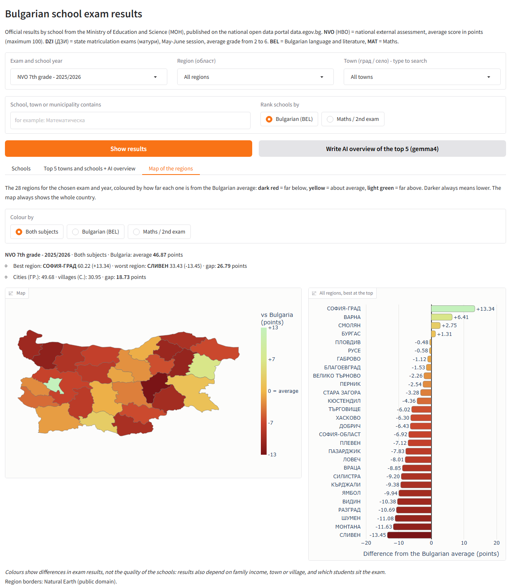

# Bulgarian school exam results

A web app that shows the **official exam results of every school in Bulgaria**, compares towns
and regions, and draws a **map of the inequality between regions**. The data is published by the
Ministry of Education and Science (МОН), and the app downloads it live when you use it.

A learning project in Python, written to be easy to read: every function is explained for
beginners in [English](explanation_english.md), [Bulgarian](explanation_bulgaria.md) and
[Russian](explanation_russian.md).



## What it shows

**The exams:**

| Exam | Grade | Years | Results per school |
|---|---|---|---|
| НВО, national external assessment | 4th | 2020/21 – 2025/26 | Bulgarian and Maths, in points (0–100) |
| НВО | 7th | 2018/19 – 2025/26 | Bulgarian and Maths, in points (0–100) |
| НВО | 10th | 2020/21 – 2025/26 | Bulgarian and Maths, in points (0–100) |
| ДЗИ, matura (May–June session) | 12th | 2021/22 – 2025/26 | Bulgarian and the 2nd compulsory exam, as grades (2–6) |

**Three tabs:**
- **Schools:** every school, ranked, with filters by region, town and name.
  - When you pick a town, it's compared with its region and the whole country, with its rank among
    towns.
- **Top 5 towns and schools + AI overview:** the best towns and schools for the chosen exam and region.
  - Optionally, a local AI model writes a short overview. The code calculates every number; the AI
    only words it.
- **Map of the regions:** the 28 regions coloured by how far their results are from the national
  average, from **dark red** (far below) through **yellow** (about average) to **light green**
  (far above).
  - The colours also get lighter as results get better, so the map still reads for colour-blind
    readers and in black and white.
  - Next to the map: a bar chart with every region's exact number, and the biggest gaps: best vs
    worst region, and cities vs villages.

## How to run it

1. **Install Python 3.11 or newer** from [python.org](https://www.python.org/downloads/).
2. **Download this repository:** use the green **Code** button, then **Download ZIP**, and unzip
   it. Or, with git:
   ```
   git clone https://github.com/Matcov/Matcov-school_education_bulgaria.git
   cd Matcov-school_education_bulgaria
   ```
3. **Install the packages** the app needs, from a terminal in that folder:
   ```
   pip install -r requirements.txt
   ```
4. **Start the app:**
   ```
   python alex_school_results.py
   ```
   It takes about 20 seconds to find the data, then opens in your browser at
   http://127.0.0.1:7860. Press **Ctrl+C** in the terminal to stop it.
5. **Optional, for the AI overview only:** install [Ollama](https://ollama.com), then download the
   model with `ollama pull gemma4`. Everything else works without it.

You need an internet connection, because the results are downloaded live from the government's
open data portal.

## Where the data comes from

- **Exam results:** the Ministry of Education and Science's open data on the national open data
  portal, [data.egov.bg](https://data.egov.bg). The app finds them through the ministry's own
  [open data page](https://www.mon.bg/mon/dostap-do-informatsiya/otvoreni-danni/) on mon.bg.
- **Region borders for the map:** [Natural Earth](https://www.naturalearthdata.com), which is in
  the public domain.
- **No personal data:** the files contain only averages per school, never results of individual
  students.

## Files in this repository

| File | What it is |
|---|---|
| [alex_school_results.py](alex_school_results.py) | The app |
| [bulgaria_regions.geojson](bulgaria_regions.geojson) | The borders of the 28 regions, for the map (Natural Earth, Bulgaria only) |
| [requirements.txt](requirements.txt) | The Python packages the app needs |
| [schools/](schools/) | A snapshot from 17 November 2026: one CSV file per school (2,379 schools), plus the index [_all_schools.csv](schools/_all_schools.csv) |
| [info.md](info.md) | Research notes: where the data is, how the portal's API works, the data's quirks, and the findings |
| [explanation_english.md](explanation_english.md), [explanation_bulgaria.md](explanation_bulgaria.md), [explanation_russian.md](explanation_russian.md) | Every function explained for Python beginners, with a diagram of how they connect |
| [overview_bulgarian.md](overview_bulgarian.md) | An overview of the project in Bulgarian |

## Good to know

- **Differences in results are not a verdict on schools.** Results also depend on family income,
  town or village, and which students sit the exam.
- **Not covered:** elective matura exams, the August–September retake session, and files before
  2018/19, which use different layouts.
- **The data is cleaned:** the ministry's files differ from year to year (column order, codes
  written with spaces, decimal commas, town names). [info.md](info.md) lists every quirk the app
  handles.
- **The AI can still get the wording wrong,** even though all numbers come from the code. The
  tables next to its text are always correct.
