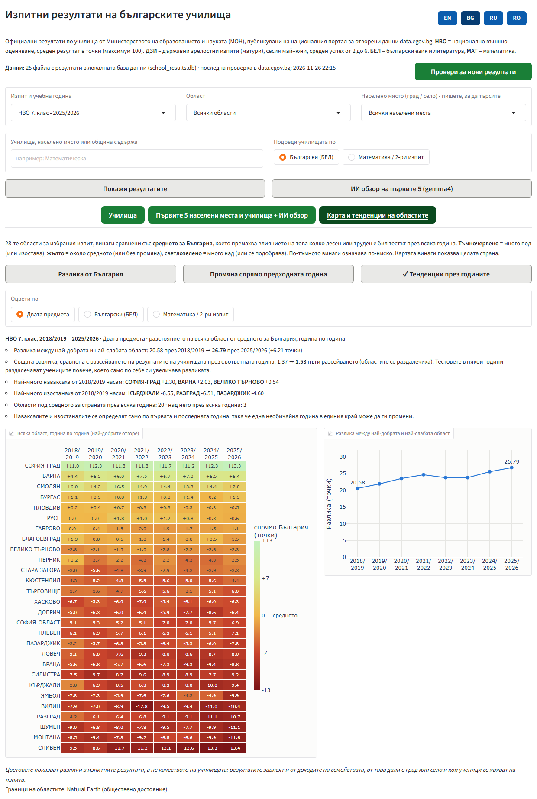

# Bulgarian school exam results

A web app that shows the **official exam results of every school in Bulgaria**, compares towns
and regions, draws a **map of the inequality between regions**, and shows **how that inequality
changes from year to year**. The data is published by the Ministry of Education and Science (МОН).
- **The app keeps a copy in a local database** that comes with this repository, so it starts in
  seconds and works without internet.
- **A green "Check for new results" button** downloads new results when the ministry publishes
  them.
- **The page comes in 4 languages:** Bulgarian, English, Russian and Romanian, with a blue button
  for each next to the title.

A learning project in Python, written to be easy to read:
- **An overview of the project** in [English](Overviews/overview_english.md),
  [Bulgarian](Overviews/overview_bulgarian.md), [Russian](Overviews/overview_russian.md) and
  [Romanian](Overviews/overview_romanian.md).
- **Every function explained for beginners** in [English](Explanations/explanation_english.md),
  [Bulgarian](Explanations/explanation_bulgarian.md), [Russian](Explanations/explanation_russian.md)
  and [Romanian](Explanations/explanation_romanian.md).




## What it shows

**The exams:**

| Exam | Grade | Years | Results per school |
|---|---|---|---|
| НВО, national external assessment | 4th | 2020/21 – 2025/26 | Bulgarian and Maths, in points (0–100) |
| НВО | 7th | 2018/19 – 2025/26 | Bulgarian and Maths, in points (0–100) |
| НВО | 10th | 2020/21 – 2025/26 | Bulgarian and Maths, in points (0–100) |
| ДЗИ, matura (May–June session) | 12th | 2021/22 – 2025/26 | Bulgarian and the 2nd compulsory exam, as grades (2–6) |

**Three tabs:**
- **Schools:** every school, ranked, with filters by region, town and name.
  - When you pick a town, it's compared with its region and the whole country, with its rank among
    towns.
- **Top 5 towns and schools + AI overview:** the best towns and schools for the chosen exam and region.
  - Optionally, a local AI model writes a short overview. The code calculates every number; the AI
    only words it.
  - If the AI isn't available, the program writes a plainer overview itself, from the same
    numbers.
- **Map and trends of the regions:** the 28 regions, always compared with the **national average**. That
  cancels out how easy or hard each year's test was, so years can be compared fairly. Three
  buttons switch between three views:
  - **Difference from Bulgaria:** a map with each region coloured by how far its results are from
    the national average, from **dark red** (far below) through **yellow** (about average) to
    **light green** (far above). Next to it: a bar chart with every region's exact number, and the
    biggest gaps: best vs worst region, and cities vs villages.
  - **Change since the previous year:** the same map and bar chart, coloured by how much each
    region moved compared with the national average since the year before. Red means it fell
    behind, green means it caught up. The summary names the regions that moved most, and gives the
    typical movement, because small changes are often just noise.
  - **Trends over the years:** a grid with one row per region and one column per year, showing
    each region's distance from the national average in every year. Next to it, a line chart of the
    gap between the best and the worst region: for the 7th grade it grew from 20.58 points in
    2018/19 to 26.79 in 2025/26.
    - Some years' tests spread students further apart, which widens the gap by itself. So the
      summary also compares the gap with how spread out the schools' results were. By that
      measure the 7th grade gap grew by 12%, not 30%, and the 10th grade regions actually came a
      little closer.
  - In all three views the colours also get lighter as results get better, so they still read for
    colour-blind readers and in black and white.

**Four languages:** the blue **EN BG RU RO** buttons next to the title switch the whole page,
including the summaries, the charts and the AI overview:

| Language | Address |
|---|---|
| Bulgarian | http://127.0.0.1:7860 |
| English | http://127.0.0.1:7860/en |
| Russian | http://127.0.0.1:7860/ru |
| Romanian | http://127.0.0.1:7860/ro |

- **The names in the data stay in Bulgarian** (schools, towns, regions), as the ministry writes
  them.
- **Decimals keep the point in every language** (55.28), like the charts. Whole numbers have a
  space between thousands outside English (53 739), so they can't be read as decimals.
- **Switching language starts the page again,** with the default choices.

**At the top of the page,** a line shows how many results files are in the database and when it
was last checked. Next to it, the green **"Check for new results"** button asks the government's
open data portal for new files, which takes about 20 seconds. It downloads only the files the
database doesn't have yet, or that the ministry has replaced with a corrected version. New results
come once a year: НВО around June–July, and the matura (May–June session) around July.

## How to run it

1. **Install Python 3.11 or newer** from [python.org](https://www.python.org/downloads/).
2. **Download this repository:** use the green **Code** button, then **Download ZIP**, and unzip
   it. Or, with git:
   ```
   git clone https://github.com/Matcov/Matcov-school_education_bulgaria.git
   cd Matcov-school_education_bulgaria
   ```
3. **Install the packages** the app needs, from a terminal in that folder:
   ```
   pip install -r requirements.txt
   ```
4. **Start the app:**
   ```
   python alex_school_results.py
   ```
   It starts in a few seconds, from the database, and opens in your browser at
   http://127.0.0.1:7860, in Bulgarian. Press **Ctrl+C** in the terminal to stop it.
5. **Optional, for the AI overview:** install [Ollama](https://ollama.com), then download the
   model with `ollama pull gemma4`. Without it, the program writes a plainer overview itself.

**No internet connection is needed** to use the app, because the results come from the
database. You only need internet for the green **Check for new results** button. If the database
file is ever missing, the app rebuilds it the first time it starts, which takes about a minute.

## Where the data comes from

- **Exam results:** the Ministry of Education and Science's open data on the national open data
  portal, [data.egov.bg](https://data.egov.bg). The app finds them through the ministry's own
  [open data page](https://www.mon.bg/mon/dostap-do-informatsiya/otvoreni-danni/) on mon.bg.
  - It stores them in [school_results.db](school_results.db), an SQLite database: 25 results files,
    one row per school in each exam and year (35,292 rows, about 8 MB).
  - The government websites are contacted only when the database is empty, or when you click
    **Check for new results**.
- **Region borders for the map:** [Natural Earth](https://www.naturalearthdata.com), which is in
  the public domain.
- **No personal data:** the files contain only averages per school, never results of individual
  students.

## Files in this repository

| File | What it is |
|---|---|
| [alex_school_results.py](alex_school_results.py) | The app |
| [translations.py](translations.py) | Every text on the page, in English, Bulgarian, Russian and Romanian. Change a text here, in all 4 languages |
| [school_results.db](school_results.db) | The database with every results file: the app reads only this. You can open it with any SQLite tool, such as the free [DB Browser for SQLite](https://sqlitebrowser.org) |
| [bulgaria_regions.geojson](bulgaria_regions.geojson) | The borders of the 28 regions, for the map (Natural Earth, Bulgaria only) |
| [screenshot_map.png](screenshot_map.png), [screenshot_trends.png](screenshot_trends.png) | The pictures of the map tab (Bulgarian page) at the top of this page |
| [requirements.txt](requirements.txt) | The Python packages the app needs |
| [schools/](schools/) | A snapshot from 17 November 2026: one CSV file per school (2,379 schools), plus the index [_all_schools.csv](schools/_all_schools.csv). The database is the copy that gets updated |
| [info.md](info.md) | Research notes: where the data is, how the portal's API works, the data's quirks, and the findings |
| [Overviews/](Overviews/) | An overview of the project: the data, how it's cleaned, the database and the app, in English, Bulgarian, Russian and Romanian |
| [Explanations/](Explanations/) | Every function explained for Python beginners, with a diagram of how they connect, in English, Bulgarian, Russian and Romanian |
| [CLAUDE.md](CLAUDE.md) | Notes for Claude Code, the AI assistant used to build this project: how to run and test it, and the project's rules |

## Good to know

- **Differences in results are not a verdict on schools.** Results also depend on family income,
  town or village, and which students sit the exam.
- **Comparing years:** each year's test is different, so the app never compares raw averages
  across years. It compares each region with that year's national average instead. A change of
  a few tenths is often just noise, and the summary says how big a typical change is. For trends,
  it also compares the gap between regions with how spread out that year's results were.
- **Not covered:** elective matura exams, the August–September retake session, and files before
  2018/19, which use different layouts.
- **The data is cleaned:** the ministry's files differ from year to year (column order, codes
  written with spaces, decimal commas, town names). [info.md](info.md) lists every quirk the app
  handles.
- **The AI can still get the wording wrong,** even though all numbers come from the code. The
  tables next to its text are always correct, and so is the overview the program writes when the
  AI isn't available. gemma4 writes English best; its Bulgarian, Russian and Romanian are less
  polished.
- **The translations were made with AI help.** A native speaker should read them before you rely
  on them.
- **The database is a copy.** Results the ministry publishes later appear only after you click
  **Check for new results**.
- **If the page stops reacting, close other tabs of the app.** A browser allows only 6 connections
  to one server, and every open tab of the app keeps some of them busy.
