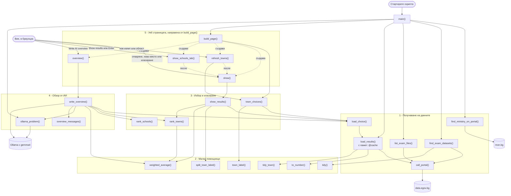

# Как работи `alex_school_results.py` — обяснено просто

Това ръководство е за хора, които **тепърва започват с Python**. То обяснява с прости думи всяка
функция (`def`) в [alex_school_results.py](alex_school_results.py) и после показва как работят
заедно.

Как да го четете:
1. Прочетете **„Какво прави програмата“** и **„Думи, които ще срещнете“**.
2. Разгледайте **диаграмата** в раздел 4.
3. Прочетете функциите. Всяка има връзка към своя ред в кода (номерата на редовете са към
   25 ноември 2026 г.).

---

## 1. Какво прави програмата

1. **Изтегля** от интернет официалните изпитни резултати на всяко училище в България. Публикува
   ги Министерството на образованието и науката (МОН).
2. **Почиства** данните, които са разхвърляни: имена, написани по различен начин, числа със
   запетаи и т.н.
3. **Показва** резултатите на уеб страница във вашия браузър, направена с библиотеката Gradio.
4. На страницата **избирате** изпит, учебна година, област и населено място. Програмата
   **подрежда** училищата и населените места в класация.
5. Ако искате, **локален изкуствен интелект** (моделът gemma4, който работи в Ollama на вашия
   компютър) пише кратък обзор на първите 5 населени места и училища.

**Изпитите:**
- **НВО** (национално външно оценяване) в 4., 7. и 10. клас: точки от 0 до 100 по български
  език и литература (**BEL**) и математика (**MAT**).
- **ДЗИ** (държавни зрелостни изпити, матури) в 12. клас: оценки от 2 до 6 по български език и
  по втори изпит.

---

## 2. Думи, които ще срещнете

| Дума | Значение |
|---|---|
| **функция** (`def`) | Рецепта с име. Давате ѝ съставки (**параметри**), тя прави няколко стъпки и връща резултат (**`return`**). Пример: `def add(a, b): return a + b` → `add(2, 3)` дава `5`. |
| **извикване** на функция | Използването ѝ: `tidy_town("ГР. СОФИЯ")`. „A извиква B“ означава, че функцията A използва функцията B. |
| **`None`** | Думата на Python за „нищо, няма стойност“. |
| **низ** (string) | Текст в кавички: `"Варна"`. |
| **списък** (list) `[ ]` | Няколко стойности подред: `["Варна", "Бургас"]`. |
| **кортеж** (tuple) `( )` | Като списък, но не се променя: `("ГР.ВАРНА", "ВАРНА")`. Функция може да върне две стойности като кортеж. |
| **речник** (dictionary) `{ }` | Двойки *ключ → стойност*, като телефонен указател: `{"NVO 7th grade": "b56288b6-..."}`. |
| **таблица** (pandas `DataFrame`) | Лист като в Excel, но вътре в Python: редове и колони. |
| **API** | Уебсайт, направен за **програми**, а не за хора: изпращате въпрос и получавате данни. |
| **JSON** | Текстов формат за данни, който прилича на речниците и списъците в Python. API-тата отговарят в JSON. |
| **грешка** (изключение, exception) | Сигналът на Python, че „нещо се е объркало“. `raise` изпраща такъв сигнал; `try:` … `except:` го хваща, за да може програмата да реагира. |
| **`_`** | Име за стойност, която **не ни трябва**: `kind, table = …` срещу `_, table = …`. |
| **декоратор** (`@cache`) | Етикет над функция, който ѝ дава допълнителна способност. `@cache` ѝ дава памет. |
| **генератор** (`yield`) | Функция, която връща резултатите **на части**, а не наведнъж с `return`. Използва се, за да се показва текстът на ИИ дума по дума. |
| **вътрешна функция** | Функция, написана вътре в друга функция. |
| **събитие** (event) | Нещо, което се случва на уеб страницата (щракване, нов избор). Тогава Gradio извиква функция. |
| **константа** | Настройка, написана с ГЛАВНИ букви в началото на файла, напр. `TOP = 5`. Не се променя, докато програмата работи. |

---

## 3. Настройките в началото на файла (редове 43–118)

| Настройка | Какво е |
|---|---|
| `MON_OPEN_DATA_PAGE` | Страницата на министерството, която ни казва къде са данните |
| `PORTAL_API` | Адресът на API-то на Портала за отворени данни (data.egov.bg) |
| `KNOWN_MINISTRY_ID` | Идентификаторът (ID) на министерството в портала, за случая, когато mon.bg не работи |
| `headers` | Казва честно на сайтовете кой пита |
| `MODEL`, `THINK` | Моделът на ИИ (`gemma4`) и „не мисли на глас“, за да е по-бърз |
| `EXAMS` | Четирите изпита, с вида им (`"nvo"` или `"dzi"`) и името на набора им от данни в портала |
| `RESULT_COLUMNS` | Имената на четирите колони с резултати за всеки вид изпит |
| `ALL_REGIONS`, `ALL_TOWNS`, `ABROAD`, `RANK_BY` | Постоянни текстове, използвани на страницата |
| `TOP` | Колко населени места и училища показва обзорът на ИИ (5) |
| `MIN_TOWN_STUDENTS`, `MIN_TOWN_STUDENTS_IN_REGION`, `MIN_SCHOOL_STUDENTS` | Минималният брой ученици (100, 30, 10), за да влезеш в класацията, така че малки села да не печелят |
| `BOM` | Невидим символ, с който започват някои файлове |
| `overview_system_prompt` | Правилата, които ИИ трябва да спазва, когато пише обзора |

---

## 4. Голямата картина: как са свързани функциите

Как да четете диаграмата:
- **Стрелка** `A → B` означава „A **извиква** B“.
- **Пунктирна стрелка** означава „създава“ или „после Gradio изпълнява“.
- **Цилиндър** е външният свят: уебсайт или ИИ на вашия компютър.

> Диаграмата се вижда като картинка **в GitHub**. Във VS Code инсталирайте разширението
> *„Markdown Preview Mermaid Support“* или прочетете текстовата версия под диаграмата.



### Същото като текст: три пътя

**Път А: стартирате програмата** (`uv run education_bulgaria/alex_school_results.py`)

```text
main()
 ├─ find_ministry_on_portal()      чете mon.bg  (ако mon.bg не работи: KNOWN_MINISTRY_ID)
 ├─ find_exam_datasets()           намира четирите набора от данни за изпитите
 │    ├─ call_portal()             пита data.egov.bg
 │    └─ tidy()
 ├─ list_exam_files()              изброява 25-те годишни файла
 │    └─ call_portal()             пита data.egov.bg
 ├─ load_results()                 първия файл, само за да вземе списъка с области
 │    ├─ call_portal()
 │    ├─ to_number()
 │    └─ tidy_town()
 ├─ build_page()                   изгражда уеб страницата
 │    └─ town_choices()            попълва списъка с населени места
 │         ├─ load_choice() → load_results()
 │         └─ town_label()
 ├─ ollama_problem()               готов ли е ИИ? (само предупреждение)
 └─ page.launch()                  отваря браузъра
```

**Път Б: разделът „Schools“** (страницата се отваря, променяте нещо или щраквате „Show results“)

```text
show_schools_tab()                 само при „Show results“ и Enter: отива на раздела Schools
refresh_towns()                    само при смяна на изпита или областта: нов списък с места
 └─ town_choices() → load_choice() → load_results(), town_label()
show()
 └─ show_results()                 обобщението + таблицата
      ├─ load_choice() → load_results()    (мигновено, ако файлът е отварян преди)
      ├─ split_town_label()                 (ако е избрано населено място)
      ├─ weighted_average()                 (средните стойности в обобщението)
      └─ rank_towns() → weighted_average()  (мястото на населеното място в класацията)
```

**Път В: щраквате „Write AI overview“**

```text
(страницата преминава към втория раздел)
overview()
 └─ write_overview()
      ├─ load_choice() → load_results()
      ├─ rank_towns() → weighted_average()   първите 5 населени места
      ├─ rank_schools()                      първите 5 училища
      ├─ weighted_average()                  средната стойност за района и „Vs area average“
      ├─ ollama_problem()                    готов ли е Ollama?
      ├─ overview_messages()                 указанията + фактите в JSON
      └─ ollama.chat()                       gemma4 пише, дума по дума
```

### Кои функции общуват с външния свят

| Функция | Общува с |
|---|---|
| `find_ministry_on_portal()` | **mon.bg**, сайта на министерството |
| `call_portal()` | **data.egov.bg**, Портала за отворени данни. Всеки въпрос към портала минава през тази единствена функция. |
| `ollama_problem()` и `write_overview()` | **Ollama** на вашия компютър: ИИ gemma4 |
| `main()`, чрез `page.launch()` | **вашия браузър** |

Всички останали функции работят само с данни, които вече са в паметта.

---

## 5. Всяка функция, една по една

### Група 1: Малки помощници

#### `tidy(text)`: [ред 121](alex_school_results.py#L121)
- **С едно изречение:** прави едно име лесно за сравняване с друго име.
- **Получава:** текст. **Връща:** същия текст с малки букви, с единични интервали и без точка
  накрая.
- **Пример:** `"Резултати  от ДЗИ."` → `"резултати от дзи"`
- **Защо:** министерството понякога пише името на набор от данни с двоен интервал или с точка
  накрая. След `tidy()` „едно и също име, написано малко по-различно“ се смята за еднакво.
- **Как:** `text.split()` разрязва текста на думи и премахва всички интервали; `" ".join(...)`
  залепва думите обратно с точно един интервал; `.lower()` прави буквите малки; `.rstrip(".")`
  маха точката накрая.
- **Извиква се от:** `find_exam_datasets()`.

#### `tidy_town(town)`: [ред 128](alex_school_results.py#L128)
- **С едно изречение:** прави така, че едно и също населено място да изглежда еднакво във всеки
  файл.
- **Примери:** `"ГР. СОФИЯ"` → `"ГР.СОФИЯ"` · `"Прага"` → `"ПРАГА"` ·
  `"СОФИЯ 11 РН КРАСНА ПОЛЯНА"` (софийски район) → `"ГР.СОФИЯ"`
- **Как:**
  1. Единични интервали и ГЛАВНИ букви (`.upper()`).
  2. **Регулярен израз** (`re.sub`, шаблон за търсене в текст) маха интервала след „ГР.“ или
     „С.“.
  3. Ако името започва със „СОФИЯ, число, РН“, това е район на София, затова става „ГР.СОФИЯ“.
- **Извиква се от:** `load_results()`, за всяко училище.

#### `to_number(text)`: [ред 225](alex_school_results.py#L225)
- **С едно изречение:** превръща клетка от файла в число или в `None`, когато няма резултат.
- **Примери:** `"52.4"` → `52.4` · `"3,09"` → `3.09` (десетична запетая) · `""` → `None` ·
  `"0"` → `None` (нула означава, че никой не е държал този изпит) · `"Област"` → `None`
- **Как:** заменя запетаята с точка и опитва `float()`. Ако Python не може да направи число, той
  вдига `ValueError`; частта `except` го хваща и връща `None`. Последният ред,
  `return value or None`, превръща `0` в `None`.
- **Извиква се от:** `load_results()`, за всяка клетка.

#### `weighted_average(table, count_column, average_column)`: [ред 298](alex_school_results.py#L298)
- **С едно изречение:** средната стойност за всички **ученици**, а не за училищата.
- **Защо:** училище със 100 ученици трябва да тежи повече от училище с 5.
- **Пример:** училище А има 100 ученици със среден резултат 60; училище Б има 5 ученици с 90.
  - Средното на двете училища е (60 + 90) / 2 = **75**, което подвежда.
  - Претеглената средна стойност е (100 × 60 + 5 × 90) / 105 = **61,43**, което е честно.
- **Връща две стойности:** средната стойност и броя на учениците. Ако никой не е държал изпита:
  `(None, 0)`.
- **Как:** маха редовете с празни стойности (`dropna`), умножава ученици × среден резултат за
  всяко училище, събира всичко и дели на общия брой ученици.
- **Извиква се от:** `rank_towns()`, `show_results()`, `write_overview()`.

#### `town_label(town, region)`: [ред 310](alex_school_results.py#L310)
- **С едно изречение:** съставя текста, който се показва в списъка с населени места.
- **Пример:** `town_label("ГР.ВАРНА", "ВАРНА")` → `"ГР.ВАРНА (ВАРНА)"`
- **Защо областта:** много села имат едно и също име в различни области.
- **Извиква се от:** `town_choices()`.

#### `split_town_label(label)`: [ред 318](alex_school_results.py#L318)
- **С едно изречение:** обратното на `town_label()`: отново разделя населеното място и областта.
- **Пример:** `"ГР.ВАРНА (ВАРНА)"` → `("ГР.ВАРНА", "ВАРНА")`
- **Как:** `rsplit(" (", 1)` разрязва текста веднъж, при последното `" ("`; `rstrip(")")` маха
  затварящата скоба.
- **Извиква се от:** `show_results()`.

---

### Група 2: Получаване на данните от интернет

#### `call_portal(method, payload)`: [ред 142](alex_school_results.py#L142)
- **С едно изречение:** изпраща един въпрос до Портала за отворени данни (data.egov.bg) и връща
  отговора.
- **Получава:** името на въпроса (`method`), напр. `"listResources"`, и подробностите му
  (`payload`) като речник. **Връща:** отговора като речник.
- **Пример:** `call_portal("getOrganisationDetails", {"org_uri": "a57a2273-..."})` →
  `{"success": True, "data": {"id": 117, "name": "Министерство на образованието и науката", ...}}`
- **Как:**
  1. `requests.post(...)` изпраща въпроса.
  2. `raise_for_status()` спира с грешка, ако сайтът отговори с код за грешка, напр. 404 или 500.
  3. `.json()` превръща JSON текста в речник на Python.
  4. Порталът казва `"success": false`, когато нещо не е наред. Тогава функцията вдига собствена
     грешка (`RuntimeError`) със съобщението на портала.
- **Добре е да знаете:** това е **единствената врата към портала**. Ако порталът някога се
  промени, има само едно място за поправка.
- **Извиква се от:** `find_exam_datasets()`, `list_exam_files()`, `load_results()`.

#### `find_ministry_on_portal()`: [ред 155](alex_school_results.py#L155)
- **С едно изречение:** чете страницата „Отворени данни“ на mon.bg и намира идентификатора (ID) на
  министерството в портала.
- **Получава:** нищо. **Връща:** ID-то, текст като `"a57a2273-6b21-4a7a-99ee-05ec4f67ebe4"`.
- **Как:** това е частта за **извличане на данни от уеб страници** (web scraping), с
  BeautifulSoup:
  1. `requests.get` изтегля страницата.
  2. `BeautifulSoup` чете нейния HTML.
  3. Цикъл минава през всяка връзка (`<a href="...">`).
  4. Когато връзката съдържа `data.egov.bg/organisation/profile/`, изрязва ID-то между
     `/profile/` и `?` и го връща.
  5. Ако не намери такава връзка, вдига грешка.
- **Извиква се от:** `main()`. Ако mon.bg не работи, `main()` използва `KNOWN_MINISTRY_ID`.

#### `find_exam_datasets(ministry_id)`: [ред 171](alex_school_results.py#L171)
- **С едно изречение:** намира четирите набора от данни за изпитите (НВО в 4., 7. и 10. клас и
  ДЗИ) сред около 350-те набора на министерството.
- **Връща:** речник *изпит → ID на набора*, напр. `{"NVO 7th grade": "b56288b6-...", ...}`
- **Как:**
  1. Пита портала за номера на министерството (117).
  2. Иска наборите от данни на министерството **страница по страница**, по 100 наведнъж.
     Цикълът `while True:` се повтаря, докато страница не съдържа по-малко от 100 (`break`).
  3. За всеки изпит в `EXAMS` запазва наборите, чието име след `tidy()` е равно на очакваното.
  4. Ако няколко имат това име, взема най-новия (`max` по `updated_at`).
- **Знакът `_`:** в `for exam, (_, dataset_name) in EXAMS.items():` всяка стойност в `EXAMS` е
  двойка (вид, име). Тук ни трябва само името, затова видът получава името „не ни трябва“ — `_`.
- **Извиква се от:** `main()`.

#### `list_exam_files(exam_datasets)`: [ред 201](alex_school_results.py#L201)
- **С едно изречение:** изброява годишните файлове на всеки изпит и дава на всеки четимо име като
  `"NVO 7th grade - 2025/2026"`.
- **Връща:** речник *„изпит - година“ → (вид, ID на файла)*, напр.
  `{"NVO 7th grade - 2025/2026": ("nvo", "08157f0e-..."), ...}`. Този речник попълва списъка
  „Exam and school year“ на страницата.
- **Как:**
  1. Пита портала за файловете на всеки набор.
  2. **Регулярен израз** (`re.search`) намира учебната година в името на файла
     („учебна 2025/2026“). Файловете без нея са в стар формат, затова `continue` ги прескача.
  3. За ДЗИ запазва само основната сесия (май–юни) на задължителните изпити.
  4. Подрежда файловете с най-новата година първа.
- **Извиква се от:** `main()`.

#### `load_results(kind, resource_id)`: [ред 239](alex_school_results.py#L239)
- **С едно изречение:** изтегля един файл с резултати и го превръща в чиста таблица, по един ред
  за училище.
- **Получава:** вида (`"nvo"` или `"dzi"`) и ID-то на файла. **Връща:** таблица с колоните Region,
  Municipality, Town, School, School code и 4 колони с резултати.
- **Най-важната функция:** тя поправя всички проблеми в държавните файлове:
  - заглавен ред над имената на колоните;
  - колони в различен ред в някои години;
  - кодове на училища, написани с интервали;
  - десетични запетаи;
  - „В ЧУЖБИНА“ вместо „ЧУЖБИНА“;
  - няколко колони по предмети за втория изпит на матурите.
- **Как:**
  1. Изтегля редовете — списъци от текстове — чрез `call_portal("getResourceData", ...)`.
  2. Намира заглавния ред: реда, който започва с „Област“.
  3. Намира по имената им кои колони са „Училище“ и „Код“.
  4. За всяко училище извиква `to_number()` за всяка клетка.
     - **НВО:** взема последните 4 числа.
     - **ДЗИ:** българският език е в колони 5 и 6 (Python брои от 0, така че това са 6-ата и
       7-ата колона). Вторият изпит е претеглената средна стойност от всички останали колони по
       предмети.
     - Подрежда областта, кода, името и населеното място (`tidy_town()`).
  5. Изгражда таблицата (`pd.DataFrame`). Броят на учениците става цели числа (`Int64`), а
     средните стойности се закръгляват до 2 знака след десетичната запетая.
- **`@cache` (редът над функцията):** дава на функцията **памет**. Първия път, когато се поиска
  даден файл, той се изтегля (около 1 секунда). Следващия път Python връща запомнената таблица
  мигновено, без да тегли. Рестартирането на програмата изтрива паметта.
- **Извиква се от:** `load_choice()`, `main()`.

#### `load_choice(exam_files, choice)`: [ред 284](alex_school_results.py#L284)
- **С едно изречение:** превръща това, което сте избрали в списъка „Exam and school year“, в
  таблица с резултати или показва съобщение за грешка на страницата.
- **Получава:** речника с файловете и вашия избор, напр. `"DZI (matura) - 2025/2026"`.
  **Връща две стойности:** вида (`"dzi"`) и таблицата.
- **Как:**
  1. Ако изборът ви не е в речника, вдига `gr.Error(...)`, което Gradio показва като червено
     изскачащо съобщение на страницата.
  2. Намира вида и ID-то на файла.
  3. Извиква `load_results()` вътре в `try:`. Ако изтеглянето не успее, получавате разбираемо
     `gr.Error` вместо срив.
- **Извиква се от:** `town_choices()`, `show_results()`, `write_overview()`.

---

### Група 3: Избор и класиране

#### `town_choices(exam_files, choice, region)`: [ред 326](alex_school_results.py#L326)
- **С едно изречение:** съставя списъка с населени места за падащото меню „Town“.
- **Връща:** списък, който започва с `"All towns"`, после населените места по азбучен ред, напр.
  `"ГР.ВАРНА (ВАРНА)"`.
- **Защо градовете са първи:** в азбуката Г е преди С, затова „ГР.“ (градове) са преди „С.“
  (села).
- **Как:** зарежда таблицата (`load_choice()`), запазва само училищата от избраната област, маха
  повторенията (`drop_duplicates()`), прави етикетите (`town_label()`) и ги подрежда.
- **Извиква се от:** `build_page()` (първия списък) и `refresh_towns()` (при смяна на изпита или
  областта).

#### `rank_towns(table, kind, min_students)`: [ред 339](alex_school_results.py#L339)
- **С едно изречение:** прави класация на населените места, най-добрите първи.
- **Връща:** таблица с по един ред за населено място: `#`, Town, Region, Schools, Students, двете
  средни стойности и „Both subjects“.
- **Как:**
  1. `groupby(["Region", "Town"])` събира заедно училищата от едно и също място.
  2. За всяко място извиква `weighted_average()` за български език и за математика (или втория
     изпит).
  3. Прескача местата с твърде малко ученици (по-малко от `min_students`), за да не може малко
     село да спечели.
  4. „Both subjects“ = (български + математика) / 2.
  5. Подрежда по „Both subjects“, от най-високото, и добавя колоната за място `#`: 1, 2, 3…
- **`min_students`:** 100 за цяла България, 30 в рамките на една област.
- **Извиква се от:** `show_results()` (мястото на вашето населено място) и `write_overview()`
  (първите 5).

#### `rank_schools(table, kind)`: [ред 363](alex_school_results.py#L363)
- **С едно изречение:** същото като `rank_towns()`, но за училища.
- **Как:**
  1. Запазва само училищата с поне 10 ученици на всеки изпит (`MIN_SCHOOL_STUDENTS`).
     - `big_enough` е списък от `True`/`False`, по едно за всяко училище (**маска**);
       `table[big_enough]` запазва само редовете с `True`.
     - `fillna(0)` означава, че празен брой ученици се брои като 0, тоест твърде малко.
  2. Изчислява „Both subjects“, подрежда училищата и ги номерира.
- **Извиква се от:** `write_overview()`.

#### `show_results(exam_files, choice, region, town, search, rank_by)`: [ред 380](alex_school_results.py#L380)
- **С едно изречение:** прави всичко в раздела „Schools“: обобщението и таблицата.
- **Получава:** петте ви избора от страницата: изпит, област, населено място, текст за търсене и
  „подреди по“. **Връща две стойности:** обобщението (текст в Markdown) и таблицата.
- **Как:**
  1. **Зареждане:** взема таблицата с `load_choice()`.
  2. **Филтриране:** запазва училищата от вашето населено място или от вашата област.
     - Ако сте избрали населено място, запазва и неговата област и цялата страна, за сравнение.
     - Разделя етикета на мястото със `split_town_label()`.
  3. **Търсене:** запазва редовете, в които училището, населеното място или общината съдържат
     вашия текст. `case=False` означава, че главните и малките букви нямат значение.
  4. **Подреждане:** по български или по математика, най-добрите първи, и добавя колоната `#`.
  5. **Обобщение:** броят на училищата и средните стойности (`weighted_average()`), сравнени с
     областта и България. Ако сте избрали населено място, добавя мястото му в класацията за
     България и за неговата област (`rank_towns()`).
- **Извиква се от:** `show()` на страницата.

---

### Група 4: Обзорът от ИИ

#### `ollama_problem()`: [ред 452](alex_school_results.py#L452)
- **С едно изречение:** проверява дали ИИ е готов: Ollama работи и gemma4 е изтеглен.
- **Връща:** `None`, ако всичко е наред („няма проблем“), иначе съобщение какво не е наред.
- **Как:**
  1. Пита Ollama на вашия компютър (`http://localhost:11434/api/tags`) за списъка му с модели.
     - **Няма отговор:** „Ollama isn't running…“.
     - **gemma4 не е в списъка:** „gemma4 isn't downloaded…“.
  2. За Ollama `gemma4` и `gemma4:latest` са един и същ модел, затова кодът добавя `:latest`,
     преди да сравни.
- **Защо това име:** функцията отговаря на въпроса *„какъв е проблемът?“*, а `None` означава, че
  няма проблем. Затова кодът гласи `if problem:`.
- **Извиква се от:** `main()` (предупреждение при старта) и `write_overview()` (преди да пита ИИ).

#### `overview_messages(choice, kind, area, area_averages, towns, schools, min_town_students)`: [ред 468](alex_school_results.py#L468)
- **С едно изречение:** пише „писмото“ до ИИ: нашите правила плюс фактите.
- **Връща:** списък от две съобщения:
  - `{"role": "system", ...}`: правилата, от `overview_system_prompt` в началото на файла.
  - `{"role": "user", ...}`: изпитът, районът, средните стойности и първите 5 населени места и
    училища като JSON.
- **JSON:** `json.dumps(...)` превръща таблиците в текст, който ИИ може да чете.
  `ensure_ascii=False` запазва кирилицата четима.
- **Извиква се от:** `write_overview()`.

#### `write_overview(exam_files, choice, region)`: [ред 492](alex_school_results.py#L492)
- **С едно изречение:** изчислява първите 5 населени места и училища, показва ги и после оставя
  gemma4 да напише обзора дума по дума.
- **Особеност:** това е **генератор**. Използва `yield` вместо `return` и всяко `yield` изпраща
  обновление към страницата: двете таблици и текста дотук. Така текстът се появява дума по дума.
- **Как:**
  1. Зарежда таблицата и запазва избраната област.
  2. Извиква `rank_towns()` и `rank_schools()` и запазва първите 5 (`head(TOP)`).
  3. Изчислява средната стойност за района и колко се отдалечава от нея всяко място и училище
     („Vs area average“).
     - **Това го изчислява кодът, не ИИ**, защото моделите на ИИ се справят зле с аритметиката.
       В нашите тестове gemma4 написа 13,04 вместо 14,04.
  4. Проверява Ollama (`ollama_problem()`). Ако има проблем, го показва и спира.
  5. `ollama.chat(..., stream=True)` пита gemma4. За всяко малко парче текст (**chunk**) добавя
     парчето и подава (`yield`) по-дългия текст.
  6. Ако нещо се провали, `try`/`except` показва грешката под написания дотук текст.
- **Настройки в извикването:**
  - `temperature 0.3`: да се придържа към фактите.
  - `num_predict 900`: максимална дължина.
  - `think=False`: без скрито „мислене“, което е по-бързо.
- **Извиква се от:** `overview()` на страницата.

---

### Група 5: Уеб страницата и стартът

#### `build_page(exam_files, regions)`: [ред 554](alex_school_results.py#L554)
- **С едно изречение:** изгражда уеб страницата (списъци, бутони, раздели, таблици) и решава коя
  функция да се изпълни, когато щракнете или промените нещо.
- **Получава:** речника с файловете и списъка с области. **Връща:** страницата, която `main()`
  после отваря.
- **Как:**
  1. Създава малки **вътрешни функции**: `show`, `overview` и `refresh_towns`. Те помнят
     `exam_files`, така че Gradio трябва да им подаде само вашите избори.
  2. `with gr.Blocks() as page:` означава, че всичко, което е с отстъп отдолу, става част от
     страницата. `gr.Row()` слага нещата едно до друго; `gr.Tabs()` и `gr.Tab()` правят двата
     раздела.
  3. Свързва **събитията**: `нещо.събитие(функция, входове, изходи)` означава „когато това се
     случи, извикай тази функция със стойностите на тези входове и сложи резултатите ѝ в тези
     изходи“. `.then(...)` означава „след това направи и това“.

| Когато вие… | Gradio извиква |
|---|---|
| отворите страницата | `show()` |
| смените изпита или областта | `refresh_towns()`, после `show()` |
| изберете населено място или смените „Rank schools by“ | `show()` |
| щракнете „Show results“ или натиснете Enter в полето за търсене | `show_schools_tab()`, после `show()` |
| щракнете „Write AI overview“ | преминаване към втория раздел, после `overview()` |

- **Вътрешните функции** (създадени вътре в `build_page()`):
  - `show(choice, region, town, search, rank_by)` извиква `show_results(exam_files, …)`.
  - `overview(choice, region)` извиква `write_overview(exam_files, …)`. `yield from` предава
    всяко обновление, затова и тя е генератор.
  - `refresh_towns(choice, region, current_town)` извиква `town_choices()` и връща ново падащо
    меню с новия списък. Запазва вашето населено място, ако то все още е в списъка.
  - `show_schools_tab()` връща `gr.Tabs(selected="schools")`, което означава „отиди на раздела
    Schools“.
  - Малка `lambda`, функция от един ред без име, превключва към втория раздел.
- **`.input` или `.change`?**
  - `.input` реагира само на **вас**.
  - `.change` реагира и когато **кодът** промени стойността.
  - Списъкът с населени места използва `.input`, за да не се показват резултатите два пъти,
    когато `refresh_towns()` нулира избраното място.

#### `main()`: [ред 638](alex_school_results.py#L638)
- **С едно изречение:** началната точка: подготвя данните, изгражда страницата и я отваря в
  браузъра.
- **Как:**
  1. `sys.stdout.reconfigure(...)` позволява на терминала в Windows да показва кирилица.
  2. `find_ministry_on_portal()`. Ако mon.bg не отговори, използва `KNOWN_MINISTRY_ID`.
  3. `find_exam_datasets()` и после `list_exam_files()` дават 25-те файла.
  4. `load_results()` за първия файл, само за да събере имената на областите.
  5. `build_page()`.
  6. Ако нещо се обърка, отпечатва едно ясно съобщение и спира със `sys.exit(1)`. `1` е кодът за
     „грешка“.
  7. Предупреждава, ако липсва изпит или ако ИИ не е готов (`ollama_problem()`).
  8. `page.launch(inbrowser=True)` стартира уеб сървъра и отваря браузъра.
- **Последните два реда на файла:** `if __name__ == "__main__": main()` означава „изпълни
  `main()` само когато този файл е **стартиран** директно (`uv run …`), а не когато друг файл го
  **импортира**“. Благодарение на това можете да пробвате отделни функции самостоятелно (вижте
  съветите по-долу).

---

## 6. Съвети за разглеждане на кода

- **Пробвайте функция самостоятелно.** Изпълнете това от папката на проекта (`-X utf8` кара
  терминала да показва кирилицата правилно):
  ```
  uv run python -X utf8 -c "from education_bulgaria.alex_school_results import tidy_town, to_number; print(tidy_town('ГР. СОФИЯ'), to_number('3,09'), to_number(''))"
  ```
  Отпечатва: `ГР.СОФИЯ 3.09 None`
- **Погледнете вътре:** добавете `print(...)` във функция, за да виждате стойностите ѝ, докато
  програмата работи, и после го махнете.
- **Променете настройка:** например `TOP = 10` в началото на файла дава първите 10 вместо
  първите 5. Рестартирайте програмата, за да видите промяната.
- **Четете в реда на пътищата:** започнете от `main()` и следвайте извикванията, както е показано
  в раздел 4.
