# How `alex_school_results.py` works, explained simply

This guide is for people who are **new to Python**. It explains every function (`def`) in
[alex_school_results.py](alex_school_results.py) in plain words, and then shows how they all work
together.

How to read it:
1. Read **"What the program does"** and **"Words you will meet"**.
2. Look at the **diagram** in section 4.
3. Read the functions. Each one has a link to its line in the code (line numbers as of
   25 November 2026).

---

## 1. What the program does

1. It **keeps** the official exam results of every school in Bulgaria in a **local database**,
   the file `school_results.db`. The Ministry of Education (МОН) publishes the results on the
   internet; the program downloads them only the very first time, or when you click the green
   **Check for new results** button.
2. It **cleans** the data while downloading it, because it's messy: names written in different
   ways, numbers with commas, and so on.
3. It **shows** the results on a web page in your browser, made with the Gradio library.
4. On the page you **choose** an exam, a school year, a region and a town. The program **ranks**
   the schools and towns for you.
5. If you want, a **local AI** (the gemma4 model, running in Ollama on your PC) writes a short
   overview of the top 5 towns and schools. If the AI isn't available, the program writes a
   plainer overview itself.
6. A **map of the 28 regions** colours each region by how far its results are from the national
   average, from dark red (far below) to light green (far above), next to a bar chart with the
   exact numbers.

**The exams:**
- **НВО** (national external assessment) in 4th, 7th and 10th grade: points from 0 to 100 in
  Bulgarian (**BEL**) and Maths (**MAT**).
- **ДЗИ** (matura) in 12th grade: grades from 2 to 6 in Bulgarian and in a second exam.

---

## 2. Words you will meet

| Word | Meaning |
|---|---|
| **function** (`def`) | A named recipe. You give it ingredients (**parameters**), it does some steps and gives back a result (**`return`**). Example: `def add(a, b): return a + b` → `add(2, 3)` gives `5`. |
| **call** a function | Use it: `tidy_town("ГР. СОФИЯ")`. "A calls B" means function A uses function B. |
| **`None`** | Python's word for "nothing, no value". |
| **string** | Text, in quotes: `"Варна"`. |
| **list** `[ ]` | Several values in order: `["Варна", "Бургас"]`. |
| **tuple** `( )` | Like a list, but fixed: `("ГР.ВАРНА", "ВАРНА")`. A function can return two values as a tuple. |
| **dictionary** `{ }` | Pairs of *key → value*, like a phone book: `{"NVO 7th grade": "b56288b6-..."}`. |
| **table** (pandas `DataFrame`) | An Excel-like sheet inside Python: rows and columns. |
| **database** (SQLite) | A file that stores tables and can be searched quickly. SQLite is built into Python, and the whole database is one file: here, `school_results.db`. |
| **SQL** | The language for asking a database questions. `SELECT school FROM results WHERE town = 'ГР.ВАРНА'` means "give me the schools in Varna". |
| **transaction** | Several changes to a database that happen **all together or not at all**. If something fails halfway, nothing is half-saved. |
| **API** | A website made for **programs** instead of people: you send a question, you get data back. |
| **JSON** | A text format for data that looks like Python dictionaries and lists. APIs answer in JSON. |
| **error** (exception) | Python's signal that "something went wrong". `raise` sends one; `try:` … `except:` catches it so the program can react. `finally:` runs in every case, error or not. |
| **`_`** | A name for a value we **don't need**: `kind, table = …` vs `_, table = …`. |
| **decorator** (`@cache`) | A label written above a function that gives it an extra ability. `@cache` gives it a memory. |
| **generator** (`yield`) | A function that hands back results **bit by bit** instead of all at once with `return`. Used to show the AI's text word by word. |
| **inner function** | A function written inside another function. |
| **event** | Something that happens on the web page (a click, a new choice). Gradio then calls a function. |
| **constant** | A setting written in CAPITAL letters at the top of the file, e.g. `TOP = 5`. It doesn't change while the program runs. |

---

## 3. The settings at the top of the file (lines 57–192)

| Setting | What it is |
|---|---|
| `MON_OPEN_DATA_PAGE` | The ministry's web page that tells us where the data is |
| `PORTAL_API` | The address of the national open data portal's API (data.egov.bg) |
| `KNOWN_MINISTRY_ID` | The ministry's ID on the portal, used if mon.bg is down |
| `headers` | Says honestly to the websites who is asking |
| `MODEL`, `THINK` | The AI model (`gemma4`), and "don't think aloud" so it's faster |
| `EXAMS` | The 4 exams, with their kind (`"nvo"` or `"dzi"`) and their dataset name on the portal |
| `RESULT_COLUMNS` | The names of the 4 result columns for each kind of exam |
| `ALL_REGIONS`, `ALL_TOWNS`, `ABROAD`, `RANK_BY` | Fixed texts used on the page |
| `TOP` | How many towns and schools the AI overview shows (5) |
| `MIN_TOWN_STUDENTS`, `MIN_TOWN_STUDENTS_IN_REGION`, `MIN_SCHOOL_STUDENTS` | The minimum number of students (100, 30, 10) to be ranked, so tiny villages don't win |
| `BOM` | An invisible character that some files start with |
| `DATABASE_FILE` | Where the database is: the file `school_results.db` next to the script |
| `DATABASE_TABLES` | The database's 3 tables, written in SQL: `files`, `results` and `checks`. They're created the first time the file is opened |
| `DATABASE_COLUMNS` | The names of the results columns in the database (`region`, `school`, `bel_average`…) |
| `REGION_MAP_FILE` | Where the map's region borders are: the file `bulgaria_regions.geojson` next to the script |
| `MAP_SUBJECTS` | What the map can be coloured by: both subjects, Bulgarian, or Maths / 2nd exam |
| `MAP_COLOURS` | The map's colours, from dark red (far below average) to light green (far above). They also get lighter, so darker always means worse |
| `MAP_NOTE` | The line under the map: the colours show differences in results, not the quality of the schools |
| `overview_system_prompt` | The rules the AI must follow when it writes the overview |

---

## 4. The big picture: how the functions are connected

How to read the diagram:
- An **arrow** `A → B` means "A **calls** B".
- A **dotted arrow** means "creates", or "then Gradio runs".
- A **cylinder** is something outside the code: a website, a file, or the AI on your PC.

> The diagram shows as a picture **on GitHub**. In VS Code, install the extension
> *"Markdown Preview Mermaid Support"*, or read the text version below the diagram.

```mermaid
flowchart TD
    START(["You run the script"]) --> n_main["main()"]

    subgraph g_helpers ["1 - Small helpers"]
        n_tidy["tidy()"]
        n_tidy_town["tidy_town()"]
        n_to_number["to_number()"]
        n_weighted["weighted_average()"]
        n_town_label["town_label()"]
        n_split_label["split_town_label()"]
    end

    subgraph g_internet ["2 - Getting the data from the internet"]
        n_find_ministry["find_ministry_on_portal()"]
        n_find_datasets["find_exam_datasets()"]
        n_list_files["list_exam_files()"]
        n_download["download_results()"]
        n_call_portal["call_portal()"]
    end

    subgraph g_db ["3 - The database"]
        n_update["update_database()"]
        n_save["save_results()"]
        n_stored["stored_files()"]
        n_read["read_results()"]
        n_status["database_status()"]
        n_open["open_database()"]
        n_load_choice["load_choice()"]
    end

    subgraph g_rank ["4 - Choosing and ranking"]
        n_town_choices["town_choices()"]
        n_show_results["show_results()"]
        n_rank_towns["rank_towns()"]
        n_rank_schools["rank_schools()"]
    end

    subgraph g_ai ["5 - AI overview"]
        n_write_overview["write_overview()"]
        n_overview_messages["overview_messages()"]
        n_template["template_overview()"]
        n_ollama_problem["ollama_problem()"]
    end

    subgraph g_map ["6 - The map"]
        n_show_map["show_map()"]
        n_schools_in_bulgaria["schools_in_bulgaria()"]
        n_subject_score["subject_score()"]
        n_load_region_map["load_region_map()<br/>with memory: @cache"]
        n_region_map["region_map()"]
        n_region_bars["region_bars()"]
    end

    subgraph g_page ["7 - The web page, made by build_page()"]
        n_build_page["build_page()"]
        n_show["show()"]
        n_refresh["refresh_towns()"]
        n_tab["show_schools_tab()"]
        n_overview["overview()"]
        n_map_view["map_view()"]
        n_check["check_for_new_results()"]
    end

    MON[("mon.bg")]
    PORTAL[("data.egov.bg")]
    DBFILE[("school_results.db")]
    OLLAMA[("Ollama with gemma4")]
    MAPFILE[("bulgaria_regions.geojson")]
    YOU(["You, in the browser"])

    %% Starting the program
    n_main --> n_stored
    n_main -->|only if the database is empty| n_update
    n_main --> n_read
    n_main --> n_build_page
    n_main --> n_ollama_problem

    %% The database
    n_update --> n_find_ministry
    n_update --> n_find_datasets
    n_update --> n_list_files
    n_update --> n_stored
    n_update --> n_download
    n_update --> n_save
    n_update --> n_open
    n_save --> n_open
    n_stored --> n_open
    n_read --> n_open
    n_status --> n_open
    n_open --> DBFILE
    n_load_choice --> n_read

    %% Getting the data from the internet
    n_find_ministry --> MON
    n_find_datasets --> n_call_portal
    n_find_datasets --> n_tidy
    n_list_files --> n_call_portal
    n_download --> n_call_portal
    n_download --> n_to_number
    n_download --> n_tidy_town
    n_call_portal --> PORTAL

    %% The web page
    n_build_page --> n_town_choices
    n_build_page --> n_status
    n_build_page -.->|creates| n_show
    n_build_page -.->|creates| n_refresh
    n_build_page -.->|creates| n_tab
    n_build_page -.->|creates| n_overview
    n_build_page -.->|creates| n_map_view
    n_build_page -.->|creates| n_check
    YOU -->|page opens, new town or ranking| n_show
    YOU -->|new exam or region| n_refresh
    YOU -->|Show results or Enter| n_tab
    YOU -->|Write AI overview| n_overview
    YOU -->|Map tab, new exam or Colour by| n_map_view
    YOU -->|Check for new results| n_check
    n_refresh -.->|then| n_show
    n_tab -.->|then| n_show
    n_check --> n_update
    n_check --> n_stored
    n_check --> n_status

    %% Choosing and ranking
    n_show --> n_show_results
    n_refresh --> n_town_choices
    n_town_choices --> n_load_choice
    n_town_choices --> n_town_label
    n_show_results --> n_load_choice
    n_show_results --> n_split_label
    n_show_results --> n_weighted
    n_show_results --> n_rank_towns
    n_rank_towns --> n_weighted

    %% AI overview
    n_overview --> n_write_overview
    n_write_overview --> n_load_choice
    n_write_overview --> n_rank_towns
    n_write_overview --> n_rank_schools
    n_write_overview --> n_weighted
    n_write_overview --> n_ollama_problem
    n_write_overview --> n_overview_messages
    n_write_overview -->|without AI| n_template
    n_write_overview --> OLLAMA
    n_ollama_problem --> OLLAMA

    %% The map
    n_map_view --> n_show_map
    n_show_map --> n_load_choice
    n_show_map --> n_schools_in_bulgaria
    n_show_map --> n_load_region_map
    n_show_map --> n_subject_score
    n_show_map --> n_region_map
    n_show_map --> n_region_bars
    n_subject_score --> n_weighted
    n_load_region_map --> MAPFILE
```



### The same thing as text: five journeys

**Journey A: you start the program** (`uv run education_bulgaria/alex_school_results.py`)

```text
main()
 ├─ stored_files() → open_database()          the list of files in school_results.db
 ├─ update_database()                         ONLY if the database is empty: see Journey E
 ├─ read_results() → open_database()          the first file, only to get the list of regions
 ├─ build_page()                              builds the web page
 │    ├─ database_status() → open_database()  the "Data: 25 results files..." line
 │    └─ town_choices()                       fills the Town list
 │         ├─ load_choice() → read_results()
 │         └─ town_label()
 ├─ ollama_problem()                          is the AI ready? (only a warning)
 └─ page.launch()                             opens your browser
```

No internet is needed here: everything comes from the database.

**Journey B: the "Schools" tab** (the page opens, you change something, or you click "Show results")

```text
show_schools_tab()                 only for "Show results" and Enter: go to the Schools tab
refresh_towns()                    only when the exam or region changes: a new Town list
 └─ town_choices() → load_choice() → read_results(), town_label()
show()
 └─ show_results()                 the summary + the table
      ├─ load_choice() → read_results()     (about 20 milliseconds, from the database)
      ├─ split_town_label()                 (if a town is chosen)
      ├─ weighted_average()                 (the averages in the summary)
      └─ rank_towns() → weighted_average()  (the town's rank, if a town is chosen)
```

**Journey C: you click "Write AI overview"**

```text
(the page switches to the second tab)
overview()
 └─ write_overview()
      ├─ load_choice() → read_results()
      ├─ rank_towns() → weighted_average()   top 5 towns
      ├─ rank_schools()                      top 5 schools
      ├─ weighted_average()                  the area's average, and "Vs area average"
      ├─ ollama_problem()                    is Ollama ready?
      ├─ template_overview()                 if not, or if the AI fails: the program writes it
      ├─ overview_messages()                 the instructions + the facts in JSON
      └─ ollama.chat()                       gemma4 writes, word by word
```

**Journey D: you open the "Map of the regions" tab** (or change the exam, or "Colour by")

```text
map_view()
 └─ show_map()                     the summary of the gaps + the map + the bar chart
      ├─ load_choice() → read_results()
      ├─ schools_in_bulgaria()                  leaves out the schools abroad
      ├─ load_region_map()                      reads bulgaria_regions.geojson (only the first time)
      ├─ subject_score() → weighted_average()   Bulgaria, each region, cities, villages
      ├─ region_map()                           the coloured map
      └─ region_bars()                          the bar chart, best at the top
```

**Journey E: you click the green "Check for new results" button**

```text
check_for_new_results()
 ├─ update_database()
 │    ├─ find_ministry_on_portal()           reads mon.bg (if it's down: KNOWN_MINISTRY_ID)
 │    ├─ find_exam_datasets()                finds the 4 exam datasets
 │    │    ├─ call_portal()                  asks data.egov.bg
 │    │    └─ tidy()
 │    ├─ list_exam_files()                   the portal's list of files
 │    │    └─ call_portal()
 │    ├─ stored_files()                      the database's list, to compare
 │    ├─ download_results()                  only for each new or replaced file
 │    │    ├─ call_portal()
 │    │    ├─ to_number()
 │    │    └─ tidy_town()
 │    ├─ save_results() → open_database()    stores the file, in one transaction
 │    └─ open_database()                     logs the check in the "checks" table
 ├─ stored_files()                           refreshes the "Exam and school year" list
 └─ database_status()                        the new "Data: ..." line
```

### Which functions talk to the outside world

| Function | Talks to |
|---|---|
| `find_ministry_on_portal()` | **mon.bg**, the ministry's website, only when the database is filled or updated |
| `call_portal()` | **data.egov.bg**, the open data portal, only when the database is filled or updated. Every question to the portal goes through this one function. |
| `open_database()` | The file **school_results.db** next to the script, on your PC. Every use of the database goes through this one function. |
| `ollama_problem()` and `write_overview()` | **Ollama** on your PC: the gemma4 AI |
| `load_region_map()` | The file **bulgaria_regions.geojson** next to the script, on your PC |
| `main()`, through `page.launch()` | **your browser** |

All the other functions only work with data that is already in memory.

---

## 5. Every function, one by one

### Group 1: Small helpers

#### `tidy(text)`: [line 195](alex_school_results.py#L195)
- **In one sentence:** makes a name easy to compare with another name.
- **Gets:** a text. **Gives back:** the same text in lower case, with single spaces and no full stop
  at the end.
- **Example:** `"Резултати  от ДЗИ."` → `"резултати от дзи"`
- **Why:** the ministry sometimes writes a dataset name with a double space or a full stop at the
  end. After `tidy()`, "the same name, written a bit differently" counts as equal.
- **How:** `text.split()` cuts the text into words and drops all the spaces; `" ".join(...)` glues
  the words back with exactly one space; `.lower()` makes lower case; `.rstrip(".")` removes a full
  stop at the end.
- **Called by:** `find_exam_datasets()`.

#### `tidy_town(town)`: [line 202](alex_school_results.py#L202)
- **In one sentence:** makes the same town look the same in every file.
- **Examples:** `"ГР. СОФИЯ"` → `"ГР.СОФИЯ"` · `"Прага"` → `"ПРАГА"` ·
  `"СОФИЯ 11 РН КРАСНА ПОЛЯНА"` (a Sofia district) → `"ГР.СОФИЯ"`
- **How:**
  1. Single spaces and CAPITAL letters (`.upper()`).
  2. A **regular expression** (`re.sub`, a search pattern for text) removes the space after "ГР." or
     "С.".
  3. If the name starts with "СОФИЯ, a number, РН", it's a district of Sofia, so it becomes
     "ГР.СОФИЯ".
- **Called by:** `download_results()`, for every school.

#### `to_number(text)`: [line 299](alex_school_results.py#L299)
- **In one sentence:** turns a cell of the file into a number, or into `None` when there's no
  result.
- **Examples:** `"52.4"` → `52.4` · `"3,09"` → `3.09` (decimal comma) · `""` → `None` · `"0"` → `None`
  (zero means nobody took that exam) · `"Област"` → `None`
- **How:** it replaces the comma with a dot and tries `float()`. If Python can't make a number, it
  raises a `ValueError`; the `except` part catches it and returns `None`. The last line,
  `return value or None`, turns `0` into `None`.
- **Called by:** `download_results()`, for every cell.

#### `weighted_average(table, count_column, average_column)`: [line 476](alex_school_results.py#L476)
- **In one sentence:** the average over all **students**, not over schools.
- **Why:** a school with 100 students should count more than a school with 5.
- **Example:** school A has 100 students with an average of 60; school B has 5 students with 90.
  - The average of the two schools is (60 + 90) / 2 = **75**, which is misleading.
  - The weighted average is (100 × 60 + 5 × 90) / 105 = **61.43**, which is fair.
- **Gives back two values:** the average and the number of students. If nobody took the exam:
  `(None, 0)`.
- **How:** it drops rows with empty values (`dropna`), multiplies students × average for each
  school, adds it all up, and divides by the total number of students.
- **Called by:** `rank_towns()`, `show_results()`, `write_overview()`, `subject_score()`.

#### `town_label(town, region)`: [line 488](alex_school_results.py#L488)
- **In one sentence:** builds the text shown in the Town list.
- **Example:** `town_label("ГР.ВАРНА", "ВАРНА")` → `"ГР.ВАРНА (ВАРНА)"`
- **Why the region:** many villages have the same name in different regions.
- **Called by:** `town_choices()`.

#### `split_town_label(label)`: [line 496](alex_school_results.py#L496)
- **In one sentence:** the opposite of `town_label()`: it takes the town and the region apart again.
- **Example:** `"ГР.ВАРНА (ВАРНА)"` → `("ГР.ВАРНА", "ВАРНА")`
- **How:** `rsplit(" (", 1)` cuts the text once, at the last `" ("`; `rstrip(")")` removes the
  closing bracket.
- **Called by:** `show_results()`.

---

### Group 2: Getting the data from the internet

These functions are used **only to fill or update the database**: the very first time, and when you
click the green **Check for new results** button.

#### `call_portal(method, payload)`: [line 216](alex_school_results.py#L216)
- **In one sentence:** sends one question to the open data portal (data.egov.bg) and returns its
  answer.
- **Gets:** the name of the question (`method`), e.g. `"listResources"`, and its details
  (`payload`) as a dictionary. **Gives back:** the answer as a dictionary.
- **Example:** `call_portal("getOrganisationDetails", {"org_uri": "a57a2273-..."})` →
  `{"success": True, "data": {"id": 117, "name": "Министерство на образованието и науката", ...}}`
- **How:**
  1. `requests.post(...)` sends the question.
  2. `raise_for_status()` stops with an error if the website answers with an error code, such as
     404 or 500.
  3. `.json()` turns the JSON text into a Python dictionary.
  4. The portal says `"success": false` when something is wrong. Then the function raises its own
     error (`RuntimeError`) with the portal's message.
- **Good to know:** this is the **only door to the portal**. If the portal ever changes, there's one
  place to fix.
- **Called by:** `find_exam_datasets()`, `list_exam_files()`, `download_results()`.

#### `find_ministry_on_portal()`: [line 229](alex_school_results.py#L229)
- **In one sentence:** reads the ministry's "open data" page on mon.bg and finds the ministry's ID
  on the portal.
- **Gets:** nothing. **Gives back:** the ID, a text like `"a57a2273-6b21-4a7a-99ee-05ec4f67ebe4"`.
- **How:** this is the **web scraping** part, with BeautifulSoup:
  1. `requests.get` downloads the page.
  2. `BeautifulSoup` reads its HTML.
  3. A loop goes through every link (`<a href="...">`).
  4. When a link contains `data.egov.bg/organisation/profile/`, it cuts out the ID between
     `/profile/` and `?` and returns it.
  5. If no link is found, it raises an error.
- **Called by:** `update_database()`. If mon.bg is down, `update_database()` uses
  `KNOWN_MINISTRY_ID` instead.

#### `find_exam_datasets(ministry_id)`: [line 245](alex_school_results.py#L245)
- **In one sentence:** finds the ministry's 4 exam datasets (НВО 4th, 7th and 10th grade, and
  ДЗИ) among its roughly 350 datasets.
- **Gives back:** a dictionary *exam → dataset ID*, e.g. `{"NVO 7th grade": "b56288b6-...", ...}`
- **How:**
  1. It asks the portal for the ministry's number (117).
  2. It asks for the ministry's datasets **page by page**, 100 at a time. The `while True:` loop
     repeats until a page has fewer than 100 (`break`).
  3. For each exam in `EXAMS`, it keeps the datasets whose `tidy()` name equals the expected name.
  4. If several have that name, it takes the newest (`max` by `updated_at`).
- **The `_`:** in `for exam, (_, dataset_name) in EXAMS.items():`, each value of `EXAMS` is a pair
  (kind, name). We only need the name here, so the kind gets the "don't need" name `_`.
- **Called by:** `update_database()`.

#### `list_exam_files(exam_datasets)`: [line 275](alex_school_results.py#L275)
- **In one sentence:** lists each exam's yearly files on the portal and gives each one a readable
  name like `"NVO 7th grade - 2025/2026"`.
- **Gives back:** a dictionary *"exam - year" → (kind, file ID)*, e.g.
  `{"NVO 7th grade - 2025/2026": ("nvo", "08157f0e-..."), ...}`.
- **How:**
  1. It asks the portal for the files of each dataset.
  2. A **regular expression** (`re.search`) finds the school year in the file's name
     ("учебна 2025/2026"). Files without it have an old layout, so `continue` skips them.
  3. For ДЗИ it keeps only the main session (May–June) of the compulsory exams.
  4. It sorts the files with the newest year first.
- **Called by:** `update_database()`, which compares this list with the database's list.

#### `download_results(kind, resource_id)`: [line 311](alex_school_results.py#L311)
- **In one sentence:** downloads one results file from the portal and turns it into a clean table,
  one row per school.
- **Gets:** the kind (`"nvo"` or `"dzi"`) and the file's ID. **Gives back:** a table with the columns
  Region, Municipality, Town, School, School code, and 4 result columns.
- **The most important cleaning function:** it fixes all the problems in the government's files:
  - a title line above the column names;
  - columns in a different order in some years;
  - school codes written with spaces;
  - decimal commas;
  - "В ЧУЖБИНА" instead of "ЧУЖБИНА";
  - several subject columns for the matura's 2nd exam.
- **How:**
  1. It downloads the rows: lists of texts, through `call_portal("getResourceData", ...)`.
  2. It finds the header row: the row that starts with "Област".
  3. It finds which columns are "Училище" (school) and "Код" (code) by their names.
  4. For each school: it calls `to_number()` on every cell.
     - **НВО:** it takes the last 4 numbers.
     - **ДЗИ:** Bulgarian is in columns 5 and 6 (Python counts from 0, so these are the 6th and
       7th columns). The 2nd exam is the weighted average of all the other subject columns.
     - It tidies the region, the code, the name and the town (`tidy_town()`).
  5. It builds the table (`pd.DataFrame`). Student numbers become whole numbers (`Int64`), and
     averages are rounded to 2 decimals.
- **Good to know:** the clean table goes straight into the database (`save_results()`), so the
  cleaning happens **once per file**, not every time you look at the results.
- **Called by:** `update_database()`.

---

### Group 3: The database

#### `open_database()`: [line 357](alex_school_results.py#L357)
- **In one sentence:** opens the database file `school_results.db`, and creates it and its tables if
  they don't exist yet.
- **Gives back:** an open **connection** to the database: the line through which Python talks to it.
- **How:**
  1. `sqlite3.connect(DATABASE_FILE)` opens the file, or creates it if it's missing.
  2. `executescript(DATABASE_TABLES)` runs the SQL in `DATABASE_TABLES`. `CREATE TABLE IF NOT EXISTS`
     creates each table only if it isn't there yet.
- **Good to know:** whoever opens the database must close it again with `.close()`. That's why the
  other functions use `try:` … `finally: database.close()`: `finally` runs even when something fails
  in between.
- **Called by:** `save_results()`, `stored_files()`, `read_results()`, `update_database()`,
  `database_status()`.

#### `save_results(choice, kind, resource_id, table)`: [line 367](alex_school_results.py#L367)
- **In one sentence:** stores one downloaded results file in the database, replacing an older copy of
  it.
- **Gets:** the file's name (`choice`, like `"NVO 7th grade - 2025/2026"`), its kind, its ID on the
  portal, and the clean table from `download_results()`.
- **How:**
  1. It renames the table's columns to the database's names (`DATABASE_COLUMNS`) and adds a
     `choice` column, so each row knows which file it belongs to.
  2. Inside `with database:`, which is a **transaction**, it:
     - deletes the file's old rows (`DELETE FROM results WHERE choice = ?`);
     - adds the new ones (`to_sql`);
     - writes the file's row in the `files` table, with today's date (`INSERT OR REPLACE`).
  3. Thanks to the transaction, either everything is saved or nothing is: an update that fails
     halfway never leaves half a file.
- **The `?` in the SQL:** a placeholder that sqlite3 fills in with the value, safely. Never paste
  values into SQL text yourself.
- **Called by:** `update_database()`.

#### `stored_files()`: [line 385](alex_school_results.py#L385)
- **In one sentence:** lists every results file in the database.
- **Gives back:** the same kind of dictionary as `list_exam_files()`: *"exam - year" → (kind, file
  ID)*. This dictionary fills the "Exam and school year" list on the page.
- **How:** `SELECT … FROM files` reads the `files` table. Then two sorts put the files exam by exam
  (in the order of `EXAMS`), with the newest year first. Python's sort is **stable**: when it sorts
  by exam, files of the same exam keep the year order from the first sort.
- **Called by:** `main()`, `update_database()`, `check_for_new_results()`.

#### `read_results(choice, kind)`: [line 402](alex_school_results.py#L402)
- **In one sentence:** reads one exam and year from the database, as a table with the page's column
  names.
- **Example:** `read_results("NVO 7th grade - 2025/2026", "nvo")` gives the 1,702 schools in about
  20 milliseconds.
- **How:**
  1. `pd.read_sql("SELECT … FROM results WHERE choice = ? ORDER BY rowid", …)` asks the database.
     `ORDER BY rowid` keeps the order in which the rows were saved.
  2. It renames the columns to the page's names (`RESULT_COLUMNS`) and turns the student numbers
     into whole numbers (`Int64`).
- **Called by:** `load_choice()`, `main()`.

#### `update_database()`: [line 419](alex_school_results.py#L419)
- **In one sentence:** asks the portal for its list of results files, and downloads only the ones the
  database doesn't have yet, or that the ministry has replaced.
- **Gives back:** the list of files that were added or replaced. It's empty if nothing was new.
- **How:**
  1. `find_ministry_on_portal()` (or `KNOWN_MINISTRY_ID` if mon.bg is down), then
     `find_exam_datasets()` and `list_exam_files()`: the portal's list (about 15–20 seconds).
  2. It compares it with `stored_files()`. A file counts as new if its exam and year are missing, or
     if its file ID is different, which means the ministry replaced it with a corrected version.
  3. For each new file: `download_results()`, then `save_results()`.
  4. It logs the check in the `checks` table, with the date and the number of new files.
- **Called by:** `main()` (only when the database is empty) and `check_for_new_results()` (the green
  button).

#### `database_status()`: [line 448](alex_school_results.py#L448)
- **In one sentence:** writes the line at the top of the page, like *"Data: 25 results files in the
  local database (school_results.db) · last checked on data.egov.bg: 2026-11-25 13:22"*.
- **How:** it asks the database two questions in SQL: `SELECT COUNT(*) FROM files` (how many files)
  and `SELECT MAX(checked_at) FROM checks` (the latest check). If the portal was never checked, it
  says "never".
- **Called by:** `build_page()` and `check_for_new_results()`.

#### `load_choice(exam_files, choice)`: [line 462](alex_school_results.py#L462)
- **In one sentence:** turns what you picked in the "Exam and school year" list into the results
  table, from the database, or shows an error message on the page.
- **Gets:** the files dictionary and your choice, e.g. `"DZI (matura) - 2025/2026"`.
  **Gives back two values:** the kind (`"dzi"`) and the table.
- **How:**
  1. If your choice isn't in the dictionary, it raises `gr.Error(...)`, which Gradio shows as a red
     pop-up on the page.
  2. It looks up the kind.
  3. It calls `read_results()` inside `try:`. If the database can't be read, you get a friendly
     `gr.Error` instead of a crash.
- **Called by:** `town_choices()`, `show_results()`, `write_overview()`, `show_map()`.

---

### Group 4: Choosing and ranking

#### `town_choices(exam_files, choice, region)`: [line 504](alex_school_results.py#L504)
- **In one sentence:** makes the list of towns for the "Town" dropdown.
- **Gives back:** a list that starts with `"All towns"`, then the towns in alphabetical order, e.g.
  `"ГР.ВАРНА (ВАРНА)"`.
- **Why cities come first:** in the alphabet Г comes before С, so "ГР." (cities) come before "С."
  (villages).
- **How:** it loads the table (`load_choice()`), keeps only the chosen region's schools,
  removes repeats (`drop_duplicates()`), makes the labels (`town_label()`) and sorts them.
- **Called by:** `build_page()` (the first list) and `refresh_towns()` (when the exam or region
  changes).

#### `rank_towns(table, kind, min_students)`: [line 517](alex_school_results.py#L517)
- **In one sentence:** makes a ranking of the towns, best first.
- **Gives back:** a table with one row per town: `#`, Town, Region, Schools, Students, the two
  averages, and "Both subjects".
- **How:**
  1. `groupby(["Region", "Town"])` puts together the schools of the same town.
  2. For each town, it calls `weighted_average()` for Bulgarian and for Maths (or the 2nd exam).
  3. It skips towns with too few students (fewer than `min_students`), so a tiny village can't
     win.
  4. "Both subjects" = (Bulgarian + Maths) / 2.
  5. It sorts by "Both subjects", highest first, and adds the rank column `#`: 1, 2, 3…
- **`min_students`:** 100 for the whole of Bulgaria, 30 inside one region.
- **Called by:** `show_results()` (the rank of your town) and `write_overview()` (the top 5).

#### `rank_schools(table, kind)`: [line 541](alex_school_results.py#L541)
- **In one sentence:** the same as `rank_towns()`, but for schools.
- **How:**
  1. It keeps only schools with at least 10 students in each exam (`MIN_SCHOOL_STUDENTS`).
     - `big_enough` is a list of `True`/`False`, one per school (a **mask**); `table[big_enough]`
       keeps only the rows marked `True`.
     - `fillna(0)` means an empty number of students counts as 0, which is too few.
  2. It calculates "Both subjects", sorts the schools, and numbers them.
- **Called by:** `write_overview()`.

#### `show_results(exam_files, choice, region, town, search, rank_by)`: [line 558](alex_school_results.py#L558)
- **In one sentence:** makes everything on the "Schools" tab: the summary text and the table.
- **Gets:** your 5 choices from the page: exam, region, town, search text, and "rank by".
  **Gives back two values:** the summary (Markdown text) and the table.
- **How:**
  1. **Load:** it gets the table with `load_choice()`.
  2. **Filter:** it keeps your town's schools, or your region's.
     - If you chose a town, it also keeps the town's region and the whole country, to compare
       with.
     - It splits the town's label with `split_town_label()`.
  3. **Search:** it keeps the rows where the school, town or municipality contains your text.
     `case=False` means capital and small letters don't matter.
  4. **Sort:** by Bulgarian or by Maths, best first, and adds the `#` column.
  5. **Summary:** the number of schools and the averages (`weighted_average()`), compared with the
     region and Bulgaria. If you chose a town, it adds the town's rank in Bulgaria and in its
     region (`rank_towns()`).
- **Called by:** `show()` on the page.

---

### Group 5: The AI overview

#### `ollama_problem()`: [line 630](alex_school_results.py#L630)
- **In one sentence:** checks whether the AI is ready: Ollama is running and gemma4 is downloaded.
- **Gives back:** `None` if all is fine ("no problem"), otherwise a message that says what's wrong.
- **How:**
  1. It asks Ollama on your PC (`http://localhost:11434/api/tags`) for its list of models.
     - **No answer:** "Ollama isn't running…".
     - **gemma4 not in the list:** "gemma4 isn't downloaded…".
  2. For Ollama, `gemma4` and `gemma4:latest` are the same model, so the code adds `:latest`
     before comparing.
- **Why the name:** the function answers the question *"what's the problem?"*, and `None` means
  there isn't one. That's why the code reads `if problem:`.
- **Called by:** `main()` (a warning at the start) and `write_overview()` (before asking the AI).

#### `overview_messages(choice, kind, area, area_averages, towns, schools, min_town_students)`: [line 646](alex_school_results.py#L646)
- **In one sentence:** writes the "letter" to the AI: our rules plus the facts.
- **Gives back:** a list of two messages:
  - `{"role": "system", ...}`: the rules, from `overview_system_prompt` at the top of the file.
  - `{"role": "user", ...}`: the exam, the area, the averages, and the top 5 towns and schools as
    JSON.
- **JSON:** `json.dumps(...)` turns the tables into text the AI can read. `ensure_ascii=False`
  keeps the Cyrillic letters readable.
- **Called by:** `write_overview()`.

#### `template_overview(area, towns, schools)`: [line 670](alex_school_results.py#L670)
- **In one sentence:** writes the overview **without AI**, from the same numbers the AI gets.
- **When:** if Ollama isn't running, if the model isn't downloaded, or if the AI fails halfway.
- **Gives back:** Markdown text with the same layout as the AI's: "## Top towns", a numbered list,
  "## Top schools", a numbered list, and a closing line if most of the top schools are in the same
  town.
- **Example of a line:** `1. **ГР.ВАРНА**: 60.04, 6.75 above the area's average`
- **How:**
  1. `to_dict(orient="records")` turns each table into a list of dictionaries, one per row, and an
     f-string writes one line for each.
  2. `value_counts()` counts the towns of the top schools. If one town has all of them, or more than
     half, the closing line says so.
- **Good to know:** it's plainer than the AI's text, but **instant and always exact**.
- **Called by:** `write_overview()`.

#### `write_overview(exam_files, choice, region)`: [line 701](alex_school_results.py#L701)
- **In one sentence:** calculates the top 5 towns and schools, shows them, then lets gemma4 write
  the overview word by word.
- **Special:** it's a **generator**. It uses `yield` instead of `return`, and each `yield` sends an
  update to the page: the two tables and the text so far. That's how the text appears word by
  word.
- **How:**
  1. It loads the table and keeps the chosen region.
  2. It calls `rank_towns()` and `rank_schools()` and keeps the first 5 (`head(TOP)`).
  3. It calculates the area's average and how far each town and school is from it
     ("Vs area average").
     - **The code calculates this, not the AI,** because AI models are bad at arithmetic. In our
       tests, gemma4 wrote 13.04 instead of 14.04.
  4. It checks Ollama (`ollama_problem()`). If there's a problem, the program writes the overview
     itself (`template_overview()`) and says why.
  5. `ollama.chat(..., stream=True)` asks gemma4. For each small piece of text (a **chunk**), it
     adds the piece and `yield`s the longer text.
  6. If anything fails while the AI writes, `try`/`except` replaces the text with the program's
     overview, and says what went wrong.
- **Settings in the call:**
  - `temperature 0.3`: stick to the facts.
  - `num_predict 900`: a maximum length.
  - `think=False`: no hidden "thinking", which is faster.
- **Called by:** `overview()` on the page.

---

### Group 6: The map

#### `schools_in_bulgaria(table)`: [line 765](alex_school_results.py#L765)
- **In one sentence:** leaves out the schools abroad, which have no region on the map.
- **How:** in Bulgaria every town starts with "ГР." (city) or "С." (village).
  `str.startswith(("ГР.", "С."))` gives `True` for those, and the region must not be "ЧУЖБИНА". The
  table keeps only those rows.
- **Why:** some files list the schools abroad under ЧУЖБИНА, others under a Bulgarian region. The
  school in БРАТИСЛАВА, for example, is listed under СОФИЯ-ГРАД, which would mix it into Sofia's
  average.
- **Called by:** `show_map()`.

#### `subject_score(schools, kind, subject)`: [line 774](alex_school_results.py#L774)
- **In one sentence:** the average of a group of schools in the chosen subject, weighted by
  students.
- **Gets:** a group of schools (one region, all cities, all villages, or the whole country), the
  kind of exam, and the subject: "Both subjects", "Bulgarian (BEL)" or "Maths / 2nd exam".
  **Gives back:** one number, or `None` if there are no results.
- **How:** it calls `weighted_average()` for Bulgarian and for Maths (or the 2nd exam), then returns
  the one you asked for. "Both subjects" is the average of the two.
- **Example:** НВО 7th grade 2025/2026, both subjects: the whole country gives 46.87, СОФИЯ-ГРАД
  gives 60.22.
- **Called by:** `show_map()`.

#### `load_region_map()`: [line 793](alex_school_results.py#L793)
- **In one sentence:** reads the borders of the 28 regions from the file `bulgaria_regions.geojson`.
- **Gives back:** the file's content as a dictionary. For each region it has the name as written in
  the data (e.g. "ВАРНА"), the code (BG-03), the English name, and the border as a list of points.
- **`@cache`:** it reads the file only once, the first time the map is shown, and remembers it.
- **The file:** made from Natural Earth's world map, which is in the public domain, keeping only
  Bulgaria (66 KB).
- **Called by:** `show_map()`.

#### `region_map(regions, borders, unit, limit)`: [line 801](alex_school_results.py#L801)
- **In one sentence:** draws the map, with each region coloured by how far it is from the national
  average.
- **Gets:** the table of regions (name, average, difference from Bulgaria, number of schools), the
  borders, the unit ("points" or "grade") and `limit`, the biggest difference. **Gives back:** a
  Plotly figure, which Gradio shows on the page.
- **How:**
  1. `go.Choropleth(...)` is Plotly's "coloured areas" map. `featureidkey="properties.region"` tells
     it to match each border to the data by the region's Bulgarian name.
  2. `zmin=-limit, zmax=limit`: the colours go the same distance both ways, so the national average
     (0) is always the middle colour, yellow.
  3. The colour key shows "−13 … 0 = average … +13", and hovering over a region shows its exact
     numbers.
  4. `fitbounds="locations", visible=False` zooms in on Bulgaria and hides the rest of the world.
- **Called by:** `show_map()`.

#### `region_bars(regions, unit, limit)`: [line 833](alex_school_results.py#L833)
- **In one sentence:** the same 28 regions as a bar chart, best at the top, with each region's
  exact difference written next to its bar.
- **Why:** a map is good for *where*, and bars are better for *how much*. The written numbers
  (like `+13.34` or `−13.45`) also let you read the chart without the colours.
- **How:** `go.Bar(..., orientation="h")` makes horizontal bars, coloured with the same
  `MAP_COLOURS` as the map. The axis goes the same distance both ways, with 0 (the national average)
  in the middle.
- **Called by:** `show_map()`.

#### `show_map(exam_files, choice, subject)`: [line 866](alex_school_results.py#L866)
- **In one sentence:** makes everything on the "Map of the regions" tab: the summary of the gaps, the
  map and the bar chart.
- **Gets:** the chosen exam and year, and the subject from "Colour by". **Gives back three values:**
  the summary text, the map and the bar chart.
- **How:**
  1. It loads the table (`load_choice()`) and leaves out the schools abroad
     (`schools_in_bulgaria()`).
  2. It reads the borders (`load_region_map()`). If the file is missing, it returns a clear message
     instead of crashing.
  3. It calculates the national average and each region's average with `subject_score()`, one region
     at a time thanks to `groupby("Region")`, and each region's difference ("Vs Bulgaria").
  4. It sorts the regions, finds the best and the worst, and compares cities ("ГР.") with villages
     ("С.").
  5. It draws the map (`region_map()`) and the bars (`region_bars()`).
- **Example of the summary:** "Best region: СОФИЯ-ГРАД 60.22 (+13.34) · worst region: СЛИВЕН 33.43
  (−13.45) · gap: 26.79 points", then "Cities (ГР.): 49.68 · villages (С.): 30.95 · gap: 18.73
  points".
- **Called by:** `map_view()` on the page.

---

### Group 7: The web page and the start

#### `build_page(exam_files, regions)`: [line 907](alex_school_results.py#L907)
- **In one sentence:** builds the web page (lists, buttons, tabs, tables) and decides which
  function runs when you click or change something.
- **Gets:** the files dictionary and the list of regions. **Gives back:** the page, which `main()`
  then opens.
- **How:**
  1. It creates small **inner functions**: `show`, `overview`, `refresh_towns`, `map_view` and
     `check_for_new_results`. They remember `exam_files`, so Gradio only has to pass your choices.
  2. `with gr.Blocks(...) as page:` means everything indented below becomes part of the page.
     `gr.Row()` puts things side by side; `gr.Tabs()` and `gr.Tab()` make the three tabs.
  3. **The green button:** `elem_id="check-button"` gives the button a name, and the CSS rule
     `#check-button { background: #1a7f37 … }`, passed with `gr.Blocks(css=...)`, colours that one
     button green. White text on this green has a contrast of 5.1:1, so it's easy to read.
  4. It connects the **events**: `thing.event(function, inputs, outputs)` means "when this happens,
     call this function with the values of these inputs, and put its results into these outputs".
     `.then(...)` means "after that, also do this".

| When you… | Gradio calls |
|---|---|
| open the page | `show()` |
| change the exam or the region | `refresh_towns()`, then `show()` |
| pick a town, or change "Rank schools by" | `show()` |
| click "Show results", or press Enter in the search box | `show_schools_tab()`, then `show()` |
| click "Write AI overview" | switch to the second tab, then `overview()` |
| open the "Map of the regions" tab, change the exam, or change "Colour by" | `map_view()` |
| click the green "Check for new results" button | `check_for_new_results()` |

- **The inner functions** (created inside `build_page()`):
  - `show(choice, region, town, search, rank_by)` calls `show_results(exam_files, …)`.
  - `overview(choice, region)` calls `write_overview(exam_files, …)`. `yield from` passes on every
    update, so it's a generator too.
  - `refresh_towns(choice, region, current_town)` calls `town_choices()` and returns a new
    dropdown with the new list. It keeps your town if it's still in the list.
  - `map_view(choice, subject)` calls `show_map(exam_files, …)`. The map is drawn when you open its
    tab, because a chart drawn in a hidden tab can come out the wrong size.
  - `check_for_new_results(current_choice)` is a generator too:
    1. It first shows "Checking data.egov.bg…", then calls `update_database()`.
    2. It refills the shared `exam_files` dictionary (`clear()`, then `update()`), so every part of
       the page sees the new years.
    3. It returns the new "Data" line (`database_status()`) and a new "Exam and school year" list,
       keeping your current choice.
    4. If the check fails, for example without internet, it shows the error instead.
  - `show_schools_tab()` returns `gr.Tabs(selected="schools")`, which means "go to the Schools
    tab".
  - A tiny `lambda`, a one-line function without a name, switches to the second tab.
- **`.input` or `.change`?**
  - `.input` reacts only to **you**.
  - `.change` also reacts when the **code** changes the value.
  - The Town list uses `.input`, so the results aren't shown twice when `refresh_towns()` resets
    the town.

#### `main()`: [line 1044](alex_school_results.py#L1044)
- **In one sentence:** the starting point: it gets the data ready from the database, builds the page
  and opens it in your browser.
- **How:**
  1. `sys.stdout.reconfigure(...)` lets the Windows terminal print Cyrillic.
  2. `stored_files()` reads the list of files in the database.
  3. **If the database is empty** (the very first start, or the file was deleted), `update_database()`
     fills it from the internet, once, in about a minute. Then `stored_files()` again.
  4. `read_results()` on the first file, only to collect the region names.
  5. `build_page()`.
  6. If anything goes wrong, it prints one clear message and stops with `sys.exit(1)`. The `1` is
     the "error" code.
  7. It warns if an exam is missing, or if the AI isn't ready (`ollama_problem()`).
  8. `page.launch(inbrowser=True)` starts the web server and opens your browser.
- **No internet needed:** when the database has data, nothing is downloaded at the start.
- **The last two lines of the file:** `if __name__ == "__main__": main()` means "run `main()`
  only when this file is **started** directly (`uv run …`), not when another file **imports** it".
  Thanks to this, you can try single functions on their own (see the tips below).

---

## 6. Tips for exploring the code

- **Try a function on its own.** Run this from the project folder (`-X utf8` makes the terminal
  print Cyrillic correctly):
  ```
  uv run python -X utf8 -c "from education_bulgaria.alex_school_results import tidy_town, to_number; print(tidy_town('ГР. СОФИЯ'), to_number('3,09'), to_number(''))"
  ```
  It prints: `ГР.СОФИЯ 3.09 None`
- **Look inside the database** with one line of SQL, from the project folder:
  ```
  uv run python -X utf8 -c "import sqlite3; db = sqlite3.connect('education_bulgaria/school_results.db'); print(db.execute('SELECT choice, COUNT(*) FROM results GROUP BY choice ORDER BY choice LIMIT 3').fetchall())"
  ```
  It prints the first 3 exams and years with their number of schools, starting with
  `('DZI (matura) - 2021/2022', 951)`. To click around instead, open the file in the free
  [DB Browser for SQLite](https://sqlitebrowser.org).
- **Look inside a function:** add a `print(...)` to see its values while the program runs, and
  remove it afterwards.
- **Change a setting:** for example `TOP = 10` at the top of the file gives a top 10 instead of a
  top 5. Restart the program to see the change.
- **Read in journey order:** start at `main()`, then follow the calls as shown in section 4.
