# Как работает `alex_school_results.py` — простыми словами

Это руководство для тех, кто **только начинает изучать Python**. Оно простыми словами объясняет
каждую функцию (`def`) в [alex_school_results.py](alex_school_results.py), а затем показывает, как
они работают вместе.

Как читать:
1. Прочитайте разделы **«Что делает программа»** и **«Слова, которые вам встретятся»**.
2. Посмотрите на **схему** в разделе 4.
3. Прочитайте описания функций. У каждой есть ссылка на её строку в коде (номера строк указаны на
   25 ноября 2026 г.).

---

## 1. Что делает программа

1. **Хранит** официальные результаты экзаменов каждой школы Болгарии в **локальной базе данных** —
   файле `school_results.db`. Министерство образования и науки Болгарии (МОН) публикует результаты
   в интернете; программа скачивает их только в самый первый раз или когда вы нажимаете зелёную
   кнопку **Check for new results**.
2. **Очищает** данные во время скачивания, потому что в них много беспорядка: названия, написанные
   по-разному, числа с запятыми и т. д.
3. **Показывает** результаты на веб-странице в вашем браузере, сделанной с помощью библиотеки
   Gradio.
4. На странице вы **выбираете** экзамен, учебный год, область и населённый пункт. Программа
   **составляет рейтинг** школ и населённых пунктов.
5. По желанию **локальный ИИ** (модель gemma4, которая работает в Ollama на вашем компьютере)
   пишет краткий обзор пяти лучших населённых пунктов и школ. Если ИИ недоступен, программа сама
   пишет более простой обзор.
6. **Карта 28 областей** окрашивает каждую область в зависимости от того, насколько её результаты
   отличаются от среднего по стране — от тёмно-красного (намного ниже) до светло-зелёного (намного
   выше), а рядом — столбчатая диаграмма с точными числами.
7. Три кнопки на вкладке с картой переключают три **вида** (view): это отличие от среднего по
   стране, **изменение по сравнению с прошлым годом** и **тенденции за несколько лет**.

**Экзамены:**
- **НВО** (национальное внешнее оценивание) в 4, 7 и 10 классе: баллы от 0 до 100 по болгарскому
  языку и литературе (**BEL**) и математике (**MAT**).
- **ДЗИ** (государственные выпускные экзамены, «матура») в 12 классе: оценки от 2 до 6 по
  болгарскому языку и по второму экзамену.

---

## 2. Слова, которые вам встретятся

| Слово | Значение |
|---|---|
| **функция** (`def`) | Рецепт с названием. Вы даёте ей ингредиенты (**параметры**), она выполняет несколько шагов и возвращает результат (**`return`**). Пример: `def add(a, b): return a + b` → `add(2, 3)` даёт `5`. |
| **вызвать** функцию | Использовать её: `tidy_town("ГР. СОФИЯ")`. «A вызывает B» значит, что функция A использует функцию B. |
| **`None`** | Слово Python для «ничего, нет значения». |
| **строка** (string) | Текст в кавычках: `"Варна"`. |
| **список** (list) `[ ]` | Несколько значений по порядку: `["Варна", "Бургас"]`. |
| **кортеж** (tuple) `( )` | Как список, но неизменяемый: `("ГР.ВАРНА", "ВАРНА")`. Функция может вернуть два значения в виде кортежа. |
| **словарь** (dictionary) `{ }` | Пары *ключ → значение*, как телефонная книга: `{"NVO 7th grade": "b56288b6-..."}`. |
| **таблица** (pandas `DataFrame`) | Лист как в Excel, только внутри Python: строки и столбцы. |
| **база данных** (SQLite) | Файл, в котором хранятся таблицы и в котором можно быстро искать. SQLite встроена в Python, а вся база — это один файл: здесь `school_results.db`. |
| **SQL** | Язык, на котором задают вопросы базе данных. `SELECT school FROM results WHERE town = 'ГР.ВАРНА'` означает «дай мне школы Варны». |
| **транзакция** | Несколько изменений в базе данных, которые происходят **все вместе или ни одно**. Если что-то сломается посередине, ничего не сохранится наполовину. |
| **API** | Сайт, сделанный для **программ**, а не для людей: вы отправляете вопрос и получаете данные. |
| **JSON** | Текстовый формат данных, похожий на словари и списки Python. API отвечают в формате JSON. |
| **ошибка** (исключение, exception) | Сигнал Python о том, что «что-то пошло не так». `raise` отправляет такой сигнал; `try:` … `except:` перехватывает его, чтобы программа могла отреагировать. `finally:` выполняется всегда — с ошибкой или без. |
| **`_`** | Имя для значения, которое нам **не нужно**: `kind, table = …` и `_, table = …`. |
| **декоратор** (`@cache`) | Метка над функцией, которая даёт ей дополнительную способность. `@cache` даёт ей память. |
| **генератор** (`yield`) | Функция, которая отдаёт результаты **по частям**, а не все сразу через `return`. Используется, чтобы показывать текст ИИ слово за словом. |
| **вложенная функция** | Функция, написанная внутри другой функции. |
| **событие** (event) | То, что происходит на веб-странице (щелчок, новый выбор). Тогда Gradio вызывает функцию. |
| **константа** | Настройка, написанная ЗАГЛАВНЫМИ буквами в начале файла, например `TOP = 5`. Она не меняется, пока программа работает. |
| **состояние** (`gr.State`) | Значение, которое Gradio **запоминает** для каждого посетителя страницы, но не показывает. Здесь: какой из трёх видов карты вы выбрали. |
| **медиана** | Значение посередине: половина чисел меньше него, половина — больше. Если чисел чётное количество, это среднее двух средних чисел. В отличие от обычного среднего, одно крайнее число почти не сдвигает медиану. |

---

## 3. Настройки в начале файла (строки 57–199)

| Настройка | Что это |
|---|---|
| `MON_OPEN_DATA_PAGE` | Страница министерства, которая сообщает, где находятся данные |
| `PORTAL_API` | Адрес API национального портала открытых данных (data.egov.bg) |
| `KNOWN_MINISTRY_ID` | Идентификатор (ID) министерства на портале — на случай, если mon.bg не работает |
| `headers` | Честно сообщает сайтам, кто к ним обращается |
| `MODEL`, `THINK` | Модель ИИ (`gemma4`) и «не думай вслух», чтобы было быстрее |
| `EXAMS` | Четыре экзамена, их вид (`"nvo"` или `"dzi"`) и название их набора данных на портале |
| `RESULT_COLUMNS` | Названия четырёх столбцов с результатами для каждого вида экзамена |
| `ALL_REGIONS`, `ALL_TOWNS`, `ABROAD`, `RANK_BY` | Постоянные тексты, которые используются на странице |
| `TOP` | Сколько населённых пунктов и школ показывает обзор ИИ (5) |
| `MIN_TOWN_STUDENTS`, `MIN_TOWN_STUDENTS_IN_REGION`, `MIN_SCHOOL_STUDENTS` | Минимальное число учеников (100, 30, 10), чтобы попасть в рейтинг, — чтобы крошечные сёла не выигрывали |
| `BOM` | Невидимый символ, с которого начинаются некоторые файлы |
| `DATABASE_FILE` | Где лежит база данных: файл `school_results.db` рядом со скриптом |
| `DATABASE_TABLES` | Три таблицы базы, написанные на SQL: `files`, `results` и `checks`. Они создаются, когда файл открывается впервые |
| `DATABASE_COLUMNS` | Названия столбцов с результатами в базе (`region`, `school`, `bel_average`…) |
| `REGION_MAP_FILE` | Где лежат границы областей для карты: файл `bulgaria_regions.geojson` рядом со скриптом |
| `MAP_SUBJECTS` | По чему можно окрасить карту: оба предмета, болгарский язык или математика / второй экзамен |
| `MAP_COLOURS` | Цвета карты — от тёмно-красного (намного ниже среднего) до светло-зелёного (намного выше). Кроме того, они становятся всё светлее, так что темнее всегда значит слабее |
| `MAP_VIEWS` | Три вида вкладки с картой и надпись на кнопке каждого: `"difference"` → «Difference from Bulgaria» (отличие от Болгарии), `"change"` → «Change since the previous year» (изменение с прошлого года), `"trends"` → «Trends over the years» (тенденции за несколько лет) |
| `MAP_NOTE` | Строка под картой: цвета показывают различия в результатах, а не качество школ |
| `overview_system_prompt` | Правила, которые ИИ должен соблюдать, когда пишет обзор |

---

## 4. Общая картина: как связаны функции

Как читать схему:
- **Стрелка** `A → B` означает «A **вызывает** B».
- **Пунктирная стрелка** означает «создаёт» или «затем Gradio выполняет».
- **Цилиндр** — это что-то вне кода: сайт, файл или ИИ на вашем компьютере.

> Схема отображается как картинка **на GitHub**. В VS Code установите расширение
> *«Markdown Preview Mermaid Support»* или прочитайте текстовую версию под схемой.

```mermaid
flowchart TD
    START(["Вы запускаете скрипт"]) --> n_main["main()"]

    subgraph g_helpers ["1 - Маленькие помощники"]
        n_tidy["tidy()"]
        n_tidy_town["tidy_town()"]
        n_to_number["to_number()"]
        n_weighted["weighted_average()"]
        n_town_label["town_label()"]
        n_split_label["split_town_label()"]
    end

    subgraph g_internet ["2 - Получение данных из интернета"]
        n_find_ministry["find_ministry_on_portal()"]
        n_find_datasets["find_exam_datasets()"]
        n_list_files["list_exam_files()"]
        n_download["download_results()"]
        n_call_portal["call_portal()"]
    end

    subgraph g_db ["3 - База данных"]
        n_update["update_database()"]
        n_save["save_results()"]
        n_stored["stored_files()"]
        n_read["read_results()"]
        n_status["database_status()"]
        n_open["open_database()"]
        n_load_choice["load_choice()"]
    end

    subgraph g_rank ["4 - Выбор и рейтинг"]
        n_town_choices["town_choices()"]
        n_show_results["show_results()"]
        n_rank_towns["rank_towns()"]
        n_rank_schools["rank_schools()"]
    end

    subgraph g_ai ["5 - Обзор от ИИ"]
        n_write_overview["write_overview()"]
        n_overview_messages["overview_messages()"]
        n_template["template_overview()"]
        n_ollama_problem["ollama_problem()"]
    end

    subgraph g_map ["6 - Карта и три её вида"]
        n_show_map["show_map()"]
        n_show_change["show_change()"]
        n_show_trends["show_trends()"]
        n_exam_years["exam_years()"]
        n_region_gaps["region_gaps()"]
        n_schools_in_bulgaria["schools_in_bulgaria()"]
        n_subject_score["subject_score()"]
        n_school_spread["school_spread()"]
        n_drift_words["drift_words()"]
        n_load_region_map["load_region_map()<br/>с памятью: @cache"]
        n_region_map["region_map()"]
        n_region_bars["region_bars()"]
        n_trend_heatmap["trend_heatmap()"]
        n_gap_trend_chart["gap_trend_chart()"]
        n_colour_key["colour_key()"]
        n_signed["signed()"]
        n_year_labels["year_labels()"]
    end

    subgraph g_page ["7 - Веб-страница, которую создаёт build_page()"]
        n_build_page["build_page()"]
        n_show["show()"]
        n_refresh["refresh_towns()"]
        n_tab["show_schools_tab()"]
        n_overview["overview()"]
        n_map_view["map_view()"]
        n_difference_view["difference_view()"]
        n_change_view["change_view()"]
        n_trends_view["trends_view()"]
        n_check["check_for_new_results()"]
    end

    MON[("mon.bg")]
    PORTAL[("data.egov.bg")]
    DBFILE[("school_results.db")]
    OLLAMA[("Ollama с gemma4")]
    MAPFILE[("bulgaria_regions.geojson")]
    YOU(["Вы, в браузере"])

    %% Запуск программы
    n_main --> n_stored
    n_main -->|только если база пуста| n_update
    n_main --> n_read
    n_main --> n_build_page
    n_main --> n_ollama_problem

    %% База данных
    n_update --> n_find_ministry
    n_update --> n_find_datasets
    n_update --> n_list_files
    n_update --> n_stored
    n_update --> n_download
    n_update --> n_save
    n_update --> n_open
    n_save --> n_open
    n_stored --> n_open
    n_read --> n_open
    n_status --> n_open
    n_open --> DBFILE
    n_load_choice --> n_read

    %% Получение данных из интернета
    n_find_ministry --> MON
    n_find_datasets --> n_call_portal
    n_find_datasets --> n_tidy
    n_list_files --> n_call_portal
    n_download --> n_call_portal
    n_download --> n_to_number
    n_download --> n_tidy_town
    n_call_portal --> PORTAL

    %% Веб-страница
    n_build_page --> n_town_choices
    n_build_page --> n_status
    n_build_page -.->|создаёт| n_show
    n_build_page -.->|создаёт| n_refresh
    n_build_page -.->|создаёт| n_tab
    n_build_page -.->|создаёт| n_overview
    n_build_page -.->|создаёт| n_map_view
    n_build_page -.->|создаёт| n_difference_view
    n_build_page -.->|создаёт| n_change_view
    n_build_page -.->|создаёт| n_trends_view
    n_build_page -.->|создаёт| n_check
    YOU -->|открытие страницы, новый пункт или рейтинг| n_show
    YOU -->|новый экзамен или область| n_refresh
    YOU -->|Show results или Enter| n_tab
    YOU -->|Write AI overview| n_overview
    YOU -->|вкладка Map, новый экзамен или Colour by| n_map_view
    YOU -->|Difference from Bulgaria| n_difference_view
    YOU -->|Change since the previous year| n_change_view
    YOU -->|Trends over the years| n_trends_view
    YOU -->|Check for new results| n_check
    n_refresh -.->|затем| n_show
    n_tab -.->|затем| n_show
    n_check --> n_update
    n_check --> n_stored
    n_check --> n_status

    %% Выбор и рейтинг
    n_show --> n_show_results
    n_refresh --> n_town_choices
    n_town_choices --> n_load_choice
    n_town_choices --> n_town_label
    n_show_results --> n_load_choice
    n_show_results --> n_split_label
    n_show_results --> n_weighted
    n_show_results --> n_rank_towns
    n_rank_towns --> n_weighted

    %% Обзор от ИИ
    n_overview --> n_write_overview
    n_write_overview --> n_load_choice
    n_write_overview --> n_rank_towns
    n_write_overview --> n_rank_schools
    n_write_overview --> n_weighted
    n_write_overview --> n_ollama_problem
    n_write_overview --> n_overview_messages
    n_write_overview -->|без ИИ| n_template
    n_write_overview --> OLLAMA
    n_ollama_problem --> OLLAMA

    %% Карта и три её вида
    n_difference_view --> n_map_view
    n_change_view --> n_map_view
    n_trends_view --> n_map_view
    n_map_view --> n_show_map
    n_map_view --> n_show_change
    n_map_view --> n_show_trends
    n_show_map --> n_load_choice
    n_show_map --> n_schools_in_bulgaria
    n_show_map --> n_load_region_map
    n_show_map --> n_subject_score
    n_show_map --> n_region_map
    n_show_map --> n_region_bars
    n_show_change --> n_load_choice
    n_show_change --> n_exam_years
    n_show_change --> n_load_region_map
    n_show_change --> n_region_gaps
    n_show_change --> n_region_map
    n_show_change --> n_region_bars
    n_show_trends --> n_load_choice
    n_show_trends --> n_exam_years
    n_show_trends --> n_region_gaps
    n_show_trends --> n_trend_heatmap
    n_show_trends --> n_gap_trend_chart
    n_show_trends --> n_drift_words
    n_region_gaps --> n_load_choice
    n_region_gaps --> n_schools_in_bulgaria
    n_region_gaps --> n_subject_score
    n_region_gaps --> n_school_spread
    n_region_map --> n_colour_key
    n_region_bars --> n_colour_key
    n_region_bars --> n_signed
    n_trend_heatmap --> n_colour_key
    n_trend_heatmap --> n_signed
    n_trend_heatmap --> n_year_labels
    n_gap_trend_chart --> n_year_labels
    n_subject_score --> n_weighted
    n_load_region_map --> MAPFILE
```



### То же самое в виде текста: пять путей

**Путь А: вы запускаете программу** (`uv run education_bulgaria/alex_school_results.py`)

```text
main()
 ├─ stored_files() → open_database()          список файлов в school_results.db
 ├─ update_database()                         ТОЛЬКО если база пуста: см. Путь Д
 ├─ read_results() → open_database()          первый файл, только чтобы получить список областей
 ├─ build_page()                              строит веб-страницу
 │    ├─ database_status() → open_database()  строка «Data: 25 results files...»
 │    └─ town_choices()                       заполняет список населённых пунктов
 │         ├─ load_choice() → read_results()
 │         └─ town_label()
 ├─ ollama_problem()                          готов ли ИИ? (только предупреждение)
 └─ page.launch()                             открывает браузер
```

Здесь интернет не нужен: всё берётся из базы данных.

**Путь Б: вкладка «Schools»** (страница открывается, вы что-то меняете или нажимаете «Show results»)

```text
show_schools_tab()                 только для «Show results» и Enter: переход на вкладку Schools
refresh_towns()                    только при смене экзамена или области: новый список пунктов
 └─ town_choices() → load_choice() → read_results(), town_label()
show()
 └─ show_results()                 сводка + таблица
      ├─ load_choice() → read_results()     (около 20 миллисекунд, из базы данных)
      ├─ split_town_label()                 (если выбран населённый пункт)
      ├─ weighted_average()                 (средние значения в сводке)
      └─ rank_towns() → weighted_average()  (место населённого пункта в рейтинге)
```

**Путь В: вы нажимаете «Write AI overview»**

```text
(страница переключается на вторую вкладку)
overview()
 └─ write_overview()
      ├─ load_choice() → read_results()
      ├─ rank_towns() → weighted_average()   5 лучших населённых пунктов
      ├─ rank_schools()                      5 лучших школ
      ├─ weighted_average()                  среднее по району и «Vs area average»
      ├─ ollama_problem()                    готов ли Ollama?
      ├─ template_overview()                 если нет или если ИИ сломался: пишет программа
      ├─ overview_messages()                 инструкции + факты в JSON
      └─ ollama.chat()                       gemma4 пишет, слово за словом
```

**Путь Г: вы открываете вкладку «Map and trends of the regions»** (или нажимаете одну из трёх её кнопок,
меняете экзамен или «Colour by»)

Три кнопки вызывают `difference_view()`, `change_view()` или `trends_view()`. Каждая из них вызывает
`map_view()` со своим видом. Открытие вкладки, новый экзамен или «Colour by» вызывают `map_view()`
напрямую, с тем видом, который вы выбрали последним (сначала это «Difference from Bulgaria»).

```text
map_view()
 ├─ show_map()                     «Difference from Bulgaria»: сводка различий + карта + столбцы
 │    ├─ load_choice() → read_results()
 │    ├─ schools_in_bulgaria()                  убирает школы за границей
 │    ├─ load_region_map()                      читает bulgaria_regions.geojson (только в первый раз)
 │    ├─ subject_score() → weighted_average()   Болгария, каждая область, города, сёла
 │    ├─ region_map() → colour_key()            окрашенная карта
 │    └─ region_bars() → colour_key(), signed() столбчатая диаграмма, лучшие сверху
 ├─ show_change()                  «Change since the previous year»
 │    ├─ load_choice() → read_results()
 │    ├─ exam_years()                           годы этого экзамена, чтобы найти прошлый
 │    ├─ load_region_map()
 │    ├─ region_gaps()                          насколько каждая область далека от среднего по стране
 │    │    ├─ load_choice() → read_results()    (для обоих лет)
 │    │    ├─ schools_in_bulgaria()
 │    │    ├─ subject_score() → weighted_average()
 │    │    └─ school_spread()                   насколько разбросаны результаты школ
 │    ├─ region_map() → colour_key()            карта изменений
 │    └─ region_bars() → colour_key(), signed() столбчатая диаграмма, больше всех улучшившиеся сверху
 └─ show_trends()                  «Trends over the years»
      ├─ load_choice() → read_results()
      ├─ exam_years()                           все годы этого экзамена
      ├─ region_gaps()                          как выше, для каждого года
      ├─ drift_words()                          «drifted apart», «came closer» или «about the same»
      ├─ trend_heatmap() → colour_key(), signed(), year_labels()   сетка областей и лет
      └─ gap_trend_chart() → year_labels()      линия разрыва между лучшей и худшей областью
```

**Путь Д: вы нажимаете зелёную кнопку «Check for new results»**

```text
check_for_new_results()
 ├─ update_database()
 │    ├─ find_ministry_on_portal()           читает mon.bg (если не работает: KNOWN_MINISTRY_ID)
 │    ├─ find_exam_datasets()                находит 4 набора данных об экзаменах
 │    │    ├─ call_portal()                  спрашивает data.egov.bg
 │    │    └─ tidy()
 │    ├─ list_exam_files()                   список файлов на портале
 │    │    └─ call_portal()
 │    ├─ stored_files()                      список в базе, для сравнения
 │    ├─ download_results()                  только для каждого нового или заменённого файла
 │    │    ├─ call_portal()
 │    │    ├─ to_number()
 │    │    └─ tidy_town()
 │    ├─ save_results() → open_database()    сохраняет файл в одной транзакции
 │    └─ open_database()                     записывает проверку в таблицу «checks»
 ├─ stored_files()                           обновляет список «Exam and school year»
 └─ database_status()                        новая строка «Data: ...»
```

### Какие функции общаются с внешним миром

| Функция | С кем общается |
|---|---|
| `find_ministry_on_portal()` | **mon.bg**, сайт министерства — только когда база заполняется или обновляется |
| `call_portal()` | **data.egov.bg**, портал открытых данных — только когда база заполняется или обновляется. Каждый вопрос к порталу проходит через эту единственную функцию. |
| `open_database()` | Файл **school_results.db** рядом со скриптом, на вашем компьютере. Любая работа с базой проходит через эту единственную функцию. |
| `ollama_problem()` и `write_overview()` | **Ollama** на вашем компьютере: ИИ gemma4 |
| `load_region_map()` | Файл **bulgaria_regions.geojson** рядом со скриптом, на вашем компьютере |
| `main()`, через `page.launch()` | **ваш браузер** |

Все остальные функции работают только с данными, которые уже находятся в памяти.

---

## 5. Каждая функция по отдельности

### Группа 1: Маленькие помощники

#### `tidy(text)`: [строка 202](alex_school_results.py#L202)
- **Одним предложением:** делает название удобным для сравнения с другим названием.
- **Получает:** текст. **Возвращает:** тот же текст строчными буквами, с одиночными пробелами и без
  точки в конце.
- **Пример:** `"Резултати  от ДЗИ."` → `"резултати от дзи"`
- **Зачем:** министерство иногда пишет название набора данных с двойным пробелом или с точкой в
  конце. После `tidy()` «одно и то же название, написанное чуть по-разному» считается одинаковым.
- **Как:** `text.split()` разрезает текст на слова и убирает все пробелы; `" ".join(...)` склеивает
  слова обратно ровно с одним пробелом; `.lower()` делает буквы строчными; `.rstrip(".")` убирает
  точку в конце.
- **Вызывается из:** `find_exam_datasets()`.

#### `tidy_town(town)`: [строка 209](alex_school_results.py#L209)
- **Одним предложением:** делает так, чтобы один и тот же населённый пункт выглядел одинаково во
  всех файлах.
- **Примеры:** `"ГР. СОФИЯ"` → `"ГР.СОФИЯ"` · `"Прага"` → `"ПРАГА"` ·
  `"СОФИЯ 11 РН КРАСНА ПОЛЯНА"` (район Софии) → `"ГР.СОФИЯ"`
- **Как:**
  1. Одиночные пробелы и ЗАГЛАВНЫЕ буквы (`.upper()`).
  2. **Регулярное выражение** (`re.sub`, шаблон для поиска в тексте) убирает пробел после «ГР.»
     или «С.» (болгарские сокращения слов «город» и «село»).
  3. Если название начинается с «СОФИЯ, число, РН», это район Софии, поэтому оно становится
     «ГР.СОФИЯ».
- **Вызывается из:** `download_results()`, для каждой школы.

#### `to_number(text)`: [строка 306](alex_school_results.py#L306)
- **Одним предложением:** превращает ячейку файла в число или в `None`, если результата нет.
- **Примеры:** `"52.4"` → `52.4` · `"3,09"` → `3.09` (десятичная запятая) · `""` → `None` ·
  `"0"` → `None` (ноль значит, что этот экзамен никто не сдавал) · `"Област"` → `None`
- **Как:** заменяет запятую на точку и пробует `float()`. Если Python не может сделать число, он
  выбрасывает `ValueError`; часть `except` перехватывает его и возвращает `None`. Последняя строка,
  `return value or None`, превращает `0` в `None`.
- **Вызывается из:** `download_results()`, для каждой ячейки.

#### `weighted_average(table, count_column, average_column)`: [строка 483](alex_school_results.py#L483)
- **Одним предложением:** среднее значение по всем **ученикам**, а не по школам.
- **Зачем:** школа со 100 учениками должна весить больше, чем школа с 5.
- **Пример:** в школе А 100 учеников со средним результатом 60; в школе Б 5 учеников с 90.
  - Среднее двух школ: (60 + 90) / 2 = **75**, и это вводит в заблуждение.
  - Средневзвешенное: (100 × 60 + 5 × 90) / 105 = **61,43**, и это честно.
- **Возвращает два значения:** среднее и число учеников. Если экзамен никто не сдавал: `(None, 0)`.
- **Как:** убирает строки с пустыми значениями (`dropna`), умножает число учеников на средний
  результат для каждой школы, всё складывает и делит на общее число учеников.
- **Вызывается из:** `rank_towns()`, `show_results()`, `write_overview()`, `subject_score()`.

#### `town_label(town, region)`: [строка 495](alex_school_results.py#L495)
- **Одним предложением:** составляет текст, который показывается в списке населённых пунктов.
- **Пример:** `town_label("ГР.ВАРНА", "ВАРНА")` → `"ГР.ВАРНА (ВАРНА)"`
- **Зачем область:** у многих сёл одинаковые названия в разных областях.
- **Вызывается из:** `town_choices()`.

#### `split_town_label(label)`: [строка 503](alex_school_results.py#L503)
- **Одним предложением:** обратное действие к `town_label()`: снова разделяет населённый пункт и
  область.
- **Пример:** `"ГР.ВАРНА (ВАРНА)"` → `("ГР.ВАРНА", "ВАРНА")`
- **Как:** `rsplit(" (", 1)` разрезает текст один раз, по последнему `" ("`; `rstrip(")")` убирает
  закрывающую скобку.
- **Вызывается из:** `show_results()`.

---

### Группа 2: Получение данных из интернета

Эти функции используются **только для заполнения или обновления базы данных**: в самый первый раз
и когда вы нажимаете зелёную кнопку **Check for new results**.

#### `call_portal(method, payload)`: [строка 223](alex_school_results.py#L223)
- **Одним предложением:** отправляет один вопрос порталу открытых данных (data.egov.bg) и
  возвращает его ответ.
- **Получает:** название вопроса (`method`), например `"listResources"`, и его подробности
  (`payload`) в виде словаря. **Возвращает:** ответ в виде словаря.
- **Пример:** `call_portal("getOrganisationDetails", {"org_uri": "a57a2273-..."})` →
  `{"success": True, "data": {"id": 117, "name": "Министерство на образованието и науката", ...}}`
- **Как:**
  1. `requests.post(...)` отправляет вопрос.
  2. `raise_for_status()` останавливается с ошибкой, если сайт отвечает кодом ошибки, например 404
     или 500.
  3. `.json()` превращает текст JSON в словарь Python.
  4. Портал отвечает `"success": false`, когда что-то не так. Тогда функция выбрасывает
     собственную ошибку (`RuntimeError`) с сообщением портала.
- **Полезно знать:** это **единственная дверь к порталу**. Если портал когда-нибудь изменится,
  исправлять нужно будет только в одном месте.
- **Вызывается из:** `find_exam_datasets()`, `list_exam_files()`, `download_results()`.

#### `find_ministry_on_portal()`: [строка 236](alex_school_results.py#L236)
- **Одним предложением:** читает страницу «Открытые данные» на mon.bg и находит идентификатор (ID)
  министерства на портале.
- **Получает:** ничего. **Возвращает:** ID, текст вида `"a57a2273-6b21-4a7a-99ee-05ec4f67ebe4"`.
- **Как:** это часть **веб-скрейпинга** (извлечения данных с веб-страниц) с помощью BeautifulSoup:
  1. `requests.get` скачивает страницу.
  2. `BeautifulSoup` читает её HTML.
  3. Цикл проходит по каждой ссылке (`<a href="...">`).
  4. Когда ссылка содержит `data.egov.bg/organisation/profile/`, функция вырезает ID между
     `/profile/` и `?` и возвращает его.
  5. Если такой ссылки нет, функция выбрасывает ошибку.
- **Вызывается из:** `update_database()`. Если mon.bg не работает, `update_database()` использует
  `KNOWN_MINISTRY_ID`.

#### `find_exam_datasets(ministry_id)`: [строка 252](alex_school_results.py#L252)
- **Одним предложением:** находит 4 набора данных об экзаменах (НВО в 4, 7 и 10 классе и ДЗИ)
  среди примерно 350 наборов министерства.
- **Возвращает:** словарь *экзамен → ID набора*, например `{"NVO 7th grade": "b56288b6-...", ...}`
- **Как:**
  1. Спрашивает у портала номер министерства (117).
  2. Запрашивает наборы данных министерства **страница за страницей**, по 100 штук. Цикл
     `while True:` повторяется, пока на странице не окажется меньше 100 (`break`).
  3. Для каждого экзамена из `EXAMS` оставляет наборы, у которых название после `tidy()` совпадает
     с ожидаемым.
  4. Если таких несколько, берёт самый новый (`max` по `updated_at`).
- **Знак `_`:** в `for exam, (_, dataset_name) in EXAMS.items():` каждое значение в `EXAMS` — это
  пара (вид, название). Здесь нужно только название, поэтому вид получает имя «не нужно» — `_`.
- **Вызывается из:** `update_database()`.

#### `list_exam_files(exam_datasets)`: [строка 282](alex_school_results.py#L282)
- **Одним предложением:** перечисляет годовые файлы каждого экзамена на портале и даёт каждому
  понятное имя вроде `"NVO 7th grade - 2025/2026"`.
- **Возвращает:** словарь *«экзамен - год» → (вид, ID файла)*, например
  `{"NVO 7th grade - 2025/2026": ("nvo", "08157f0e-..."), ...}`.
- **Как:**
  1. Спрашивает у портала файлы каждого набора.
  2. **Регулярное выражение** (`re.search`) находит учебный год в названии файла
     («учебна 2025/2026» по-болгарски). Файлы без него имеют старый формат, поэтому `continue` их
     пропускает.
  3. Для ДЗИ оставляет только основную сессию (май–июнь) обязательных экзаменов.
  4. Сортирует файлы так, чтобы самый новый год был первым.
- **Вызывается из:** `update_database()`, которая сравнивает этот список со списком в базе.

#### `download_results(kind, resource_id)`: [строка 318](alex_school_results.py#L318)
- **Одним предложением:** скачивает один файл с результатами с портала и превращает его в чистую
  таблицу, по одной строке на школу.
- **Получает:** вид (`"nvo"` или `"dzi"`) и ID файла. **Возвращает:** таблицу со столбцами Region,
  Municipality, Town, School, School code и 4 столбцами с результатами.
- **Самая важная функция очистки:** она исправляет все проблемы в государственных файлах:
  - строка с заголовком над названиями столбцов;
  - в некоторые годы столбцы идут в другом порядке;
  - коды школ, записанные с пробелами;
  - десятичные запятые;
  - «В ЧУЖБИНА» вместо «ЧУЖБИНА» («за границей»);
  - несколько столбцов по предметам для второго экзамена матуры.
- **Как:**
  1. Скачивает строки — списки текстов — через `call_portal("getResourceData", ...)`.
  2. Находит строку заголовков: ту, которая начинается со слова «Област» («область»).
  3. По названиям находит, какие столбцы — «Училище» (школа) и «Код».
  4. Для каждой школы вызывает `to_number()` для каждой ячейки.
     - **НВО:** берёт последние 4 числа.
     - **ДЗИ:** болгарский язык — в столбцах 5 и 6 (Python считает с 0, так что это 6-й и 7-й
       столбцы). Второй экзамен — средневзвешенное всех остальных столбцов по предметам.
     - Приводит в порядок область, код, название и населённый пункт (`tidy_town()`).
  5. Строит таблицу (`pd.DataFrame`). Число учеников становится целыми числами (`Int64`), а средние
     значения округляются до 2 знаков после запятой.
- **Полезно знать:** чистая таблица сразу попадает в базу данных (`save_results()`), поэтому
  очистка происходит **один раз для каждого файла**, а не каждый раз, когда вы смотрите
  результаты.
- **Вызывается из:** `update_database()`.

---

### Группа 3: База данных

#### `open_database()`: [строка 364](alex_school_results.py#L364)
- **Одним предложением:** открывает файл базы данных `school_results.db` и создаёт его вместе с
  таблицами, если их ещё нет.
- **Возвращает:** открытое **соединение** (connection) с базой — линию, по которой Python с ней
  разговаривает.
- **Как:**
  1. `sqlite3.connect(DATABASE_FILE)` открывает файл или создаёт его, если его нет.
  2. `executescript(DATABASE_TABLES)` выполняет SQL-код из `DATABASE_TABLES`.
     `CREATE TABLE IF NOT EXISTS` создаёт каждую таблицу, только если её ещё нет.
- **Полезно знать:** кто открыл базу, должен снова закрыть её через `.close()`. Поэтому другие
  функции используют `try:` … `finally: database.close()`: `finally` выполняется, даже если
  что-то сломается посередине.
- **Вызывается из:** `save_results()`, `stored_files()`, `read_results()`, `update_database()`,
  `database_status()`.

#### `save_results(choice, kind, resource_id, table)`: [строка 374](alex_school_results.py#L374)
- **Одним предложением:** сохраняет один скачанный файл с результатами в базе, заменяя его старую
  копию.
- **Получает:** имя файла (`choice`, например `"NVO 7th grade - 2025/2026"`), его вид, его ID на
  портале и чистую таблицу из `download_results()`.
- **Как:**
  1. Переименовывает столбцы таблицы в названия из базы (`DATABASE_COLUMNS`) и добавляет столбец
     `choice`, чтобы каждая строка знала, к какому файлу она относится.
  2. Внутри `with database:`, то есть в **транзакции**:
     - удаляет старые строки файла (`DELETE FROM results WHERE choice = ?`);
     - добавляет новые (`to_sql`);
     - записывает строку файла в таблицу `files` с сегодняшней датой (`INSERT OR REPLACE`).
  3. Благодаря транзакции сохраняется либо всё, либо ничего: обновление, которое сломалось
     посередине, никогда не оставит половину файла.
- **Знак `?` в SQL:** заполнитель, в который sqlite3 безопасно подставляет значение. Никогда не
  вставляйте значения прямо в текст SQL.
- **Вызывается из:** `update_database()`.

#### `stored_files()`: [строка 392](alex_school_results.py#L392)
- **Одним предложением:** перечисляет все файлы с результатами в базе.
- **Возвращает:** такой же словарь, как `list_exam_files()`: *«экзамен - год» → (вид, ID файла)*.
  Этот словарь заполняет список «Exam and school year» на странице.
- **Как:** `SELECT … FROM files` читает таблицу `files`. Затем две сортировки располагают файлы
  экзамен за экзаменом (в порядке `EXAMS`), самый новый год — первым. Сортировка в Python
  **устойчивая**: когда она сортирует по экзамену, файлы одного экзамена сохраняют порядок по годам
  из первой сортировки.
- **Вызывается из:** `main()`, `update_database()`, `check_for_new_results()`.

#### `read_results(choice, kind)`: [строка 409](alex_school_results.py#L409)
- **Одним предложением:** читает один экзамен и год из базы в виде таблицы с названиями столбцов,
  как на странице.
- **Пример:** `read_results("NVO 7th grade - 2025/2026", "nvo")` даёт 1702 школы примерно за
  20 миллисекунд.
- **Как:**
  1. `pd.read_sql("SELECT … FROM results WHERE choice = ? ORDER BY rowid", …)` обращается к базе.
     `ORDER BY rowid` сохраняет порядок, в котором строки были записаны.
  2. Переименовывает столбцы в названия со страницы (`RESULT_COLUMNS`) и превращает число учеников
     в целые числа (`Int64`).
- **Вызывается из:** `load_choice()`, `main()`.

#### `update_database()`: [строка 426](alex_school_results.py#L426)
- **Одним предложением:** спрашивает у портала список файлов и скачивает только те, которых в базе
  ещё нет или которые министерство заменило.
- **Возвращает:** список добавленных или заменённых файлов. Он пустой, если ничего нового нет.
- **Как:**
  1. `find_ministry_on_portal()` (или `KNOWN_MINISTRY_ID`, если mon.bg не работает), затем
     `find_exam_datasets()` и `list_exam_files()`: список на портале (около 15–20 секунд).
  2. Сравнивает его со `stored_files()`. Файл считается новым, если его экзамена и года нет в базе
     или если его ID другой — это значит, что министерство заменило его исправленной версией.
  3. Для каждого нового файла: `download_results()`, затем `save_results()`.
  4. Записывает проверку в таблицу `checks` с датой и числом новых файлов.
- **Вызывается из:** `main()` (только когда база пуста) и `check_for_new_results()` (зелёная
  кнопка).

#### `database_status()`: [строка 455](alex_school_results.py#L455)
- **Одним предложением:** пишет строку вверху страницы, например *«Data: 25 results files in the
  local database (school_results.db) · last checked on data.egov.bg: 2026-11-25 13:22»*.
- **Как:** задаёт базе два вопроса на SQL: `SELECT COUNT(*) FROM files` (сколько файлов) и
  `SELECT MAX(checked_at) FROM checks` (последняя проверка). Если портал ни разу не проверяли,
  пишет «never».
- **Вызывается из:** `build_page()` и `check_for_new_results()`.

#### `load_choice(exam_files, choice)`: [строка 469](alex_school_results.py#L469)
- **Одним предложением:** превращает то, что вы выбрали в списке «Exam and school year», в таблицу
  с результатами из базы данных — или показывает сообщение об ошибке на странице.
- **Получает:** словарь файлов и ваш выбор, например `"DZI (matura) - 2025/2026"`.
  **Возвращает два значения:** вид (`"dzi"`) и таблицу.
- **Как:**
  1. Если вашего выбора нет в словаре, выбрасывает `gr.Error(...)`, и Gradio показывает его на
     странице как красное всплывающее сообщение.
  2. Находит вид.
  3. Вызывает `read_results()` внутри `try:`. Если базу не удаётся прочитать, вы увидите понятное
     `gr.Error`, а не аварийную остановку программы.
- **Вызывается из:** `town_choices()`, `show_results()`, `write_overview()`, `show_map()`.

---

### Группа 4: Выбор и рейтинг

#### `town_choices(exam_files, choice, region)`: [строка 511](alex_school_results.py#L511)
- **Одним предложением:** составляет список населённых пунктов для выпадающего списка «Town».
- **Возвращает:** список, который начинается с `"All towns"`, а затем идут населённые пункты в
  алфавитном порядке, например `"ГР.ВАРНА (ВАРНА)"`.
- **Почему города идут первыми:** в алфавите Г стоит раньше С, поэтому «ГР.» (города) идут раньше
  «С.» (сёл).
- **Как:** загружает таблицу (`load_choice()`), оставляет только школы выбранной области, убирает
  повторы (`drop_duplicates()`), делает подписи (`town_label()`) и сортирует их.
- **Вызывается из:** `build_page()` (первый список) и `refresh_towns()` (при смене экзамена или
  области).

#### `rank_towns(table, kind, min_students)`: [строка 524](alex_school_results.py#L524)
- **Одним предложением:** составляет рейтинг населённых пунктов, лучшие первыми.
- **Возвращает:** таблицу, по одной строке на населённый пункт: `#`, Town, Region, Schools,
  Students, два средних значения и «Both subjects».
- **Как:**
  1. `groupby(["Region", "Town"])` собирает вместе школы одного и того же пункта.
  2. Для каждого пункта вызывает `weighted_average()` для болгарского языка и для математики (или
     второго экзамена).
  3. Пропускает пункты, где слишком мало учеников (меньше `min_students`), чтобы крошечное село не
     могло выиграть.
  4. «Both subjects» = (болгарский + математика) / 2.
  5. Сортирует по «Both subjects», начиная с самого высокого, и добавляет столбец с местом `#`: 1,
     2, 3…
- **`min_students`:** 100 для всей Болгарии, 30 внутри одной области.
- **Вызывается из:** `show_results()` (место вашего населённого пункта) и `write_overview()`
  (первая пятёрка).

#### `rank_schools(table, kind)`: [строка 548](alex_school_results.py#L548)
- **Одним предложением:** то же, что `rank_towns()`, но для школ.
- **Как:**
  1. Оставляет только школы, где каждый экзамен сдавали хотя бы 10 учеников
     (`MIN_SCHOOL_STUDENTS`).
     - `big_enough` — это список из `True`/`False`, по одному на каждую школу (**маска**);
       `table[big_enough]` оставляет только строки с `True`.
     - `fillna(0)` означает, что пустое число учеников считается как 0, то есть слишком мало.
  2. Вычисляет «Both subjects», сортирует школы и нумерует их.
- **Вызывается из:** `write_overview()`.

#### `show_results(exam_files, choice, region, town, search, rank_by)`: [строка 565](alex_school_results.py#L565)
- **Одним предложением:** готовит всё содержимое вкладки «Schools»: сводку и таблицу.
- **Получает:** пять ваших вариантов выбора на странице: экзамен, область, населённый пункт, текст
  для поиска и «сортировать по». **Возвращает два значения:** сводку (текст в формате Markdown) и
  таблицу.
- **Как:**
  1. **Загрузка:** получает таблицу через `load_choice()`.
  2. **Фильтр:** оставляет школы вашего населённого пункта или вашей области.
     - Если вы выбрали населённый пункт, функция также запоминает его область и всю страну, чтобы
       сравнить с ними.
     - Разделяет подпись пункта с помощью `split_town_label()`.
  3. **Поиск:** оставляет строки, где школа, населённый пункт или община (муниципалитет) содержат
     ваш текст. `case=False` значит, что заглавные и строчные буквы не важны.
  4. **Сортировка:** по болгарскому языку или по математике, лучшие первыми, и добавляет столбец
     `#`.
  5. **Сводка:** число школ и средние значения (`weighted_average()`) в сравнении с областью и
     Болгарией. Если вы выбрали населённый пункт, добавляется его место в рейтинге по Болгарии и по
     его области (`rank_towns()`).
- **Вызывается из:** `show()` на странице.

---

### Группа 5: Обзор от ИИ

#### `ollama_problem()`: [строка 637](alex_school_results.py#L637)
- **Одним предложением:** проверяет, готов ли ИИ: работает ли Ollama и скачана ли модель gemma4.
- **Возвращает:** `None`, если всё в порядке («проблемы нет»), иначе — сообщение о том, что не так.
- **Как:**
  1. Спрашивает Ollama на вашем компьютере (`http://localhost:11434/api/tags`) о списке моделей.
     - **Нет ответа:** «Ollama isn't running…».
     - **gemma4 нет в списке:** «gemma4 isn't downloaded…».
  2. Для Ollama `gemma4` и `gemma4:latest` — одна и та же модель, поэтому код добавляет `:latest`
     перед сравнением.
- **Почему такое название:** функция отвечает на вопрос *«в чём проблема?»*, и `None` значит, что
  проблемы нет. Поэтому в коде написано `if problem:`.
- **Вызывается из:** `main()` (предупреждение при запуске) и `write_overview()` (перед тем как
  обратиться к ИИ).

#### `overview_messages(choice, kind, area, area_averages, towns, schools, min_town_students)`: [строка 653](alex_school_results.py#L653)
- **Одним предложением:** пишет «письмо» для ИИ: наши правила плюс факты.
- **Возвращает:** список из двух сообщений:
  - `{"role": "system", ...}`: правила из `overview_system_prompt` в начале файла.
  - `{"role": "user", ...}`: экзамен, район, средние значения и пятёрка лучших населённых пунктов и
    школ в формате JSON.
- **JSON:** `json.dumps(...)` превращает таблицы в текст, который ИИ может прочитать.
  `ensure_ascii=False` сохраняет кириллицу читаемой.
- **Вызывается из:** `write_overview()`.

#### `template_overview(area, towns, schools)`: [строка 677](alex_school_results.py#L677)
- **Одним предложением:** пишет обзор **без ИИ**, из тех же чисел, которые получает ИИ.
- **Когда:** если Ollama не работает, если модель не скачана или если ИИ сломался посередине.
- **Возвращает:** текст в формате Markdown с тем же оформлением, что у ИИ: «## Top towns»,
  нумерованный список, «## Top schools», нумерованный список и заключительная строка, если
  большинство лучших школ находится в одном населённом пункте.
- **Пример строки:** `1. **ГР.ВАРНА**: 60.04, 6.75 above the area's average`
- **Как:**
  1. `to_dict(orient="records")` превращает каждую таблицу в список словарей, по одному на строку,
     и f-строка пишет по одной строке для каждого.
  2. `value_counts()` считает населённые пункты лучших школ. Если в одном пункте все или больше
     половины, заключительная строка говорит об этом.
- **Полезно знать:** текст проще, чем у ИИ, но **мгновенный и всегда точный**.
- **Вызывается из:** `write_overview()`.

#### `write_overview(exam_files, choice, region)`: [строка 708](alex_school_results.py#L708)
- **Одним предложением:** вычисляет пятёрку лучших населённых пунктов и школ, показывает их, а
  затем даёт gemma4 написать обзор слово за словом.
- **Особенность:** это **генератор**. Он использует `yield` вместо `return`, и каждый `yield`
  отправляет на страницу обновление: две таблицы и текст, написанный к этому моменту. Так текст
  появляется слово за словом.
- **Как:**
  1. Загружает таблицу и оставляет выбранную область.
  2. Вызывает `rank_towns()` и `rank_schools()` и оставляет первые 5 (`head(TOP)`).
  3. Вычисляет среднее по району и насколько от него отличается каждый пункт и каждая школа
     («Vs area average»).
     - **Это вычисляет код, а не ИИ**, потому что модели ИИ плохо справляются с арифметикой. В наших
       тестах gemma4 написала 13,04 вместо 14,04.
  4. Проверяет Ollama (`ollama_problem()`). Если есть проблема, программа сама пишет обзор
     (`template_overview()`) и объясняет почему.
  5. `ollama.chat(..., stream=True)` обращается к gemma4. Каждый маленький кусочек текста
     (**chunk**) добавляется к тексту, и более длинный текст отдаётся через `yield`.
  6. Если что-то сломалось, пока ИИ пишет, `try`/`except` заменяет текст обзором программы и
     сообщает, что пошло не так.
- **Настройки в вызове:**
  - `temperature 0.3`: держаться фактов.
  - `num_predict 900`: максимальная длина ответа.
  - `think=False`: без скрытых «размышлений», так быстрее.
- **Вызывается из:** `overview()` на странице.

---

### Группа 6: Карта и три её вида

#### `schools_in_bulgaria(table)`: [строка 772](alex_school_results.py#L772)
- **Одним предложением:** убирает школы за границей, у которых нет области на карте.
- **Как:** в Болгарии название каждого населённого пункта начинается с «ГР.» (город) или «С.»
  (село). `str.startswith(("ГР.", "С."))` даёт `True` для таких пунктов, а область не должна быть
  «ЧУЖБИНА» («за границей»). В таблице остаются только эти строки.
- **Зачем:** в одних файлах школы за границей записаны под ЧУЖБИНА, в других — под болгарской
  областью. Например, школа в БРАТИСЛАВА записана под СОФИЯ-ГРАД и иначе попала бы в среднее по
  Софии.
- **Вызывается из:** `show_map()` и `region_gaps()`.

#### `subject_score(schools, kind, subject)`: [строка 781](alex_school_results.py#L781)
- **Одним предложением:** среднее значение группы школ по выбранному предмету, взвешенное по числу
  учеников.
- **Получает:** группу школ (одну область, все города, все сёла или всю страну), вид экзамена и
  предмет: «Both subjects», «Bulgarian (BEL)» или «Maths / 2nd exam». **Возвращает:** одно число или
  `None`, если результатов нет.
- **Как:** вызывает `weighted_average()` для болгарского языка и для математики (или второго
  экзамена) и возвращает тот результат, который вы запросили. «Both subjects» — среднее двух.
- **Пример:** НВО 7 класс 2025/2026, оба предмета: для всей страны получается 46,87, для
  СОФИЯ-ГРАД — 60,22.
- **Вызывается из:** `show_map()` и `region_gaps()`.

#### `school_spread(schools, kind, subject)`: [строка 798](alex_school_results.py#L798)
- **Одним предложением:** насколько разбросаны результаты школ по выбранному предмету.
- **Возвращает:** одно число — **стандартное отклонение**: грубо говоря, насколько обычная школа
  далека от среднего. Маленькое число значит, что у большинства школ примерно одинаковые
  результаты; большое — что они сильно различаются.
- **Как:** берёт столбец выбранного предмета (для «Both subjects» — среднее двух столбцов, школа за
  школой), а всё остальное делает `.std()` из pandas.
- **Зачем:** сравнение со средним по стране убирает то, насколько *лёгким* был тест, но не то,
  насколько сильно он *разводит учеников в стороны*. Тест, который сильнее разводит учеников,
  увеличивает и разрыв между областями, даже если на самом деле ничего не изменилось. Деление
  разрыва на это число убирает этот эффект.
- **Пример:** НВО 7 класс, оба предмета: 15,01 балла в 2018/2019 и 17,55 в 2025/2026.
- **Вызывается из:** `region_gaps()`.

#### `load_region_map()`: [строка 816](alex_school_results.py#L816)
- **Одним предложением:** читает границы 28 областей из файла `bulgaria_regions.geojson`.
- **Возвращает:** содержимое файла в виде словаря. Для каждой области там есть название, как в
  данных (например, «ВАРНА»), код (BG-03), английское название и граница в виде списка точек.
- **`@cache`:** читает файл только один раз — когда карта показывается впервые — и запоминает его.
- **Файл:** сделан из карты мира Natural Earth, которая является общественным достоянием (public
  domain); оставлена только Болгария (66 КБ).
- **Вызывается из:** `show_map()` и `show_change()`.

#### `colour_key(values, zero_label)`: [строка 824](alex_school_results.py#L824)
- **Одним предложением:** вычисляет цветовую шкалу для набора чисел выше и ниже 0: два её конца и
  подписи её легенды.
- **Получает:** числа (столбец таблицы) и текст для середины легенды, например «0 = average» или
  «0 = no change». **Возвращает три значения:** `limit` — самое большое расстояние от 0; 5 мест для
  подписей легенды; и сами подписи.
- **Как:**
  1. `values.abs().max()` — самое большое число без учёта знака. Шкала идёт от `-limit` до
     `+limit`, одинаково далеко в обе стороны, поэтому 0 всегда получает средний цвет — жёлтый.
  2. Если чисел нет или все они равны 0, функция берёт крошечный предел (0,01), чтобы диаграмма
     всё равно работала.
  3. Для больших чисел меньше знаков после запятой: «+13» для баллов, «+0.41» для оценок.
- **Пример:** для различий 7 класса (−13,45 … +13,34) получаются подписи «−13», «−7»,
  «0 = average», «+7», «+13».
- **Вызывается из:** `region_map()`, `region_bars()` и `trend_heatmap()`.

#### `signed(value, decimals=2)`: [строка 840](alex_school_results.py#L840)
- **Одним предложением:** пишет число со знаком, например «+2.14» или «−4.99», для чисел на
  диаграммах.
- **`decimals=2`:** параметр со **значением по умолчанию**. Если его не передать, он равен 2.
- **Как:** `f"{value:+.2f}"` пишет число со знаком и 2 знаками после запятой. Число, которое
  округляется до нуля, получилось бы «-0.00», поэтому у таких чисел знак убирается: `text[1:]` — это
  текст без первого символа.
- **Пример:** `signed(2.141)` даёт «+2.14», `signed(-0.004)` даёт «0.00», а `signed(-0.04, 1)`
  даёт «0.0».
- **Вызывается из:** `region_bars()` и `trend_heatmap()`.

#### `year_labels(years)`: [строка 849](alex_school_results.py#L849)
- **Одним предложением:** пишет учебные годы в две строки, например «2018/» над «2019», чтобы они
  помещались под узкими столбцами диаграмм тенденций и не были наклонены.
- **Как:** `year.replace("/", "/<br>")`. В подписях Plotly `<br>` означает «новая строка».
- **Вызывается из:** `trend_heatmap()` и `gap_trend_chart()`.

#### `region_map(regions, borders, column, key_title, zero_label)`: [строка 857](alex_school_results.py#L857)
- **Одним предложением:** рисует карту, окрашивая каждую область по числам из одного столбца
  таблицы: её отличию от среднего по стране или тому, насколько это отличие изменилось.
- **Получает:** таблицу областей, границы, столбец, по которому окрашивать (`"Vs Bulgaria"` или
  `"Change"`), заголовок цветовой легенды и текст для её середины («0 = average» или
  «0 = no change»). В таблице есть также столбец `"Hover"` — текст, который виден при наведении мыши
  на область. **Возвращает:** фигуру Plotly, которую Gradio показывает на странице.
- **Как:**
  1. `colour_key()` даёт два конца шкалы и подписи легенды.
  2. `go.Choropleth(...)` — это карта Plotly с «окрашенными областями».
     `featureidkey="properties.region"` говорит ей связывать каждую границу с данными по болгарскому
     названию области.
  3. `zmin=-limit, zmax=limit`: цвета простираются одинаково далеко в обе стороны, поэтому 0 всегда
     получает средний цвет — жёлтый.
  4. `fitbounds="locations", visible=False` приближает Болгарию и скрывает остальной мир.
- **Почему одна функция для двух карт:** виды «Difference» и «Change» рисуют одинаковую карту, только
  по разным столбцам, поэтому они используют эту функцию вместе, а не две её копии.
- **Вызывается из:** `show_map()` и `show_change()`.

#### `region_bars(regions, column, axis_title)`: [строка 885](alex_school_results.py#L885)
- **Одним предложением:** те же 28 областей в виде столбчатой диаграммы, самые высокие значения
  сверху, с точным числом каждой области, написанным рядом с её столбцом.
- **Зачем:** карта хорошо показывает, *где*, а столбцы — *насколько*. Написанные числа (например,
  `+13.34` или `−13.45`, их делает `signed()`) позволяют читать диаграмму и без цветов.
- **Как:**
  1. `go.Bar(..., orientation="h")` строит горизонтальные столбцы тех же цветов `MAP_COLOURS` и с
     той же шкалой (`colour_key()`), что и карта.
  2. Ось простирается одинаково в обе стороны, с 0 посередине. Она в 1,6 раза длиннее самого
     большого числа, чтобы числа помещались рядом со столбцами.
  3. Таблица должна быть уже отсортирована, начиная с самого низкого значения, потому что Plotly
     рисует первую строку внизу.
- **Вызывается из:** `show_map()` и `show_change()`.

#### `show_map(exam_files, choice, subject)`: [строка 920](alex_school_results.py#L920)
- **Одним предложением:** готовит всё содержимое вкладки «Map and trends of the regions»: сводку различий,
  карту и столбчатую диаграмму.
- **Получает:** выбранный экзамен и год, а также предмет из «Colour by». **Возвращает три
  значения:** текст сводки, карту и столбчатую диаграмму.
- **Как:**
  1. Загружает таблицу (`load_choice()`) и убирает школы за границей (`schools_in_bulgaria()`).
  2. Читает границы (`load_region_map()`). Если файла нет, возвращает понятное сообщение, а не
     останавливается с ошибкой.
  3. Вычисляет среднее по стране и среднее каждой области через `subject_score()` — по одной
     области за раз благодаря `groupby("Region")` — и разницу для каждой области («Vs Bulgaria»).
  4. Сортирует области и пишет для каждой текст `"Hover"` с её английским названием из файла
     границ. Находит лучшую и худшую область и сравнивает города («ГР.») с сёлами («С.»).
  5. Рисует карту (`region_map()`) и столбцы (`region_bars()`), обе окрашены по столбцу
     «Vs Bulgaria».
- **Пример сводки:** «Best region: СОФИЯ-ГРАД 60.22 (+13.34) · worst region: СЛИВЕН 33.43 (−13.45)
  · gap: 26.79 points», затем «Cities (ГР.): 49.68 · villages (С.): 30.95 · gap: 18.73 points».
- **Вызывается из:** `map_view()` на странице, для вида «Difference from Bulgaria».

#### `exam_years(exam_files, choice)`: [строка 969](alex_school_results.py#L969)
- **Одним предложением:** находит все годы выбранного экзамена, от самого старого.
- **Как:** выбор выглядит как «NVO 7th grade - 2025/2026». `rsplit(" - ", 1)` разрезает его по
  **последнему** « - » на экзамен («NVO 7th grade») и год. Функция оставляет файлы того же экзамена
  и сортирует их. Сортировка текста работает, потому что каждый год начинается с 4 цифр.
- **Пример:** для «NVO 7th grade - 2025/2026» получается 8 вариантов, от
  «NVO 7th grade - 2018/2019» до «NVO 7th grade - 2025/2026».
- **Вызывается из:** `show_change()` и `show_trends()`.

#### `region_gaps(exam_files, choices, subject)`: [строка 978](alex_school_results.py#L978)
- **Одним предложением:** для каждого из заданных лет экзамена — насколько каждая область далека от
  среднего по стране в том же году.
- **Получает:** файлы, список вариантов выбора (2 года для изменения, все годы для тенденций) и
  предмет. **Возвращает три значения:** таблицу, где одна строка — это область, а один столбец —
  учебный год; средние по стране; и то, насколько разбросаны были результаты школ в каждом году
  (`school_spread()`). Третье значение `show_change()` не нужно, поэтому там вместо него
  написано `_`.
- **Как:**
  1. Для каждого года загружает таблицу, убирает школы за границей и вычисляет через
     `subject_score()` среднее по стране и среднее каждой области, а через `school_spread()` —
     разброс.
  2. `pd.DataFrame(scores)` строит таблицу: области становятся строками, а годы — столбцами.
  3. `.sub(national, axis=1)` вычитает среднее по стране за каждый год из всего столбца этого года.
- **Почему среднее по стране:** каждый год тест другой. Среднее по стране в 7 классе за один год
  упало с 49,33 до 46,87, в основном потому, что тест был труднее, а не потому, что все школы стали
  хуже. Расстояние области от среднего по стране убирает этот эффект, и годы можно сравнивать.
- **Вызывается из:** `show_change()` и `show_trends()`.

#### `show_change(exam_files, choice, subject)`: [строка 999](alex_school_results.py#L999)
- **Одним предложением:** готовит вид «Change since the previous year»: насколько каждая область
  сдвинулась относительно среднего по стране по сравнению с прошлым годом.
- **Возвращает три значения,** как `show_map()`: сводку, карту и столбчатую диаграмму.
- **Как:**
  1. Находит место выбранного года в `exam_years()`. Если это первый год, сравнивать не с чем,
     поэтому функция возвращает сообщение и `None` вместо двух диаграмм.
  2. `region_gaps()` даёт расстояние каждой области от среднего по стране в обоих годах.
  3. `.dropna()` оставляет только области, у которых есть результаты в обоих годах. Изменение — это
     «сейчас» минус «раньше».
  4. Пишет сводку и рисует карту и столбцы через `region_map()` и `region_bars()`, окрашенные по
     столбцу «Change».
- **Сводка:** 3 области, которые улучшились больше всех, и 3, которые больше всех отстали;
  **типичный сдвиг** (медиана изменений без учёта знака); и то, как изменилось среднее по самой
  Болгарии.
- **Пример:** НВО 7 класс 2024/2025 → 2025/2026, оба предмета: больше всех улучшилась ДОБРИЧ +2,14,
  больше всех отстала ЯМБОЛ −4,99, типичный сдвиг — 0,98 балла.
- **Вызывается из:** `map_view()` на странице.

#### `show_trends(exam_files, choice, subject)`: [строка 1044](alex_school_results.py#L1044)
- **Одним предложением:** готовит вид «Trends over the years»: расстояние каждой области от среднего
  по стране в каждом году выбранного экзамена.
- **Возвращает три значения:** сводку, сетку областей и лет (`trend_heatmap()`) и линейную диаграмму
  разрыва между лучшей и худшей областью (`gap_trend_chart()`).
- **Как:**
  1. `exam_years()` даёт все годы, а `region_gaps()` — таблицу расстояний.
  2. Сортирует области по последнему году. Plotly рисует первую строку внизу, поэтому лучшая
     область оказывается наверху.
  3. `gaps.max() - gaps.min()` даёт для каждого года (каждого столбца) расстояние лучшей области
     минус расстояние худшей: **разрыв между областями**.
  4. `spread / school_spreads` делит разрыв каждого года на то, насколько были разбросаны
     результаты школ в этом году (`school_spread()`). Это более честная мера, а `drift_words()`
     описывает её изменение словами.
  5. Сравнивает последний год каждой области с её первым годом, чтобы найти, кто догнал, а кто
     отстал. Сводка предупреждает, что при этом используются только эти два года.
- **Пример:** НВО 7 класс, оба предмета: разрыв вырос с 20,58 балла в 2018/2019 до 26,79 в
  2025/2026 (+30%). По сравнению с разбросом он вырос с 1,37 до 1,53 (+12%): области действительно
  разошлись, но меньше, чем кажется по баллам. 20 областей были ниже среднего по стране в каждом
  году.
- **Вызывается из:** `map_view()` на странице.

#### `drift_words(change)`: [строка 1089](alex_school_results.py#L1089)
- **Одним предложением:** описывает словами изменение разрыва (по сравнению с разбросом): «the
  regions drifted apart» (области разошлись), «the regions came closer» (области сблизились) или
  «about the same» (примерно так же).
- **Как:** два `if`. Изменение меньше 0,05 в любую сторону считается «about the same», потому что
  оно слишком маленькое, чтобы что-то значить.
- **Пример:** разрыв в 10 классе вырос на 1,07 балла, но по сравнению с разбросом он уменьшился с
  1,28 до 1,21, поэтому `drift_words(-0.07)` даёт «the regions came closer».
- **Вызывается из:** `show_trends()`.

#### `trend_heatmap(gaps, unit)`: [строка 1101](alex_school_results.py#L1101)
- **Одним предложением:** рисует сетку, где одна строка — это область, а один столбец — учебный год;
  каждая клетка окрашена по расстоянию области от среднего по стране, и в ней написано число.
- **Как:**
  1. `go.Heatmap(...)` — это сетка окрашенных клеток в Plotly, с теми же цветами и той же шкалой,
     что и карта (`colour_key()`).
  2. `texttemplate="%{text}"` пишет число в каждой клетке (его делает `signed()`). Plotly сам
     выбирает белый или чёрный текст, чтобы его было видно и на тёмных, и на светлых клетках.
  3. `xgap=2, ygap=2` оставляет тонкий промежуток между клетками. Годы стоят сверху, их пишет
     `year_labels()`.
- **Вызывается из:** `show_trends()`.

#### `gap_trend_chart(spread, relative, unit)`: [строка 1136](alex_school_results.py#L1136)
- **Одним предложением:** линейная диаграмма разрыва между лучшей и худшей областью, год за годом.
  Линия, которая идёт вверх, значит, что области расходятся.
- **Получает:** разрывы в баллах или оценках (`spread`), те же разрывы, делённые на разброс
  результатов школ (`relative`), и единицу измерения.
- **Как:**
  1. `go.Scatter(mode="lines+markers+text")` рисует линию с точками. Число написано только у первого
     и последнего года, чтобы линию было легко читать.
  2. Ось начинается с 0, чтобы подъём линии не казался больше, чем он есть, и идёт на 20% выше самой
     высокой точки, чтобы её число поместилось.
  3. `customdata=relative.values` даёт каждой точке ещё одно число, которое показывает всплывающая
     подсказка: «Gap: 26.79 points = 1.53 times the spread of the schools' results».
- **Вызывается из:** `show_trends()`.

---

### Группа 7: Веб-страница и запуск

#### `build_page(exam_files, regions)`: [строка 1170](alex_school_results.py#L1170)
- **Одним предложением:** строит веб-страницу (списки, кнопки, вкладки, таблицы) и решает, какая
  функция запустится, когда вы что-то нажмёте или измените.
- **Получает:** словарь файлов и список областей. **Возвращает:** страницу, которую затем открывает
  `main()`.
- **Как:**
  1. Создаёт маленькие **вложенные функции**: `show`, `overview`, `refresh_towns`, `map_view`,
     `difference_view`, `change_view`, `trends_view` и `check_for_new_results`. Они помнят
     `exam_files`, поэтому Gradio нужно передать им только ваш выбор.
  2. `with gr.Blocks(...) as page:` означает, что всё, что написано ниже с отступом, становится
     частью страницы. `gr.Row()` ставит элементы рядом; `gr.Tabs()` и `gr.Tab()` создают три
     вкладки.
  3. **Цвета кнопок** задаются через CSS, переданный в `gr.Blocks(css=...)`:
     - `elem_id="check-button"` даёт зелёной кнопке имя, а правило
       `#check-button { background: #1a7f37 … }` окрашивает только эту кнопку. Белый текст на этом
       зелёном имеет контраст 5,1:1, поэтому легко читается.
     - `elem_classes="grey-button"` объединяет остальные кнопки в группу, а правило `.grey-button`
       делает их все светло-серыми (тёмный текст на `#e9e9e7`, контраст 13,6:1).
     - `gr.Tabs(elem_id="main-tabs")` даёт имя полосе вкладок, а ещё два правила делают названия трёх
       вкладок выровненными по центру, жирными (`font-weight: 700`) и на два размера крупнее
       (`--text-xl`, 22px, вместо обычного `--text-md`, 14px). `flex-wrap: wrap` позволяет им перейти
       на вторую строку в узком окне: иначе вкладки по центру обрезались бы с обеих сторон.
  4. **`gr.State("difference")`** запоминает, какой из трёх видов карты вы выбрали последним. Он не
     рисуется на странице: это маленькая память, своя для каждого посетителя.
  5. Связывает **события**: `элемент.событие(функция, входы, выходы)` означает «когда это
     произойдёт, вызови эту функцию со значениями этих входов и помести её результаты в эти
     выходы». `.then(...)` означает «после этого сделай ещё и это».

| Когда вы… | Gradio вызывает |
|---|---|
| открываете страницу | `show()` |
| меняете экзамен или область | `refresh_towns()`, затем `show()` |
| выбираете населённый пункт или меняете «Rank schools by» | `show()` |
| нажимаете «Show results» или Enter в поле поиска | `show_schools_tab()`, затем `show()` |
| нажимаете «Write AI overview» | переход на вторую вкладку, затем `overview()` |
| открываете вкладку «Map and trends of the regions», меняете экзамен или «Colour by» | `map_view()` с видом, который вы выбрали последним |
| нажимаете «Difference from Bulgaria», «Change since the previous year» или «Trends over the years» | `difference_view()`, `change_view()` или `trends_view()`, которые вызывают `map_view()` |
| нажимаете зелёную кнопку «Check for new results» | `check_for_new_results()` |

- **Вложенные функции** (созданы внутри `build_page()`):
  - `show(choice, region, town, search, rank_by)` вызывает `show_results(exam_files, …)`.
  - `overview(choice, region)` вызывает `write_overview(exam_files, …)`. `yield from` передаёт
    дальше каждое обновление, поэтому это тоже генератор.
  - `refresh_towns(choice, region, current_town)` вызывает `town_choices()` и возвращает новый
    выпадающий список. Если выбранный вами пункт всё ещё есть в списке, он сохраняется.
  - `map_view(choice, subject, view)` вызывает `show_map()`, `show_change()` или `show_trends()` — в
    зависимости от вида. Возвращает вид (для `gr.State`), сводку, две диаграммы с их названиями и
    три кнопки, причём на выбранной стоит галочка «✓». Карта рисуется, когда вы открываете её
    вкладку, потому что диаграмма, нарисованная в скрытой вкладке, может получиться неправильного
    размера.
  - `difference_view`, `change_view` и `trends_view` занимают по одной строке: они вызывают
    `map_view()` со своим видом. Кнопка не умеет передавать функции постоянное слово, поэтому у
    каждой кнопки своя маленькая функция.
  - `check_for_new_results(current_choice)` — тоже генератор:
    1. Сначала показывает «Checking data.egov.bg…», затем вызывает `update_database()`.
    2. Заново заполняет общий словарь `exam_files` (`clear()`, затем `update()`), чтобы каждая
       часть страницы видела новые годы.
    3. Возвращает новую строку «Data» (`database_status()`) и новый список «Exam and school year»,
       сохраняя ваш текущий выбор.
    4. Если проверка не удалась, например без интернета, показывает ошибку.
  - `show_schools_tab()` возвращает `gr.Tabs(selected="schools")`, то есть «перейди на вкладку
    Schools».
  - Маленькая `lambda` — функция в одну строку без имени — переключает на вторую вкладку.
- **`.input` или `.change`?**
  - `.input` реагирует только на **вас**.
  - `.change` реагирует ещё и тогда, когда значение меняет **код**.
  - Список населённых пунктов использует `.input`, чтобы результаты не показывались дважды, когда
    `refresh_towns()` сбрасывает выбранный пункт.

#### `main()`: [строка 1351](alex_school_results.py#L1351)
- **Одним предложением:** точка запуска: готовит данные из базы, строит страницу и открывает её в
  браузере.
- **Как:**
  1. `sys.stdout.reconfigure(...)` позволяет терминалу Windows печатать кириллицу.
  2. `stored_files()` читает список файлов в базе.
  3. **Если база пуста** (самый первый запуск или файл удалили), `update_database()` заполняет её
     из интернета, один раз, примерно за минуту. Затем снова `stored_files()`.
  4. `read_results()` для первого файла — только чтобы собрать названия областей.
  5. `build_page()`.
  6. Если что-то пошло не так, программа печатает одно понятное сообщение и останавливается через
     `sys.exit(1)`. `1` — это код «ошибка».
  7. Предупреждает, если какого-то экзамена нет или если ИИ не готов (`ollama_problem()`).
  8. `page.launch(inbrowser=True)` запускает веб-сервер и открывает браузер.
- **Интернет не нужен:** когда в базе есть данные, при запуске ничего не скачивается.
- **Две последние строки файла:** `if __name__ == "__main__": main()` означает «запускай `main()`,
  только когда этот файл **запущен** напрямую (`uv run …`), а не когда его **импортирует** другой
  файл». Благодаря этому можно проверять отдельные функции по одной (см. советы ниже).

---

## 6. Советы для изучения кода

- **Проверьте функцию отдельно.** Запустите это из папки проекта (`-X utf8` помогает терминалу
  правильно печатать кириллицу):
  ```
  uv run python -X utf8 -c "from education_bulgaria.alex_school_results import tidy_town, to_number; print(tidy_town('ГР. СОФИЯ'), to_number('3,09'), to_number(''))"
  ```
  Программа напечатает: `ГР.СОФИЯ 3.09 None`
- **Загляните в базу данных** одной строкой SQL из папки проекта:
  ```
  uv run python -X utf8 -c "import sqlite3; db = sqlite3.connect('education_bulgaria/school_results.db'); print(db.execute('SELECT choice, COUNT(*) FROM results GROUP BY choice ORDER BY choice LIMIT 3').fetchall())"
  ```
  Программа напечатает первые 3 экзамена и года с числом школ, начиная с
  `('DZI (matura) - 2021/2022', 951)`. Если удобнее щёлкать мышью, откройте файл в бесплатной
  программе [DB Browser for SQLite](https://sqlitebrowser.org).
- **Загляните в функцию:** добавьте `print(...)`, чтобы видеть её значения во время работы
  программы, а потом уберите его.
- **Измените настройку:** например, `TOP = 10` в начале файла даёт десятку лучших вместо пятёрки.
  Перезапустите программу, чтобы увидеть изменение.
- **Читайте в порядке путей:** начните с `main()` и следуйте за вызовами, как показано в
  разделе 4.
