# Как работает `alex_school_results.py` — простыми словами

Это руководство для тех, кто **только начинает изучать Python**. Оно простыми словами объясняет
каждую функцию (`def`) в [alex_school_results.py](alex_school_results.py), а затем показывает, как
они работают вместе.

Как читать:
1. Прочитайте разделы **«Что делает программа»** и **«Слова, которые вам встретятся»**.
2. Посмотрите на **схему** в разделе 4.
3. Прочитайте описания функций. У каждой есть ссылка на её строку в коде (номера строк указаны на
   25 ноября 2026 г.).

---

## 1. Что делает программа

1. **Скачивает** из интернета официальные результаты экзаменов каждой школы Болгарии. Их публикует
   Министерство образования и науки Болгарии (МОН).
2. **Очищает** данные, в которых много беспорядка: названия, написанные по-разному, числа с
   запятыми и т. д.
3. **Показывает** результаты на веб-странице в вашем браузере, сделанной с помощью библиотеки
   Gradio.
4. На странице вы **выбираете** экзамен, учебный год, область и населённый пункт. Программа
   **составляет рейтинг** школ и населённых пунктов.
5. По желанию **локальный ИИ** (модель gemma4, которая работает в Ollama на вашем компьютере)
   пишет краткий обзор пяти лучших населённых пунктов и школ.
6. **Карта 28 областей** окрашивает каждую область в зависимости от того, насколько её результаты
   отличаются от среднего по стране — от тёмно-красного (намного ниже) до светло-зелёного (намного
   выше), а рядом — столбчатая диаграмма с точными числами.

**Экзамены:**
- **НВО** (национальное внешнее оценивание) в 4, 7 и 10 классе: баллы от 0 до 100 по болгарскому
  языку и литературе (**BEL**) и математике (**MAT**).
- **ДЗИ** (государственные выпускные экзамены, «матура») в 12 классе: оценки от 2 до 6 по
  болгарскому языку и по второму экзамену.

---

## 2. Слова, которые вам встретятся

| Слово | Значение |
|---|---|
| **функция** (`def`) | Рецепт с названием. Вы даёте ей ингредиенты (**параметры**), она выполняет несколько шагов и возвращает результат (**`return`**). Пример: `def add(a, b): return a + b` → `add(2, 3)` даёт `5`. |
| **вызвать** функцию | Использовать её: `tidy_town("ГР. СОФИЯ")`. «A вызывает B» значит, что функция A использует функцию B. |
| **`None`** | Слово Python для «ничего, нет значения». |
| **строка** (string) | Текст в кавычках: `"Варна"`. |
| **список** (list) `[ ]` | Несколько значений по порядку: `["Варна", "Бургас"]`. |
| **кортеж** (tuple) `( )` | Как список, но неизменяемый: `("ГР.ВАРНА", "ВАРНА")`. Функция может вернуть два значения в виде кортежа. |
| **словарь** (dictionary) `{ }` | Пары *ключ → значение*, как телефонная книга: `{"NVO 7th grade": "b56288b6-..."}`. |
| **таблица** (pandas `DataFrame`) | Лист как в Excel, только внутри Python: строки и столбцы. |
| **API** | Сайт, сделанный для **программ**, а не для людей: вы отправляете вопрос и получаете данные. |
| **JSON** | Текстовый формат данных, похожий на словари и списки Python. API отвечают в формате JSON. |
| **ошибка** (исключение, exception) | Сигнал Python о том, что «что-то пошло не так». `raise` отправляет такой сигнал; `try:` … `except:` перехватывает его, чтобы программа могла отреагировать. |
| **`_`** | Имя для значения, которое нам **не нужно**: `kind, table = …` и `_, table = …`. |
| **декоратор** (`@cache`) | Метка над функцией, которая даёт ей дополнительную способность. `@cache` даёт ей память. |
| **генератор** (`yield`) | Функция, которая отдаёт результаты **по частям**, а не все сразу через `return`. Используется, чтобы показывать текст ИИ слово за словом. |
| **вложенная функция** | Функция, написанная внутри другой функции. |
| **событие** (event) | То, что происходит на веб-странице (щелчок, новый выбор). Тогда Gradio вызывает функцию. |
| **константа** | Настройка, написанная ЗАГЛАВНЫМИ буквами в начале файла, например `TOP = 5`. Она не меняется, пока программа работает. |

---

## 3. Настройки в начале файла (строки 49–143)

| Настройка | Что это |
|---|---|
| `MON_OPEN_DATA_PAGE` | Страница министерства, которая сообщает, где находятся данные |
| `PORTAL_API` | Адрес API национального портала открытых данных (data.egov.bg) |
| `KNOWN_MINISTRY_ID` | Идентификатор (ID) министерства на портале — на случай, если mon.bg не работает |
| `headers` | Честно сообщает сайтам, кто к ним обращается |
| `MODEL`, `THINK` | Модель ИИ (`gemma4`) и «не думай вслух», чтобы было быстрее |
| `EXAMS` | Четыре экзамена, их вид (`"nvo"` или `"dzi"`) и название их набора данных на портале |
| `RESULT_COLUMNS` | Названия четырёх столбцов с результатами для каждого вида экзамена |
| `ALL_REGIONS`, `ALL_TOWNS`, `ABROAD`, `RANK_BY` | Постоянные тексты, которые используются на странице |
| `TOP` | Сколько населённых пунктов и школ показывает обзор ИИ (5) |
| `MIN_TOWN_STUDENTS`, `MIN_TOWN_STUDENTS_IN_REGION`, `MIN_SCHOOL_STUDENTS` | Минимальное число учеников (100, 30, 10), чтобы попасть в рейтинг, — чтобы крошечные сёла не выигрывали |
| `BOM` | Невидимый символ, с которого начинаются некоторые файлы |
| `REGION_MAP_FILE` | Где лежат границы областей для карты: файл `bulgaria_regions.geojson` рядом со скриптом |
| `MAP_SUBJECTS` | По чему можно окрасить карту: оба предмета, болгарский язык или математика / второй экзамен |
| `MAP_COLOURS` | Цвета карты — от тёмно-красного (намного ниже среднего) до светло-зелёного (намного выше). Кроме того, они становятся всё светлее, так что темнее всегда значит слабее |
| `MAP_NOTE` | Строка под картой: цвета показывают различия в результатах, а не качество школ |
| `overview_system_prompt` | Правила, которые ИИ должен соблюдать, когда пишет обзор |

---

## 4. Общая картина: как связаны функции

Как читать схему:
- **Стрелка** `A → B` означает «A **вызывает** B».
- **Пунктирная стрелка** означает «создаёт» или «затем Gradio выполняет».
- **Цилиндр** — это внешний мир: сайт или ИИ на вашем компьютере.

> Схема отображается как картинка **на GitHub**. В VS Code установите расширение
> *«Markdown Preview Mermaid Support»* или прочитайте текстовую версию под схемой.

```mermaid
flowchart TD
    START(["Вы запускаете скрипт"]) --> n_main["main()"]

    subgraph g_data ["1 - Получение данных"]
        n_find_ministry["find_ministry_on_portal()"]
        n_find_datasets["find_exam_datasets()"]
        n_list_files["list_exam_files()"]
        n_load_results["load_results()<br/>с памятью: @cache"]
        n_load_choice["load_choice()"]
        n_call_portal["call_portal()"]
    end

    subgraph g_helpers ["2 - Маленькие помощники"]
        n_tidy["tidy()"]
        n_tidy_town["tidy_town()"]
        n_to_number["to_number()"]
        n_weighted["weighted_average()"]
        n_town_label["town_label()"]
        n_split_label["split_town_label()"]
    end

    subgraph g_rank ["3 - Выбор и рейтинг"]
        n_town_choices["town_choices()"]
        n_show_results["show_results()"]
        n_rank_towns["rank_towns()"]
        n_rank_schools["rank_schools()"]
    end

    subgraph g_ai ["4 - Обзор от ИИ"]
        n_write_overview["write_overview()"]
        n_overview_messages["overview_messages()"]
        n_ollama_problem["ollama_problem()"]
    end

    subgraph g_map ["5 - Карта"]
        n_show_map["show_map()"]
        n_schools_in_bulgaria["schools_in_bulgaria()"]
        n_subject_score["subject_score()"]
        n_load_region_map["load_region_map()<br/>с памятью: @cache"]
        n_region_map["region_map()"]
        n_region_bars["region_bars()"]
    end

    subgraph g_page ["6 - Веб-страница, которую создаёт build_page()"]
        n_build_page["build_page()"]
        n_show["show()"]
        n_refresh["refresh_towns()"]
        n_tab["show_schools_tab()"]
        n_overview["overview()"]
        n_map_view["map_view()"]
    end

    MON[("mon.bg")]
    PORTAL[("data.egov.bg")]
    OLLAMA[("Ollama с gemma4")]
    MAPFILE[("bulgaria_regions.geojson")]
    YOU(["Вы, в браузере"])

    %% Запуск программы
    n_main --> n_find_ministry
    n_main --> n_find_datasets
    n_main --> n_list_files
    n_main --> n_load_results
    n_main --> n_build_page
    n_main --> n_ollama_problem

    %% Получение данных
    n_find_ministry --> MON
    n_find_datasets --> n_call_portal
    n_find_datasets --> n_tidy
    n_list_files --> n_call_portal
    n_load_results --> n_call_portal
    n_load_results --> n_to_number
    n_load_results --> n_tidy_town
    n_call_portal --> PORTAL
    n_load_choice --> n_load_results

    %% Веб-страница
    n_build_page --> n_town_choices
    n_build_page -.->|создаёт| n_show
    n_build_page -.->|создаёт| n_refresh
    n_build_page -.->|создаёт| n_tab
    n_build_page -.->|создаёт| n_overview
    n_build_page -.->|создаёт| n_map_view
    YOU -->|открытие страницы, новый пункт или рейтинг| n_show
    YOU -->|новый экзамен или область| n_refresh
    YOU -->|Show results или Enter| n_tab
    YOU -->|Write AI overview| n_overview
    YOU -->|вкладка Map, новый экзамен или Colour by| n_map_view
    n_refresh -.->|затем| n_show
    n_tab -.->|затем| n_show

    %% Выбор и рейтинг
    n_show --> n_show_results
    n_refresh --> n_town_choices
    n_town_choices --> n_load_choice
    n_town_choices --> n_town_label
    n_show_results --> n_load_choice
    n_show_results --> n_split_label
    n_show_results --> n_weighted
    n_show_results --> n_rank_towns
    n_rank_towns --> n_weighted

    %% Обзор от ИИ
    n_overview --> n_write_overview
    n_write_overview --> n_load_choice
    n_write_overview --> n_rank_towns
    n_write_overview --> n_rank_schools
    n_write_overview --> n_weighted
    n_write_overview --> n_ollama_problem
    n_write_overview --> n_overview_messages
    n_write_overview --> OLLAMA
    n_ollama_problem --> OLLAMA

    %% Карта
    n_map_view --> n_show_map
    n_show_map --> n_load_choice
    n_show_map --> n_schools_in_bulgaria
    n_show_map --> n_load_region_map
    n_show_map --> n_subject_score
    n_show_map --> n_region_map
    n_show_map --> n_region_bars
    n_subject_score --> n_weighted
    n_load_region_map --> MAPFILE
```



### То же самое в виде текста: три пути

**Путь А: вы запускаете программу** (`uv run education_bulgaria/alex_school_results.py`)

```text
main()
 ├─ find_ministry_on_portal()      читает mon.bg  (если mon.bg не работает: KNOWN_MINISTRY_ID)
 ├─ find_exam_datasets()           находит 4 набора данных об экзаменах
 │    ├─ call_portal()             спрашивает data.egov.bg
 │    └─ tidy()
 ├─ list_exam_files()              составляет список из 25 годовых файлов
 │    └─ call_portal()             спрашивает data.egov.bg
 ├─ load_results()                 первый файл, только чтобы получить список областей
 │    ├─ call_portal()
 │    ├─ to_number()
 │    └─ tidy_town()
 ├─ build_page()                   строит веб-страницу
 │    └─ town_choices()            заполняет список населённых пунктов
 │         ├─ load_choice() → load_results()
 │         └─ town_label()
 ├─ ollama_problem()               готов ли ИИ? (только предупреждение)
 └─ page.launch()                  открывает браузер
```

**Путь Б: вкладка «Schools»** (страница открывается, вы что-то меняете или нажимаете «Show results»)

```text
show_schools_tab()                 только для «Show results» и Enter: переход на вкладку Schools
refresh_towns()                    только при смене экзамена или области: новый список пунктов
 └─ town_choices() → load_choice() → load_results(), town_label()
show()
 └─ show_results()                 сводка + таблица
      ├─ load_choice() → load_results()    (мгновенно, если файл уже открывали)
      ├─ split_town_label()                 (если выбран населённый пункт)
      ├─ weighted_average()                 (средние значения в сводке)
      └─ rank_towns() → weighted_average()  (место населённого пункта в рейтинге)
```

**Путь В: вы нажимаете «Write AI overview»**

```text
(страница переключается на вторую вкладку)
overview()
 └─ write_overview()
      ├─ load_choice() → load_results()
      ├─ rank_towns() → weighted_average()   5 лучших населённых пунктов
      ├─ rank_schools()                      5 лучших школ
      ├─ weighted_average()                  среднее по району и «Vs area average»
      ├─ ollama_problem()                    готов ли Ollama?
      ├─ overview_messages()                 инструкции + факты в JSON
      └─ ollama.chat()                       gemma4 пишет, слово за словом
```

**Путь Г: вы открываете вкладку «Map of the regions»** (или меняете экзамен или «Colour by»)

```text
map_view()
 └─ show_map()                     сводка различий + карта + столбчатая диаграмма
      ├─ load_choice() → load_results()
      ├─ schools_in_bulgaria()                  убирает школы за границей
      ├─ load_region_map()                      читает bulgaria_regions.geojson (только в первый раз)
      ├─ subject_score() → weighted_average()   Болгария, каждая область, города, сёла
      ├─ region_map()                           окрашенная карта
      └─ region_bars()                          столбчатая диаграмма, лучшие сверху
```

### Какие функции общаются с внешним миром

| Функция | С кем общается |
|---|---|
| `find_ministry_on_portal()` | **mon.bg**, сайт министерства |
| `call_portal()` | **data.egov.bg**, портал открытых данных. Каждый вопрос к порталу проходит через эту единственную функцию. |
| `ollama_problem()` и `write_overview()` | **Ollama** на вашем компьютере: ИИ gemma4 |
| `load_region_map()` | Файл **bulgaria_regions.geojson** рядом со скриптом (на вашем компьютере, не в интернете) |
| `main()`, через `page.launch()` | **ваш браузер** |

Все остальные функции работают только с данными, которые уже находятся в памяти.

---

## 5. Каждая функция по отдельности

### Группа 1: Маленькие помощники

#### `tidy(text)`: [строка 146](alex_school_results.py#L146)
- **Одним предложением:** делает название удобным для сравнения с другим названием.
- **Получает:** текст. **Возвращает:** тот же текст строчными буквами, с одиночными пробелами и без
  точки в конце.
- **Пример:** `"Резултати  от ДЗИ."` → `"резултати от дзи"`
- **Зачем:** министерство иногда пишет название набора данных с двойным пробелом или с точкой в
  конце. После `tidy()` «одно и то же название, написанное чуть по-разному» считается одинаковым.
- **Как:** `text.split()` разрезает текст на слова и убирает все пробелы; `" ".join(...)` склеивает
  слова обратно ровно с одним пробелом; `.lower()` делает буквы строчными; `.rstrip(".")` убирает
  точку в конце.
- **Вызывается из:** `find_exam_datasets()`.

#### `tidy_town(town)`: [строка 153](alex_school_results.py#L153)
- **Одним предложением:** делает так, чтобы один и тот же населённый пункт выглядел одинаково во
  всех файлах.
- **Примеры:** `"ГР. СОФИЯ"` → `"ГР.СОФИЯ"` · `"Прага"` → `"ПРАГА"` ·
  `"СОФИЯ 11 РН КРАСНА ПОЛЯНА"` (район Софии) → `"ГР.СОФИЯ"`
- **Как:**
  1. Одиночные пробелы и ЗАГЛАВНЫЕ буквы (`.upper()`).
  2. **Регулярное выражение** (`re.sub`, шаблон для поиска в тексте) убирает пробел после «ГР.»
     или «С.» (болгарские сокращения слов «город» и «село»).
  3. Если название начинается с «СОФИЯ, число, РН», это район Софии, поэтому оно становится
     «ГР.СОФИЯ».
- **Вызывается из:** `load_results()`, для каждой школы.

#### `to_number(text)`: [строка 250](alex_school_results.py#L250)
- **Одним предложением:** превращает ячейку файла в число или в `None`, если результата нет.
- **Примеры:** `"52.4"` → `52.4` · `"3,09"` → `3.09` (десятичная запятая) · `""` → `None` ·
  `"0"` → `None` (ноль значит, что этот экзамен никто не сдавал) · `"Област"` → `None`
- **Как:** заменяет запятую на точку и пробует `float()`. Если Python не может сделать число, он
  выбрасывает `ValueError`; часть `except` перехватывает его и возвращает `None`. Последняя строка,
  `return value or None`, превращает `0` в `None`.
- **Вызывается из:** `load_results()`, для каждой ячейки.

#### `weighted_average(table, count_column, average_column)`: [строка 323](alex_school_results.py#L323)
- **Одним предложением:** среднее значение по всем **ученикам**, а не по школам.
- **Зачем:** школа со 100 учениками должна весить больше, чем школа с 5.
- **Пример:** в школе А 100 учеников со средним результатом 60; в школе Б 5 учеников с 90.
  - Среднее двух школ: (60 + 90) / 2 = **75**, и это вводит в заблуждение.
  - Средневзвешенное: (100 × 60 + 5 × 90) / 105 = **61,43**, и это честно.
- **Возвращает два значения:** среднее и число учеников. Если экзамен никто не сдавал: `(None, 0)`.
- **Как:** убирает строки с пустыми значениями (`dropna`), умножает число учеников на средний
  результат для каждой школы, всё складывает и делит на общее число учеников.
- **Вызывается из:** `rank_towns()`, `show_results()`, `write_overview()`.

#### `town_label(town, region)`: [строка 335](alex_school_results.py#L335)
- **Одним предложением:** составляет текст, который показывается в списке населённых пунктов.
- **Пример:** `town_label("ГР.ВАРНА", "ВАРНА")` → `"ГР.ВАРНА (ВАРНА)"`
- **Зачем область:** у многих сёл одинаковые названия в разных областях.
- **Вызывается из:** `town_choices()`.

#### `split_town_label(label)`: [строка 343](alex_school_results.py#L343)
- **Одним предложением:** обратное действие к `town_label()`: снова разделяет населённый пункт и
  область.
- **Пример:** `"ГР.ВАРНА (ВАРНА)"` → `("ГР.ВАРНА", "ВАРНА")`
- **Как:** `rsplit(" (", 1)` разрезает текст один раз, по последнему `" ("`; `rstrip(")")` убирает
  закрывающую скобку.
- **Вызывается из:** `show_results()`.

---

### Группа 2: Получение данных из интернета

#### `call_portal(method, payload)`: [строка 167](alex_school_results.py#L167)
- **Одним предложением:** отправляет один вопрос порталу открытых данных (data.egov.bg) и
  возвращает его ответ.
- **Получает:** название вопроса (`method`), например `"listResources"`, и его подробности
  (`payload`) в виде словаря. **Возвращает:** ответ в виде словаря.
- **Пример:** `call_portal("getOrganisationDetails", {"org_uri": "a57a2273-..."})` →
  `{"success": True, "data": {"id": 117, "name": "Министерство на образованието и науката", ...}}`
- **Как:**
  1. `requests.post(...)` отправляет вопрос.
  2. `raise_for_status()` останавливается с ошибкой, если сайт отвечает кодом ошибки, например 404
     или 500.
  3. `.json()` превращает текст JSON в словарь Python.
  4. Портал отвечает `"success": false`, когда что-то не так. Тогда функция выбрасывает
     собственную ошибку (`RuntimeError`) с сообщением портала.
- **Полезно знать:** это **единственная дверь к порталу**. Если портал когда-нибудь изменится,
  исправлять нужно будет только в одном месте.
- **Вызывается из:** `find_exam_datasets()`, `list_exam_files()`, `load_results()`.

#### `find_ministry_on_portal()`: [строка 180](alex_school_results.py#L180)
- **Одним предложением:** читает страницу «Открытые данные» на mon.bg и находит идентификатор (ID)
  министерства на портале.
- **Получает:** ничего. **Возвращает:** ID, текст вида `"a57a2273-6b21-4a7a-99ee-05ec4f67ebe4"`.
- **Как:** это часть **веб-скрейпинга** (извлечения данных с веб-страниц) с помощью BeautifulSoup:
  1. `requests.get` скачивает страницу.
  2. `BeautifulSoup` читает её HTML.
  3. Цикл проходит по каждой ссылке (`<a href="...">`).
  4. Когда ссылка содержит `data.egov.bg/organisation/profile/`, функция вырезает ID между
     `/profile/` и `?` и возвращает его.
  5. Если такой ссылки нет, функция выбрасывает ошибку.
- **Вызывается из:** `main()`. Если mon.bg не работает, `main()` использует `KNOWN_MINISTRY_ID`.

#### `find_exam_datasets(ministry_id)`: [строка 196](alex_school_results.py#L196)
- **Одним предложением:** находит 4 набора данных об экзаменах (НВО в 4, 7 и 10 классе и ДЗИ)
  среди примерно 350 наборов министерства.
- **Возвращает:** словарь *экзамен → ID набора*, например `{"NVO 7th grade": "b56288b6-...", ...}`
- **Как:**
  1. Спрашивает у портала номер министерства (117).
  2. Запрашивает наборы данных министерства **страница за страницей**, по 100 штук. Цикл
     `while True:` повторяется, пока на странице не окажется меньше 100 (`break`).
  3. Для каждого экзамена из `EXAMS` оставляет наборы, у которых название после `tidy()` совпадает
     с ожидаемым.
  4. Если таких несколько, берёт самый новый (`max` по `updated_at`).
- **Знак `_`:** в `for exam, (_, dataset_name) in EXAMS.items():` каждое значение в `EXAMS` — это
  пара (вид, название). Здесь нужно только название, поэтому вид получает имя «не нужно» — `_`.
- **Вызывается из:** `main()`.

#### `list_exam_files(exam_datasets)`: [строка 226](alex_school_results.py#L226)
- **Одним предложением:** перечисляет годовые файлы каждого экзамена и даёт каждому понятное имя
  вроде `"NVO 7th grade - 2025/2026"`.
- **Возвращает:** словарь *«экзамен - год» → (вид, ID файла)*, например
  `{"NVO 7th grade - 2025/2026": ("nvo", "08157f0e-..."), ...}`. Этот словарь заполняет список
  «Exam and school year» на странице.
- **Как:**
  1. Спрашивает у портала файлы каждого набора.
  2. **Регулярное выражение** (`re.search`) находит учебный год в названии файла
     («учебна 2025/2026» по-болгарски). Файлы без него имеют старый формат, поэтому `continue` их
     пропускает.
  3. Для ДЗИ оставляет только основную сессию (май–июнь) обязательных экзаменов.
  4. Сортирует файлы так, чтобы самый новый год был первым.
- **Вызывается из:** `main()`.

#### `load_results(kind, resource_id)`: [строка 264](alex_school_results.py#L264)
- **Одним предложением:** скачивает один файл с результатами и превращает его в чистую таблицу, по
  одной строке на школу.
- **Получает:** вид (`"nvo"` или `"dzi"`) и ID файла. **Возвращает:** таблицу со столбцами Region,
  Municipality, Town, School, School code и 4 столбцами с результатами.
- **Самая важная функция:** она исправляет все проблемы в государственных файлах:
  - строка с заголовком над названиями столбцов;
  - в некоторые годы столбцы идут в другом порядке;
  - коды школ, записанные с пробелами;
  - десятичные запятые;
  - «В ЧУЖБИНА» вместо «ЧУЖБИНА» («за границей»);
  - несколько столбцов по предметам для второго экзамена матуры.
- **Как:**
  1. Скачивает строки — списки текстов — через `call_portal("getResourceData", ...)`.
  2. Находит строку заголовков: ту, которая начинается со слова «Област» («область»).
  3. По названиям находит, какие столбцы — «Училище» (школа) и «Код».
  4. Для каждой школы вызывает `to_number()` для каждой ячейки.
     - **НВО:** берёт последние 4 числа.
     - **ДЗИ:** болгарский язык — в столбцах 5 и 6 (Python считает с 0, так что это 6-й и 7-й
       столбцы). Второй экзамен — средневзвешенное всех остальных столбцов по предметам.
     - Приводит в порядок область, код, название и населённый пункт (`tidy_town()`).
  5. Строит таблицу (`pd.DataFrame`). Число учеников становится целыми числами (`Int64`), а средние
     значения округляются до 2 знаков после запятой.
- **`@cache` (строка над функцией):** даёт функции **память**. Когда файл запрашивают в первый раз,
  он скачивается (около 1 секунды). В следующий раз Python мгновенно возвращает запомненную
  таблицу, ничего не скачивая. Перезапуск программы очищает память.
- **Вызывается из:** `load_choice()`, `main()`.

#### `load_choice(exam_files, choice)`: [строка 309](alex_school_results.py#L309)
- **Одним предложением:** превращает то, что вы выбрали в списке «Exam and school year», в таблицу
  с результатами — или показывает сообщение об ошибке на странице.
- **Получает:** словарь файлов и ваш выбор, например `"DZI (matura) - 2025/2026"`.
  **Возвращает два значения:** вид (`"dzi"`) и таблицу.
- **Как:**
  1. Если вашего выбора нет в словаре, выбрасывает `gr.Error(...)`, и Gradio показывает его на
     странице как красное всплывающее сообщение.
  2. Находит вид и ID файла.
  3. Вызывает `load_results()` внутри `try:`. Если скачать не получилось, вы увидите понятное
     `gr.Error`, а не аварийную остановку программы.
- **Вызывается из:** `town_choices()`, `show_results()`, `write_overview()`.

---

### Группа 3: Выбор и рейтинг

#### `town_choices(exam_files, choice, region)`: [строка 351](alex_school_results.py#L351)
- **Одним предложением:** составляет список населённых пунктов для выпадающего списка «Town».
- **Возвращает:** список, который начинается с `"All towns"`, а затем идут населённые пункты в
  алфавитном порядке, например `"ГР.ВАРНА (ВАРНА)"`.
- **Почему города идут первыми:** в алфавите Г стоит раньше С, поэтому «ГР.» (города) идут раньше
  «С.» (сёл).
- **Как:** загружает таблицу (`load_choice()`), оставляет только школы выбранной области, убирает
  повторы (`drop_duplicates()`), делает подписи (`town_label()`) и сортирует их.
- **Вызывается из:** `build_page()` (первый список) и `refresh_towns()` (при смене экзамена или
  области).

#### `rank_towns(table, kind, min_students)`: [строка 364](alex_school_results.py#L364)
- **Одним предложением:** составляет рейтинг населённых пунктов, лучшие первыми.
- **Возвращает:** таблицу, по одной строке на населённый пункт: `#`, Town, Region, Schools,
  Students, два средних значения и «Both subjects».
- **Как:**
  1. `groupby(["Region", "Town"])` собирает вместе школы одного и того же пункта.
  2. Для каждого пункта вызывает `weighted_average()` для болгарского языка и для математики (или
     второго экзамена).
  3. Пропускает пункты, где слишком мало учеников (меньше `min_students`), чтобы крошечное село не
     могло выиграть.
  4. «Both subjects» = (болгарский + математика) / 2.
  5. Сортирует по «Both subjects», начиная с самого высокого, и добавляет столбец с местом `#`: 1,
     2, 3…
- **`min_students`:** 100 для всей Болгарии, 30 внутри одной области.
- **Вызывается из:** `show_results()` (место вашего населённого пункта) и `write_overview()`
  (первая пятёрка).

#### `rank_schools(table, kind)`: [строка 388](alex_school_results.py#L388)
- **Одним предложением:** то же, что `rank_towns()`, но для школ.
- **Как:**
  1. Оставляет только школы, где каждый экзамен сдавали хотя бы 10 учеников
     (`MIN_SCHOOL_STUDENTS`).
     - `big_enough` — это список из `True`/`False`, по одному на каждую школу (**маска**);
       `table[big_enough]` оставляет только строки с `True`.
     - `fillna(0)` означает, что пустое число учеников считается как 0, то есть слишком мало.
  2. Вычисляет «Both subjects», сортирует школы и нумерует их.
- **Вызывается из:** `write_overview()`.

#### `show_results(exam_files, choice, region, town, search, rank_by)`: [строка 405](alex_school_results.py#L405)
- **Одним предложением:** готовит всё содержимое вкладки «Schools»: сводку и таблицу.
- **Получает:** пять ваших вариантов выбора на странице: экзамен, область, населённый пункт, текст
  для поиска и «сортировать по». **Возвращает два значения:** сводку (текст в формате Markdown) и
  таблицу.
- **Как:**
  1. **Загрузка:** получает таблицу через `load_choice()`.
  2. **Фильтр:** оставляет школы вашего населённого пункта или вашей области.
     - Если вы выбрали населённый пункт, функция также запоминает его область и всю страну, чтобы
       сравнить с ними.
     - Разделяет подпись пункта с помощью `split_town_label()`.
  3. **Поиск:** оставляет строки, где школа, населённый пункт или община (муниципалитет) содержат
     ваш текст. `case=False` значит, что заглавные и строчные буквы не важны.
  4. **Сортировка:** по болгарскому языку или по математике, лучшие первыми, и добавляет столбец
     `#`.
  5. **Сводка:** число школ и средние значения (`weighted_average()`) в сравнении с областью и
     Болгарией. Если вы выбрали населённый пункт, добавляется его место в рейтинге по Болгарии и по
     его области (`rank_towns()`).
- **Вызывается из:** `show()` на странице.

---

### Группа 4: Обзор от ИИ

#### `ollama_problem()`: [строка 477](alex_school_results.py#L477)
- **Одним предложением:** проверяет, готов ли ИИ: работает ли Ollama и скачана ли модель gemma4.
- **Возвращает:** `None`, если всё в порядке («проблемы нет»), иначе — сообщение о том, что не так.
- **Как:**
  1. Спрашивает Ollama на вашем компьютере (`http://localhost:11434/api/tags`) о списке моделей.
     - **Нет ответа:** «Ollama isn't running…».
     - **gemma4 нет в списке:** «gemma4 isn't downloaded…».
  2. Для Ollama `gemma4` и `gemma4:latest` — одна и та же модель, поэтому код добавляет `:latest`
     перед сравнением.
- **Почему такое название:** функция отвечает на вопрос *«в чём проблема?»*, и `None` значит, что
  проблемы нет. Поэтому в коде написано `if problem:`.
- **Вызывается из:** `main()` (предупреждение при запуске) и `write_overview()` (перед тем как
  обратиться к ИИ).

#### `overview_messages(choice, kind, area, area_averages, towns, schools, min_town_students)`: [строка 493](alex_school_results.py#L493)
- **Одним предложением:** пишет «письмо» для ИИ: наши правила плюс факты.
- **Возвращает:** список из двух сообщений:
  - `{"role": "system", ...}`: правила из `overview_system_prompt` в начале файла.
  - `{"role": "user", ...}`: экзамен, район, средние значения и пятёрка лучших населённых пунктов и
    школ в формате JSON.
- **JSON:** `json.dumps(...)` превращает таблицы в текст, который ИИ может прочитать.
  `ensure_ascii=False` сохраняет кириллицу читаемой.
- **Вызывается из:** `write_overview()`.

#### `write_overview(exam_files, choice, region)`: [строка 517](alex_school_results.py#L517)
- **Одним предложением:** вычисляет пятёрку лучших населённых пунктов и школ, показывает их, а
  затем даёт gemma4 написать обзор слово за словом.
- **Особенность:** это **генератор**. Он использует `yield` вместо `return`, и каждый `yield`
  отправляет на страницу обновление: две таблицы и текст, написанный к этому моменту. Так текст
  появляется слово за словом.
- **Как:**
  1. Загружает таблицу и оставляет выбранную область.
  2. Вызывает `rank_towns()` и `rank_schools()` и оставляет первые 5 (`head(TOP)`).
  3. Вычисляет среднее по району и насколько от него отличается каждый пункт и каждая школа
     («Vs area average»).
     - **Это вычисляет код, а не ИИ**, потому что модели ИИ плохо справляются с арифметикой. В наших
       тестах gemma4 написала 13,04 вместо 14,04.
  4. Проверяет Ollama (`ollama_problem()`). Если есть проблема, показывает её и останавливается.
  5. `ollama.chat(..., stream=True)` обращается к gemma4. Каждый маленький кусочек текста
     (**chunk**) добавляется к тексту, и более длинный текст отдаётся через `yield`.
  6. Если что-то сломалось, `try`/`except` показывает ошибку под уже написанным текстом.
- **Настройки в вызове:**
  - `temperature 0.3`: держаться фактов.
  - `num_predict 900`: максимальная длина ответа.
  - `think=False`: без скрытых «размышлений», так быстрее.
- **Вызывается из:** `overview()` на странице.

---

### Группа 5: Карта

#### `schools_in_bulgaria(table)`: [строка 579](alex_school_results.py#L579)
- **Одним предложением:** убирает школы за границей, у которых нет области на карте.
- **Как:** в Болгарии название каждого населённого пункта начинается с «ГР.» (город) или «С.»
  (село). `str.startswith(("ГР.", "С."))` даёт `True` для таких пунктов, а область не должна быть
  «ЧУЖБИНА» («за границей»). В таблице остаются только эти строки.
- **Зачем:** в одних файлах школы за границей записаны под ЧУЖБИНА, в других — под болгарской
  областью. Например, школа в БРАТИСЛАВА записана под СОФИЯ-ГРАД и иначе попала бы в среднее по
  Софии.
- **Вызывается из:** `show_map()`.

#### `subject_score(schools, kind, subject)`: [строка 588](alex_school_results.py#L588)
- **Одним предложением:** среднее значение группы школ по выбранному предмету, взвешенное по числу
  учеников.
- **Получает:** группу школ (одну область, все города, все сёла или всю страну), вид экзамена и
  предмет: «Both subjects», «Bulgarian (BEL)» или «Maths / 2nd exam». **Возвращает:** одно число или
  `None`, если результатов нет.
- **Как:** вызывает `weighted_average()` для болгарского языка и для математики (или второго
  экзамена) и возвращает тот результат, который вы запросили. «Both subjects» — среднее двух.
- **Пример:** НВО 7 класс 2025/2026, оба предмета: для всей страны получается 46,87, для
  СОФИЯ-ГРАД — 60,22.
- **Вызывается из:** `show_map()`.

#### `load_region_map()`: [строка 607](alex_school_results.py#L607)
- **Одним предложением:** читает границы 28 областей из файла `bulgaria_regions.geojson`.
- **Возвращает:** содержимое файла в виде словаря. Для каждой области там есть название, как в
  данных (например, «ВАРНА»), код (BG-03), английское название и граница в виде списка точек.
- **`@cache`:** как и `load_results()`, читает файл только один раз — когда карта показывается
  впервые.
- **Файл:** сделан из карты мира Natural Earth, которая является общественным достоянием (public
  domain); оставлена только Болгария (66 КБ).
- **Вызывается из:** `show_map()`.

#### `region_map(regions, borders, unit, limit)`: [строка 615](alex_school_results.py#L615)
- **Одним предложением:** рисует карту, окрашивая каждую область в зависимости от того, насколько
  она отличается от среднего по стране.
- **Получает:** таблицу областей (название, среднее, разница с Болгарией, число школ), границы,
  единицу измерения («points» или «grade») и `limit` — самую большую разницу. **Возвращает:** фигуру
  Plotly, которую Gradio показывает на странице.
- **Как:**
  1. `go.Choropleth(...)` — это карта Plotly с «окрашенными областями».
     `featureidkey="properties.region"` говорит ей связывать каждую границу с данными по болгарскому
     названию области.
  2. `zmin=-limit, zmax=limit`: цвета простираются одинаково далеко в обе стороны, поэтому среднее
     по стране (0) всегда получает средний цвет — жёлтый.
  3. Цветовая шкала показывает «−13 … 0 = average … +13», а при наведении мыши на область видны её
     точные числа.
  4. `fitbounds="locations", visible=False` приближает Болгарию и скрывает остальной мир.
- **Вызывается из:** `show_map()`.

#### `region_bars(regions, unit, limit)`: [строка 647](alex_school_results.py#L647)
- **Одним предложением:** те же 28 областей в виде столбчатой диаграммы, лучшие сверху, с точной
  разницей каждой области, написанной рядом с её столбцом.
- **Зачем:** карта хорошо показывает, *где*, а столбцы — *насколько*. Написанные числа (например,
  `+13.34` или `−13.45`) позволяют читать диаграмму и без цветов.
- **Как:** `go.Bar(..., orientation="h")` строит горизонтальные столбцы тех же цветов `MAP_COLOURS`,
  что и карта. Ось простирается одинаково в обе стороны, с 0 (средним по стране) посередине.
- **Вызывается из:** `show_map()`.

#### `show_map(exam_files, choice, subject)`: [строка 680](alex_school_results.py#L680)
- **Одним предложением:** готовит всё содержимое вкладки «Map of the regions»: сводку различий,
  карту и столбчатую диаграмму.
- **Получает:** выбранный экзамен и год, а также предмет из «Colour by». **Возвращает три
  значения:** текст сводки, карту и столбчатую диаграмму.
- **Как:**
  1. Загружает таблицу (`load_choice()`) и убирает школы за границей (`schools_in_bulgaria()`).
  2. Читает границы (`load_region_map()`). Если файла нет, возвращает понятное сообщение, а не
     останавливается с ошибкой.
  3. Вычисляет среднее по стране и среднее каждой области через `subject_score()` — по одной
     области за раз благодаря `groupby("Region")` — и разницу для каждой области («Vs Bulgaria»).
  4. Сортирует области, находит лучшую и худшую и сравнивает города («ГР.») с сёлами («С.»).
  5. Рисует карту (`region_map()`) и столбцы (`region_bars()`).
- **Пример сводки:** «Best region: СОФИЯ-ГРАД 60.22 (+13.34) · worst region: СЛИВЕН 33.43 (−13.45)
  · gap: 26.79 points», затем «Cities (ГР.): 49.68 · villages (С.): 30.95 · gap: 18.73 points».
- **Вызывается из:** `map_view()` на странице.

---

### Группа 6: Веб-страница и запуск

#### `build_page(exam_files, regions)`: [строка 721](alex_school_results.py#L721)
- **Одним предложением:** строит веб-страницу (списки, кнопки, вкладки, таблицы) и решает, какая
  функция запустится, когда вы что-то нажмёте или измените.
- **Получает:** словарь файлов и список областей. **Возвращает:** страницу, которую затем открывает
  `main()`.
- **Как:**
  1. Создаёт маленькие **вложенные функции**: `show`, `overview`, `refresh_towns` и `map_view`. Они
     помнят `exam_files`, поэтому Gradio нужно передать им только ваш выбор.
  2. `with gr.Blocks() as page:` означает, что всё, что написано ниже с отступом, становится
     частью страницы. `gr.Row()` ставит элементы рядом; `gr.Tabs()` и `gr.Tab()` создают две
     вкладки.
  3. Связывает **события**: `элемент.событие(функция, входы, выходы)` означает «когда это
     произойдёт, вызови эту функцию со значениями этих входов и помести её результаты в эти
     выходы». `.then(...)` означает «после этого сделай ещё и это».

| Когда вы… | Gradio вызывает |
|---|---|
| открываете страницу | `show()` |
| меняете экзамен или область | `refresh_towns()`, затем `show()` |
| выбираете населённый пункт или меняете «Rank schools by» | `show()` |
| нажимаете «Show results» или Enter в поле поиска | `show_schools_tab()`, затем `show()` |
| нажимаете «Write AI overview» | переход на вторую вкладку, затем `overview()` |
| открываете вкладку «Map of the regions», меняете экзамен или «Colour by» | `map_view()` |

- **Вложенные функции** (созданы внутри `build_page()`):
  - `show(choice, region, town, search, rank_by)` вызывает `show_results(exam_files, …)`.
  - `overview(choice, region)` вызывает `write_overview(exam_files, …)`. `yield from` передаёт
    дальше каждое обновление, поэтому это тоже генератор.
  - `refresh_towns(choice, region, current_town)` вызывает `town_choices()` и возвращает новый
    выпадающий список. Если выбранный вами пункт всё ещё есть в списке, он сохраняется.
  - `map_view(choice, subject)` вызывает `show_map(exam_files, …)`. Карта рисуется, когда вы
    открываете её вкладку, потому что диаграмма, нарисованная в скрытой вкладке, может получиться
    неправильного размера.
  - `show_schools_tab()` возвращает `gr.Tabs(selected="schools")`, то есть «перейди на вкладку
    Schools».
  - Маленькая `lambda` — функция в одну строку без имени — переключает на вторую вкладку.
- **`.input` или `.change`?**
  - `.input` реагирует только на **вас**.
  - `.change` реагирует ещё и тогда, когда значение меняет **код**.
  - Список населённых пунктов использует `.input`, чтобы результаты не показывались дважды, когда
    `refresh_towns()` сбрасывает выбранный пункт.

#### `main()`: [строка 826](alex_school_results.py#L826)
- **Одним предложением:** точка запуска: готовит данные, строит страницу и открывает её в браузере.
- **Как:**
  1. `sys.stdout.reconfigure(...)` позволяет терминалу Windows печатать кириллицу.
  2. `find_ministry_on_portal()`. Если mon.bg не отвечает, используется `KNOWN_MINISTRY_ID`.
  3. `find_exam_datasets()`, а затем `list_exam_files()` дают 25 файлов.
  4. `load_results()` для первого файла — только чтобы собрать названия областей.
  5. `build_page()`.
  6. Если что-то пошло не так, программа печатает одно понятное сообщение и останавливается через
     `sys.exit(1)`. `1` — это код «ошибка».
  7. Предупреждает, если какого-то экзамена нет или если ИИ не готов (`ollama_problem()`).
  8. `page.launch(inbrowser=True)` запускает веб-сервер и открывает браузер.
- **Две последние строки файла:** `if __name__ == "__main__": main()` означает «запускай `main()`,
  только когда этот файл **запущен** напрямую (`uv run …`), а не когда его **импортирует** другой
  файл». Благодаря этому можно проверять отдельные функции по одной (см. советы ниже).

---

## 6. Советы для изучения кода

- **Проверьте функцию отдельно.** Запустите это из папки проекта (`-X utf8` помогает терминалу
  правильно печатать кириллицу):
  ```
  uv run python -X utf8 -c "from education_bulgaria.alex_school_results import tidy_town, to_number; print(tidy_town('ГР. СОФИЯ'), to_number('3,09'), to_number(''))"
  ```
  Программа напечатает: `ГР.СОФИЯ 3.09 None`
- **Загляните внутрь:** добавьте `print(...)` в функцию, чтобы видеть её значения во время работы
  программы, а потом уберите его.
- **Измените настройку:** например, `TOP = 10` в начале файла даёт десятку лучших вместо пятёрки.
  Перезапустите программу, чтобы увидеть изменение.
- **Читайте в порядке путей:** начните с `main()` и следуйте за вызовами, как показано в
  разделе 4.
